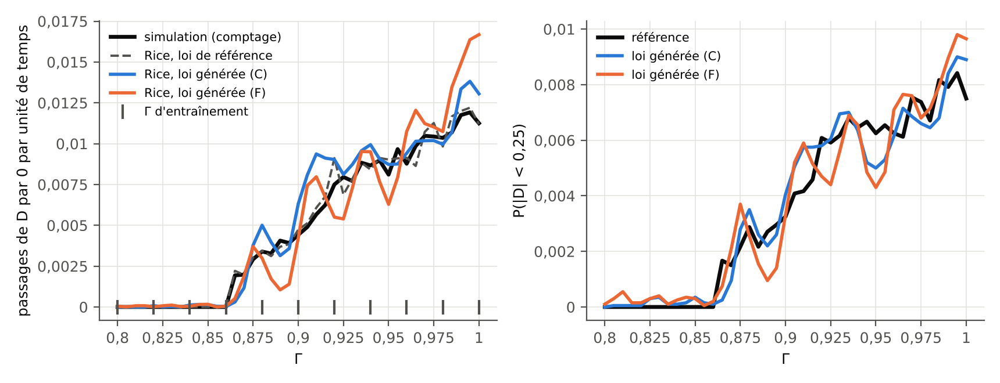
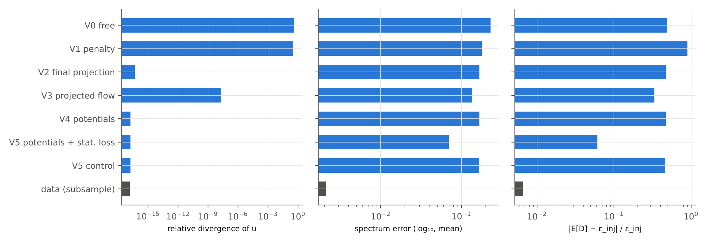
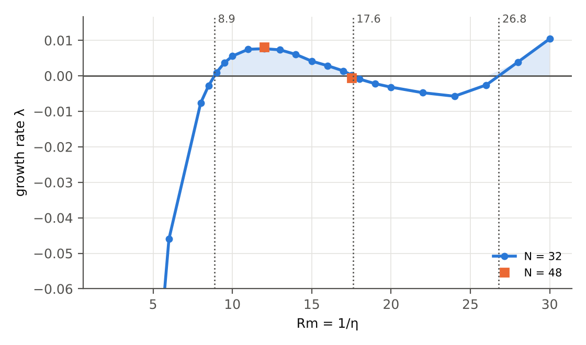

::: note
[About]{.tag}
All the experiments on this site run on an ordinary processor (Intel Xeon, 4 cores, 2.30 GHz, no GPU), in Python 3.13 with NumPy 2.5, SciPy 1.18, Matplotlib 3.11 and PyTorch 2.15 (CPU build). They are **small-scale testbeds**: they test ideas and mechanisms, not performance on real dynamo data. All the figures quoted in the [report](../rapport/index.html) come from the result files described here.
:::

## Code organization {#code}

The `experiences/` folder of the repository contains everything needed to reproduce the results.

| File | Role |
|---|---|
| `common.py` | Conditional flow matching (linear path, Heun scheme), networks (MLP, equivariant symmetrization), metrics (energy distance, sliced Wasserstein), exponential tilting (regularized I-projection). |
| `e1_gissinger.py` | E1: invariant distribution of the Gissinger (2012) reversal model, conditioned on $\Gamma$; symmetry, stationarity identities, Rice formula. Costly steps are cached in `resultats/cache_e1/`. |
| `mhd2d.py` | Pseudo-spectral solver for forced incompressible 2D MHD, in potentials $(\omega, a)$. |
| `e2_donnees.py` | E2: 2D MHD snapshots for eleven values of $\eta$ (six for training, five for testing). |
| `e2_mhd2d.py` | E2: five divergence-constraint mechanisms, distributional stationarity loss, tilting versus per-sample correction. |
| `e3_abc.py` | E3: kinematic dynamo of the ABC flow, growth rate as a function of $Rm$. |
| `unet.py` | Small periodic U-Net (not used in the final results: too slow on CPU, see below). |
| `figures.py` | Plots in French and English (`figures/<nom>.png` and `figures/<nom>-en.png`). |
| `digest.py` | Numerical digest `resultats/digest.md`, the single source of the report's tables. |

## Reproducing the results {#reproduire}

```bash
cd experiences
python3 e3_abc.py                 # E3, about 25 min
python3 e2_donnees.py             # E2, data: about 30 min
python3 e2_mhd2d.py               # E2, models: about 70 min
python3 e1_gissinger.py           # E1, about 1 h 30 (resumable)
python3 figures.py && python3 digest.py > resultats/digest.md
```

Each script accepts `--quick` for a reduced version that takes a few minutes, useful for checking the installation. The seeds are fixed in the code (0, 1 and 2 for the three repetitions of E1). The durations given were measured on the machine described above, partly while other computations were running.

## E1 — dipole reversals {#e1}

Gissinger's three-mode model serves as a "pocket dynamo": it has the symmetry $\mathbf{B}\to-\mathbf{B}$, an onset threshold for reversals (between $\Gamma = 0.86$ and $0.87$) and exactly known dynamics. We learn the stationary distribution $p(Q, D, V \mid \Gamma)$ by conditional flow matching, then measure what changes when the symmetry is imposed by construction, when the stationarity loss is added, and when a per-sample projection is applied. The reversal frequency is estimated from the generated distribution alone, through the Rice formula.

Results and discussion: [report, section E1](../rapport/index.html#e1). Interactive diagram: [Gissinger model](../interactifs/index.html#gissinger).

{width="100%" fig-alt="Two plots as a function of Gamma from 0.80 to 1.00: on the left, the frequency of zero crossings of D, zero below 0.865 and then increasing; on the right, the probability that |D| is less than 0.25."}

## E2 — 2D MHD and divergence constraints {#e2}

Forced 2D MHD produces fields $(\mathbf{u}, \mathbf{B})$ that are divergence-free by construction. We generate these fields conditionally on the parameter $\eta$ in the truncated Fourier basis (220 independent modes per scalar field), which is the POD basis of homogeneous turbulence on a periodic domain. We compare five ways of handling the divergence, then the effect of a distributional constraint on the energy budget.

Results and discussion: [report, section E2](../rapport/index.html#e2).

{width="100%" fig-alt="Three horizontal bar charts, logarithmic scale, for eight variants."}

{width="100%" fig-alt="Three horizontal bar charts for four variants."}

A first attempt with a periodic U-Net on the $32\times32$ grid (file `unet.py`) cost about 0.3 s per training step on this processor: five variants would have required several hours each. Switching to the truncated Fourier basis keeps the comparison clean (same network, same budget for all variants) at a cost compatible with a CPU. The internship itself would run on GPU, with field architectures (U-Nets, transformers, functional decoders).

## E3 — ABC kinematic dynamo {#e3}

The induction equation with the imposed ABC flow is solved by a $32^3$ pseudo-spectral method. The growth rate $\lambda(Rm)$ changes sign at $Rm \approx 8.87$, $17.60$ and $26.80$, in agreement with the known windows. The curl form of the equation keeps $\nabla\cdot\mathbf{B}$ at machine precision ($\sim 10^{-16}$).

Results: [report, section E3](../rapport/index.html#e3). Interactive diagram: [ABC dynamo](../interactifs/index.html#abc-dynamo).

{width="100%" fig-alt="Curve of the growth rate as a function of Rm, positive between 8.9 and 17.6 and then beyond 26.8."}

## Result files {#resultats}

| File | Contents |
|---|---|
| `resultats/digest.md` | Numerical tables of all the experiments (generated). |
| `resultats/e1_gissinger.json` | E1: configuration, data statistics, evaluation per variant, per $\Gamma$ and per seed, fine grid. |
| `resultats/e2_mhd2d.json` | E2: configuration, evaluation per variant and per $\eta$, "distributional" part. |
| `resultats/e3_abc.json` | E3: growth rates, resolution convergence, interpolated thresholds. |
| `resultats/*.npz` | Generated samples and eigenmodes, for the figures and the widgets. |

The files are in the repository: <https://github.com/knoel99/knoel99.github.io/tree/main/milady-2027/experiences>.
