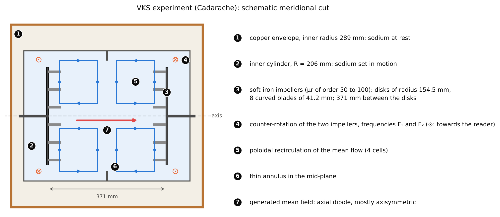

## Objectives {#objectifs}

A conducting fluid moving through a magnetic field carries electric currents, and these currents in turn create a magnetic field. If the flow is fast enough and well organized, the field it creates can reinforce the initial field instead of weakening it: this is the **dynamo effect**, by which the Earth, the Sun and three liquid-sodium experiments generate their own field. This module starts from Maxwell's equations as taught in the undergraduate curriculum and leads up to the questions the MilaDy project is asking today: dynamo thresholds, the role of boundary conditions, field reversals. By the end of the thirty hours of planned work, you will be able to:

1. write Maxwell's equations and Ohm's law in a moving conductor, justify by order-of-magnitude estimates the approximation that neglects the displacement current, and derive the induction equation from them;
2. compute the magnetic diffusivity, the magnetic Reynolds number $Rm$ and the magnetic Prandtl number $Pm$ of a liquid metal, and place the experiments, the Earth's core and the Sun in the $(Rm, Pm)$ plane;
3. prove Alfvén's frozen-flux theorem, the MHD energy budget and the conservation of magnetic and cross helicities in ideal MHD, then derive the dispersion relation of Alfvén waves;
4. write the magnetic boundary conditions (insulator, perfect conductor, pseudo-vacuum, permeability jump) and compute the free decay modes of a conducting sphere for each of them;
5. formulate the kinematic dynamo as an eigenvalue problem, state Cowling's and Zeldovich's anti-dynamo theorems, and prove the latter in planar geometry;
6. solve the mean-field $\alpha^2$ dynamo (dispersion relation, threshold, saturation), analytically and numerically, and measure an $\alpha$ effect on the G. O. Roberts flow;
7. describe the laboratory dynamos of Riga, Karlsruhe and Cadarache (VKS) and the DRESDYN project, with their key figures and their sources;
8. integrate Gissinger's three-mode reversal model, locate its fixed points and count its reversals as a function of the forcing parameter $\Gamma$.

## Prerequisites {#prerequis}

The starting point is the level of the second year of a French undergraduate physics degree (L2): Maxwell's equations in integral and local form in vacuum, the notion of the Lorentz force on a charge, and the basics of fluid mechanics (material derivative, continuity equation). On the mathematical side, you need to be able to solve a linear differential equation with constant coefficients, diagonalize a small matrix and compute a Fourier series.

The module [Vector calculus and Fourier analysis](../p1-calcul-vectoriel/index.html) is essential: we use without re-proving them the vector identities and product formulas (chapter 2), the Stokes and Green–Ostrogradsky (divergence) theorems (chapter 3), the stream function, the vector potential and the poloidal–toroidal decomposition (chapter 4), as well as spectral differentiation (chapter 5). The module [Fluid mechanics and turbulence](../p2-mecanique-fluides/index.html) is recommended for the Navier–Stokes equation, the Reynolds number and the kinetic energy budget, which we extend here to MHD. For chapters 5 and 7, it is useful to read in parallel the module [Dynamical systems, bifurcations and invariant measures](../p4-systemes-dynamiques/index.html), which covers pitchfork and Hopf bifurcations and chaotic attractors.

On the programming side, it is enough to know how to use NumPy and SciPy (arrays, fast Fourier transform, eigenvalues, integration of differential equations). All code blocks run in less than 30 seconds on a single core.

## Work plan {#plan}

The level indicates the difficulty: 1 for the foundations, 2 for the core of the module, 3 for what already touches on the research questions of the internship. It never goes down from one session to the next.

| Session | Duration | Level | Content | Exercises |
|:---:|:---:|:---:|---|:---:|
| 1 | 3 h | 1 | Chapter 1: Maxwell's equations, Ohm's law in a moving conductor, quasi-static approximation, $\nabla\cdot\mathbf{B} = 0$ | 1, 2 |
| 2 | 4 h | 1 | Chapter 2: induction equation, $\eta$, $Rm$, $Pm$, frozen flux, flux expulsion by an eddy (code and widget) | 3, 4 |
| 3 | 5 h | 2 | Chapter 3: Lorentz force, MHD equations, energy budget, helicities, Alfvén waves (budget code in 2D MHD) | 5, 6, 7 |
| 4 | 3 h | 2 | Chapter 4: magnetic boundary conditions, free modes of a sphere, soft-iron impellers | 8, 9 |
| 5 | 4 h | 2 | Chapter 5, sections 5.1 to 5.3: kinematic dynamo, energy bound, anti-dynamo theorems, examples of dynamos | 10, 11 |
| 6 | 4 h | 3 | Chapter 5, sections 5.4 and 5.5: $\alpha$ effect, $\alpha^2$ dynamo, saturation, Roberts flow (codes and widget) | 12 |
| 7 | 3 h | 3 | Chapter 6: the Riga, Karlsruhe and VKS dynamos and the DRESDYN project (code converting between definitions of $Rm$) | 3 (b), 9 (c) |
| 8 | 4 h | 3 | Chapter 7: reversals, the Pétrélis–Fauve, Gissinger and DQVU models, geodynamo, simulation codes (code and widget) | 13, 14 |
| **Total** | **30 h** | | 7 chapters | 14 exercises |

Each session ends with the indicated exercises, to be attempted before reading their solution. The code blocks are complete programs: copy them, run them, then change their parameters. Three interactive diagrams (chapters 2, 5 and 7) let you vary $Rm$, the dynamo number $C$ and the parameter $\Gamma$ of the Gissinger model directly in the page.

## 1. Electromagnetism refresher {#ch1}

The dynamo effect involves currents in a moving liquid metal or plasma. We must therefore start from Maxwell's equations, add Ohm's law written in the frame of the fluid, and then simplify them by taking into account that the velocities involved are very small compared with the speed of light. This chapter carries out these three steps and arrives at the “pre-Maxwellian” equations of MHD.

### 1.1 Maxwell's equations

::: def
[Definition 1.1 — Maxwell's equations]{.tag}
In vacuum or in a non-magnetic medium, the electric field $\mathbf{E}$ and the magnetic field $\mathbf{B}$ are related to the charge density $\rho_e$ and to the current density $\mathbf{j}$ by four local equations (SI units, $\varepsilon_0$ the permittivity and $\mu_0 = 4\pi\times10^{-7}\ \mathrm{H\,m^{-1}}$ the permeability of vacuum). The Maxwell–Gauss equation reads

$$
\nabla\cdot\mathbf{E} = \frac{\rho_e}{\varepsilon_0}. \tag{1.1}
$$

The absence of magnetic charge reads

$$
\nabla\cdot\mathbf{B} = 0. \tag{1.2}
$$

Faraday's law relates the curl of the electric field to the variation of the magnetic field:

$$
\nabla\times\mathbf{E} = -\frac{\partial\mathbf{B}}{\partial t}. \tag{1.3}
$$

Finally, the Maxwell–Ampère equation reads

$$
\nabla\times\mathbf{B} = \mu_0\mathbf{j} + \mu_0\varepsilon_0\frac{\partial\mathbf{E}}{\partial t}. \tag{1.4}
$$
:::

In integral form (Green–Ostrogradsky and Stokes theorems, module 1, chapter 3), (1.2) says that the flux of $\mathbf{B}$ through any closed surface is zero: field lines have neither sources nor sinks. Law (1.3) says that the circulation of $\mathbf{E}$ around a fixed circuit equals minus the time derivative of the magnetic flux through it: this is the induced electromotive force. The last term of (1.4), $\mu_0\varepsilon_0\,\partial_t\mathbf{E}$, is Maxwell's **displacement current**; it is what makes electromagnetic waves possible, and it is what MHD will neglect.

:::: prop
[Proposition 1.2 — Charge conservation and the constraint $\nabla\cdot\mathbf{B} = 0$]{.tag}
(i) Equations (1.1) and (1.4) imply charge conservation, $\partial_t\rho_e + \nabla\cdot\mathbf{j} = 0$. (ii) Faraday's law (1.3) implies $\partial_t(\nabla\cdot\mathbf{B}) = 0$: if $\nabla\cdot\mathbf{B} = 0$ at the initial time, this property is preserved at all times.

::: proof
We use the identity $\nabla\cdot(\nabla\times\mathbf{F}) = 0$ (module 1, section 2.1). (i) The divergence of (1.4) gives $0 = \mu_0\nabla\cdot\mathbf{j} + \mu_0\varepsilon_0\,\partial_t(\nabla\cdot\mathbf{E})$, and (1.1) replaces $\varepsilon_0\nabla\cdot\mathbf{E}$ by $\rho_e$. (ii) The divergence of (1.3) gives $0 = -\partial_t(\nabla\cdot\mathbf{B})$. [∎]{.qed}
:::
::::

::: note
[Remark 1.3 — A constraint, not an evolution equation]{.tag}
Proposition 1.2 (ii) shows that $\nabla\cdot\mathbf{B} = 0$ is a **constraint on the initial condition**, which the exact dynamics preserves. A numerical scheme, or a generative model, does not preserve it automatically: a divergence error, once created, is not corrected by the equations. This is why MHD codes impose the constraint by construction (vector potential, spectral projection) and why the MilaDy internship asks for generated fields with zero divergence.
:::

### 1.2 Ohm's law in a moving conductor

In a conductor at rest, the current density is proportional to the electric field, $\mathbf{j} = \sigma\mathbf{E}$, where $\sigma$ is the electrical conductivity (in $\mathrm{S\,m^{-1}}$). For a fluid, this law holds in the frame in which the fluid element is at rest.

::: def
[Definition 1.4 — Ohm's law for a conducting fluid]{.tag}
If the fluid has a velocity $\mathbf{u}(\mathbf{x}, t)$ much smaller than the speed of light $c$, the electric field seen by the fluid element is $\mathbf{E}' = \mathbf{E} + \mathbf{u}\times\mathbf{B}$, and Ohm's law reads

$$
\mathbf{j} = \sigma\,(\mathbf{E} + \mathbf{u}\times\mathbf{B}). \tag{1.5}
$$
:::

The term $\mathbf{u}\times\mathbf{B}$ is the **motional electric field**: a charge $q$ carried along by the fluid experiences the force $q\,\mathbf{u}\times\mathbf{B}$, exactly like the electrons of a conducting bar moved through a magnet. The transformation $\mathbf{E}' = \mathbf{E} + \mathbf{u}\times\mathbf{B}$ is the Galilean limit of the Lorentz transformation of the fields; the corrections are of order $(u/c)^2$, about $10^{-15}$ for a liquid metal at $10\ \mathrm{m\,s^{-1}}$. Exercise 2 applies (1.5) to the Faraday disk, the ancestor of all dynamos.

### 1.3 The quasi-static approximation

In a good conductor in slow motion, two simplifications are in order: charges neutralize almost instantly, and the displacement current is negligible. We justify them by order-of-magnitude estimates, denoting by $L$ a characteristic length, $U$ a characteristic velocity and $T = L/U$ a characteristic time of the flow.

:::: prop
[Proposition 1.5 — Quasi-static approximation (QSA)]{.tag}
Assume $U \ll c$ and a charge relaxation time $\tau_e = \varepsilon_0/\sigma$ much smaller than $T$. Then (i) any free charge density disappears within a time of order $\tau_e$; (ii) the displacement current is of order $(U/c)^2$ relative to $\nabla\times\mathbf{B}$ and can be neglected; (iii) the electric force $\rho_e\mathbf{E}$ is negligible compared with the magnetic force $\mathbf{j}\times\mathbf{B}$. The field equations then reduce to

$$
\nabla\times\mathbf{B} = \mu_0\mathbf{j}, \qquad \nabla\cdot\mathbf{B} = 0, \qquad \nabla\times\mathbf{E} = -\partial_t\mathbf{B}, \qquad \mathbf{j} = \sigma(\mathbf{E} + \mathbf{u}\times\mathbf{B}), \tag{1.6}
$$

which imply $\nabla\cdot\mathbf{j} = 0$.

::: proof
*Sketch.* (i) In a conductor at rest, charge conservation and Ohm's law give $\partial_t\rho_e = -\sigma\nabla\cdot\mathbf{E} = -(\sigma/\varepsilon_0)\rho_e$: the charge decays as $e^{-t/\tau_e}$. For sodium, $\tau_e \approx 10^{-18}$ s (code below), so that on any hydrodynamic time scale the charge is in equilibrium and only enters through the condition $\nabla\cdot\mathbf{j} \approx 0$.

(ii) Ohm's law shows that $\mathbf{E}$ is of the order of the motional field, $E \sim UB$. The displacement current is therefore of order $\mu_0\varepsilon_0 E/T \sim UB/(c^2 T) = U^2 B/(c^2 L)$, to be compared with $|\nabla\times\mathbf{B}| \sim B/L$. The ratio is $(U/c)^2$.

(iii) Gauss's law gives $\rho_e \sim \varepsilon_0 E/L \sim \varepsilon_0 UB/L$, hence $\rho_e E \sim \varepsilon_0 U^2 B^2/L$, whereas $|\mathbf{j}\times\mathbf{B}| \sim B^2/(\mu_0 L)$. The ratio is again $\mu_0\varepsilon_0 U^2 = (U/c)^2$. Finally, the divergence of $\nabla\times\mathbf{B} = \mu_0\mathbf{j}$ gives $\nabla\cdot\mathbf{j} = 0$. [∎]{.qed}
:::
::::

::: ex
[Example 1.6 — Orders of magnitude for liquid sodium]{.tag}
Liquid sodium is the working fluid of all three laboratory dynamos. At about 120 °C, Nore et al. (2018, §2.1) give $\sigma = 9.6\times10^{6}\ \mathrm{S\,m^{-1}}$, $\rho = 932\ \mathrm{kg\,m^{-3}}$ and $\nu = 6.78\times10^{-7}\ \mathrm{m^2\,s^{-1}}$. The following code computes, for a velocity of $10\ \mathrm{m\,s^{-1}}$ and a length of $0.2$ m (typical values for an experiment, chosen here for illustration), the quantities of proposition 1.5 and the dimensionless numbers of chapter 2.
:::

```python
import numpy as np

mu0, eps0, c = 4e-7 * np.pi, 8.854e-12, 2.998e8

# Liquid sodium at about 120 °C (values from Nore et al. 2018, §2.1)
sigma, rho, nu = 9.6e6, 932.0, 6.78e-7
U, L = 10.0, 0.2                    # typical velocity and radius of an experiment (m/s, m)

eta = 1 / (mu0 * sigma)             # magnetic diffusivity (m²/s)
tau_e = eps0 / sigma                # charge relaxation time (s)
print(f"eta        = {eta:.3f} m²/s")
print(f"tau_e      = {tau_e:.1e} s   (compare with L/U = {L/U:.2f} s)")
print(f"(U/c)^2    = {(U/c)**2:.1e}  (weight of the displacement current)")
print(f"tau_eta    = L²/eta = {L**2/eta:.2f} s")
print(f"Re = {U*L/nu:.1e},  Rm = {U*L/eta:.1f},  Pm = nu/eta = {nu/eta:.2e}")
# Alfvén speed of a 40 G = 4 mT field in sodium
B = 4e-3
vA = B / np.sqrt(mu0 * rho)
print(f"v_A(40 G)  = {vA:.3f} m/s,  ratio U/v_A = {U/vA:.0f}")
# output:
# eta        = 0.083 m²/s
# tau_e      = 9.2e-19 s   (compare with L/U = 0.02 s)
# (U/c)^2    = 1.1e-15  (weight of the displacement current)
# tau_eta    = L²/eta = 0.48 s
# Re = 2.9e+06,  Rm = 24.1,  Pm = nu/eta = 8.18e-06
# v_A(40 G)  = 0.117 m/s,  ratio U/v_A = 86
```

The charge relaxation time ($10^{-18}$ s) and the weight of the displacement current ($10^{-15}$) are so small that the QSA is exact in practice. The magnetic Prandtl number obtained, $8.2\times10^{-6}$, is the one given by Nore et al. (2018), $0.82\times10^{-5}$. The last line anticipates chapter 3: a field of 40 gauss, the order of magnitude measured in VKS above threshold (Monchaux et al., 2007), corresponds to an Alfvén speed of $0.12\ \mathrm{m\,s^{-1}}$, much lower than the fluid velocity; the magnetic energy there remains small compared with the kinetic energy.

:::: recap
::: recap-title
Key takeaways — chapter 1
:::
- Ohm's law is written in the frame of the fluid: $\mathbf{j} = \sigma(\mathbf{E} + \mathbf{u}\times\mathbf{B})$; the term $\mathbf{u}\times\mathbf{B}$ is the motional electric field.
- For $U \ll c$ and $\tau_e = \varepsilon_0/\sigma \ll L/U$, the displacement current and the charge are neglected: $\nabla\times\mathbf{B} = \mu_0\mathbf{j}$ and $\nabla\cdot\mathbf{j} = 0$.
- $\nabla\cdot\mathbf{B} = 0$ is an initial constraint preserved by the exact dynamics, but not by a numerical scheme or a generative model that does not enforce it.
::::

## 2. Induction equation, magnetic Reynolds number and frozen flux {#ch2}

The induction equation describes how the flow transports, stretches and diffuses the magnetic field. It is the heart of the whole theory of the dynamo: depending on the value of a single dimensionless number, the magnetic Reynolds number, the field behaves like a diffusing dye or like a set of elastic threads attached to the fluid.

### 2.1 Derivation

:::: thm
[Theorem 2.1 — Induction equation]{.tag}
Under the assumptions of the QSA (proposition 1.5) and for a uniform conductivity, the magnetic field satisfies

$$
\frac{\partial\mathbf{B}}{\partial t} = \nabla\times(\mathbf{u}\times\mathbf{B}) + \eta\,\Delta\mathbf{B}, \qquad \eta = \frac{1}{\mu_0\sigma}, \tag{2.1}
$$

where $\eta$ (in $\mathrm{m^2\,s^{-1}}$) is the **magnetic diffusivity**. If $\sigma$ varies in space, the diffusion term becomes $-\nabla\times(\eta\,\nabla\times\mathbf{B})$.

::: proof
From (1.6), $\mathbf{j} = \nabla\times\mathbf{B}/\mu_0$ and Ohm's law gives $\mathbf{E} = \mathbf{j}/\sigma - \mathbf{u}\times\mathbf{B} = \eta\,\nabla\times\mathbf{B} - \mathbf{u}\times\mathbf{B}$. Faraday's law then reads

$$
\frac{\partial\mathbf{B}}{\partial t} = -\nabla\times\mathbf{E} = \nabla\times(\mathbf{u}\times\mathbf{B}) - \nabla\times(\eta\,\nabla\times\mathbf{B}).
$$

If $\eta$ is uniform, the identity $\nabla\times(\nabla\times\mathbf{B}) = \nabla(\nabla\cdot\mathbf{B}) - \Delta\mathbf{B}$ (module 1, section 2.1) and $\nabla\cdot\mathbf{B} = 0$ give $-\eta\,\nabla\times\nabla\times\mathbf{B} = \eta\,\Delta\mathbf{B}$. [∎]{.qed}
:::
::::

Three properties of (2.1) will come up again and again. First, the equation is **linear** in $\mathbf{B}$ when $\mathbf{u}$ is given: this is the starting point of the kinematic dynamo (chapter 5). Next, it is invariant under $\mathbf{B} \to -\mathbf{B}$; since the Lorentz force is quadratic in $\mathbf{B}$, all of MHD is too, and this is the origin of the two equivalent polarities of the Earth's field (chapter 7). Finally, the first term is a curl, so its divergence is zero: (2.1) preserves $\nabla\cdot\mathbf{B} = 0$, as proposition 1.2 announced.

:::: prop
[Proposition 2.2 — Advection, stretching, diffusion]{.tag}
If the flow is incompressible ($\nabla\cdot\mathbf{u} = 0$), the induction equation reads

$$
\frac{\partial\mathbf{B}}{\partial t} + (\mathbf{u}\cdot\nabla)\mathbf{B} = (\mathbf{B}\cdot\nabla)\mathbf{u} + \eta\,\Delta\mathbf{B}. \tag{2.2}
$$

::: proof
The product formula $\nabla\times(\mathbf{u}\times\mathbf{B}) = \mathbf{u}(\nabla\cdot\mathbf{B}) - \mathbf{B}(\nabla\cdot\mathbf{u}) + (\mathbf{B}\cdot\nabla)\mathbf{u} - (\mathbf{u}\cdot\nabla)\mathbf{B}$ (module 1, section 2.2) reduces to its last two terms when $\nabla\cdot\mathbf{B} = \nabla\cdot\mathbf{u} = 0$. [∎]{.qed}
:::
::::

The left-hand side of (2.2) is the material derivative: the field is **transported** by the fluid. The term $(\mathbf{B}\cdot\nabla)\mathbf{u}$ measures the variation of the velocity along a field line: it **stretches** the lines and amplifies them. The Laplacian **diffuses** them. Equation (2.2) has exactly the form of the vorticity equation of an incompressible fluid, $\partial_t\boldsymbol\omega + (\mathbf{u}\cdot\nabla)\boldsymbol\omega = (\boldsymbol\omega\cdot\nabla)\mathbf{u} + \nu\Delta\boldsymbol\omega$, with an essential difference stressed by Tobias (2021): the vorticity is tied to the velocity, whereas $\mathbf{B}$ is an independent field as long as it is weak.

### 2.2 Diffusivity, diffusion time and dimensionless numbers

::: def
[Definition 2.3 — Diffusion time, $Rm$ and $Pm$]{.tag}
For a characteristic length $L$ and velocity $U$, we define the **magnetic diffusion time** $\tau_\eta = L^2/\eta$, the advection time $\tau_u = L/U$, the **magnetic Reynolds number** and the **magnetic Prandtl number**:

$$
Rm = \frac{UL}{\eta} = \frac{\tau_\eta}{\tau_u}, \qquad Pm = \frac{\nu}{\eta} = \frac{Rm}{Re}, \tag{2.3}
$$

where $\nu$ is the kinematic viscosity and $Re = UL/\nu$ the Reynolds number.
:::

Taking $L$ as the unit of length and $L/U$ as the unit of time, the induction equation becomes $\partial_t\mathbf{B} = \nabla\times(\mathbf{u}\times\mathbf{B}) + Rm^{-1}\Delta\mathbf{B}$. When $Rm \ll 1$, diffusion dominates and the field roughly follows the field imposed from outside; when $Rm \gg 1$, induction dominates. Without flow, each Fourier mode $e^{i\mathbf{k}\cdot\mathbf{x}}$ of the field decays as $e^{-\eta k^2 t}$: a field that nothing sustains disappears within a time of order $\tau_\eta$. Tobias (2021) gives a few orders of magnitude: of order $10^4$ years for a field on the scale of the Earth's core and $10^9$ years for the Sun. The Earth's field, several billion years old, must therefore be **sustained**: this is the founding argument of dynamo theory.

The following table places the systems encountered in this module. The values are published orders of magnitude, with their source; they show that $Pm$ is tiny in liquid metals and in stars, whereas numerical simulations almost always work at $Pm$ close to 1.

| System | $Pm$ | $Rm$ | Source |
|---|---|---|---|
| Liquid sodium (VKS, 120 °C) | $0.82\times10^{-5}$ | up to 49 (the paper's definition) | Nore et al. (2018); Monchaux et al. (2007) |
| Earth's core (liquid iron) | $O(10^{-6})$ | $O(10^{3})$ | Rincon (2019) |
| Solar convection zone | $10^{-6}$ to $10^{-2}$ | $10^{6}$ to $10^{10}$ | Rincon (2019) |
| Usual numerical simulations | $0.1$ to $10$ | — | Rincon (2019) |
| Reference VKS simulation (LATU code) | $\approx 0.33$ | 531 ($Re = 1594$) | Bousquet et al. (2026) |

A small $Pm$ has two consequences. First, to reach $Rm \sim 50$ in sodium, one needs $Re = Rm/Pm \sim 10^6$ to $10^7$: the flow of a laboratory dynamo is always turbulent, and driving it requires a power of the order of a hundred kilowatts (chapter 6). Second, the magnetic dissipation scale $\ell_\eta$ falls in the inertial range of the turbulence; Rincon (2019, eq. 2.25) estimates $\ell_\eta \sim Pm^{-3/4}\ell_\nu$, where $\ell_\nu$ is the Kolmogorov scale. The field therefore “sees” all of the turbulence at scales larger than $\ell_\eta$, which makes the dynamo harder to obtain than at $Pm \sim 1$ (see chapter 6 and Ponty et al., 2005).

### 2.3 Frozen magnetic flux

When $Rm \to \infty$, diffusion disappears from (2.1) and the field becomes literally attached to the fluid. To state this, we call **material surface** a surface $S(t)$ each point of which moves with the local fluid velocity.

::: prop
[Lemma 2.4 — Derivative of a flux through a material surface]{.tag}
For any smooth field $\mathbf{F}$ and any material surface $S(t)$,

$$
\frac{\mathrm{d}}{\mathrm{d}t}\int_{S(t)}\mathbf{F}\cdot\mathrm{d}\mathbf{S} = \int_{S(t)}\Big[\frac{\partial\mathbf{F}}{\partial t} + \mathbf{u}\,(\nabla\cdot\mathbf{F}) - \nabla\times(\mathbf{u}\times\mathbf{F})\Big]\cdot\mathrm{d}\mathbf{S}. \tag{2.4}
$$
:::

*Proof sketch.* Between $t$ and $t + \delta t$, the surface goes from $S$ to $S'$, and the swept volume has element $\delta t\,\mathbf{u}\cdot\mathrm{d}\mathbf{S}$. Its boundary $C$, oriented by the normal of $S$ (right-hand rule), sweeps a lateral band whose surface element, oriented outward from the swept volume, is $\mathrm{d}\boldsymbol\ell\times(\mathbf{u}\,\delta t)$. The Green–Ostrogradsky theorem applied to the volume enclosed by $S$, $S'$ and the band, with the field taken at time $t$, reads $\delta t\int_S(\nabla\cdot\mathbf{F})\,\mathbf{u}\cdot\mathrm{d}\mathbf{S} = \int_{S'}\mathbf{F}\cdot\mathrm{d}\mathbf{S} - \int_{S}\mathbf{F}\cdot\mathrm{d}\mathbf{S} + \delta t\oint_C\mathbf{F}\cdot(\mathrm{d}\boldsymbol\ell\times\mathbf{u}) + o(\delta t)$. Since $\mathrm{d}\boldsymbol\ell\times\mathbf{u} = -\,\mathbf{u}\times\mathrm{d}\boldsymbol\ell$, we obtain

$$
\int_{S'}\mathbf{F}\cdot\mathrm{d}\mathbf{S} - \int_{S}\mathbf{F}\cdot\mathrm{d}\mathbf{S} = \delta t\int_S(\nabla\cdot\mathbf{F})\,\mathbf{u}\cdot\mathrm{d}\mathbf{S} + \delta t\oint_C\mathbf{F}\cdot(\mathbf{u}\times\mathrm{d}\boldsymbol\ell) + o(\delta t).
$$

The sign can be checked on an example: for $\mathbf{F} = \mathbf{e}_z$ and an expanding horizontal disk, the first term vanishes and the second equals $+\delta t\oint u_r\,\mathrm{d}\ell$, the area gained. The triple product reads $\mathbf{F}\cdot(\mathbf{u}\times\mathrm{d}\boldsymbol\ell) = (\mathbf{F}\times\mathbf{u})\cdot\mathrm{d}\boldsymbol\ell$, and Stokes' theorem turns the circulation into $\int_S\nabla\times(\mathbf{F}\times\mathbf{u})\cdot\mathrm{d}\mathbf{S} = -\int_S\nabla\times(\mathbf{u}\times\mathbf{F})\cdot\mathrm{d}\mathbf{S}$. It remains to add the variation of $\mathbf{F}$ between $t$ and $t + \delta t$ at fixed surface, $\delta t\int_S\partial_t\mathbf{F}\cdot\mathrm{d}\mathbf{S}$, then to divide by $\delta t$. ∎

:::: thm
[Theorem 2.5 — Frozen flux (Alfvén, 1942)]{.tag}
If $\eta = 0$, (i) the magnetic flux through any material surface is constant in time; (ii) field lines are material lines: two fluid particles located on the same field line remain on it.

::: proof
(i) Apply (2.4) to $\mathbf{F} = \mathbf{B}$: $\nabla\cdot\mathbf{B} = 0$, and the ideal induction equation $\partial_t\mathbf{B} = \nabla\times(\mathbf{u}\times\mathbf{B})$ cancels the bracket. (ii) Let $\delta\boldsymbol\ell$ be a small material segment joining two neighboring particles. Its material derivative is the difference of the velocities of its endpoints, $\mathrm{D}\,\delta\boldsymbol\ell/\mathrm{D}t = (\delta\boldsymbol\ell\cdot\nabla)\mathbf{u}$. In incompressible flow and for $\eta = 0$, (2.2) gives $\mathrm{D}\mathbf{B}/\mathrm{D}t = (\mathbf{B}\cdot\nabla)\mathbf{u}$: $\mathbf{B}$ and $\delta\boldsymbol\ell$ obey the same linear equation. If $\mathbf{B} = \lambda\,\delta\boldsymbol\ell$ at the initial time, uniqueness of solutions gives $\mathbf{B} = \lambda\,\delta\boldsymbol\ell$ at all times, with the same $\lambda$. A segment tangent to a field line therefore remains so. [∎]{.qed}
:::
::::

The proof of (ii) says more: in ideal incompressible flow, **the field strength is proportional to the stretching of material lines**. A flow that stretches fluid elements therefore amplifies the field; in a chaotic flow, lengths grow exponentially and so does the field, at least until diffusion steps in at small scales. Since $Rm$ is never infinite, this intervention is unavoidable: by stretching, the flow brings lines of opposite direction closer together, down to distances at which diffusion **reconnects** them. Exercise 4 quantifies this mechanism on a flux tube.

### 2.4 A complete example: flux expulsion by an eddy

Let us place an initially uniform field $\mathbf{B}_0 = B_0\,\mathbf{e}_x$ in the two-dimensional cellular flow with stream function $\psi = \sin x\sin y$, in the periodic box $[0, 2\pi]^2$. With the site's conventions, $\mathbf{u} = (\partial_y\psi, -\partial_x\psi) = (\sin x\cos y, \; -\cos x\sin y)$: four eddies of alternating sign. The planar field reads $\mathbf{B} = (\partial_y a, -\partial_x a)$, where $a$ is the magnetic potential (module 1, section 4.1); the uniform field corresponds to $a = B_0 y$. By “uncurling” the planar induction equation, we obtain an advection–diffusion equation for $a$:

$$
\frac{\partial a}{\partial t} + \mathbf{u}\cdot\nabla a = \eta\,\Delta a. \tag{2.5}
$$

The field lines are the level lines of $a$. We write $a = B_0 y + a'(x, y, t)$ with $a'$ periodic; $a'$ obeys (2.5) with the source term $-B_0 u_y$. The mean of $B_x = B_0 + \partial_y a'$ remains equal to $B_0$: the total horizontal flux is imposed.

The physics unfolds in two stages, described by Weiss (1966). First, each eddy winds up the field lines like thread on a spool; the field grows linearly in time, because the lines get longer. Then, when the turns become tight enough, diffusion reconnects lines of opposite direction: the field is **expelled** from the core of the eddies and concentrates in thin layers along their edges.

::: prop
[Proposition 2.6 — Scaling laws of expulsion (boundary-layer argument)]{.tag}
At large $Rm = UL/\eta$, the steady state concentrates the flux in layers of thickness $\delta \sim L\,Rm^{-1/2}$, where the field is $B \sim B_0\,Rm^{1/2}$. The mean magnetic energy satisfies $\langle|\mathbf{B}|^2\rangle \sim B_0^2\,Rm^{1/2}$.
:::

*Argument.* A particle travels along the edge of an eddy in a time $L/U$; during that time, diffusion acts over a thickness $\delta$ such that $\delta^2/\eta \sim L/U$, i.e. $\delta \sim L\,Rm^{-1/2}$. The horizontal flux $B_0 L$, which is conserved, passes through these layers, hence $B\,\delta \sim B_0 L$ and $B \sim B_0\,Rm^{1/2}$. Finally, the mean energy is $B^2\,\delta/L \sim B_0^2\,Rm^{1/2}$. This is not a proof but an estimate, which the following code checks.

The program integrates $a'$ with a pseudo-spectral method (Fourier derivatives, the 2/3 rule from module 1, fourth-order Runge–Kutta with an integrating factor that treats diffusion exactly), then measures the energy and the maximum field in the steady state for three values of $Rm$.

```python
import numpy as np

def expulsion(Rm, N=96, T=60.0, dt=0.04):
    """Uniform field B0 = (1, 0) in the cellular flow psi = sin x sin y (2*pi box).
    Potential a = y + a'(x, y, t) with a' periodic:  d_t a' + u.grad a' + u_y = eta Lap a'."""
    eta = 1.0 / Rm                                  # U = L = 1, hence Rm = 1/eta
    x = np.arange(N) * 2 * np.pi / N
    X, Y = np.meshgrid(x, x, indexing="ij")
    ux, uy = np.sin(X) * np.cos(Y), -np.cos(X) * np.sin(Y)   # u = (d_y psi, -d_x psi)
    KX, KY = np.meshgrid(np.fft.fftfreq(N, 1 / N), np.fft.rfftfreq(N, 1 / N), indexing="ij")
    K2 = KX**2 + KY**2
    keep = (np.abs(KX) < N / 3) & (KY < N / 3)      # 2/3 rule
    F, iF = np.fft.rfft2, lambda h: np.fft.irfft2(h, s=(N, N))

    def rhs(ah):                                    # advection + source, in Fourier space
        return -F(ux * iF(1j * KX * ah) + uy * iF(1j * KY * ah) + uy) * keep

    E = np.exp(-eta * K2 * dt / 2)                  # integrating factor (exact diffusion)
    ah, hist = np.zeros(K2.shape, complex), []
    for n in range(int(round(T / dt))):             # integrating-factor Runge-Kutta 4
        k1 = rhs(ah)
        k2 = rhs(E * (ah + dt / 2 * k1))
        k3 = rhs(E * ah + dt / 2 * k2)
        k4 = rhs(E**2 * ah + dt * E * k3)
        ah = E**2 * ah + dt / 6 * (E**2 * k1 + 2 * E * (k2 + k3) + k4)
        bx, by = 1 + iF(1j * KY * ah), -iF(1j * KX * ah)
        hist.append(((bx**2 + by**2).mean(), np.hypot(bx, by).max()))
    return np.array(hist)

print(" Rm   <B²>/B0²   max|B|/B0   transient peak of <B²>")
res = {}
for Rm in [10, 40, 160]:
    h = expulsion(Rm)
    res[Rm] = h[-1]
    print(f"{Rm:4d}   {h[-1,0]:7.2f}     {h[-1,1]:6.2f}       {h[:,0].max():6.2f}"
          f"   (change over the last 5 time units: {abs(h[-1,0]-h[-126,0]):.1e})")
p = np.polyfit(np.log([10, 40, 160]), np.log([res[r][0] for r in res]), 1)[0]
q = np.polyfit(np.log([10, 40, 160]), np.log([res[r][1] for r in res]), 1)[0]
print(f"log-log slopes: <B²> ~ Rm^{p:.2f},  max|B| ~ Rm^{q:.2f}")
# output:
#  Rm   <B²>/B0²   max|B|/B0   transient peak of <B²>
#   10      3.42       5.71         4.18   (change over the last 5 time units: 1.2e-09)
#   40      6.78      11.28        11.75   (change over the last 5 time units: 8.4e-05)
#  160     13.52      22.22        29.63   (change over the last 5 time units: 6.3e-03)
# log-log slopes: <B²> ~ Rm^0.50,  max|B| ~ Rm^0.49
```

The measured slopes, $0.50$ and $0.49$, confirm proposition 2.6. The transient maximum of the energy clearly exceeds the final value at large $Rm$: this is the winding phase, before reconnection. The figure shows the steady field lines: the flux goes around the eddies and concentrates on their boundaries.

{width="100%" fig-alt="Three square panels showing blue field lines and four gray eddies; from left to right, the blue lines increasingly avoid the center of the eddies and crowd together along the lines y = 0, y = pi and x = pi."}

The following interactive diagram solves the same equation in your browser (third-order finite differences on a $128^2$ grid, which gives values within a few percent of those of the spectral code). Vary $Rm$: at small $Rm$, the lines are barely deformed; at large $Rm$, watch the winding, the transient peak of $\langle|\mathbf{B}|^2\rangle$, then the expulsion.

```{=html}
<div class="widget" id="w-expulsion" role="group" aria-label="Expulsion du flux magnétique par un écoulement cellulaire" data-en-label="Magnetic flux expulsion by a cellular flow">
  <p class="widget-title" data-en="Interactive: flux expulsion by a cellular flow">Interactif : expulsion du flux par un écoulement cellulaire</p>
  <div class="widget-controls">
    <label><span data-en="Magnetic Reynolds number Rm">Nombre de Reynolds magnétique Rm</span>
      <input type="range" name="rm" min="1" max="2.5" step="0.01" value="1.6"> <output class="rm-val">40</output></label>
    <button type="button" class="play">Pause</button>
    <button type="button" class="reset" data-en="Restart">Recommencer</button>
  </div>
  <canvas style="max-width:520px;margin:0 auto" aria-label="Lignes de champ magnétique dans quatre tourbillons" data-en-label="Magnetic field lines in four eddies"></canvas>
  <p class="widget-readout" aria-live="off"></p>
  <p class="widget-note" data-en="Blue: field lines (contours of a = y + a'). Grey: streamlines of ψ = sin x sin y. The mean horizontal flux is imposed (B₀ = 1). The simulation stops at t = 400.">En bleu : lignes de champ (iso-valeurs de a = y + a'). En gris : lignes de courant de ψ = sin x sin y. Le flux horizontal moyen est imposé (B₀ = 1). La simulation s'arrête à t = 400.</p>
</div>
```

This example is **not** a dynamo: the field is sustained by the external currents that impose $B_0$. If we set $B_0 = 0$, any initial field eventually disappears; this is Zeldovich's theorem from chapter 5, which rules out any two-dimensional dynamo.

:::: recap
::: recap-title
Key takeaways — chapter 2
:::
- Induction equation: $\partial_t\mathbf{B} = \nabla\times(\mathbf{u}\times\mathbf{B}) + \eta\Delta\mathbf{B}$ with $\eta = 1/(\mu_0\sigma)$; it is linear in $\mathbf{B}$, invariant under $\mathbf{B} \to -\mathbf{B}$, and preserves $\nabla\cdot\mathbf{B} = 0$.
- $Rm = UL/\eta$ compares induction and diffusion; $Pm = \nu/\eta$ is about $10^{-5}$ for sodium and $O(10^{-6})$ in the Earth's core, hence dynamo flows are always turbulent.
- At $\eta = 0$, the flux is frozen into the fluid and the field grows like the stretching of material lines (Alfvén); at finite $Rm$, diffusion reconnects at small scales.
- An eddy expels the flux toward its edges, into layers of thickness $L\,Rm^{-1/2}$ (Weiss); $\langle|\mathbf{B}|^2\rangle \propto Rm^{1/2}$, checked numerically.
::::

## 3. Lorentz force, MHD equations and invariants {#ch3}

Chapter 2 treated the flow as imposed. In reality, the induced currents are subject to the Lorentz force, which acts back on the fluid: this feedback is what limits the growth of a dynamo. This chapter writes down the coupled system, then establishes its conservation laws, which provide the physical constraints and the metrics used in the internship.

### 3.1 The Lorentz force: magnetic tension and pressure

A volume of fluid carrying the current density $\mathbf{j}$ is subject to the body force $\mathbf{j}\times\mathbf{B}$ (we saw in proposition 1.5 that the electric force is negligible).

:::: prop
[Proposition 3.1 — Decomposition of the Lorentz force]{.tag}
With $\mathbf{j} = \nabla\times\mathbf{B}/\mu_0$,

$$
\mathbf{j}\times\mathbf{B} = \frac{1}{\mu_0}(\mathbf{B}\cdot\nabla)\mathbf{B} - \nabla\Big(\frac{|\mathbf{B}|^2}{2\mu_0}\Big). \tag{3.1}
$$

The first term is a **magnetic tension** directed toward the center of curvature of the field lines, of magnitude $|\mathbf{B}|^2/(\mu_0 R_c)$ where $R_c$ is the radius of curvature; the second is the gradient of a **magnetic pressure** $|\mathbf{B}|^2/(2\mu_0)$.

::: proof
The identity $(\nabla\times\mathbf{B})\times\mathbf{B} = (\mathbf{B}\cdot\nabla)\mathbf{B} - \nabla(|\mathbf{B}|^2/2)$ is checked in index notation: $[(\nabla\times\mathbf{B})\times\mathbf{B}]_i = \varepsilon_{ijk}\varepsilon_{jlm}\,\partial_l B_m\,B_k = (\delta_{kl}\delta_{im} - \delta_{km}\delta_{il})\,\partial_l B_m\,B_k = B_k\partial_k B_i - B_k\partial_i B_k$ (module 1, lemma 1.12). For the interpretation, write $\mathbf{B} = B\,\mathbf{t}$ with $\mathbf{t}$ the unit tangent vector and $s$ the arc length along the line: $(\mathbf{B}\cdot\nabla)\mathbf{B} = B\,\partial_s(B\mathbf{t}) = \mathbf{t}\,\partial_s(B^2/2) + B^2\,\mathbf{n}/R_c$, where $\mathbf{n}$ is the principal normal (Frenet formula). [∎]{.qed}
:::
::::

Field lines therefore behave like **stretched elastic bands** that push each other apart sideways. The part $\mathbf{t}\,\partial_s(B^2/2)$ of the tension exactly cancels the component of the pressure along the lines: the Lorentz force is always perpendicular to $\mathbf{B}$, which can also be seen from $\mathbf{j}\times\mathbf{B}$. Exercise 5 computes these two terms for the field of a wire.

### 3.2 The incompressible MHD equations

::: def
[Definition 3.2 — Incompressible MHD and Alfvén units]{.tag}
For a fluid of uniform density $\rho$, viscosity $\nu$ and magnetic diffusivity $\eta$, subject to a body force $\rho\mathbf{f}$, the incompressible MHD equations are the Navier–Stokes equation with the Lorentz force,

$$
\frac{\partial\mathbf{u}}{\partial t} + (\mathbf{u}\cdot\nabla)\mathbf{u} = -\frac{1}{\rho}\nabla p + \frac{1}{\rho}\,\mathbf{j}\times\mathbf{B} + \nu\Delta\mathbf{u} + \mathbf{f}, \tag{3.2}
$$

the induction equation (2.1), and the constraints $\nabla\cdot\mathbf{u} = 0$, $\nabla\cdot\mathbf{B} = 0$. By measuring the field in **Alfvén units**, that is, by replacing $\mathbf{B}$ with $\mathbf{B}/\sqrt{\mu_0\rho}$ (a velocity), and writing $\mathbf{j} = \nabla\times\mathbf{B}$, the system becomes

$$
\partial_t\mathbf{u} + (\mathbf{u}\cdot\nabla)\mathbf{u} = -\nabla P + \mathbf{j}\times\mathbf{B} + \nu\Delta\mathbf{u} + \mathbf{f}, \qquad \partial_t\mathbf{B} = \nabla\times(\mathbf{u}\times\mathbf{B}) + \eta\Delta\mathbf{B}, \tag{3.3}
$$

with $P = p/\rho$. The magnitude $v_A = |\mathbf{B}|/\sqrt{\mu_0\rho}$ of the field in Alfvén units is called the **Alfvén speed**.
:::

This is the convention adopted throughout the site and that of pseudo-spectral codes (Ponty et al., 2005). Nondimensionalizing with $L$ and $U$, the coefficients become $1/Re$ and $1/Rm$. Codes that simulate the experiments add variable material properties: SFEMaNS, for instance, solves $\partial_t\mathbf{B} = \nabla\times(\mathbf{u}\times\mathbf{B}) - Rm^{-1}\nabla\times\big(\sigma_r^{-1}\nabla\times(\mathbf{B}/\mu_r)\big)$, where $\sigma_r$ and $\mu_r$ are the relative conductivity and permeability (Nore et al., 2018); we return to this in chapter 4.

### 3.3 The energy budget

We work in a periodic box (or in a domain whose boundaries exchange neither energy nor flux) and denote by $\langle\cdot\rangle$ the spatial average. The kinetic and magnetic energies per unit mass are $E_K = \tfrac12\langle|\mathbf{u}|^2\rangle$ and $E_M = \tfrac12\langle|\mathbf{B}|^2\rangle$ (Alfvén units).

:::: thm
[Theorem 3.3 — MHD energy budget]{.tag}
For a smooth solution of (3.3) in a periodic box, with $\boldsymbol\omega = \nabla\times\mathbf{u}$,

$$
\frac{\mathrm{d}E_K}{\mathrm{d}t} = \langle\mathbf{u}\cdot(\mathbf{j}\times\mathbf{B})\rangle - \nu\langle|\boldsymbol\omega|^2\rangle + \langle\mathbf{u}\cdot\mathbf{f}\rangle, \tag{3.4}
$$

$$
\frac{\mathrm{d}E_M}{\mathrm{d}t} = -\langle\mathbf{u}\cdot(\mathbf{j}\times\mathbf{B})\rangle - \eta\langle|\mathbf{j}|^2\rangle. \tag{3.5}
$$

The total energy $E = E_K + E_M$ therefore satisfies $\mathrm{d}E/\mathrm{d}t = \langle\mathbf{u}\cdot\mathbf{f}\rangle - \nu\langle|\boldsymbol\omega|^2\rangle - \eta\langle|\mathbf{j}|^2\rangle$: the exchange term drops out.

::: proof
*Kinetic energy.* Take the dot product of (3.3) with $\mathbf{u}$ and average. The advection term gives $\langle\mathbf{u}\cdot(\mathbf{u}\cdot\nabla)\mathbf{u}\rangle = \langle\mathbf{u}\cdot\nabla(|\mathbf{u}|^2/2)\rangle = -\langle(\nabla\cdot\mathbf{u})\,|\mathbf{u}|^2/2\rangle = 0$, by integration by parts over the periodic box. Likewise $\langle\mathbf{u}\cdot\nabla P\rangle = -\langle P\,\nabla\cdot\mathbf{u}\rangle = 0$. The viscous term gives $\nu\langle\mathbf{u}\cdot\Delta\mathbf{u}\rangle = -\nu\langle|\nabla\mathbf{u}|^2\rangle$, and for a periodic divergence-free field $\langle|\nabla\mathbf{u}|^2\rangle = \langle|\boldsymbol\omega|^2\rangle$ (Parseval's identity, module 1, chapter 5: $|\mathbf{k}|^2|\hat{\mathbf{u}}|^2 = |\mathbf{k}\times\hat{\mathbf{u}}|^2$ when $\mathbf{k}\cdot\hat{\mathbf{u}} = 0$).

*Magnetic energy.* Multiply the induction equation by $\mathbf{B}$. The identity $\nabla\cdot(\mathbf{F}\times\mathbf{G}) = \mathbf{G}\cdot(\nabla\times\mathbf{F}) - \mathbf{F}\cdot(\nabla\times\mathbf{G})$ gives, averaged over the box, $\langle\mathbf{B}\cdot\nabla\times\mathbf{F}\rangle = \langle\mathbf{F}\cdot\nabla\times\mathbf{B}\rangle$. With $\mathbf{F} = \mathbf{u}\times\mathbf{B}$, we obtain $\langle\mathbf{j}\cdot(\mathbf{u}\times\mathbf{B})\rangle = -\langle\mathbf{u}\cdot(\mathbf{j}\times\mathbf{B})\rangle$ by antisymmetry of the triple product. Finally $\eta\langle\mathbf{B}\cdot\Delta\mathbf{B}\rangle = -\eta\langle|\mathbf{j}|^2\rangle$ as for the velocity. [∎]{.qed}
:::
::::

The term $W = \langle\mathbf{u}\cdot(\mathbf{j}\times\mathbf{B})\rangle$ is the power of the Lorentz force on the flow. When $W < 0$, the flow works against the Lorentz force and gives energy to the field: this is how a dynamo converts mechanical energy (supplied by the motors in VKS, by convection in the Earth's core) into magnetic energy. In SI units, (3.5) reads $\frac{\mathrm{d}}{\mathrm{d}t}\int\frac{|\mathbf{B}|^2}{2\mu_0}\,\mathrm{d}V = -\int\mathbf{u}\cdot(\mathbf{j}\times\mathbf{B})\,\mathrm{d}V - \int\frac{|\mathbf{j}|^2}{\sigma}\,\mathrm{d}V$, where the last term is Joule heating (Tobias, 2021, eqs. 2.11–2.12). In a bounded domain, a flux of the Poynting vector through the boundary is added.

::: key
[Key point — Mean budget in a steady regime]{.tag}
In a statistically steady regime, the time (or ensemble) average of $\mathrm{d}E/\mathrm{d}t$ is zero, hence

$$
\mathbb{E}\big[\langle\mathbf{u}\cdot\mathbf{f}\rangle\big] = \nu\,\mathbb{E}\big[\langle|\boldsymbol\omega|^2\rangle\big] + \eta\,\mathbb{E}\big[\langle|\mathbf{j}|^2\rangle\big].
$$

This equality concerns the **distribution** of the fields, not each snapshot: an individual field can have an energy that grows or decays. This is the form in which the internship imposes the energy budget on a generative model.
:::

### 3.4 Helicities and ideal invariants

::: def
[Definition 3.4 — Helicities]{.tag}
For $\mathbf{B} = \nabla\times\mathbf{A}$, we define the **magnetic helicity** $H_M = \langle\mathbf{A}\cdot\mathbf{B}\rangle$, the **cross helicity** $H_C = \langle\mathbf{u}\cdot\mathbf{B}\rangle$ and the **kinetic helicity** $H_K = \langle\mathbf{u}\cdot\boldsymbol\omega\rangle$.
:::

The vector potential is only defined up to a gradient; in a periodic box where $\langle\mathbf{B}\rangle = 0$, however, $H_M$ does not depend on this choice, since $\langle\nabla\chi\cdot\mathbf{B}\rangle = -\langle\chi\,\nabla\cdot\mathbf{B}\rangle = 0$. In a bounded domain, this invariance requires $\mathbf{B}\cdot\mathbf{n} = 0$ on the boundary (Berger and Field, 1984; module 1, proposition 4.10). Moffatt (1969) showed that helicity measures the **linkage** of flux tubes: two closed tubes linked once, with fluxes $\Phi_1$ and $\Phi_2$, contribute $\pm2\Phi_1\Phi_2$ to the integral of $\mathbf{A}\cdot\mathbf{B}$.

:::: thm
[Theorem 3.5 — Invariants of ideal MHD]{.tag}
In a periodic box, with $\langle\mathbf{B}\rangle = 0$, smooth solutions of (3.3) satisfy

$$
\frac{\mathrm{d}H_M}{\mathrm{d}t} = -2\eta\,\langle\mathbf{j}\cdot\mathbf{B}\rangle, \qquad \frac{\mathrm{d}H_C}{\mathrm{d}t} = -(\nu + \eta)\,\langle\boldsymbol\omega\cdot\mathbf{j}\rangle + \langle\mathbf{f}\cdot\mathbf{B}\rangle. \tag{3.6}
$$

In ideal MHD ($\nu = \eta = 0$, $\mathbf{f} = 0$), the energy $E$, the magnetic helicity $H_M$ and the cross helicity $H_C$ are therefore conserved; the invariance of $H_M$ was established by Woltjer (1958). Kinetic helicity, invariant in ideal hydrodynamics (Moffatt, 1969), is no longer invariant in MHD (Pouquet et al., 2019).

::: proof
*Magnetic helicity.* The “uncurled” induction equation reads $\partial_t\mathbf{A} = \mathbf{u}\times\mathbf{B} - \eta\,\mathbf{j} - \nabla\phi$, where $\phi$ depends on the gauge. Then

$$
\frac{\mathrm{d}H_M}{\mathrm{d}t} = \langle\partial_t\mathbf{A}\cdot\mathbf{B}\rangle + \langle\mathbf{A}\cdot\nabla\times\partial_t\mathbf{A}\rangle = 2\,\langle\partial_t\mathbf{A}\cdot\mathbf{B}\rangle,
$$

since $\langle\mathbf{A}\cdot\nabla\times\mathbf{G}\rangle = \langle\mathbf{G}\cdot\nabla\times\mathbf{A}\rangle$ (identity used in theorem 3.3). Now $(\mathbf{u}\times\mathbf{B})\cdot\mathbf{B} = 0$ and $\langle\nabla\phi\cdot\mathbf{B}\rangle = 0$, hence the result.

*Cross helicity.* Write the velocity equation in the form $\partial_t\mathbf{u} = \mathbf{u}\times\boldsymbol\omega + \mathbf{j}\times\mathbf{B} - \nabla\Pi + \nu\Delta\mathbf{u} + \mathbf{f}$, with $\Pi = P + |\mathbf{u}|^2/2$. In $\mathrm{d}H_C/\mathrm{d}t = \langle\mathbf{B}\cdot\partial_t\mathbf{u}\rangle + \langle\mathbf{u}\cdot\partial_t\mathbf{B}\rangle$, the nonlinear terms are $\langle\mathbf{B}\cdot(\mathbf{u}\times\boldsymbol\omega)\rangle + \langle\mathbf{u}\cdot\nabla\times(\mathbf{u}\times\mathbf{B})\rangle = \langle\mathbf{B}\cdot(\mathbf{u}\times\boldsymbol\omega)\rangle + \langle\boldsymbol\omega\cdot(\mathbf{u}\times\mathbf{B})\rangle$, and these two triple products are opposite. The terms $\langle\mathbf{B}\cdot(\mathbf{j}\times\mathbf{B})\rangle$ and $\langle\mathbf{B}\cdot\nabla\Pi\rangle$ vanish. What remains is $\nu\langle\mathbf{B}\cdot\Delta\mathbf{u}\rangle + \eta\langle\mathbf{u}\cdot\Delta\mathbf{B}\rangle = -(\nu + \eta)\langle\mathbf{j}\cdot\boldsymbol\omega\rangle$ (same Parseval argument as in theorem 3.3) and the forcing term. [∎]{.qed}
:::
::::

The quadratic invariants organize MHD turbulence. At given helicity, the magnetic energy is lower the larger the scales occupied by the field (this is the inequality of exercise 7); a classical argument deduces from this that the energy cascades toward small scales while $H_M$ undergoes an **inverse cascade** toward large scales, which can favor the emergence of large-scale fields (Tobias, 2021; Pouquet et al., 2019). In two dimensions, $\mathbf{A} = a\,\mathbf{e}_z$ is perpendicular to the planar field and $H_M = 0$; the ideal quadratic invariants are then the energy, the cross helicity and the **mean-square potential** $\langle a^2\rangle$ (Krstulovic et al., 2011). Exercise 7 shows that a helical field cannot dissipate without losing its helicity.

### 3.5 Alfvén waves

Magnetic tension plays the role of the tension of a string: a displaced field line returns toward its equilibrium position and oscillates. Alfvén (1942) deduced from this the existence of waves specific to conducting fluids.

:::: prop
[Proposition 3.6 — Dispersion relation of Alfvén waves]{.tag}
Linearize (3.3) without dissipation or forcing around rest and a uniform field $\mathbf{B}_0$ (Alfvén units), writing $\mathbf{B} = \mathbf{B}_0 + \mathbf{b}$ with $\mathbf{u}$ and $\mathbf{b}$ small. The perturbations obey $\partial_t\mathbf{u} = (\mathbf{B}_0\cdot\nabla)\mathbf{b}$ and $\partial_t\mathbf{b} = (\mathbf{B}_0\cdot\nabla)\mathbf{u}$. A perturbation proportional to $e^{i(\mathbf{k}\cdot\mathbf{x} - \omega t)}$ satisfies

$$
\omega^2 = (\mathbf{k}\cdot\mathbf{B}_0)^2. \tag{3.7}
$$

The **Elsässer variables** $\mathbf{z}^\pm = \mathbf{u} \pm \mathbf{b}$ decouple the system: $\partial_t\mathbf{z}^\pm = \pm(\mathbf{B}_0\cdot\nabla)\mathbf{z}^\pm$.

::: proof
To first order, $\mathbf{j}\times\mathbf{B} \approx (\nabla\times\mathbf{b})\times\mathbf{B}_0 = (\mathbf{B}_0\cdot\nabla)\mathbf{b} - \nabla(\mathbf{B}_0\cdot\mathbf{b})$ from (3.1), and $\nabla\times(\mathbf{u}\times\mathbf{B}_0) = (\mathbf{B}_0\cdot\nabla)\mathbf{u}$ from the product formula, since $\mathbf{B}_0$ is uniform and $\mathbf{u}$ divergence-free. The gradient combines with the perturbed total pressure $P' + \mathbf{B}_0\cdot\mathbf{b}$; taking the divergence of the velocity equation, this total pressure is harmonic; being periodic, it is therefore constant, and its gradient vanishes. We obtain the two stated equations; by adding and subtracting, $\partial_t\mathbf{z}^\pm = \pm(\mathbf{B}_0\cdot\nabla)\mathbf{z}^\pm$, and each Fourier mode gives $\omega = \mp\,\mathbf{k}\cdot\mathbf{B}_0$. [∎]{.qed}
:::
::::

Alfvén waves are transverse (since $\mathbf{k}\cdot\hat{\mathbf{u}} = 0$), non-dispersive, and carry energy along the field lines at the speed $v_A$, whatever the direction of $\mathbf{k}$. The packets $\mathbf{z}^+$ and $\mathbf{z}^-$ propagate in opposite directions; in the full equations, the nonlinearity reads $(\mathbf{z}^\mp\cdot\nabla)\mathbf{z}^\pm$, so that only packets that cross each other interact. Exercise 6 adds viscosity and diffusivity.

::: ex
[Example 3.7 — Numerical check of the budgets in 2D MHD]{.tag}
In 2D, with $\mathbf{u} = (\partial_y\psi, -\partial_x\psi)$ and $\mathbf{B} = (\partial_y a, -\partial_x a)$, the vorticity and the current are scalars, $\omega = -\Delta\psi$ and $j = -\Delta a$, and (3.3) becomes

$$
\partial_t\omega + \mathbf{u}\cdot\nabla\omega = \mathbf{B}\cdot\nabla j + \nu\Delta\omega, \qquad \partial_t a + \mathbf{u}\cdot\nabla a = \eta\Delta a.
$$

The following code starts from the initial condition of Orszag and Tang (1979), in the form $\psi = 2(\cos x + \cos y)$, $a = 2\cos x + \cos 2y$ given by Krstulovic et al. (2011). It first checks that in truncated ideal MHD (2/3 rule), $E$, $H_C$ and $\langle a^2\rangle$ are conserved while $E_K$ and $E_M$ exchange energy; then, with $\nu = \eta = 0.02$, it compares the measured time derivatives with the right-hand sides of (3.4), (3.5), (3.6) and of $\mathrm{d}\langle a^2\rangle/\mathrm{d}t = -2\eta\langle|\mathbf{B}|^2\rangle$.
:::

```python
import numpy as np

N = 128
x = np.arange(N) * 2 * np.pi / N
X, Y = np.meshgrid(x, x, indexing="ij")
KX, KY = np.meshgrid(np.fft.fftfreq(N, 1 / N), np.fft.rfftfreq(N, 1 / N), indexing="ij")
K2 = KX**2 + KY**2
K2i = np.where(K2 > 0, 1 / np.where(K2 > 0, K2, 1), 0)
keep = (np.abs(KX) < N / 3) & (KY < N / 3)
F, iF = np.fft.rfft2, lambda h: np.fft.irfft2(h, s=(N, N))

def champs(wh, ah):
    """Vorticity w = -Lap psi and potential a -> u = (d_y psi, -d_x psi), B = (d_y a, -d_x a), j = -Lap a."""
    ph = wh * K2i
    u = (iF(1j * KY * ph), -iF(1j * KX * ph))
    B = (iF(1j * KY * ah), -iF(1j * KX * ah))
    return u, B, iF(wh), iF(K2 * ah)

def rhs(wh, ah, nu, eta):
    u, B, w, j = champs(wh, ah)
    adv_w = u[0] * iF(1j * KX * wh) + u[1] * iF(1j * KY * wh)
    lor = B[0] * iF(1j * KX * K2 * ah) + B[1] * iF(1j * KY * K2 * ah)        # B.grad j
    adv_a = u[0] * iF(1j * KX * ah) + u[1] * iF(1j * KY * ah)
    return (F(lor - adv_w) * keep - nu * K2 * wh, -F(adv_a) * keep - eta * K2 * ah)

def diagnostics(wh, ah):
    u, B, w, j = champs(wh, ah)
    a = iF(ah)
    EK = 0.5 * (u[0]**2 + u[1]**2).mean()
    EM = 0.5 * (B[0]**2 + B[1]**2).mean()
    TL = (u[0] * (-j * B[1]) + u[1] * (j * B[0])).mean()     # <u.(j x B)>, j x B = j(-B_y, B_x)
    return dict(EK=EK, EM=EM, HC=(u[0] * B[0] + u[1] * B[1]).mean(), A=(a**2).mean(),
                w2=(w**2).mean(), j2=(j**2).mean(), wj=(w * j).mean(), B2=2 * EM, TL=TL)

def run(nu, eta, T, dt=1e-3):
    # Orszag-Tang initial condition: psi = 2(cos x + cos y), a = 2 cos x + cos 2y
    wh = F(2 * (np.cos(X) + np.cos(Y)))          # w = -Lap psi = psi here (|k| = 1)
    ah = F(2 * np.cos(X) + np.cos(2 * Y))
    out = [diagnostics(wh, ah)]
    for n in range(int(round(T / dt))):
        k1 = rhs(wh, ah, nu, eta)
        k2 = rhs(wh + dt / 2 * k1[0], ah + dt / 2 * k1[1], nu, eta)
        k3 = rhs(wh + dt / 2 * k2[0], ah + dt / 2 * k2[1], nu, eta)
        k4 = rhs(wh + dt * k3[0], ah + dt * k3[1], nu, eta)
        wh = wh + dt / 6 * (k1[0] + 2 * k2[0] + 2 * k3[0] + k4[0])
        ah = ah + dt / 6 * (k1[1] + 2 * k2[1] + 2 * k3[1] + k4[1])
        out.append(diagnostics(wh, ah))
    return out, dt

# 1) Ideal case (nu = eta = 0): E, H_C and A = <a²> are conserved
d, dt = run(0.0, 0.0, 0.5)
for key in ["EK", "EM", "HC", "A"]:
    print(f"ideal  {key:2s}: t=0 {d[0][key]:+.6f}   t=0.5 {d[-1][key]:+.6f}")
E0, E1 = d[0]["EK"] + d[0]["EM"], d[-1]["EK"] + d[-1]["EM"]
print(f"ideal  relative drift of E: {abs(E1 - E0) / E0:.1e}")

# 2) Dissipative case: compare dE/dt (centered differences) with the terms of the budget
nu = eta = 0.02
d, dt = run(nu, eta, 0.6)
for n in [100, 300, 500]:
    dEK = (d[n+1]["EK"] - d[n-1]["EK"]) / (2 * dt)
    dEM = (d[n+1]["EM"] - d[n-1]["EM"]) / (2 * dt)
    dHC = (d[n+1]["HC"] - d[n-1]["HC"]) / (2 * dt)
    dA = (d[n+1]["A"] - d[n-1]["A"]) / (2 * dt)
    q = d[n]
    print(f"t={n*dt:.1f}  dEK/dt={dEK:+.5f} vs  T_L - nu<w²>={q['TL'] - nu*q['w2']:+.5f} | "
          f"dEM/dt={dEM:+.5f} vs -T_L - eta<j²>={-q['TL'] - eta*q['j2']:+.5f}")
    print(f"        dHC/dt={dHC:+.6f} vs -(nu+eta)<wj>={-(nu+eta)*q['wj']:+.6f} | "
          f"dA/dt={dA:+.6f} vs -2 eta<B²>={-2*eta*q['B2']:+.6f}")
# output:
# ideal  EK: t=0 +2.000000   t=0.5 +1.722202
# ideal  EM: t=0 +2.000000   t=0.5 +2.277798
# ideal  HC: t=0 +2.000000   t=0.5 +2.000000
# ideal  A : t=0 +2.500000   t=0.5 +2.500000
# ideal  relative drift of E: 2.3e-13
# t=0.1  dEK/dt=-0.18930 vs  T_L - nu<w²>=-0.18930 | dEM/dt=-0.09584 vs -T_L - eta<j²>=-0.09584
#         dHC/dt=-0.075942 vs -(nu+eta)<wj>=-0.075942 | dA/dt=-0.158776 vs -2 eta<B²>=-0.158776
# t=0.3  dEK/dt=-0.74490 vs  T_L - nu<w²>=-0.74490 | dEM/dt=+0.38293 vs -T_L - eta<j²>=+0.38293
#         dHC/dt=-0.047763 vs -(nu+eta)<wj>=-0.047763 | dA/dt=-0.160630 vs -2 eta<B²>=-0.160630
# t=0.5  dEK/dt=-1.42340 vs  T_L - nu<w²>=-1.42340 | dEM/dt=+0.84178 vs -T_L - eta<j²>=+0.84179
#         dHC/dt=-0.007340 vs -(nu+eta)<wj>=-0.007340 | dA/dt=-0.170934 vs -2 eta<B²>=-0.170934
```

The budgets are verified to five or six digits, the accuracy of centered differences in time: the dealiased pseudo-spectral solver satisfies the identities of theorem 3.3 exactly, up to round-off. In the ideal case, energy passes from the kinetic reservoir to the magnetic reservoir ($E_K$ drops by 0.28, $E_M$ increases by the same amount); this is the exchange term $W$ at work. This kind of check is exactly what is applied to fields **generated** by a model: compute the terms of the budget on each sample and test the equality on average.

:::: recap
::: recap-title
Key takeaways — chapter 3
:::
- $\mathbf{j}\times\mathbf{B}$ = tension $(\mathbf{B}\cdot\nabla)\mathbf{B}/\mu_0$ minus the gradient of the magnetic pressure $|\mathbf{B}|^2/(2\mu_0)$.
- Budget: $\mathrm{d}E_K/\mathrm{d}t = W - \nu\langle|\boldsymbol\omega|^2\rangle + \langle\mathbf{u}\cdot\mathbf{f}\rangle$ and $\mathrm{d}E_M/\mathrm{d}t = -W - \eta\langle|\mathbf{j}|^2\rangle$, with $W = \langle\mathbf{u}\cdot(\mathbf{j}\times\mathbf{B})\rangle$; in a steady regime, injection = dissipation, on average.
- In ideal MHD, $E$, $H_M = \langle\mathbf{A}\cdot\mathbf{B}\rangle$ and $H_C = \langle\mathbf{u}\cdot\mathbf{B}\rangle$ are conserved; $H_M$ measures the linkage of field lines.
- Alfvén waves: $\omega = \pm\mathbf{k}\cdot\mathbf{B}_0$, transverse, guided by the field; $\mathbf{z}^\pm = \mathbf{u}\pm\mathbf{b}$.
::::

## 4. Magnetic boundary conditions {#ch4}

A laboratory dynamo is a vessel of liquid metal surrounded by air, copper or steel walls, and sometimes iron parts. The magnetic field does not stop at the walls: it extends outside. Magnetic boundary conditions change dynamo thresholds by several tens of percent (Nore et al., 2018), and some of them are **nonlocal**, which is a major difficulty for numerical methods and generative models alike.

### 4.1 Jump conditions

In a medium of permeability $\mu = \mu_0\mu_r$, we introduce the magnetic field strength $\mathbf{H} = \mathbf{B}/\mu$, and Ampère's equation in the QSA becomes $\nabla\times\mathbf{H} = \mathbf{j}$.

::: prop
[Proposition 4.1 — Jump conditions at an interface]{.tag}
Across a surface with normal $\mathbf{n}$ separating two media, denoting by $[\cdot]$ the jump:

$$
[\mathbf{n}\cdot\mathbf{B}] = 0, \qquad [\mathbf{n}\times\mathbf{H}] = \mathbf{K}_s, \qquad [\mathbf{n}\times\mathbf{E}] = 0, \tag{4.1}
$$

where $\mathbf{K}_s$ is a possible surface current density, zero if the conductivities are finite (Tobias, 2021, eq. 2.7). The first relation comes from $\nabla\cdot\mathbf{B} = 0$ applied to a small flat box straddling the surface (Green–Ostrogradsky theorem); the other two come from Ampère's and Faraday's equations applied to a small rectangle straddling the surface (Stokes' theorem).
:::

With finite conductivities, the normal component of $\mathbf{B}$ and the tangential component of $\mathbf{H} = \mathbf{B}/(\mu_0\mu_r)$ are continuous. If $\mu_r$ jumps, the tangential component of $\mathbf{B}$ therefore jumps by a factor $\mu_{r,2}/\mu_{r,1}$: field lines are **refracted** (exercise 8).

### 4.2 External insulator: matching to a potential field

If the conductor occupies a bounded domain $V$ surrounded by an insulator (air, vacuum) of the same permeability, no current flows outside. Then $\nabla\times\mathbf{B} = 0$ outside $V$, hence $\mathbf{B} = -\nabla\Phi$ with $\Delta\Phi = 0$; the external field is a **potential** field. The field must be continuous across $\partial V$ and decay at infinity at least like a dipole ($|\mathbf{B}| = O(r^{-3})$).

This condition is **nonlocal**: the value of $\mathbf{B}$ on the boundary depends on the solution of a Laplace problem in the whole exterior. In a sphere, it becomes local mode by mode. We write the field with the poloidal–toroidal decomposition (module 1, section 4.3) $\mathbf{B} = \nabla\times\nabla\times(P\,\mathbf{x}) + \nabla\times(T\,\mathbf{x})$ and expand $P$ and $T$ in spherical harmonics. Outside, $T = 0$ and the degree-$l$ component of $P$ is proportional to $r^{-(l+1)}$; continuity of $P$, of $\partial_r P$ and of $T$ at $r = R$ gives

$$
T_l(R) = 0, \qquad \frac{\mathrm{d}P_l}{\mathrm{d}r}(R) + \frac{l+1}{R}\,P_l(R) = 0. \tag{4.2}
$$

This is a Robin condition, one per degree $l$. In a finite cylinder such as VKS, no separation of this kind exists: SFEMaNS solves for the field in the conductors and for a scalar potential in the insulator, and couples the two by an interior penalty method (Guermond et al., 2007; Nore et al., 2018).

### 4.3 Perfectly conducting wall

If the outer domain is a perfect conductor at rest ($\sigma \to \infty$), the field cannot penetrate it, and the tangential electric field vanishes there. On the fluid side of the boundary, one then imposes $\mathbf{n}\cdot\mathbf{B} = 0$ and $\mathbf{n}\times\mathbf{j} = 0$ (Tobias, 2021, eq. 2.8). For a planar wall $z = z_0$ (constant), this reads $B_z = \partial_z B_x = \partial_z B_y = 0$. Such a wall “traps” the flux: a uniform tangential field between two perfectly conducting plates does not decay.

### 4.4 Pseudo-vacuum and ferromagnetic walls

::: def
[Definition 4.2 — Pseudo-vacuum condition]{.tag}
The **pseudo-vacuum** condition is $\mathbf{n}\times\mathbf{B} = 0$ on the boundary: the field there is normal to the wall. It is also called the “perfect ferromagnetic” condition ($\mathbf{H}\times\mathbf{n} = 0$) in SFEMaNS (Nore et al., 2018).
:::

This condition is the limit of a wall of infinite permeability: the tangential component of $\mathbf{H}$ is continuous, and in a material where $\mu_r \to \infty$ with finite $\mathbf{B}$, $\mathbf{H} = \mathbf{B}/(\mu_0\mu_r) \to 0$; therefore $\mathbf{H}$, and then $\mathbf{B}$, has zero tangential component on the fluid side. Unlike the insulator condition, it is **local**, hence its popularity in spectral or finite-difference codes. But it does not describe the same physical problem, and it changes the thresholds.

:::: prop
[Proposition 4.3 — Free dipole mode of a sphere]{.tag}
In a stationary conducting sphere of radius $R$, the most slowly decaying axisymmetric dipole mode reads $\mathbf{B} = \nabla\times\big(f(r)\sin\theta\,\mathbf{e}_\varphi\big)$ with $f(r) = j_1(kr)$, where $j_1$ is the spherical Bessel function of order 1, and it decays as $e^{-\eta k^2 t}$. The value of $kR$ depends on the boundary condition:

- external insulator: $j_0(kR) = 0$, i.e. $kR = \pi$;
- pseudo-vacuum ($B_\theta = 0$): $kR\,j_0(kR) = j_1(kR)$, i.e. $kR \approx 2.744$;
- perfect conductor ($B_r = 0$): $j_1(kR) = 0$, i.e. $kR \approx 4.493$.

::: proof
The vector potential $A_\varphi = f(r)\sin\theta$ gives $B_r = 2f\cos\theta/r$ and $B_\theta = -(rf)'\sin\theta/r$. The diffusion equation $\partial_t\mathbf{B} = \eta\Delta\mathbf{B}$, for a mode proportional to $e^{-\eta k^2 t}$, imposes $f'' + 2f'/r - 2f/r^2 = -k^2 f$, whose solution regular at $r = 0$ is $j_1(kr)$. *Insulator*: outside, the dipolar potential field corresponds to $f = c/r^2$; continuity of $B_r$ and $B_\theta$ imposes continuity of $f$ and of $(rf)'$, hence $(rf)'(R) = -f(R)$, that is, $R f'(R) + 2f(R) = 0$ (condition (4.2) with $l = 1$). With the recurrence relation $j_1'(x) = j_0(x) - 2j_1(x)/x$, this becomes $x\,j_0(x) = 0$ for $x = kR$. *Pseudo-vacuum*: $B_\theta(R) = 0$ imposes $(rf)'(R) = 0$, i.e. $j_1 + x j_1' = x j_0 - j_1 = 0$. *Perfect conductor*: $B_r(R) = 0$ imposes $f(R) = 0$. The roots are computed numerically (code below). [∎]{.qed}
:::
::::

The decay time $R^2/(\eta\,(kR)^2)$ is the “cost” that the flow must offset to sustain a dipole. The pseudo-vacuum condition lowers $kR$ from $\pi$ to $2.744$: the dipole decays $(\pi/2.744)^2 \approx 1.31$ times more slowly than with an insulator, which makes the dynamo easier. This is the trend observed in simulations: for VKS at $Re = 1.5\times10^3$ and $\mu_r = 50$, Nore et al. (2018, table 3) find $Rm_c = 90 \pm 5$ with the condition $\mathbf{H}\times\mathbf{n} = 0$ and $130 \pm 10$ with the vacuum condition; for the precession dynamo, Botez et al. (2026) conclude that the simplified condition of zero tangential field **systematically underestimates** the threshold. The code checks the roots by a finite-difference eigenvalue computation (with the Robin condition $Rf' + cf = 0$ via a ghost point) and gives the decay times of a 20 cm sodium sphere.

```python
import numpy as np
from scipy.optimize import brentq
from scipy.special import spherical_jn as jn
from scipy.sparse import diags
from scipy.sparse.linalg import eigs

# Free dipole mode (l = 1) of a conducting sphere of radius R: A_phi = f(r) sin(theta),
# f'' + 2 f'/r - 2 f/r² = -k² f, f = j_1(k r), decay rate eta k².
conditions = {
    "vacuum (insulator)":      lambda x: jn(0, x),                  # potential matching: j_0(kR) = 0
    "pseudo-vacuum (B_t = 0)": lambda x: x * jn(0, x) - jn(1, x),  # d(r f)/dr = 0
    "perfect conductor":       lambda x: jn(1, x),                  # B_r = 0: j_1(kR) = 0
}
racines = {}
for nom, g in conditions.items():
    xs = np.linspace(0.5, 6, 2000)
    i = np.where(np.sign(g(xs[:-1])) != np.sign(g(xs[1:])))[0][0]
    racines[nom] = brentq(g, xs[i], xs[i + 1])

# Finite-difference check (radial problem with Robin condition R f' + c f = 0)
def kR_fd(c, N=2000):
    h = 1.0 / N
    r = h * np.arange(1, N + 1)
    lo, hi = 1 / h**2 - 1 / (h * r[1:]), 1 / h**2 + 1 / (h * r[:-1])
    main = -2 / h**2 - 2 / r**2
    if c is not None:                               # ghost point f_{N+1} = f_{N-1} - 2 h c f_N
        g = 1 / h**2 + 1 / (h * r[-1])
        lo[-1] += g
        main[-1] -= g * 2 * h * c
        M = diags([lo, main, hi], [-1, 0, 1], format="csc")
    else:                                           # Dirichlet f(1) = 0
        M = diags([lo[:-1], main[:-1], hi[:-1]], [-1, 0, 1], format="csc")
    lam = eigs(M, k=1, sigma=0, which="LM", return_eigenvectors=False)
    return np.sqrt(-lam[0].real)

fd = {"vacuum (insulator)": kR_fd(2), "pseudo-vacuum (B_t = 0)": kR_fd(1), "perfect conductor": kR_fd(None)}
eta, R = 1 / (4e-7 * np.pi * 9.6e6), 0.2          # sodium, 20 cm sphere
for nom, x in racines.items():
    print(f"{nom:23s} kR = {x:.4f} (finite diff. {fd[nom]:.4f}),  "
          f"tau = R²/(eta x²) = {R**2 / (eta * x**2) * 1e3:5.1f} ms")
# output:
# vacuum (insulator)      kR = 3.1416 (finite diff. 3.1416),  tau = R²/(eta x²) =  48.9 ms
# pseudo-vacuum (B_t = 0) kR = 2.7437 (finite diff. 2.7437),  tau = R²/(eta x²) =  64.1 ms
# perfect conductor       kR = 4.4934 (finite diff. 4.4934),  tau = R²/(eta x²) =  23.9 ms
```

{width="100%" fig-alt="Three circles with blue field lines: on the left, the lines leave the circle and form a dipole outside; in the center, the lines cross the boundary at right angles and the outside is shaded gray; on the right, the lines form two families of closed loops inside the circle."}

### 4.5 Permeability jumps: the soft-iron impellers of VKS

In the VKS experiment (chapter 6), the sodium is set in motion by two impellers. With stainless-steel disks, no dynamo was observed up to the maximum speed of 26 Hz; with **soft-iron** disks, a dynamo appears above $Rm \approx 30$ (Monchaux et al., 2007). Boisson et al. (2012) confirmed that at least one iron impeller rotating faster than 15 Hz is required. The relative permeability of these impellers is of order 50 to 100: Monchaux et al. (2009) report $\mu_r \approx 100$, and Giesecke et al. (2010) cite measurements of $65$ to $70$ on a VKS-type impeller.

The field then satisfies the induction equation with a diffusion term $-\nabla\times\big(\eta\,\nabla\times(\mathbf{B}/\mu_r)\big)$ and, at each iron–sodium interface, continuity of $\mathbf{B}\cdot\mathbf{n}$ and of $(\mathbf{B}/\mu_r)\times\mathbf{n}$ (proposition 4.1). Simulations explain the effect of the iron: the permeability favors the observed axisymmetric mode (Giesecke et al., 2010) and lowers the threshold. At $Re = 500$, Nore et al. (2016) find for the axisymmetric family of modes $Rm_c = 240 \pm 5$ with $\mu_r = 5$, $130 \pm 2$ with $\mu_r = 50$ and $82 \pm 2$ with $\mu_r = 100$. Kreuzahler et al. (2017) obtain dynamos at $Rm = 500$ as soon as $\mu_r \geq 12$ in a pseudo-spectral code, whereas the threshold without iron is about 740 at $Re = 1500$ in that code.

Numerically, a jump in $\mu_r$ by a factor of 100 is a difficulty: SFEMaNS handles it with an interior penalty Galerkin method designed for discontinuous permeabilities (Guermond et al., 2011), and the pseudo-spectral code of Kreuzahler et al. (2017) smooths the jump with a filter before penalizing. For a generative model, these jump conditions are additional **hard constraints**, which bear on the trace of the field on either side of a surface.

:::: recap
::: recap-title
Key takeaways — chapter 4
:::
- At an interface: $\mathbf{B}\cdot\mathbf{n}$ and $(\mathbf{B}/\mu_r)\times\mathbf{n}$ are continuous (finite conductivities).
- Insulator: matching to an external potential field, a **nonlocal** condition (local per spherical harmonic in a sphere: $P_l' + (l+1)P_l/R = 0$).
- Perfect conductor: $\mathbf{B}\cdot\mathbf{n} = 0$, $\mathbf{n}\times\mathbf{j} = 0$. Pseudo-vacuum: $\mathbf{n}\times\mathbf{B} = 0$, the limit of a wall with infinite $\mu_r$.
- The free dipole of a sphere has $kR = \pi$ (vacuum), $2.744$ (pseudo-vacuum), $4.493$ (perfect conductor); pseudo-vacuum lowers thresholds, as VKS simulations confirm.
- Soft-iron impellers ($\mu_r \sim 50$ to $100$) are necessary for the VKS dynamo and select the axisymmetric mode.
::::

## 5. The dynamo effect {#ch5}

A dynamo is a flow that sustains a magnetic field against ohmic diffusion, without any external current. The diagram below summarizes the loop: the flow stretches the field (induction), the field brakes the flow (Lorentz force), and the energy supplied by the forcing is dissipated by viscosity and by Joule heating. This chapter first studies the first arrow alone (kinematic dynamo), then saturation through the second.

```{=html}
<figure class="schema">
<svg viewBox="0 0 720 300" role="img" aria-labelledby="boucle-titre" style="width:100%;height:auto;color:var(--ink)">
  <title id="boucle-titre">The dynamo loop: the flow creates the field by induction, the field brakes the flow through the Lorentz force</title>
  <defs>
    <marker id="fl" viewBox="0 0 10 10" refX="9" refY="5" markerWidth="8" markerHeight="8" orient="auto-start-reverse"><path d="M0,0 L10,5 L0,10 z" fill="currentColor"/></marker>
  </defs>
  <rect x="40" y="105" width="190" height="80" rx="10" style="fill:var(--def-bg);stroke:var(--def-bar)" stroke-width="2"/>
  <text x="135" y="140" text-anchor="middle" font-size="17" font-weight="700" fill="currentColor">Flow u</text>
  <text x="135" y="164" text-anchor="middle" font-size="13" fill="currentColor">kinetic energy E_K</text>
  <rect x="490" y="105" width="190" height="80" rx="10" style="fill:var(--key-bg);stroke:var(--key-bar)" stroke-width="2"/>
  <text x="585" y="140" text-anchor="middle" font-size="17" font-weight="700" fill="currentColor">Field B</text>
  <text x="585" y="164" text-anchor="middle" font-size="13" fill="currentColor">magnetic energy E_M</text>
  <path d="M200,100 C280,30 440,30 520,100" fill="none" stroke="currentColor" stroke-width="2.2" marker-end="url(#fl)"/>
  <text x="360" y="38" text-anchor="middle" font-size="13.5" fill="currentColor">induction ∇×(u×B): stretches and folds the field lines</text>
  <path d="M520,190 C440,260 280,260 200,190" fill="none" stroke="currentColor" stroke-width="2.2" marker-end="url(#fl)"/>
  <text x="360" y="272" text-anchor="middle" font-size="13.5" fill="currentColor">Lorentz force j×B: brakes the flow (saturation)</text>
  <text x="360" y="150" text-anchor="middle" font-size="13" fill="currentColor">transfer −⟨u·(j×B)⟩ &gt; 0</text>
  <text x="360" y="168" text-anchor="middle" font-size="13" fill="currentColor">when the dynamo operates</text>
  <path d="M15,145 L38,145" stroke="currentColor" stroke-width="2.2" marker-end="url(#fl)"/>
  <text x="12" y="98" font-size="12.5" fill="currentColor">forcing f</text>
  <text x="12" y="114" font-size="12.5" fill="currentColor">(motors, convection)</text>
  <path d="M135,186 L135,226" stroke="currentColor" stroke-width="2" stroke-dasharray="5 4" marker-end="url(#fl)"/>
  <text x="145" y="222" font-size="12.5" fill="currentColor">viscous dissipation ν⟨|ω|²⟩</text>
  <path d="M585,186 L585,226" stroke="currentColor" stroke-width="2" stroke-dasharray="5 4" marker-end="url(#fl)"/>
  <text x="575" y="222" text-anchor="end" font-size="12.5" fill="currentColor">Joule heating η⟨|j|²⟩</text>
</svg>
<figcaption>The dynamo loop. Solid arrows: couplings; dashed arrows: energy losses. The kinematic dynamo (sections 5.1 to 5.4) keeps only the top arrow; saturation (section 5.5) brings in the bottom one.</figcaption>
</figure>
```

### 5.1 The kinematic dynamo, an eigenvalue problem

As long as the field is weak, the Lorentz force is negligible and the flow is the one we impose. The induction equation is then linear in $\mathbf{B}$.

::: def
[Definition 5.1 — Kinematic dynamo, growth rate and threshold]{.tag}
Let $\mathbf{u}$ be a given steady flow in a domain $V$, with magnetic boundary conditions from chapter 4. Denote by $\mathcal{L}_\eta\mathbf{B} = \nabla\times(\mathbf{u}\times\mathbf{B}) + \eta\Delta\mathbf{B}$ the induction operator, acting on divergence-free fields. Solutions of the form $\mathbf{B}(\mathbf{x}, t) = e^{\lambda t}\hat{\mathbf{B}}(\mathbf{x})$ satisfy the eigenvalue problem

$$
\mathcal{L}_\eta\hat{\mathbf{B}} = \lambda\,\hat{\mathbf{B}}. \tag{5.1}
$$

The **growth rate** is $\sigma(Rm) = \max\operatorname{Re}\lambda$ (in this chapter, $\sigma$ denotes a growth rate and no longer the conductivity of chapter 1). The flow is a **kinematic dynamo** if $\sigma > 0$: an arbitrarily weak seed field then grows exponentially. The **threshold** $Rm_c$ is the smallest value of $Rm$ at which $\sigma$ vanishes; if the critical eigenvalue is complex, the emerging field oscillates (Hopf bifurcation). One speaks of a **fast dynamo** if $\sigma$ remains bounded below by a positive constant as $Rm \to \infty$, and of a **slow dynamo** otherwise.
:::

The operator $\mathcal{L}_\eta$ is not self-adjoint; its eigenvectors are not orthogonal and transient growth is possible even when $\sigma < 0$. For a time-dependent flow, periodic or turbulent, the eigenvalue is replaced by a Floquet or Lyapunov exponent. A first necessary condition follows from a simple energy budget.

:::: prop
[Proposition 5.2 — Necessary energy bound]{.tag}
In a periodic box of side $L$, for a given incompressible flow and a field of zero mean, let $S = \tfrac12(\nabla\mathbf{u} + \nabla\mathbf{u}^{\mathsf T})$ be the strain-rate tensor and $s_{\max}$ the maximum, over the domain and in time, of its largest eigenvalue. Then

$$
\frac{\mathrm{d}E_M}{\mathrm{d}t} \le 2\Big(s_{\max} - \eta\,\frac{4\pi^2}{L^2}\Big)E_M. \tag{5.2}
$$

If $s_{\max}L^2/\eta \le 4\pi^2$, the magnetic energy cannot grow: a dynamo therefore requires $s_{\max}L^2/\eta > 4\pi^2$.

::: proof
From (2.2), $\mathrm{d}E_M/\mathrm{d}t = \langle\mathbf{B}\cdot(\mathbf{B}\cdot\nabla)\mathbf{u}\rangle - \langle\mathbf{B}\cdot(\mathbf{u}\cdot\nabla)\mathbf{B}\rangle + \eta\langle\mathbf{B}\cdot\Delta\mathbf{B}\rangle$. The second term equals $\langle\mathbf{u}\cdot\nabla(|\mathbf{B}|^2/2)\rangle = 0$. The first reads $\langle B_i B_j\,\partial_j u_i\rangle = \langle\mathbf{B}\cdot S\mathbf{B}\rangle$, because only the symmetric part of the gradient contributes to a quadratic form; it is bounded above by $s_{\max}\langle|\mathbf{B}|^2\rangle = 2s_{\max}E_M$. Finally $\eta\langle\mathbf{B}\cdot\Delta\mathbf{B}\rangle = -\eta\sum_{\mathbf{k}}|\mathbf{k}|^2|\hat{\mathbf{B}}_{\mathbf{k}}|^2 \le -\eta\,(2\pi/L)^2\langle|\mathbf{B}|^2\rangle$, since the mode $\mathbf{k} = 0$ is absent and the others satisfy $|\mathbf{k}| \ge 2\pi/L$. [∎]{.qed}
:::
::::

This bound is far from optimal (exercise 10 evaluates it for the ABC flow), but it captures the essential point: the flow must stretch faster than diffusion destroys. Sharper bounds, in spherical geometries, go back to Backus (1958).

### 5.2 The anti-dynamo theorems

Intense stretching is not enough: some geometries rule out the dynamo whatever the strength of the flow. These negative theorems long cast doubt on the very existence of dynamos.

::: thm
[Theorem 5.3 — Cowling (1933)]{.tag}
An axisymmetric magnetic field that vanishes at infinity cannot be sustained by dynamo action. In its Cartesian version, no field independent of a coordinate $z$ and vanishing at infinity can be sustained (statements taken from Tobias, 2021, §2.4).
:::

*Idea of the proof.* If the flow is not axisymmetric, it immediately generates a non-axisymmetric field; we can therefore restrict to an axisymmetric flow. We write the field as $\mathbf{B} = \nabla\times(A\,\mathbf{e}_\varphi) + B_\varphi\mathbf{e}_\varphi$ in cylindrical coordinates $(s, \varphi, z)$. The poloidal part, described by $A$, has no source term: the quantity $sA$ is simply transported and diffused, and Tobias (2021) shows that $\frac{\mathrm{d}}{\mathrm{d}t}\int\tfrac12 s^2A^2\,\mathrm{d}V = -\eta\int|\nabla(sA)|^2\,\mathrm{d}V$. The poloidal part therefore decays. The toroidal part $B_\varphi$, for its part, can be produced from the poloidal part by differential rotation (the “$\omega$ effect”), but once the poloidal part has disappeared, it has no source left and decays in turn. The key point is the absence of any mechanism that regenerates the poloidal field from the toroidal field in axisymmetric geometry.

The equivalent for planar flows is Zeldovich's theorem (1957): a flow whose velocity has only two components, $\mathbf{u} = (u_x, u_y, 0)$, cannot be a dynamo, even if these components depend on all three coordinates. We prove the two-dimensional version, which is sufficient for the 2D MHD of the internship.

:::: thm
[Theorem 5.4 — Zeldovich, two-dimensional version]{.tag}
In a periodic box, let $\mathbf{u}(x, y, t)$ be a smooth, divergence-free flow with bounded gradient ($\|\nabla\mathbf{u}\| \le \gamma$), independent of $z$, and $\mathbf{B}(x, y, t)$ a solution of the induction equation with zero mean. Then $\mathbf{B} \to 0$ as $t \to \infty$.

::: proof
We write the field as $\mathbf{B} = (\partial_y a, -\partial_x a, B_z)$, with $\langle a\rangle = 0$, and denote $\mathbf{u}_\perp = (u_x, u_y)$. The $x$ and $y$ components of the induction equation “uncurl” into equation (2.5), $\partial_t a + \mathbf{u}_\perp\cdot\nabla a = \eta\Delta a$.

*Step 1: the potential decays.* Multiplying by $a$ and averaging, the advection term drops out (it equals $\langle\mathbf{u}_\perp\cdot\nabla(a^2/2)\rangle = 0$), hence, with $Y = \langle a^2\rangle$ and $X = \langle|\nabla a|^2\rangle$,

$$
\frac{\mathrm{d}Y}{\mathrm{d}t} = -2\eta X \le -2\eta k_{\min}^2\,Y,
$$

by the Parseval inequality used in proposition 5.2. Therefore $Y(t) \le Y(0)\,e^{-2\eta k_{\min}^2 t} \to 0$.

*Step 2: the planar field decays.* $X$ is the energy of the planar field. Differentiating $X$ and integrating by parts, the advection term gives $-2\langle\partial_k a\,\partial_k u_j\,\partial_j a\rangle$, bounded above by $2\gamma X$, and diffusion gives $-2\eta\langle(\Delta a)^2\rangle$. Moreover $X = -\langle a\,\Delta a\rangle \le \sqrt{Y}\sqrt{\langle(\Delta a)^2\rangle}$ (Cauchy–Schwarz), so $\langle(\Delta a)^2\rangle \ge X^2/Y$. We obtain

$$
\frac{\mathrm{d}X}{\mathrm{d}t} \le 2X\Big(\gamma - \eta\,\frac{X}{Y}\Big).
$$

As soon as $X > \gamma Y/\eta$, $X$ decreases. Fix $\varepsilon > 0$. Since $Y \to 0$, there exists a time $t_0$ after which $Y < \eta\varepsilon/(2\gamma)$. After $t_0$, as long as $X \ge \varepsilon$, we have $\eta X/Y > 2\gamma$, so $\mathrm{d}X/\mathrm{d}t \le -2\gamma X \le -2\gamma\varepsilon$: $X$ drops below $\varepsilon$ in finite time. It can then no longer rise above it, since its derivative is negative whenever $X \ge \varepsilon$. Since $\varepsilon$ is arbitrary, $X \to 0$.

*Step 3: the component $B_z$ decays.* The $z$ component of the induction equation is $\partial_t B_z + \mathbf{u}_\perp\cdot\nabla B_z = \eta\Delta B_z + \mathbf{B}_\perp\cdot\nabla u_z$: an advection–diffusion equation whose source term tends to zero (step 2). The energy $\langle B_z^2\rangle$ satisfies $\tfrac12\frac{\mathrm{d}}{\mathrm{d}t}\langle B_z^2\rangle \le -\eta k_{\min}^2\langle B_z^2\rangle + \gamma\sqrt{X}\sqrt{\langle B_z^2\rangle}$, and Grönwall's lemma shows that it tends to zero. [∎]{.qed}
:::
::::

The proof shows where the difficulty lies: the planar field can grow transiently (the factor $2\gamma X$), as we saw in chapter 2 with the energy peak of the winding phase, but the potential $a$, which is a transported scalar, can only diffuse. For the internship, the consequence is direct: a statistically steady two-dimensional MHD field, such as those of experiment E2 in the repository, can only exist if the magnetic field is **forced** as well; this is why E2 adds a random forcing to the equation for $a$ (see the [report](../../rapport/index.html#e2)). A true dynamo requires three dimensions and a non-planar flow.

### 5.3 Three dynamo flows

The anti-dynamo theorems were circumvented by carefully chosen flows, which became the models for the experiments.

::: ex
[Example 5.5 — Ponomarenko, Roberts, ABC]{.tag}
**Ponomarenko (1973).** A rigid conducting cylinder of radius $R$, rotating at $\Omega$ and translating at $V$ along its axis (a helical motion), slides through an infinite medium at rest of the same conductivity. The threshold is $Rm_c = 17.7$ for the convective instability, with the radius taken as the length scale (Gailitis and Freibergs, 1976, cited by Gailitis et al., 2008); Pétrélis, Mordant and Fauve (2007) specify that this minimum is reached for a ratio $V/(R\Omega) \approx 1.3$ with $Rm = \mu_0\sigma R\sqrt{(R\Omega)^2 + V^2}$, and other authors use other definitions. The velocity jump at the surface of the cylinder and the presence of the conductor at rest are essential. This is the principle of the Riga dynamo.

**G. O. Roberts (1972).** The periodic flow $\mathbf{u} = (\cos y - \cos z, \; \sin z, \; \sin y)$, whose three components depend only on $(y, z)$, is a dynamo “for almost all resistivities” (abstract of the paper). One checks that $\nabla\times\mathbf{u} = \mathbf{u}$: it is a Beltrami flow, of maximal helicity. The growing field varies slowly in $x$, on a scale much larger than that of the flow: it is a **two-scale** dynamo, the principle of the Karlsruhe experiment.

**ABC.** The flow $\mathbf{u} = (\sin z + \cos y, \; \sin x + \cos z, \; \sin y + \cos x)$, also a Beltrami flow and with partly chaotic streamlines, is a dynamo in two windows, $8.9 < Rm < 17.5$ and then $Rm > 27$, with $Rm = 1/\eta$ (Galloway and Frisch, 1984, cited by Archontis et al., 2003). Bouya and Dormy (2013) still find a growth rate of about $0.1$ at $Rm = 25\,000$. Experiment E3 in the repository computes this rate as a function of $Rm$ (see the [report](../../rapport/index.html#e3)).
:::

### 5.4 The $\alpha$ effect and the mean-field $\alpha^2$ dynamo

The Roberts flow suggests a fruitful idea: a small-scale flow, if it is helical, can generate a large-scale field. The **mean-field** theory of Steenbeck, Krause and Rädler (1966) formalizes it. Velocity and field are split into a mean (over the small scales, or over an ensemble) and a fluctuation, $\mathbf{u} = \bar{\mathbf{u}} + \mathbf{u}'$ and $\mathbf{B} = \bar{\mathbf{B}} + \mathbf{b}$. Averaging the induction equation gives

$$
\frac{\partial\bar{\mathbf{B}}}{\partial t} = \nabla\times\big(\bar{\mathbf{u}}\times\bar{\mathbf{B}} + \boldsymbol{\mathcal{E}}\big) + \eta\Delta\bar{\mathbf{B}}, \qquad \boldsymbol{\mathcal{E}} = \overline{\mathbf{u}'\times\mathbf{b}}, \tag{5.3}
$$

where the **mean electromotive force** $\boldsymbol{\mathcal{E}}$ is the only place where the small scales act on the mean field. Since $\mathbf{b}$ depends linearly on $\bar{\mathbf{B}}$, it is expanded as $\mathcal{E}_i = \alpha_{ij}\bar B_j - \beta_{ijk}\,\partial_j\bar B_k + \dots$; for isotropic turbulence, $\boldsymbol{\mathcal{E}} = \alpha\bar{\mathbf{B}} - \beta\,\nabla\times\bar{\mathbf{B}}$. The coefficient $\alpha$, which creates a current **parallel** to the field, is the **$\alpha$ effect**; $\beta$ adds to $\eta$ as a turbulent diffusivity $\eta_T = \eta + \beta$. For turbulence with correlation time $\tau$, the classical first-order estimate is $\alpha \approx -\tfrac{\tau}{3}\overline{\mathbf{u}'\cdot\boldsymbol\omega'}$ and $\beta \approx \tfrac{\tau}{3}\overline{|\mathbf{u}'|^2}$ (Rincon, 2019, eq. 4.23): the $\alpha$ effect is proportional to the kinetic helicity, and changes sign with it.

:::: prop
[Proposition 5.6 — First-order $\alpha$ effect of the Roberts flow]{.tag}
For the Roberts flow of example 5.5 and a uniform mean field $\bar{\mathbf{B}}$, the steady fluctuation to first order in $Rm = 1/\eta$ is $\mathbf{b} = (\bar{\mathbf{B}}\cdot\nabla)\mathbf{u}/\eta$, and the mean electromotive force is $\boldsymbol{\mathcal{E}} = \alpha\,(0, \bar B_y, \bar B_z)$ with $\alpha = -1/\eta$.

::: proof
At lowest order in $Rm$, the equation for the fluctuation reduces to a balance between production and diffusion: $0 = \nabla\times(\mathbf{u}\times\bar{\mathbf{B}}) + \eta\Delta\mathbf{b} = (\bar{\mathbf{B}}\cdot\nabla)\mathbf{u} + \eta\Delta\mathbf{b}$ (the term $\nabla\times(\mathbf{u}\times\mathbf{b})$, relatively of order $Rm$, is neglected). All components of $\mathbf{u}$ are Fourier modes of wavenumber 1, so $\Delta(\bar{\mathbf{B}}\cdot\nabla)\mathbf{u} = -(\bar{\mathbf{B}}\cdot\nabla)\mathbf{u}$ and $\mathbf{b} = (\bar{\mathbf{B}}\cdot\nabla)\mathbf{u}/\eta$. Since $\mathbf{u}$ does not depend on $x$, $\bar B_x$ does not contribute. For $\bar{\mathbf{B}} = \bar B_y\mathbf{e}_y$, we have $\partial_y\mathbf{u} = (-\sin y, 0, \cos y)$ and

$$
\mathbf{u}\times\partial_y\mathbf{u} = \big(\sin z\cos y, \; -\sin^2 y - (\cos y - \cos z)\cos y, \; \sin z\sin y\big),
$$

whose mean is $(0, -1, 0)$; hence $\mathcal{E}_y = -\bar B_y/\eta$. The computation with $\partial_z\mathbf{u} = (\sin z, \cos z, 0)$ likewise gives $\mathcal{E}_z = -\bar B_z/\eta$. [∎]{.qed}
:::
::::

Now consider a mean field that depends on only one coordinate, with uniform $\alpha$ and $\eta_T$; for the Roberts flow, this will be $x$ and the field $(\bar B_y, \bar B_z)$. To fix notation, we write the model in its usual form, with a field $\bar{\mathbf{B}} = (B_x(z, t), B_y(z, t), 0)$:

$$
\partial_t B_x = -\alpha\,\partial_z B_y + \eta_T\,\partial_z^2 B_x, \qquad \partial_t B_y = \alpha\,\partial_z B_x + \eta_T\,\partial_z^2 B_y. \tag{5.4}
$$

:::: prop
[Proposition 5.7 — $\alpha^2$ dynamo: dispersion relation and thresholds]{.tag}
(i) The Fourier modes $e^{ikz}$ of (5.4) have growth rates

$$
\sigma_\pm(k) = \pm\alpha k - \eta_T k^2, \tag{5.5}
$$

maximal for $|k| = |\alpha|/(2\eta_T)$, where the rate equals $\alpha^2/(4\eta_T)$. In a periodic box of length $L$, the allowed wavenumbers are $k_n = 2\pi n/L$, and there is a dynamo if and only if the **dynamo number** $C = |\alpha| L/\eta_T$ exceeds $2\pi$.

(ii) In the layer $0 < z < L$ with $B_x = B_y = 0$ at both boundaries, the eigenvalues are real and equal to

$$
\lambda_n = \frac{\alpha^2}{4\eta_T} - \eta_T\,\frac{n^2\pi^2}{L^2}, \qquad n = 1, 2, \dots \tag{5.6}
$$

The threshold is again $C = 2\pi$.

::: proof
Set $\Psi = B_x + iB_y$. Combining the two equations of (5.4), $\partial_t\Psi = -\alpha\,\partial_z B_y + i\alpha\,\partial_z B_x + \eta_T\partial_z^2\Psi = i\alpha\,\partial_z\Psi + \eta_T\,\partial_z^2\Psi$. Likewise $\bar\Psi = B_x - iB_y$ satisfies $\partial_t\bar\Psi = -i\alpha\,\partial_z\bar\Psi + \eta_T\,\partial_z^2\bar\Psi$. (i) For $\Psi \propto e^{ikz + \sigma t}$, we find $\sigma = -\alpha k - \eta_T k^2$, and for $\bar\Psi$, $\sigma = \alpha k - \eta_T k^2$: these are the two circular polarizations (helical fields of opposite handedness). The maximum of a parabola and the condition $\sigma_+(2\pi/L) > 0 \Leftrightarrow |\alpha| > 2\pi\eta_T/L$ are immediate. (ii) We look for $\Psi = e^{\lambda t}\phi(z)$ with $\phi(0) = \phi(L) = 0$, i.e. $\eta_T\phi'' + i\alpha\phi' - \lambda\phi = 0$. The change of function $\phi = e^{-i\alpha z/(2\eta_T)}\chi$ eliminates the first-order term: a direct computation gives $\eta_T\chi'' + \big(\alpha^2/(4\eta_T) - \lambda\big)\chi = 0$, with $\chi(0) = \chi(L) = 0$. The solutions are $\chi = \sin(n\pi z/L)$ and $\lambda_n$ is given by (5.6). The condition $\lambda_1 > 0$ reads $\alpha^2 L^2/\eta_T^2 > 4\pi^2$. [∎]{.qed}
:::
::::

The growing mode is **helical**: the field rotates with $z$, and it is the variation of its direction that allows the $\alpha$ effect to regenerate each component from the other. The first code of this chapter checks proposition 5.7 (ii) by finite differences: eigenvalues and numerical threshold.

```python
import numpy as np
from scipy.optimize import brentq

# Mean-field alpha² dynamo, B(z, t) = (Bx, By, 0), units L = 1, eta_T = 1, C = alpha L / eta_T:
#   dBx/dt = -C dBy/dz + Bxzz,   dBy/dt = C dBx/dz + Byzz.

# 1) Layer 0 < z < 1 with Bx = By = 0 at the boundaries: eigenvalue problem
def operateur(C, N=200):
    h = 1.0 / N
    I = np.eye(N - 1)
    D1 = (np.eye(N - 1, k=1) - np.eye(N - 1, k=-1)) / (2 * h)
    D2 = (np.eye(N - 1, k=1) - 2 * I + np.eye(N - 1, k=-1)) / h**2
    return np.block([[D2, -C * D1], [C * D1, D2]])

def taux(C):
    return np.linalg.eigvals(operateur(C)).real.max()

for C in [4.0, 8.0, 12.0]:
    print(f"C = {C:4.1f}: numerical rate {taux(C):+8.3f},  theory C²/4 - pi² = {C**2/4 - np.pi**2:+8.3f}")
Cc = brentq(taux, 4.0, 8.0, xtol=1e-6)
print(f"numerical threshold C_c = {Cc:.4f}   (theory 2*pi = {2*np.pi:.4f})")

# 2) Periodic box and saturation by "alpha-quenching": alpha = C / (1 + |B|²)
def sature(C, N=32, T=12.0, dt=1e-3, seed=0):
    k = 2 * np.pi * np.fft.rfftfreq(N, 1.0 / N)
    rng = np.random.default_rng(seed)
    bx, by = 1e-3 * rng.standard_normal(N), 1e-3 * rng.standard_normal(N)
    E = np.exp(-k**2 * dt)                          # diffusion treated exactly
    phi = np.where(k > 0, (1 - E) / np.where(k > 0, k**2, 1), dt)   # ETD1 scheme
    for _ in range(int(T / dt)):
        a = C / (1 + bx**2 + by**2)
        fx, fy = np.fft.rfft(bx), np.fft.rfft(by)
        nx = -1j * k * np.fft.rfft(a * by)          # -d/dz (alpha By)
        ny = 1j * k * np.fft.rfft(a * bx)           #  d/dz (alpha Bx)
        bx = np.fft.irfft(E * fx + phi * nx, N)
        by = np.fft.irfft(E * fy + phi * ny, N)
    return (bx**2 + by**2).mean(), (bx**2 + by**2).std()

print("   C    saturated <B²>   theory C/2pi - 1   (spatial std. dev. of |B|²)")
for C in [7.0, 8.0, 10.0, 12.0]:
    m, s = sature(C)
    print(f"{C:5.1f}    {m:8.4f}      {C / (2 * np.pi) - 1:8.4f}          {s:.1e}")
# output:
# C =  4.0: numerical rate   -5.870,  theory C²/4 - pi² =   -5.870
# C =  8.0: numerical rate   +6.127,  theory C²/4 - pi² =   +6.130
# C = 12.0: numerical rate  +26.118,  theory C²/4 - pi² =  +26.130
# numerical threshold C_c = 6.2837   (theory 2*pi = 6.2832)
#    C    saturated <B²>   theory C/2pi - 1   (spatial std. dev. of |B|²)
#   7.0      0.1141        0.1141          1.4e-04
#   8.0      0.2732        0.2732          2.0e-04
#  10.0      0.5915        0.5915          2.6e-04
#  12.0      0.9099        0.9099          3.0e-04
```

The numerical threshold, $6.2837$, coincides with $2\pi$ to within $10^{-4}$ (the discretization error in $h^2$). The second part of the code, which adds a nonlinear saturation, is discussed in section 5.5.

{width="100%" fig-alt="Two plots. On the left, two parabolas increasing with C; the blue one (n = 1) crosses zero at 2 pi, the orange one (n = 2) at 4 pi; numerical circles lie on the blue one. On the right, the saturated energy is zero up to C = 2 pi and then grows linearly; the simulation points lie on the line."}

The following interactive diagram plots the dispersion relation for both geometries. Vary $C$: in the periodic box, the most unstable mode moves from $n = 1$ to $n = 2$ and beyond as $C$ increases; between walls, it is always $n = 1$.

```{=html}
<div class="widget" id="w-alpha2" role="group" aria-label="Dynamo alpha carré : modes et seuil" data-en-label="Alpha-squared dynamo: modes and threshold">
  <p class="widget-title" data-en="Interactive: α² dynamo, modes and threshold">Interactif : dynamo α², modes et seuil</p>
  <div class="widget-controls">
    <label><span data-en="Dynamo number C = |α|L/η_T">Nombre dynamo C = |α|L/η_T</span>
      <input type="range" name="c" min="0" max="16" step="0.05" value="8"> <output class="c-val">8</output></label>
  </div>
  <svg role="img" aria-label="Taux de croissance des modes en fonction de leur indice" data-en-label="Growth rate of the modes versus their index"></svg>
  <p class="widget-readout"></p>
  <p class="widget-note" data-en="Circles: periodic box, σ = C kL − (kL)² at kL = 2πn. Squares: walls with B = 0, λₙ = C²/4 − n²π². Growth rates in units of η_T/L².">Cercles : boîte périodique, σ = C kL − (kL)² en kL = 2πn. Carrés : parois avec B = 0, λₙ = C²/4 − n²π². Taux en unités de η_T/L².</p>
</div>
```

Let us return to the Roberts flow to check proposition 5.6 without any scale-separation assumption. The code builds the induction operator exactly for fields of the form $e^{ikx}\,\mathbf{b}(y, z)$, with a Fourier basis of $11\times11$ modes in $(y, z)$, then computes its dominant eigenvalue. At small $k$, mean-field theory predicts $\sigma \approx |\alpha|k - \eta k^2$ with $|\alpha| = 1/\eta$: we therefore measure $|\alpha|\,\eta$.

```python
import numpy as np

# Kinematic dynamo of G.O. Roberts: u = (cos y - cos z, sin z, sin y), B = exp(i k x) b(y, z).
# Fourier Galerkin in (y, z), modes -K..K; the induction operator is built exactly.
K = 5                       # 11 x 11 modes: results unchanged with K = 7 or 10
M = 2 * K + 1
m = np.arange(-K, K + 1)
MY, NZ = np.meshgrid(m, m, indexing="ij")

def decale(f, dy, dz):
    """Multiply by exp(i(dy y + dz z)): shift of the Fourier indices, truncation at the edges."""
    g = np.zeros_like(f)
    ys, yd = (slice(0, M - dy), slice(dy, M)) if dy >= 0 else (slice(-dy, M), slice(0, M + dy))
    zs, zd = (slice(0, M - dz), slice(dz, M)) if dz >= 0 else (slice(-dz, M), slice(0, M + dz))
    g[yd, zd] = f[ys, zs]
    return g

def cos_y(f): return 0.5 * (decale(f, 1, 0) + decale(f, -1, 0))
def sin_y(f): return (decale(f, 1, 0) - decale(f, -1, 0)) / 2j
def cos_z(f): return 0.5 * (decale(f, 0, 1) + decale(f, 0, -1))
def sin_z(f): return (decale(f, 0, 1) - decale(f, 0, -1)) / 2j

def induction(B, k, eta):
    bx, by, bz = B                                   # Fourier coefficients (M, M, ...)
    ux_b = lambda f: cos_y(f) - cos_z(f)             # multiplication by u_x, u_y, u_z
    uy_b, uz_b = sin_z, sin_y
    Ex = uy_b(bz) - uz_b(by)                         # E = u x B
    Ey = uz_b(bx) - ux_b(bz)
    Ez = ux_b(by) - uy_b(bx)
    iy, iz = 1j * MY[..., None], 1j * NZ[..., None]
    rot = np.array([iy * Ez - iz * Ey, iz * Ex - 1j * k * Ez, 1j * k * Ey - iy * Ex])
    lap = -(k**2 + MY**2 + NZ**2)[..., None]
    return rot + eta * lap * B

def taux_max(k, eta):
    n = 3 * M * M
    I = np.eye(n, dtype=complex).reshape(3, M, M, n)  # canonical basis, applied as a block
    L = induction(I, k, eta).reshape(n, n)
    lam = np.linalg.eigvals(L)
    return lam[np.argmax(lam.real)]

# 1) Alpha effect: at small k, sigma = |alpha| k - eta k²; first-order theory predicts |alpha| = 1/eta
k = 0.01
print("  Rm = 1/eta   measured |alpha| x eta   (first-order theory: 1)")
for eta in [10.0, 2.0, 1.0, 0.5]:
    s = taux_max(k, eta).real
    print(f"  {1/eta:8.1f}      {(s + eta * k**2) / k * eta:.4f}")
# 2) Growth rate of the dynamo mode at Rm = 5
eta = 0.2
print("Rm = 5:", ", ".join(f"k = {k}: sigma = {taux_max(k, eta).real:+.4f}" for k in [0.1, 0.2, 0.4, 0.6, 0.8]))
# output:
#   Rm = 1/eta   measured |alpha| x eta   (first-order theory: 1)
#        0.1      0.9850
#        0.5      0.8783
#        1.0      0.6519
#        2.0      0.3108
# Rm = 5: k = 0.1: sigma = +0.0350, k = 0.2: sigma = +0.0754, k = 0.4: sigma = +0.1590, k = 0.6: sigma = +0.1461, k = 0.8: sigma = +0.0528
```

For $Rm = 0.1$, the measured $\alpha$ effect is 98.5% of the first-order prediction; the remaining gap comes mainly from corrections in $k$ (the turbulent diffusivity $\beta$). The gap grows with $Rm$: at $Rm = 2$, the $\alpha$ effect is only 31% of the first-order value, which is no longer valid. The flow nevertheless remains a dynamo: at $Rm = 5$, the growth rate is positive for all the wavenumbers tested and maximal between $k = 0.4$ and $k = 0.6$, that is, for a field whose scale is about twice that of the flow. This is the mechanism that the Karlsruhe experiment realized with 52 helical cells (chapter 6).

### 5.5 Nonlinear saturation

A kinematic dynamo grows exponentially, without limit. In reality, when the field becomes strong enough, the Lorentz force modifies the flow (bottom arrow of the diagram) and growth stops. Theorem 3.3 gives a bound: in a steady regime, ohmic dissipation cannot exceed the injected power. The simplest model of this feedback, within mean-field theory, is the **quenching of the $\alpha$ effect** (“$\alpha$-quenching”): one assumes that the $\alpha$ effect decreases as the field approaches equipartition, $\alpha = \alpha_0/(1 + |\bar{\mathbf{B}}|^2/B_{\mathrm{eq}}^2)$.

::: prop
[Proposition 5.8 — Saturation of the periodic $\alpha^2$ dynamo]{.tag}
In a periodic box, with the quenched $\alpha$ effect and $2\pi < C < 4\pi$ (a single unstable mode), the system has a steady saturated state carried by the helical mode $n = 1$, of uniform magnitude, with

$$
\frac{|\bar{\mathbf{B}}|^2}{B_{\mathrm{eq}}^2} = \frac{C}{2\pi} - 1. \tag{5.7}
$$
:::

*Proof of existence.* The helical mode $\bar{\mathbf{B}} = B(\cos kz, \sin kz, 0)$, with its polarization chosen so that its rate (5.5) equals $|\alpha|k - \eta_T k^2$, has a uniform magnitude, hence a uniform $\alpha$, and remains an exact solution of (5.4) with this $\alpha$. It is steady if this rate vanishes: $|\alpha(B)|k = \eta_T k^2$ with $k = 2\pi/L$, i.e. $|\alpha_0|/(1 + B^2/B_{\mathrm{eq}}^2) = 2\pi\eta_T/L$, hence (5.7). ∎ We do not prove that this state attracts the other solutions; the code below checks it numerically starting from weak noise.

The second part of the code above integrates (5.4) with quenched $\alpha$ starting from weak noise: the saturated energy agrees with (5.7) to four digits. The law $|\bar{\mathbf{B}}|^2 \propto C - C_c$ is the signature of a **supercritical pitchfork bifurcation** (module 4). Experiments recover it: in VKS, $\langle B^2\rangle$ grows linearly with $(Rm - Rm_c)/Rm_c$ and collapses the data taken at different temperatures, without hysteresis (Monchaux et al., 2007). This is not universal: Ponty et al. (2007) found a **subcritical** bifurcation, with hysteresis, in the Taylor–Green flow; the hysteresis there is linked to the modifications of the flow induced by the Lorentz force. The feedback can also break symmetries of the flow: in VKS simulations analyzed by POD, saturation breaks the symmetry of the velocity field even in exact counter-rotation (Botez et al., 2025).

::: note
[Remark 5.9 — “Catastrophic” quenching and magnetic helicity]{.tag}
The quenching law of proposition 5.8 is a closure hypothesis, not a consequence of the equations. At large $Rm$, conservation of magnetic helicity (theorem 3.5) imposes a more severe constraint: a helical dynamo that creates helicity of one sign at large scales creates as much of the opposite sign at small scales, and the latter disappears only through ohmic diffusion. In a periodic box, this argument leads to a law of the form $\alpha = \alpha_{\mathrm{kin}}/(1 + Rm\,|\bar{\mathbf{B}}|^2/B_{\mathrm{eq}}^2)$, called **catastrophic**: the $\alpha$ effect collapses as soon as $|\bar{\mathbf{B}}|^2 \sim B_{\mathrm{eq}}^2/Rm$, and the mean field can then grow only on the resistive diffusion time, which is very long at large $Rm$ (Rincon, 2019, §4.6.3 and eq. 4.85; see also the review by Brandenburg and Subramanian, 2005). Helicity fluxes through the boundaries of the domain are one of the ways out that have been discussed. For the internship, the lesson is that magnetic helicity is not just a metric: it constrains the saturation dynamics.
:::

:::: recap
::: recap-title
Key takeaways — chapter 5
:::
- Kinematic dynamo: eigenvalue problem $\mathcal{L}_\eta\hat{\mathbf{B}} = \lambda\hat{\mathbf{B}}$; threshold $Rm_c$ where $\max\operatorname{Re}\lambda = 0$. Necessary condition: the maximal stretching must exceed $\eta k_{\min}^2$.
- Anti-dynamo: no axisymmetric field (Cowling), no planar dynamo (Zeldovich); in 2D, the potential $a$ only diffuses, so any unforced field disappears.
- Ponomarenko (helix), Roberts (helical cells) and ABC are dynamos; the first two inspired Riga and Karlsruhe.
- $\alpha$ effect: mean electromotive force parallel to the field, linked to helicity. $\alpha^2$ dynamo: $\sigma = \pm\alpha k - \eta_T k^2$, threshold $|\alpha|L/\eta_T = 2\pi$ in a periodic box as well as between walls.
- Saturation: the Lorentz force stops the growth; with quenched $\alpha$, $|\bar{\mathbf{B}}|^2/B_{\mathrm{eq}}^2 = C/2\pi - 1$, a supercritical pitchfork, as in VKS.
::::

## 6. Laboratory dynamos {#ch6}

Obtaining a dynamo in the laboratory is difficult for a reason that chapter 2 has already given: with $Pm \approx 10^{-5}$, reaching $Rm \sim 10$ to $50$ requires $Re \sim 10^6$ to $10^7$, hence from 150 liters (VKS) to 2 m³ (Riga) of liquid sodium set in motion by motors or pumps with a power of the order of a hundred kilowatts (up to 300 kW for VKS). The abstract of the ANR MilaDy project recalls that only three experiments, including the one at Cadarache, have obtained a dynamo effect with liquid sodium. This chapter presents them, with the published figures, then the DRESDYN project, which is of direct interest to MilaDy. The values of $Rm$ are **not comparable** from one experiment to another, nor even from one paper to another for VKS: each uses its own reference velocity and length.

### 6.1 Riga: a Ponomarenko dynamo

The Riga facility (Latvia) realizes the Ponomarenko flow (example 5.5): the sodium flows helically in a central tube 0.25 m in diameter and 2.91 m long, returns through a coaxial tube of 0.43 m, and the whole is surrounded by a layer of sodium at rest (Gailitis et al., 2000). The facility holds about 2 m³ of sodium; a propeller driven by two motors circulates it at velocities of the order of 15 m/s in the central tube. The first self-excitation of a magnetic mode was observed in November 1999, at 2150 revolutions per minute and 205 °C: the mode grew at a rate of $0.0315 \pm 0.0009\ \mathrm{s^{-1}}$ with a frequency of $1.326$ Hz, in agreement with the numerical predictions (Gailitis et al., 2000). As theory predicts, only the azimuthal mode $m = 1$ is involved: the field is alternating, of low frequency, and rotates slowly around the axis. The July 2000 campaign reached the saturated regime, with a radial field of 7 mT at the sensor (Gailitis et al., 2001).

### 6.2 Karlsruhe: a two-scale dynamo

The Karlsruhe experiment (Germany) realizes the idea of G. O. Roberts taken up by Busse: 52 “spin generators”, cells in which the sodium flows helically, are arranged in a cylinder of radius 0.85 m and height 0.71 m. The design aimed at a critical $Rm$ below 10, with flow rates of 115 to 143 m³/h (Müller et al., 2008). The first dynamo operation dates from December 1999, a few weeks after Riga (Rädler and Brandenburg, 2003), and the demonstration was published by Stieglitz and Müller (2001). The saturated field is steady and dipole-like; at 115 m³/h, the mean main component is about 260 G with fluctuations of only about 0.2%, so constrained is the flow (Müller et al., 2008). The $\alpha$ effect of section 5.4, applied at the scale of the cells, describes this device well.

### 6.3 VKS: a turbulent dynamo

The VKS experiment (von Kármán Sodium, CEA Cadarache) is very different: the sodium is stirred by two counter-rotating impellers in a cylinder, without any piping. The mean flow consists of two toroidal cells rotating in opposite directions and a poloidal recirculation, but the turbulent fluctuations have an energy comparable to that of the mean flow.

{width="100%" fig-alt="Cross-section of a horizontal cylinder surrounded by a copper shell; two vertical bladed impellers near the ends rotate in opposite directions; four blue recirculation loops; a red arrow along the axis represents the generated axial dipole; a numbered legend details the components."}

The published dimensions are as follows (Monchaux et al., 2007): a cylinder of inner diameter 412 mm, disks of radius 154.5 mm, 371 mm apart and fitted with 8 curved blades, a shell of sodium at rest, 150 liters of sodium in total, and motors supplying up to 300 kW for rotation frequencies up to 26 Hz. With the definition $Rm = K\mu_0\sigma R^2\Omega$ ($K \approx 0.6$ measures the efficiency of the impellers), $Re$ reaches $5\times10^6$ and $Rm$ at most 49 at 120 °C.

The main results are as follows.

- **Threshold.** With soft-iron impellers, a dynamo appears for $Rm_c \approx 31$; with stainless-steel disks, there is none up to 26 Hz (Monchaux et al., 2007). The field reaches about 40 G at 30% above threshold and $\langle B^2\rangle$ grows like $(Rm - Rm_c)/Rm_c$, without hysteresis (section 5.5). The mode is essentially **axisymmetric** (Monchaux et al., 2009). Since Cowling's theorem rules out a purely axisymmetric dynamo, non-axisymmetric ingredients are needed; Laguerre et al. (2008) showed that an $\alpha$ effect carried by the impeller blades, with ferromagnetic boundary conditions, makes it possible to reach the observed threshold.
- **Reversals.** When the two impellers rotate at different frequencies, the field can reverse irregularly. Berhanu et al. (2007) observed, at $F_1 = 16$ Hz and $F_2 = 22$ Hz, polarities with mean durations of 120 s and 50 s, separated by reversals lasting about 5 s, to be compared with an ohmic diffusion time of about 0.4 s. During reversals, the power consumed drops by more than 20%. Monchaux et al. (2009) describe a whole family of dynamical regimes (reversals, oscillations), low-dimensional despite the turbulence.
- **Threshold definitions.** Depending on the reference velocity and length, the same threshold reads $Rm_c \approx 31$ (Monchaux et al., 2007), $Rm_c \simeq 44$ with another definition (Miralles et al., 2013), or $52 \le Rm_c \le 71$ with the definition $\mu_0\sigma\,2\pi f R^2$ without the factor $K$ (Nore et al., 2018). This is not a contradiction but a reminder: a model conditioned on $Rm$ must specify its definition.

::: ex
[Example 6.1 — One rotation, three magnetic Reynolds numbers]{.tag}
The three definitions differ in the reference velocity and length. Monchaux et al. (2007) use $Rm = K\mu_0\sigma R_{\mathrm{cyl}}^2\Omega$ with $K = 0.6$, Miralles et al. (2013) $Rm = \mu_0\sigma\Omega R_{\mathrm{imp}}R_o$ (impeller radius $R_{\mathrm{imp}} = 154.5$ mm, inner radius of the copper shell $R_o = 289$ mm), and Nore et al. (2018) $Rm = \mu_0\sigma\Omega R_{\mathrm{cyl}}^2$, with $\Omega = 2\pi F$ and $R_{\mathrm{cyl}} = 206$ mm. The following code evaluates them at the two extreme frequencies, 16 and 22 Hz, between which Nore et al. (2018) place the observed dynamos.
:::

```python
import numpy as np

# Three published definitions of Rm for VKS, applied to the same impeller rotation frequency F
mu0, sigma, nu = 4e-7 * np.pi, 9.6e6, 6.78e-7      # sodium at about 120 °C (Nore et al. 2018, §2.1)
R_cyl, R_imp, R_o, K = 0.206, 0.1545, 0.289, 0.6    # radii (m) and factor K of Monchaux et al. (2007)

def nombres(F):
    Om = 2 * np.pi * F
    return {"Monchaux 2007: K mu0 sigma R_cyl² Omega": K * mu0 * sigma * R_cyl**2 * Om,
            "Miralles 2013: mu0 sigma Omega R_imp R_o": mu0 * sigma * Om * R_imp * R_o,
            "Nore 2018:     mu0 sigma Omega R_cyl²": mu0 * sigma * Om * R_cyl**2}

for F in [16.0, 22.0]:
    print(f"F = {F:.0f} Hz:  Re (Nore) = {2 * np.pi * F * R_cyl**2 / nu:.1e}")
    for nom, Rm in nombres(F).items():
        print(f"    {nom:42s} Rm = {Rm:5.1f}")
# output:
# F = 16 Hz:  Re (Nore) = 6.3e+06
#     Monchaux 2007: K mu0 sigma R_cyl² Omega    Rm =  30.9
#     Miralles 2013: mu0 sigma Omega R_imp R_o   Rm =  54.2
#     Nore 2018:     mu0 sigma Omega R_cyl²      Rm =  51.5
# F = 22 Hz:  Re (Nore) = 8.7e+06
#     Monchaux 2007: K mu0 sigma R_cyl² Omega    Rm =  42.5
#     Miralles 2013: mu0 sigma Omega R_imp R_o   Rm =  74.5
#     Nore 2018:     mu0 sigma Omega R_cyl²      Rm =  70.8
```

We recover the published values: $6.3\times10^6 \le Re \le 8.7\times10^6$ and $52 \le Rm \le 71$ in the definition of Nore et al. (2018), $Rm \approx 31$ at 16 Hz in that of Monchaux et al. (2007), which corresponds to their threshold (located around 16 to 17 Hz depending on the campaign: Monchaux et al., 2009; Berhanu et al., 2007), and the value $42.5$ that Berhanu et al. (2007) associate with 22 Hz. For a given rotation, the ratio between definitions is fixed: $1/K \approx 1.67$ between Nore and Monchaux, $R_{\mathrm{imp}}R_o/R_{\mathrm{cyl}}^2 \approx 1.05$ between Miralles and Nore. On top of this comes the dependence of $\sigma$ on the sodium temperature, which varies from one campaign to the next.

The SFEMaNS simulations of VKS reproduce the observed axial dipole with impellers of finite permeability, and give an asymptotic threshold $Rm_c \approx 70$ in the definition of Nore et al. (2018), compatible with the experimental interval $[52, 71]$.

### 6.4 DRESDYN: a precession dynamo

The DRESDYN project (Helmholtz-Zentrum Dresden-Rossendorf) aims at a dynamo without propeller or impeller: a cylinder of sodium rotates about its axis, which is itself driven in slow rotation about a second axis (precession). Stefani et al. (2015) describe its design. Nore et al. (2011) had shown numerically that precession can generate a dynamo in a cylinder, and Giesecke et al. (2018) studied the nonlinear large-scale flow that could sustain it. Botez et al. (2026), within MilaDy, compute the kinematic dynamo driven by time-averaged precession flows and identify a narrow range of the Poincaré number (the ratio of the precession and rotation frequencies) where the dynamo is most likely; they also show that the boundary conditions (conducting or permeable walls) can favor or suppress the dynamo. The experiment is **ongoing** according to the abstract of the ANR project, whose second objective is to optimize DRESDYN with parametric reduced models.

| Experiment | Flow | First dynamo | Key figures | Sources |
|---|---|---|---|---|
| Riga | Ponomarenko helix + return + sodium at rest | November 1999 | 2 m³ of sodium; rate $0.0315\ \mathrm{s^{-1}}$, $f = 1.326$ Hz | Gailitis et al. (2000, 2001, 2008) |
| Karlsruhe | 52 helical cells (Roberts–Busse) | December 1999 | target $Rm_c < 10$; steady dipole-like field | Stieglitz and Müller (2001); Müller et al. (2008) |
| VKS | turbulent von Kármán, soft-iron impellers | 2006 (published in 2007) | $Re \le 5\times10^6$; $Rm_c \approx 31$; reversals | Monchaux et al. (2007, 2009); Berhanu et al. (2007) |
| DRESDYN | precession of a cylinder | ongoing | narrow range of the Poincaré number (simulations) | Stefani et al. (2015); Botez et al. (2026) |

:::: recap
::: recap-title
Key takeaways — chapter 6
:::
- The small $Pm$ of sodium imposes $Re \sim 10^6$–$10^7$: every laboratory dynamo is turbulent and power-hungry.
- Riga (Ponomarenko) and Karlsruhe (Roberts–Busse) operated at the end of 1999 with highly constrained flows, close to the kinematic models.
- VKS (2006–2007) is the first dynamo in a fully turbulent flow; it requires soft-iron impellers, its field is an essentially axisymmetric axial dipole, and it exhibits reversals.
- DRESDYN, ongoing, seeks a precession dynamo; it is one of the two targets of the MilaDy project.
- Published values of $Rm_c$ depend on the chosen definition: always specify it.
::::

## 7. Reversals, geodynamo and simulation codes {#ch7}

The Earth's field has reversed many times, irregularly, on time scales of a hundred thousand to a million years (Rincon, 2019); the VKS dynamo reverses too. How can a turbulent system, governed by equations invariant under $\mathbf{B} \to -\mathbf{B}$, switch from one polarity to the other? Very low-dimensional models answer this question surprisingly well, and they are at the heart of experiment E1 in the repository and of objective (i) of MilaDy.

### 7.1 Dipole–quadrupole coupling: the Pétrélis and Fauve model

Pétrélis and Fauve (2008) describe the field by two amplitudes, that of a dipolar mode $D$ and that of a quadrupolar mode $Q$, which they combine into $A = D + iQ$. The symmetry $\mathbf{B} \to -\mathbf{B}$ requires the evolution equation for $A$ to be invariant under $A \to -A$; it therefore contains only odd-degree terms. When the forcing breaks the symmetry between the two impellers, an expansion near threshold and the change to polar coordinates $A = Re^{i(\theta + \theta_0)}$ reduce the phase dynamics to

$$
\dot\theta = \mu_i - \rho\,\sin 2\theta. \tag{7.1}
$$

If $|\mu_i| < \rho$, this equation has four fixed points, two stable (two opposite polarities of the field, $\theta_c$ and $\theta_c + \pi$) and two unstable. At $\mu_i = \rho$, the stable and unstable fixed points merge in pairs: this is a **saddle-node bifurcation**. Beyond it, $\theta$ rotates indefinitely and the field reverses periodically. Just below threshold, turbulent noise is enough to cross the barrier, and the reversals become random (Pétrélis and Fauve, 2008). Pétrélis et al. (2009) applied this mechanism to the Earth's field, by adding noise to (7.1). Exercise 14 computes the period of the reversals.

### 7.2 The Gissinger model (2012)

Gissinger (2012) proposes a **deterministic** three-mode model: the quadrupole $Q$, the dipole $D$ and a velocity mode $V$ that breaks the mirror symmetry of the flow (in VKS, the velocity difference between the two impellers). With the conventions of the paper (Gissinger et al., 2010, swap the roles of $D$ and $Q$):

$$
\dot Q = \mu Q - VD, \qquad \dot D = -\nu D + VQ, \qquad \dot V = \Gamma - V + QD. \tag{7.2}
$$

The parameter $\mu$ measures the growth of the quadrupole, $\nu$ the damping of the dipole (these are dimensionless coefficients of the model, unrelated to permeability or viscosity), and $\Gamma$ the symmetry-breaking forcing; the term $QD$ represents the Lorentz force. The system is invariant under $(Q, D, V) \to (-Q, -D, V)$, the image of $\mathbf{B} \to -\mathbf{B}$: $V$ does not change sign during a reversal. The divergence of the vector field is $\mu - \nu - 1$, negative for the parameters studied: the system is dissipative and its trajectories converge toward an attractor of zero volume.

:::: prop
[Proposition 7.1 — Fixed points of the Gissinger model]{.tag}
(i) The point $O = (0, 0, \Gamma)$ is always a fixed point; its eigenvalues are $-1$ and $\lambda_\pm = \tfrac{\mu - \nu}{2} \pm \tfrac12\sqrt{(\mu + \nu)^2 - 4\Gamma^2}$. For $2\Gamma > \mu + \nu$ and $\mu > \nu$, $O$ is an unstable focus in the $(Q, D)$ plane.
(ii) The nontrivial fixed points satisfy $V^2 = \mu\nu$. The points $N_\pm$, with $V = -\sqrt{\mu\nu}$, always exist and are given by

$$
Q = \pm\sqrt{\nu + \Gamma\sqrt{\nu/\mu}}, \qquad D = \mp\sqrt{\mu + \Gamma\sqrt{\mu/\nu}}. \tag{7.3}
$$

The points $M_\pm$, with $V = +\sqrt{\mu\nu}$, exist only if $\sqrt{\mu\nu} > \Gamma$.

::: proof
(i) At $O$, the Jacobian is block-triangular: the $(Q, D)$ block is $\begin{pmatrix}\mu & -\Gamma\\ \Gamma & -\nu\end{pmatrix}$, with trace $\mu - \nu$ and determinant $\Gamma^2 - \mu\nu$, and the $V$ direction gives $-1$. The stated eigenvalues follow; they are complex if $(\mu + \nu)^2 < 4\Gamma^2$, with real part $(\mu - \nu)/2 > 0$ if $\mu > \nu$. (ii) If $(Q, D) \neq 0$, the first two equations form the linear system $\mu Q = VD$, $\nu D = VQ$, which has a nonzero solution if and only if its determinant $V^2 - \mu\nu$ vanishes. With $V = -\sqrt{\mu\nu}$, we have $D = \mu Q/V = -\sqrt{\mu/\nu}\,Q$, and the third equation $\Gamma - V + QD = 0$ gives $Q^2\sqrt{\mu/\nu} = \Gamma + \sqrt{\mu\nu}$, i.e. $Q^2 = \nu + \Gamma\sqrt{\nu/\mu}$, always positive. With $V = +\sqrt{\mu\nu}$, we find $Q^2 = \nu - \Gamma\sqrt{\nu/\mu}$, positive if and only if $\sqrt{\mu\nu} > \Gamma$. [∎]{.qed}
:::
::::

Gissinger (2012) studies the regime $\nu = 0.1$, $\Gamma = 0.9$ while varying $\mu$: periodic orbits around the points $N_\pm$ undergo a period-doubling cascade, then the two symmetric attractors merge in a **crisis** near $\mu_c \approx 0.11928$. Just below the crisis ($\mu = 0.119 < \mu_c$), the trajectory moves chaotically from the neighborhood of $N_+$ to that of $N_-$: these are chaotic reversals. The waiting times between reversals follow an exponential law at long times, as for the Earth's field. Experiment E1 in the repository (see the [report](../../rapport/index.html#e1)) fixes $\mu = 0.119$, $\nu = 0.1$ and takes $\Gamma$ as the conditioning parameter: the following code shows what $\Gamma$ does. It computes the fixed points, then integrates 4 trajectories per value of $\Gamma$ and counts the reversals, defined as a passage from $D > 0.5$ to $D < -0.5$ or the reverse (the threshold avoids counting small excursions around zero).

```python
import numpy as np

mu, nu = 0.119, 0.1                               # Gissinger (2012)
gammas = np.array([0.80, 0.84, 0.86, 0.87, 0.88, 0.90, 0.95, 1.00])

def F(X, G):
    Q, D, V = X
    return np.array([mu * Q - V * D, -nu * D + V * Q, G - V + Q * D])

def jacobienne(X):
    Q, D, V = X
    return np.array([[mu, -V, -D], [V, -nu, Q], [D, Q, -1.0]])

# Fixed points at Gamma = 0.9: O = (0, 0, Gamma) and N± (M± exists only if sqrt(mu nu) > Gamma)
G = 0.9
O = np.array([0.0, 0.0, G])
Np = np.array([np.sqrt(nu + G * np.sqrt(nu / mu)), -np.sqrt(mu + G * np.sqrt(mu / nu)), -np.sqrt(mu * nu)])
for nom, P in [("O ", O), ("N+", Np)]:
    print(f"{nom} = {np.round(P, 4)},  |F| = {np.abs(F(P, G)).max():.1e},  eigenvalues:",
          np.round(np.linalg.eigvals(jacobienne(P)), 4))

# RK4 integration of 4 trajectories per value of Gamma (all in parallel)
rng = np.random.default_rng(0)
Gv = np.repeat(gammas, 4)
X = rng.normal(size=(3, Gv.size)) * 0.8
X[2] = np.abs(X[2])
dt, T, T0 = 0.02, 5000.0, 500.0
dernier = np.zeros(Gv.size)
nrev = np.zeros(Gv.size, int)
for i in range(int(T / dt)):
    k1 = F(X, Gv); k2 = F(X + dt / 2 * k1, Gv); k3 = F(X + dt / 2 * k2, Gv); k4 = F(X + dt * k3, Gv)
    X = X + dt / 6 * (k1 + 2 * k2 + 2 * k3 + k4)
    if i * dt >= T0:                              # reversal: D goes from > 0.5 to < -0.5 (or the reverse)
        p = np.where(X[1] > 0.5, 1.0, np.where(X[1] < -0.5, -1.0, 0.0))
        nrev += (p != 0) & (dernier != 0) & (p != dernier)
        dernier = np.where(p != 0, p, dernier)
duree = 4 * (T - T0)
for g, r in zip(gammas, nrev.reshape(-1, 4).sum(1)):
    attente = f"{duree / r:7.0f}" if r else "      –"
    print(f"Gamma = {g:.2f}: {r:4d} reversals over {duree:.0f} time units, mean waiting time {attente}")
# output:
# O  = [0.  0.  0.9],  |F| = 0.0e+00,  eigenvalues: [ 0.0095+0.8933j  0.0095-0.8933j -1.    +0.j    ]
# N+ = [ 0.9618 -1.0492 -0.1091],  |F| = 1.4e-17,  eigenvalues: [-1.1691+0.j      0.094 +0.6065j  0.094 -0.6065j]
# Gamma = 0.80:    0 reversals over 18000 time units, mean waiting time       –
# Gamma = 0.84:    0 reversals over 18000 time units, mean waiting time       –
# Gamma = 0.86:    0 reversals over 18000 time units, mean waiting time       –
# Gamma = 0.87:   41 reversals over 18000 time units, mean waiting time     439
# Gamma = 0.88:   63 reversals over 18000 time units, mean waiting time     286
# Gamma = 0.90:   87 reversals over 18000 time units, mean waiting time     207
# Gamma = 0.95:  163 reversals over 18000 time units, mean waiting time     110
# Gamma = 1.00:  196 reversals over 18000 time units, mean waiting time      92
```

The eigenvalues of $O$ have a positive real part ($0.0095$) and an imaginary part close to $\Gamma$: it is an unstable focus, a necessary condition for reversals according to Gissinger (2012). The points $N_\pm$ are unstable as well (a complex pair with real part $0.094$): there is no simple attractor, hence the chaos. The count shows a sharp transition: **no reversal for $\Gamma \le 0.86$**, reversals from $\Gamma = 0.87$ on, more and more frequent as $\Gamma$ increases (mean waiting time of 207 time units at $\Gamma = 0.9$, of 92 at $\Gamma = 1$). For $\Gamma \le 0.86$, the trajectory remains chaotic but confined around a single polarity. These figures are measured by this code; the finite duration of the integrations does not allow the transition to be located to better than $0.01$.

{width="100%" fig-alt="Two time series of the dipole D: the first stays negative, the second alternates irregularly between positive and negative plateaus. On the right, an increasing curve of the number of reversals, zero up to Gamma = 0.86 and then rising to about 11 for Gamma = 1."}

The following interactive diagram integrates the model live. Vary $\Gamma$ around $0.86$–$0.87$, then $\mu$ around the crisis $\mu_c \approx 0.1193$ at $\Gamma = 0.9$: on the right, the $(Q, D)$ phase portrait shows the two symmetric attractors, separate or connected.

```{=html}
<div class="widget" id="w-gissinger" role="group" aria-label="Modèle de renversements de Gissinger" data-en-label="Gissinger reversal model">
  <p class="widget-title" data-en="Interactive: chaotic reversals in the Gissinger model">Interactif : renversements chaotiques du modèle de Gissinger</p>
  <div class="widget-controls">
    <label>Γ <input type="range" name="gamma" min="0.80" max="1.00" step="0.005" value="0.90"> <output class="g-val">0,900</output></label>
    <label>μ <input type="range" name="mu" min="0.100" max="0.140" step="0.0005" value="0.119"> <output class="mu-val">0,119</output></label>
    <button type="button" class="play">Pause</button>
    <button type="button" class="reset" data-en="New initial condition">Nouvelle condition initiale</button>
  </div>
  <canvas aria-label="Série temporelle du dipôle et portrait de phase" data-en-label="Time series of the dipole and phase portrait"></canvas>
  <p class="widget-readout"></p>
  <p class="widget-note" data-en="ν = 0.1 is fixed. A reversal is counted when D goes from above 0.5 to below −0.5 (or the reverse), after a transient of 200 time units. Changing a parameter resets the counter.">ν = 0,1 est fixé. Un renversement est compté quand D passe de plus de 0,5 à moins de −0,5 (ou l'inverse), après un transitoire de 200 unités de temps. Changer un paramètre remet le compteur à zéro.</p>
</div>
```

### 7.3 From the DQV model to the DQVU model

The Gissinger model is phenomenological: its coefficients are not derived from the MHD equations. Bousquet et al. (2026), within MilaDy, take this step for VKS. They simulate the experiment with two codes (LATU and SFEMaNS), non-axisymmetric soft-iron impellers of permeability $\mu_r = 16$ and a slightly asymmetric forcing; the reference simulation has $Re = 1594$ and $Rm = 531$. They observe reversals, which require a conducting medium around the cylinder in the range explored, and describe them in five stages: dipole, weakening near the fast impeller, quadrupolar state, weakening near the slow impeller, reversed dipole. A proper orthogonal decomposition (POD) of 2000 snapshots of $\mathbf{u}$ and $\mathbf{H}$ brings out four dominant axisymmetric modes: a dipole $D$, a quadrupole $Q$, an antisymmetric zonal velocity mode $V$ and a symmetric velocity mode $U$. The Galerkin projection of the MHD equations onto these modes gives the **DQVU** model, which reduces to the DQV model when $U$ is removed; its coefficients are identified by a constrained Galerkin regression (PySINDy), which imposes energy conservation by the quadratic terms and a statistical constraint on the third-order moment. The DQVU model reproduces the asymmetric bimodal distribution of $V$, which DQV does not. The data from this study are not public.

This approach (from simulations to a constrained reduced model, then to reversal statistics) is exactly the one that the internship extends with generative models: learning the **distribution** of the states of the system, conditioned on the parameters, while respecting the symmetries and the budgets.

### 7.4 The geodynamo

The Earth's field is generated in the liquid-iron outer core by rapidly rotating convection. The parameters there are beyond the reach of any simulation: Rincon (2019) gives $Rm = O(10^3)$, $Pm = O(10^{-6})$, an Ekman number $E = \nu/(\Omega L^2) = O(10^{-15})$ and a Rossby number $O(10^{-6})$, whereas one of the most advanced simulations he cites runs at $Rm = 514$, $Pm = 0.1$ and $E = 10^{-7}$. Unlike in the experiments, the field there is very strong: Rincon (2019) estimates the Alfvén number $A$ of the core, whose square is the ratio of the kinetic energy to the magnetic energy, at $O(10^{-2})$; the magnetic energy there is therefore about $10^4$ times larger than the kinetic energy. Direct simulations of spherical dynamos show that the reversal mechanisms depend on $Pm$: at $Pm < 0.5$, reversals mainly involve the axial dipole and quadrupole, coupled through a symmetry breaking of the flow, as in the Gissinger model (Gissinger et al., 2010).

### 7.5 Simulation codes

Three families of codes produce the data that the internship will need.

- **SFEMaNS** (Spectral/Finite Elements for Maxwell and Navier–Stokes) solves MHD in heterogeneous axisymmetric domains: Fourier decomposition in azimuth, Lagrange finite elements in the meridional plane, magnetic field in the conductors and scalar potential in the insulators, coupled by interior penalty, discontinuous permeabilities and conductivities, impellers via pseudo-penalization, and entropy viscosity for large $Re$ (Guermond et al., 2007, 2011; Nore et al., 2018). It is distributed under the GPL license. Its outputs live on an unstructured mesh of the meridional plane, which complicates the direct use of convolutional networks.
- **LATU**, H. Homann's pseudo-spectral code used by Kreuzahler et al. (2017) and by Bousquet et al. (2026), solves full MHD in a periodic box, represents the impellers by volume penalization and handles permeability jumps with a smoothing filter (Kreuzahler et al., 2017).
- **Pseudo-spectral codes in a periodic box**, such as those used for the Taylor–Green dynamo (Ponty et al., 2005, with second-order Runge–Kutta and dealiasing), GHOST (Mininni et al., 2011) or Dedalus (Burns et al., 2020). The constraint $\nabla\cdot\mathbf{B} = 0$ is exact there thanks to the Fourier projection (module 1, chapter 6), as in the codes of this module.

:::: recap
::: recap-title
Key takeaways — chapter 7
:::
- The symmetry $\mathbf{B} \to -\mathbf{B}$ and a forcing that breaks the symmetry of the flow are enough to explain reversals, via a dipole–quadrupole coupling (Pétrélis and Fauve).
- Gissinger model: $\dot Q = \mu Q - VD$, $\dot D = -\nu D + VQ$, $\dot V = \Gamma - V + QD$; chaotic reversals after a crisis; with $\mu = 0.119$ and $\nu = 0.1$, no reversal for $\Gamma \le 0.86$ and reversals from $0.87$ on (measured here).
- DQVU (Bousquet et al., 2026): a 4-mode POD Galerkin model derived from VKS simulations, identified under constraints.
- Geodynamo: $Pm \sim 10^{-6}$, $E \sim 10^{-15}$, beyond the reach of simulations; reduced and generative models serve as a bridge.
- Codes: SFEMaNS (Fourier + finite elements, heterogeneous materials), LATU and periodic pseudo-spectral codes.
::::

## Exercises {#exercices}

The exercises follow the order of the sessions in the work plan. One star (★) marks a direct application of the course, two stars (★★) an exercise that chains several results, three stars (★★★) a proof or a longer program, close to the questions of the internship. Work on each exercise for at least twenty minutes before reading its solution. Exercises 10 and 14 require running code; numerical values marked “assumption” are orders of magnitude chosen for the exercise, not published data.

1. **★ The quasi-static approximation in numbers (session 1).** Take $\sigma = 10^7\ \mathrm{S\,m^{-1}}$ for liquid sodium (Berhanu et al., 2007). (a) Compute the charge relaxation time $\tau_e = \varepsilon_0/\sigma$. (b) For a field varying at a frequency of 1 kHz, compare the displacement current $\varepsilon_0\,\partial_t\mathbf{E}$ with the conduction current $\sigma\mathbf{E}$. (c) A 50 Hz alternating field penetrates sodium over the skin depth $\delta = \sqrt{2\eta/\omega}$. Compute it and interpret it in terms of magnetic diffusion.

   ::: sol
   *Solution.* (a) $\tau_e = 8.85\times10^{-12}/10^7 \approx 8.9\times10^{-19}$ s: electrical neutrality is restored almost instantly.

   *(b)* For a dependence in $e^{i\omega t}$, the ratio of the amplitudes is $\varepsilon_0\omega/\sigma = 8.85\times10^{-12}\times2\pi\times10^3/10^7 \approx 5.6\times10^{-15}$: the displacement current is utterly negligible, even at frequencies far higher than those of the flow.

   *(c)* With $\eta = 1/(\mu_0\sigma) \approx 0.080\ \mathrm{m^2\,s^{-1}}$ and $\omega = 2\pi\times50 \approx 314\ \mathrm{s^{-1}}$, we find $\delta = \sqrt{2\times0.080/314} \approx 2.3$ cm. The skin depth is the distance that magnetic diffusion covers during one period, $\delta \sim \sqrt{\eta T}$: beyond it, the alternating field is screened by the induced currents. A rapidly varying field therefore “sees” only a thin layer of the conductor.
   :::

2. **★ The Faraday disk (session 1).** A conducting disk of radius $R$ rotates at angular velocity $\Omega$ about its axis, in a uniform field $B_0\,\mathbf{e}_z$ parallel to the axis. (a) In open circuit ($\mathbf{j} = 0$), compute the electric field in the disk and the potential difference between the axis and the rim. Numerical application: $R = 10$ cm, 10 revolutions per second, $B_0 = 0.1$ T. (b) The rim and the axis are connected by a wire of resistance $R_c$ that forms a loop around the axis, so that the current $I$ itself creates a flux $\Phi = MI$ through the disk. Neglecting the resistance of the disk and denoting by $L_c$ the inductance of the circuit, write the equation for $I(t)$ and show that the current can grow spontaneously beyond a critical speed. Why is this system not a good model of natural dynamos?

   ::: sol
   *Solution.* (a) The velocity of a point of the disk is $\mathbf{u} = \Omega r\,\mathbf{e}_\theta$, so $\mathbf{u}\times\mathbf{B} = \Omega r B_0\,(\mathbf{e}_\theta\times\mathbf{e}_z) = \Omega r B_0\,\mathbf{e}_r$. With $\mathbf{j} = 0$, Ohm's law (1.5) imposes $\mathbf{E} = -\mathbf{u}\times\mathbf{B} = -\Omega r B_0\,\mathbf{e}_r$, and the voltage between the axis and the rim is

   $$
   U = \int_0^R\Omega r B_0\,\mathrm{d}r = \frac{\Omega B_0 R^2}{2}.
   $$

   Numerically, $U = 2\pi\times10\times0.1\times0.01/2 \approx 31$ mV.

   *(b)* The electromotive force reads $U = \Omega B_0 R^2/2 = \Omega\Phi/(2\pi)$ with $\Phi = \pi R^2 B_0 = MI$. Kirchhoff's voltage law gives $L_c\,\mathrm{d}I/\mathrm{d}t + R_c I = \Omega MI/(2\pi)$, hence $I \propto e^{st}$ with $s = (\Omega M/(2\pi) - R_c)/L_c$. The current, and therefore the field, grows spontaneously from a seed field as soon as $\Omega > 2\pi R_c/M$: this is a homopolar dynamo. This model relies on an imposed **circuit** (the wire guides the currents in a chosen geometry), whereas in a homogeneous fluid the currents flow freely; this is precisely what makes the anti-dynamo theorems possible and the homogeneous dynamo difficult.
   :::

3. **★ Dimensionless numbers of VKS and of the Earth's core (sessions 2 and 7).** (a) With the definitions of Monchaux et al. (2007), $Rm = K\mu_0\sigma R^2\Omega$ and $Re = KR^2\Omega/\nu$, where $K = 0.6$, $R = 0.206$ m and $\Omega = 2\pi F$, compute $Rm$ and $Re$ for $F = 16$ Hz and for $F = 26$ Hz with the sodium properties of example 1.6. Compare with the published values ($Rm \le 49$, $Re$ up to $5\times10^6$). (b) For the Earth's core, take (assumptions) $U = 10^{-3}\ \mathrm{m\,s^{-1}}$ (the order of magnitude of the velocities inferred from observations, according to Tobias, 2021), $L = 2\times10^6$ m, $\eta = 1\ \mathrm{m^2\,s^{-1}}$ and $\nu = 10^{-6}\ \mathrm{m^2\,s^{-1}}$. Compute $Rm$, $Re$ and $Pm$ and compare with the orders of magnitude of Rincon (2019).

   ::: sol
   *Solution.* (a) With $\sigma = 9.6\times10^6\ \mathrm{S\,m^{-1}}$, $\mu_0\sigma = 12.06\ \mathrm{s\,m^{-2}}$ and $R^2 = 0.0424\ \mathrm{m^2}$. At 16 Hz, $\Omega = 100.5\ \mathrm{s^{-1}}$, hence $Rm = 0.6\times12.06\times0.0424\times100.5 \approx 31$ and $Re = 0.6\times0.0424\times100.5/(6.78\times10^{-7}) \approx 3.8\times10^6$. At 26 Hz, both numbers are multiplied by $26/16$: $Rm \approx 50$ and $Re \approx 6.1\times10^6$. We recover the published order of magnitude; the small differences come from the sodium properties used (they vary with temperature) and from the exact value of $K$.

   *(b)* $Rm = UL/\eta = 10^{-3}\times2\times10^6/1 = 2\times10^3$, $Re = UL/\nu = 2\times10^9$ and $Pm = \nu/\eta = 10^{-6}$, consistent with the orders of magnitude $Rm = O(10^3)$ and $Pm = O(10^{-6})$ of Rincon (2019). The core has an $Rm$ only a few tens of times larger than VKS, but an $Re$ several hundred times larger.
   :::

4. **★★ Stretching a flux tube (session 2).** A straight flux tube, of cross-section $S$, length $\ell$ and flux $\Phi$, is stretched by an incompressible flow. (a) Assuming frozen flux, show that $B \propto \ell$ and that the magnetic energy of the tube is proportional to $\ell^2$. Where does this energy come from? (b) The tube is stretched at a constant rate $s$, $\ell(t) = \ell_0 e^{st}$. Show that its radius decreases as $e^{-st/2}$ and determine the time at which diffusion can no longer be neglected. (c) Deduce the minimal thickness of the magnetic structures when $s = U/L$, and compare it with the thickness of the layers of proposition 2.6.

   ::: sol
   *Solution.* (a) The flux $\Phi = BS$ is conserved (theorem 2.5) and so is the volume $V = S\ell$ (incompressibility), so $B = \Phi/S = \Phi\ell/V \propto \ell$. The magnetic energy of the tube is $E_M = \frac{B^2}{2\mu_0}V = \frac{\Phi^2\ell^2}{2\mu_0 V} \propto \ell^2$: doubling the length quadruples the energy. It comes from the work of the flow against magnetic tension (the term $W$ of theorem 3.3): stretching an elastic band takes energy.

   *(b)* The cross-section satisfies $S = V/\ell \propto e^{-st}$, so the radius $a \propto \sqrt{S} \propto e^{-st/2}$. The diffusion time across the tube, $a^2/\eta = a_0^2e^{-st}/\eta$, decreases until it becomes comparable to the stretching time $1/s$: diffusion steps in at time $t^* = s^{-1}\ln(s a_0^2/\eta)$, when the radius reaches $a^* = \sqrt{\eta/s}$.

   *(c)* With $s = U/L$, $a^* = \sqrt{\eta L/U} = L\,Rm^{-1/2}$, exactly the thickness $\delta$ of the layers of proposition 2.6. This is the universal scale at which stretching by the large-scale flow and diffusion balance.
   :::

5. **★ Magnetic tension and pressure around a wire (session 3).** A conducting cylinder of radius $a$ carries a total current $I$ distributed uniformly along its axis $\mathbf{e}_z$. The field is $B_\theta = \mu_0 I r/(2\pi a^2)$ inside and $\mu_0 I/(2\pi r)$ outside. (a) Compute $\mathbf{j}\times\mathbf{B}$ inside; in which direction does it act? (b) Compute separately the tension and the magnetic pressure gradient inside and check (3.1). (c) Same question outside. What do you conclude?

   ::: sol
   *Solution.* (a) Inside, $\mathbf{j} = \frac{I}{\pi a^2}\mathbf{e}_z$ and $\mathbf{j}\times\mathbf{B} = \frac{I}{\pi a^2}B_\theta\,(\mathbf{e}_z\times\mathbf{e}_\theta) = -\frac{\mu_0 I^2 r}{2\pi^2a^4}\,\mathbf{e}_r$: the force is directed toward the axis, it compresses the conductor (the pinch effect).

   *(b)* For a purely azimuthal field $B_\theta(r)$, the lines are circles of radius $r$ and the tension is $\frac{1}{\mu_0}(\mathbf{B}\cdot\nabla)\mathbf{B} = -\frac{B_\theta^2}{\mu_0 r}\mathbf{e}_r$. With $B_\theta = \beta r$ and $\beta = \mu_0 I/(2\pi a^2)$, the tension is $-\beta^2 r/\mu_0$ and the pressure term $-\partial_r\big(\beta^2r^2/(2\mu_0)\big) = -\beta^2 r/\mu_0$. The sum, $-2\beta^2 r/\mu_0 = -\mu_0I^2r/(2\pi^2a^4)$, indeed gives back (a).

   *(c)* Outside, $B_\theta = c/r$ with $c = \mu_0 I/(2\pi)$: the tension is $-c^2/(\mu_0 r^3)$ and the pressure term $-\partial_r\big(c^2/(2\mu_0 r^2)\big) = +c^2/(\mu_0 r^3)$. They cancel, which is to be expected since $\mathbf{j} = 0$ outside the wire. Magnetic tension and pressure are terms that are **separately nonzero** in a current-free field; only their sum has a physical meaning.
   :::

6. **★★ Dissipative Alfvén waves (session 3).** Take proposition 3.6 again with viscosity and diffusivity: $\partial_t\mathbf{u} = (\mathbf{B}_0\cdot\nabla)\mathbf{b} + \nu\Delta\mathbf{u}$ and $\partial_t\mathbf{b} = (\mathbf{B}_0\cdot\nabla)\mathbf{u} + \eta\Delta\mathbf{b}$. (a) For modes proportional to $e^{i\mathbf{k}\cdot\mathbf{x} + st}$, derive the characteristic equation and solve it. (b) Case $\nu = \eta$: interpret with the Elsässer variables. (c) Case of a liquid metal, $\nu \ll \eta$, with $\mathbf{k}\parallel\mathbf{B}_0$: under what condition does the wave stop oscillating? Application to sodium with $v_A = 0.12\ \mathrm{m\,s^{-1}}$ (example 1.6).

   ::: sol
   *Solution.* (a) Writing $\omega_A = \mathbf{k}\cdot\mathbf{B}_0$, the system becomes $(s + \nu k^2)\hat{\mathbf{u}} = i\omega_A\hat{\mathbf{b}}$ and $(s + \eta k^2)\hat{\mathbf{b}} = i\omega_A\hat{\mathbf{u}}$. A nonzero solution requires $(s + \nu k^2)(s + \eta k^2) + \omega_A^2 = 0$, i.e.

   $$
   s = -\frac{(\nu + \eta)k^2}{2} \pm \sqrt{\frac{(\nu - \eta)^2k^4}{4} - \omega_A^2}.
   $$

   *(b)* If $\nu = \eta$, $s = -\nu k^2 \pm i\omega_A$: the wave propagates at $v_A$ and is damped at the rate $\nu k^2$. The equations for $\mathbf{z}^\pm = \mathbf{u}\pm\mathbf{b}$ remain decoupled, $\partial_t\mathbf{z}^\pm = \pm(\mathbf{B}_0\cdot\nabla)\mathbf{z}^\pm + \nu\Delta\mathbf{z}^\pm$.

   *(c)* The square root becomes real, and the wave purely damped, if $|\omega_A| < |\nu - \eta|k^2/2 \approx \eta k^2/2$, i.e. for $\mathbf{k}\parallel\mathbf{B}_0$, $k > 2v_A/\eta$. With $v_A = 0.12\ \mathrm{m\,s^{-1}}$ and $\eta \approx 0.083\ \mathrm{m^2\,s^{-1}}$, $k > 2.9\ \mathrm{m^{-1}}$, that is, for all wavelengths shorter than about 2 m. In a sodium experiment a few tens of centimeters in size, Alfvén waves are therefore overdamped: the **Lundquist number** $v_A L/\eta$ is below 1 there.
   :::

7. **★★ Magnetic helicity and energy (session 3).** Work in a periodic box of side $2\pi$, with $\langle\mathbf{B}\rangle = 0$, and in the Coulomb gauge ($\nabla\cdot\mathbf{A} = 0$). (a) Show that $\hat{\mathbf{A}}_{\mathbf{k}} = i\mathbf{k}\times\hat{\mathbf{B}}_{\mathbf{k}}/|\mathbf{k}|^2$ and deduce the inequality $|H_M| \le \langle|\mathbf{B}|^2\rangle/k_{\min}$ with $k_{\min} = 1$. (b) Deduce that a decaying magnetic energy forces the helicity to decay too, and comment in light of (3.6). (c) Compute $H_M$ for the ABC field $\mathbf{B} = (\sin z + \cos y, \; \sin x + \cos z, \; \sin y + \cos x)$, which satisfies $\nabla\times\mathbf{B} = \mathbf{B}$, and show that the inequality of (a) is an equality.

   ::: sol
   *Solution.* (a) In Fourier space, $\nabla\times\mathbf{A} = \mathbf{B}$ reads $i\mathbf{k}\times\hat{\mathbf{A}} = \hat{\mathbf{B}}$. With $\mathbf{k}\cdot\hat{\mathbf{A}} = 0$, we have $\mathbf{k}\times(\mathbf{k}\times\hat{\mathbf{A}}) = -|\mathbf{k}|^2\hat{\mathbf{A}}$, hence $\hat{\mathbf{A}} = i\mathbf{k}\times\hat{\mathbf{B}}/|\mathbf{k}|^2$ and $|\hat{\mathbf{A}}| = |\hat{\mathbf{B}}|/|\mathbf{k}|$ (since $\mathbf{k}\perp\hat{\mathbf{B}}$). By Parseval and Cauchy–Schwarz mode by mode, $|H_M| = |\sum_{\mathbf{k}}\hat{\mathbf{A}}_{\mathbf{k}}\cdot\hat{\mathbf{B}}_{\mathbf{k}}^*| \le \sum_{\mathbf{k}}|\hat{\mathbf{B}}_{\mathbf{k}}|^2/|\mathbf{k}| \le \langle|\mathbf{B}|^2\rangle/k_{\min}$.

   *(b)* The inequality reads $E_M \ge k_{\min}|H_M|/2$. As long as the helicity remains large, the energy cannot fall below this floor. Now, according to (3.6), helicity decays only by diffusion, at the rate $2\eta\langle\mathbf{j}\cdot\mathbf{B}\rangle$, which is small if the field is at large scale: a helical field is “protected” against dissipation, which is one of the reasons for the importance of helicity in dynamo theory and of its inverse cascade.

   *(c)* Since $\nabla\times\mathbf{B} = \mathbf{B}$ and $\nabla\cdot\mathbf{B} = 0$, we can take $\mathbf{A} = \mathbf{B}$, which is in the Coulomb gauge. Then $H_M = \langle|\mathbf{B}|^2\rangle$; each component is a sum of two independent sinusoids of amplitude 1, with mean square $1/2 + 1/2 = 1$, so $H_M = 3$. All modes have $|\mathbf{k}| = 1 = k_{\min}$, hence $\langle|\mathbf{B}|^2\rangle/k_{\min} = 3$: equality is reached, the field is **maximally helical**.
   :::

8. **★★ Refraction of field lines (session 4).** A planar interface separates a medium 1 of relative permeability $\mu_1$ (sodium, $\mu_1 = 1$) and a medium 2 of permeability $\mu_2$; there is no surface current. Denote by $\theta_i$ the angle between the field $\mathbf{B}_i$ and the normal. (a) Show that $\tan\theta_2/\tan\theta_1 = \mu_2/\mu_1$. (b) In soft iron ($\mu_2 = 100$), a field line makes an angle of 80° with the normal. What angle does it make in the sodium? (c) What does the condition become when $\mu_2 \to \infty$? Relate it to pseudo-vacuum and comment on the remark by Giesecke et al. (2010) that this idealization is not justified for the actual VKS impellers.

   ::: sol
   *Solution.* (a) Continuity of the normal component of $\mathbf{B}$ gives $B_1\cos\theta_1 = B_2\cos\theta_2$, that of the tangential component of $\mathbf{H} = \mathbf{B}/(\mu_0\mu_r)$ gives $B_1\sin\theta_1/\mu_1 = B_2\sin\theta_2/\mu_2$. Dividing the second by the first, $\tan\theta_1/\mu_1 = \tan\theta_2/\mu_2$.

   *(b)* $\tan\theta_1 = \tan 80°/100 \approx 5.67/100 = 0.057$, i.e. $\theta_1 \approx 3.2°$: on the sodium side, the line meets the iron almost at right angles.

   *(c)* For $\mu_2 \to \infty$ and fixed $\theta_2 < 90°$, $\tan\theta_1 \to 0$: the field is normal to the wall on the fluid side, $\mathbf{n}\times\mathbf{B} = 0$, which is the pseudo-vacuum condition (definition 4.2). Giesecke et al. (2010) consider, however, that this condition is not justified for the VKS impellers, whose permeability is finite (at most 60 in their model, for measurements of 65 to 70) and whose geometry is complex; they therefore model the distribution of $\mu_r$ explicitly instead of imposing a zero tangential field.
   :::

9. **★★ Decay time of a sphere (sessions 4 and 7).** (a) From proposition 4.3, show that the slowest free dipole of a sphere surrounded by an insulator decays over a time $\tau = R^2/(\pi^2\eta)$. (b) Application to a 20 cm sodium sphere. (c) Application to the Earth's core with (assumptions) $R = 3.5\times10^6$ m and $\eta = 1\ \mathrm{m^2\,s^{-1}}$. Compare with the order of magnitude given by Tobias (2021) and conclude. (d) In VKS, a reversal lasts about 5 s and the ohmic time is about 0.4 s (Berhanu et al., 2007). What can be deduced about the mechanism of the reversals?

   ::: sol
   *Solution.* (a) The mode decays as $e^{-\eta k^2 t}$ with $kR = \pi$, hence $\tau = 1/(\eta k^2) = R^2/(\pi^2\eta)$.

   *(b)* With $\eta = 0.083\ \mathrm{m^2\,s^{-1}}$, $\tau = 0.04/(9.87\times0.083) \approx 49$ ms, the value displayed by the code of chapter 4.

   *(c)* $\tau = (3.5\times10^6)^2/9.87 \approx 1.2\times10^{12}$ s, i.e. about $4\times10^4$ years, of the same order as the $10^4$ years of Tobias (2021). The Earth's field exists and reverses over durations of hundreds of thousands to millions of years (Rincon, 2019), much longer: it cannot be a fossil field, it is continuously regenerated by a dynamo.

   *(d)* A reversal lasts about ten ohmic times: it is not a simple free decay followed by regrowth, but a slow evolution of the coupled field–flow dynamics, which is what the low-dimensional models of chapter 7 describe.
   :::

10. **★★ Energy bound for the ABC flow (session 5).** (a) For the ABC flow $\mathbf{u} = (\sin z + \cos y, \; \sin x + \cos z, \; \sin y + \cos x)$, write the Jacobian matrix and check that the tensor $S$ is traceless. (b) Compute $s_{\max}$ numerically on a grid and deduce, from proposition 5.2, a value of $Rm = 1/\eta$ below which no dynamo is possible in the $2\pi$-periodic box. (c) Compare with the first known dynamo window.

    ::: sol
    *Solution.* (a) The nonzero derivatives are $\partial_y u_x = -\sin y$, $\partial_z u_x = \cos z$, $\partial_x u_y = \cos x$, $\partial_z u_y = -\sin z$, $\partial_x u_z = -\sin x$, $\partial_y u_z = \cos y$: the diagonal of the Jacobian is zero, so $\operatorname{tr}S = \nabla\cdot\mathbf{u} = 0$.

    *(b)* The following program computes the eigenvalues of $S$ at each point of a $64^3$ grid.

    ```python
    import numpy as np

    # ABC flow (A = B = C = 1): u = (sin z + cos y, sin x + cos z, sin y + cos x)
    n = 64
    x = np.arange(n) * 2 * np.pi / n
    X, Y, Z = np.meshgrid(x, x, x, indexing="ij")
    J = np.zeros((n, n, n, 3, 3))                 # J[..., i, j] = d u_i / d x_j
    J[..., 0, 1], J[..., 0, 2] = -np.sin(Y), np.cos(Z)
    J[..., 1, 0], J[..., 1, 2] = np.cos(X), -np.sin(Z)
    J[..., 2, 0], J[..., 2, 1] = -np.sin(X), np.cos(Y)
    S = 0.5 * (J + np.swapaxes(J, -1, -2))
    lam = np.linalg.eigvalsh(S)                   # eigenvalues in increasing order
    smax = lam[..., -1].max()
    print(f"max trace of S (= div u): {np.abs(lam.sum(-1)).max():.1e}")
    print(f"s_max = {smax:.4f}  ->  dynamo impossible if Rm = 1/eta < 1/s_max = {1/smax:.3f}")
    # output:
    # max trace of S (= div u): 2.0e-15
    # s_max = 1.4142  ->  dynamo impossible if Rm = 1/eta < 1/s_max = 0.707
    ```

    With $k_{\min} = 1$, proposition 5.2 requires $s_{\max} > \eta$, i.e. $Rm > 1/s_{\max} \approx 0.71$ (the numerical value $1.4142$ suggests $s_{\max} = \sqrt2$).

    *(c)* The first dynamo window starts at $Rm \approx 8.9$ (Galloway and Frisch, 1984, cited by Archontis et al., 2003): the energy bound is correct but more than ten times too weak. It ignores the fact that the maximal stretching is reached only at a few points and that the field must be reoriented to be stretched coherently.
    :::

11. **★★ Zeldovich for a three-dimensional planar flow (session 5).** Let $\mathbf{u} = (u_x, u_y, 0)$ be divergence-free, with components depending on $(x, y, z, t)$. (a) Show that $B_z$ obeys an advection–diffusion equation with no source term, and deduce that $\langle B_z^2\rangle \to 0$ for a field of zero mean in a periodic box. (b) Explain why, if we had exactly $B_z \equiv 0$, we would be brought back to theorem 5.4.

    ::: sol
    *Solution.* (a) The $z$ component of $\nabla\times(\mathbf{u}\times\mathbf{B}) = (\mathbf{B}\cdot\nabla)\mathbf{u} - (\mathbf{u}\cdot\nabla)\mathbf{B}$ (divergence-free flow and field) equals $(\mathbf{B}\cdot\nabla)u_z - (\mathbf{u}\cdot\nabla)B_z = -(\mathbf{u}\cdot\nabla)B_z$ since $u_z = 0$. Hence $\partial_t B_z + \mathbf{u}\cdot\nabla B_z = \eta\Delta B_z$. Multiplying by $B_z$ and averaging, advection drops out and $\frac{\mathrm{d}}{\mathrm{d}t}\langle B_z^2\rangle = -2\eta\langle|\nabla B_z|^2\rangle \le -2\eta k_{\min}^2\langle B_z^2\rangle$; the mean of $B_z$ is conserved, and zero by assumption.

    *(b)* If $B_z \equiv 0$, then $\partial_x B_x + \partial_y B_y = 0$ in each plane $z = z_0$ (constant), so $(B_x, B_y) = (\partial_y a, -\partial_x a)$ for some function $a(x, y, z, t)$. The motional field $\mathbf{u}\times\mathbf{B}$ then has only a $z$ component, equal to $-\mathbf{u}\cdot\nabla a$, and $a$ obeys $\partial_t a + \mathbf{u}\cdot\nabla a = \eta\Delta a$ (up to a gauge function, which can be chosen to be zero). Steps 1 and 2 of the proof of theorem 5.4 then apply, provided $X$ is taken to be the mean square of the **three-dimensional** gradient of $a$, which bounds the energy of the planar field from above. In the general case, $B_z$ is not zero but decays exponentially by (a), and it acts as a source term $B_z\,\partial_z\mathbf{u}$ in the equation for $(B_x, B_y)$; a complete proof must control this coupling, which we do not do here.
    :::

12. **★★★ The $\alpha\Omega$ dynamo and dynamo waves (session 6).** In the Sun, differential rotation (shear $S$) produces much more azimuthal field than the $\alpha$ effect. Replace (5.4) by $\partial_t B_x = -\alpha\,\partial_z B_y + \eta_T\partial_z^2 B_x$ and $\partial_t B_y = S B_x + \eta_T\partial_z^2 B_y$. (a) For modes proportional to $e^{ikz + \sigma t}$, show that $(\sigma + \eta_T k^2)^2 = -i\alpha kS$. (b) Deduce $\operatorname{Re}\sigma$ and $\operatorname{Im}\sigma$, and the dynamo condition in terms of the dynamo number $D = \alpha S/(\eta_T^2k^3)$. (c) Interpret the imaginary part.

    ::: sol
    *Solution.* (a) The two equations become $(\sigma + \eta_T k^2)\hat B_x = -i\alpha k\hat B_y$ and $(\sigma + \eta_T k^2)\hat B_y = S\hat B_x$. Multiplying, $(\sigma + \eta_T k^2)^2\hat B_x\hat B_y = -i\alpha kS\,\hat B_x\hat B_y$, hence the result for a nonzero solution.

    *(b)* For $\alpha kS > 0$, the square roots of $-i\alpha kS$ are $\pm(1 - i)\sqrt{\alpha kS/2}$, since $(1 - i)^2 = -2i$. The root with positive real part gives

    $$
    \operatorname{Re}\sigma = \sqrt{\frac{|\alpha kS|}{2}} - \eta_T k^2, \qquad \operatorname{Im}\sigma = -\sqrt{\frac{|\alpha kS|}{2}}
    $$

    (the sign of the imaginary part changes with that of $\alpha kS$). There is growth if $|\alpha kS|/2 > \eta_T^2k^4$, that is, $|D| > 2$.

    *(c)* The nonzero imaginary part means that the mode is a **wave** propagating in $z$: this is Parker's dynamo wave (1955), whose direction of propagation depends on the sign of $\alpha S$ and which Parker proposed to explain the solar cycle. Unlike the $\alpha^2$ dynamo (proposition 5.7), the threshold is oscillatory: it is a Hopf bifurcation.
    :::

13. **★★ Structure of the Gissinger model (session 8).** (a) Check that (7.2) is invariant under $(Q, D, V) \to (-Q, -D, V)$. (b) Show that $\frac{\mathrm{d}}{\mathrm{d}t}\frac{Q^2 + D^2}{2} = \mu Q^2 - \nu D^2$: what does the term in $V$ do in the $(Q, D)$ plane? Deduce the geometric interpretation of a reversal. (c) For $\mu = \nu = 0.35$ and $\Gamma = 0.1$ (a regime studied by Gissinger, 2012), compute the four nontrivial fixed points.

    ::: sol
    *Solution.* (a) The right-hand sides of $\dot Q$ and $\dot D$ are odd in $(Q, D)$ at fixed $V$ ($\mu Q - VD$ and $-\nu D + VQ$ change sign), and that of $\dot V$ contains $QD$, which is invariant. The equations are therefore unchanged.

    *(b)* $Q\dot Q + D\dot D = \mu Q^2 - VQD - \nu D^2 + VQD = \mu Q^2 - \nu D^2$. The term in $V$ does not change the norm of the vector $(Q, D)$: it **rotates** it at angular velocity $V$ (the system $\dot Q = -VD$, $\dot D = VQ$ is a rotation). A reversal is a half-turn rotation in the $(Q, D)$ plane, which takes $(Q, D)$ to $(-Q, -D)$ while passing through a quadrupolar state ($D = 0$): this is the dipole → quadrupole → reversed dipole transfer that Gissinger (2012) predicts and that Bousquet et al. (2026) describe in their VKS simulations.

    *(c)* Here $\sqrt{\mu\nu} = 0.35 > \Gamma$, so $M_\pm$ exist. By proposition 7.1, $M_\pm = (\pm\sqrt{0.35 - 0.1}, \; \pm\sqrt{0.35 - 0.1}, \; 0.35) = (\pm0.5, \pm0.5, 0.35)$ and $N_\pm = (\pm\sqrt{0.45}, \mp\sqrt{0.45}, -0.35) \approx (\pm0.671, \mp0.671, -0.35)$.
    :::

14. **★★★ The Pétrélis and Fauve model (session 8).** We study $\dot\theta = \mu_i - \rho\sin 2\theta$ with $\rho > 0$, the dipole being $D = R\cos(\theta + \theta_0)$. (a) For $0 \le \mu_i < \rho$, find the fixed points and their stability. (b) What happens at $\mu_i = \rho$? (c) For $\mu_i > \rho$, show that the dipole changes sign at regular intervals $T = \pi/\sqrt{\mu_i^2 - \rho^2}$, and give the behavior of $T$ near threshold. (d) Check the formula numerically.

    ::: sol
    *Solution.* (a) The fixed points satisfy $\sin 2\theta = \mu_i/\rho$. Writing $2\theta_c = \arcsin(\mu_i/\rho) \in [0, \pi/2)$, they are $\theta_c$, $\pi/2 - \theta_c$ and their translates by $\pi$. The derivative of the right-hand side is $-2\rho\cos 2\theta$: it is negative at $\theta_c$ and $\theta_c + \pi$ (stable points, two opposite polarities of the dipole) and positive at $\pi/2 - \theta_c$ and $3\pi/2 - \theta_c$ (unstable points).

    *(b)* At $\mu_i = \rho$, $\theta_c = \pi/4 = \pi/2 - \theta_c$: each stable point merges with an unstable point and they disappear together. This is a saddle-node bifurcation (module 4).

    *(c)* The right-hand side no longer vanishes and $\theta$ increases indefinitely. The dipole changes sign each time $\theta$ advances by $\pi$, which takes the time

    $$
    T = \int_0^\pi\frac{\mathrm{d}\theta}{\mu_i - \rho\sin 2\theta} = \frac12\int_0^{2\pi}\frac{\mathrm{d}\varphi}{\mu_i - \rho\sin\varphi} = \frac{\pi}{\sqrt{\mu_i^2 - \rho^2}},
    $$

    by the classical integral $\int_0^{2\pi}\mathrm{d}\varphi/(a - b\sin\varphi) = 2\pi/\sqrt{a^2 - b^2}$ for $a > |b|$ (residue theorem or the substitution $t = \tan(\varphi/2)$). Near threshold, $\mu_i^2 - \rho^2 \approx 2\rho(\mu_i - \rho)$ and $T \approx \pi/\sqrt{2\rho(\mu_i - \rho)}$ diverges as $(\mu_i - \rho)^{-1/2}$: the trajectory spends most of its time near the “ghost” of the vanished fixed points, which produces long polarities separated by fast reversals.

    *(d)* We integrate the equation until $\theta$ reaches $\pi$:

    ```python
    import numpy as np
    from scipy.integrate import solve_ivp

    rho = 1.0
    for mu_i in [1.01, 1.1, 1.5, 3.0]:
        passage = lambda t, th: th[0] - np.pi          # theta has advanced by pi: one reversal
        passage.terminal = True
        sol = solve_ivp(lambda t, th: [mu_i - rho * np.sin(2 * th[0])], [0, 1e4], [0.0],
                        events=passage, rtol=1e-11, atol=1e-12)
        T_num = sol.t_events[0][0]
        print(f"mu_i = {mu_i:4.2f}: numerical T = {T_num:8.4f},  pi/sqrt(mu_i² - rho²) = {np.pi / np.sqrt(mu_i**2 - rho**2):8.4f}")
    # output:
    # mu_i = 1.01: numerical T =  22.1591,  pi/sqrt(mu_i² - rho²) =  22.1591
    # mu_i = 1.10: numerical T =   6.8555,  pi/sqrt(mu_i² - rho²) =   6.8555
    # mu_i = 1.50: numerical T =   2.8099,  pi/sqrt(mu_i² - rho²) =   2.8099
    # mu_i = 3.00: numerical T =   1.1107,  pi/sqrt(mu_i² - rho²) =   1.1107
    ```

    The agreement is perfect to the precision requested.
    :::

## Link with the internship {#lien-stage}

The [internship offer](https://scheng2024.github.io/stage_milady_2027.pdf) asks for conditional generative models of parametric MHD fields, conditioned on $Re$, $Rm$ and material properties, that respect zero divergence, the energy budget and the boundary conditions, validated first on simple PDEs and then on dynamos, with metrics based on spectra, helicity, divergence and topology. Each element of this sentence has its chapter in this module.

**The conditioning parameters.** The parameter vector $\boldsymbol\lambda$ of the site's notation contains here $Re$, $Rm$, $Pm$ (chapter 2), the permeability $\mu_r$ of the impellers (chapter 4) or the forcing $\Gamma$ of the Gissinger model (chapter 7). Two lessons of this module apply directly: the definition of $Rm$ varies from one paper to another (chapter 6), and the response of the system to $\boldsymbol\lambda$ is not smooth, since it goes through **thresholds** (dynamo or not, reversals or not). A conditional generative model must reproduce these transitions, and not merely interpolate between neighboring fields.

**The constraints.** The zero divergence of $\mathbf{B}$ is an initial constraint that the dynamics preserves but that a generator does not respect spontaneously (remark 1.3). The energy budget (theorem 3.3) holds only **in distribution** in a steady regime, which justifies the statistical constraint studied in the second part of experiment E2 in the repository (generation of forced 2D MHD fields conditioned on $\eta$, comparison of five divergence-constraint mechanisms; see the [report](../../rapport/index.html#e2) and the [formulation](../../rapport/index.html#formulation)). Zeldovich's theorem explains why these 2D fields must be magnetically forced. The boundary conditions of chapter 4 are the difficulty specific to experimental data: nonlocal insulator, local pseudo-vacuum, jump conditions at $\mu_r$ discontinuities. These constraints bear on traces of fields at an interface, and the [taxonomy](../../rapport/index.html#taxonomie) of the report discusses where to impose them (architecture, loss, sampling).

**The metrics.** The kinetic and magnetic energy spectra, the magnetic and cross helicities (definition 3.4) and their budgets (theorem 3.5), the divergence and the topology of the field lines (linkage measured by $H_M$) are the natural diagnostics of a generated MHD field. The code of example 3.7 shows the principle: compute each term of the budget on a sample and test the identity.

**The three experiments in the repository.** Experiment E1 learns by conditional flow matching the invariant distribution of the Gissinger model as a function of $\Gamma$, with the symmetry $(Q, D, V) \to (-Q, -D, V)$, stationarity identities and Rice's formula for the frequency of reversals (see the [report](../../rapport/index.html#e1)); the transition between $\Gamma = 0.86$ and $0.87$ measured in chapter 7 (between $0.86$ and $0.865$ on the fine grid of E1) is exactly the kind of threshold that the generated distribution must respect. Experiment E2 was described above. Experiment E3 computes the growth rate of the ABC kinematic dynamo as a function of $Rm$, that is, the function $\sigma(Rm)$ of definition 5.1 (see the [report](../../rapport/index.html#e3)).

**Toward the PhD.** The two objectives of the MilaDy project, reversals in VKS (DQVU model, section 7.3) and the optimization of DRESDYN (section 6.4), require moving from periodic boxes to cylinders with walls, insulator conditions and heterogeneous materials. This is one of the theoretical questions of the [PhD proposal](../../these/index.html#theorie), and its [experimental plan](../../these/index.html#plan-experimental) foresees this transition in stages.

This module builds on [Vector calculus and Fourier analysis](../p1-calcul-vectoriel/index.html) and [Fluid mechanics and turbulence](../p2-mecanique-fluides/index.html). It extends naturally into [Dynamical systems, bifurcations and invariant measures](../p4-systemes-dynamiques/index.html) (pitchfork, saddle-node and Hopf bifurcations, crises, invariant distributions), then into [Generative models: diffusion and flow matching](../p7-modeles-generatifs/index.html) and [Generative models under physical constraints](../p8-contraintes-physiques/index.html).

## Further reading {#plus-loin}

1. **K. Moffatt and E. Dormy (2019), *Self-Exciting Fluid Dynamos*.** The new edition of Moffatt's reference treatise. It contains complete proofs of the anti-dynamo theorems, mean-field theory, fast dynamos and a detailed presentation of the experiments. It is the natural continuation of chapters 2 and 5.
2. **P. A. Davidson (2016), *Introduction to Magnetohydrodynamics* (2nd edition).** A very pedagogical textbook, at master's level, which starts from electromagnetism and covers the MHD of liquid metals (magnetic damping, waves, industrial applications) before the geodynamo. Ideal for consolidating chapters 1 to 4.
3. **F. Rincon (2019), “Dynamo theories”, *Journal of Plasma Physics*.** A recent review, long and readable, freely available on arXiv, which connects small- and large-scale dynamos, the role of $Pm$ and simulations. Sections 2 and 4 complement chapters 2 and 5 of this module.
4. **S. M. Tobias (2021), “The turbulent dynamo”, *Journal of Fluid Mechanics*.** A perspective article aimed at fluid dynamicists, which presents the induction equation, the budgets, the anti-dynamo theorems and the major open questions about turbulent dynamos.
5. **F. Pétrélis, N. Mordant and S. Fauve (2007), “On the magnetic fields generated by experimental dynamos”.** A comparative review of Riga, Karlsruhe and VKS, which explains what each experiment taught us and why the conductor at rest is essential. It complements chapter 6.
6. **C. Gissinger (2012), “A new deterministic model for chaotic reversals”.** A short and clear paper, which serves as the starting point for experiment E1; to be read together with module 4 for the crisis and the waiting times.

## Sources {#sources}

The equation numbers cited for Rincon (2019) and Tobias (2021) are those of the arXiv versions.

- Alfvén, H. (1942). Existence of electromagnetic-hydrodynamic waves. *Nature*, 150, 405–406. [doi:10.1038/150405d0](https://doi.org/10.1038/150405d0)
- Archontis, V., Dorch, S. B. F., Nordlund, Å. (2003). Numerical simulations of kinematic dynamo action. *Astronomy & Astrophysics*, 397, 393–399. [doi:10.1051/0004-6361:20021568](https://doi.org/10.1051/0004-6361:20021568)
- Backus, G. (1958). A class of self-sustaining dissipative spherical dynamos. *Annals of Physics*, 4(4), 372–447. [doi:10.1016/0003-4916(58)90054-X](https://doi.org/10.1016/0003-4916(58)90054-X)
- Berger, M. A., Field, G. B. (1984). The topological properties of magnetic helicity. *Journal of Fluid Mechanics*, 147, 133–148. [doi:10.1017/S0022112084002019](https://doi.org/10.1017/S0022112084002019)
- Berhanu, M., Monchaux, R., Fauve, S., Mordant, N., Pétrélis, F., Chiffaudel, A., Daviaud, F., Dubrulle, B., Marié, L., Ravelet, F., Bourgoin, M., Odier, P., Pinton, J.-F., Volk, R. (2007). Magnetic field reversals in an experimental turbulent dynamo. *EPL*, 77, 59001. [doi:10.1209/0295-5075/77/59001](https://doi.org/10.1209/0295-5075/77/59001)
- Boisson, J., Aumaître, S., Bonnefoy, N., Bourgoin, M., Daviaud, F., Dubrulle, B., Odier, P., Pinton, J.-F., Plihon, N., Verhille, G. (2012). Symmetry and couplings in stationary Von Kármán sodium dynamos. *New Journal of Physics*, 14, 013044. [doi:10.1088/1367-2630/14/1/013044](https://doi.org/10.1088/1367-2630/14/1/013044)
- Botez, V., Bousquet, R., Nore, C. (2025). Large scale analysis of the von Kármán sodium experiment using proper orthogonal decomposition. *Magnetohydrodynamics*, 61(1/2), 13–24. [doi:10.22364/mhd.61.1-2.2](https://doi.org/10.22364/mhd.61.1-2.2)
- Botez, V., Giesecke, A., Nore, C., Cappanera, L., Stefani, F. (2026). Impact of boundary conditions on onset and symmetry of precession-driven dynamos. *Physical Review Fluids*, 11(8), 083701. [doi:10.1103/rx1h-5zxp](https://doi.org/10.1103/rx1h-5zxp)
- Bousquet, R., Ponty, Y., Botez, V., Plihon, N., Nore, C. (2026). Magnetic field reversals in numerical simulations of the von Kármán sodium experiment. *Physical Review Fluids*, 11(6), 063703. [doi:10.1103/9tx2-1m13](https://doi.org/10.1103/9tx2-1m13)
- Bouya, I., Dormy, E. (2013). Revisiting the ABC flow dynamo. *Physics of Fluids*, 25, 037103. [doi:10.1063/1.4795546](https://doi.org/10.1063/1.4795546)
- Brandenburg, A., Subramanian, K. (2005). Astrophysical magnetic fields and nonlinear dynamo theory. *Physics Reports*, 417, 1–209. [doi:10.1016/j.physrep.2005.06.005](https://doi.org/10.1016/j.physrep.2005.06.005)
- Burns, K. J., Vasil, G. M., Oishi, J. S., Lecoanet, D., Brown, B. P. (2020). Dedalus: a flexible framework for numerical simulations with spectral methods. *Physical Review Research*, 2, 023068. [doi:10.1103/PhysRevResearch.2.023068](https://doi.org/10.1103/PhysRevResearch.2.023068)
- Cowling, T. G. (1933). The magnetic field of sunspots. *Monthly Notices of the Royal Astronomical Society*, 94, 39–48. [doi:10.1093/mnras/94.1.39](https://doi.org/10.1093/mnras/94.1.39)
- Davidson, P. A. (2016). *Introduction to Magnetohydrodynamics* (2nd edition). Cambridge University Press. [doi:10.1017/9781316672853](https://doi.org/10.1017/9781316672853)
- Gailitis, A., Freibergs, Ya. (1976). *Magnetohydrodynamics*, 12, 127–129 (reference cited from Gailitis et al., 2008; original not consulted).
- Gailitis, A., Lielausis, O., Dement'ev, S., Platacis, E., Cifersons, A., Gerbeth, G., Gundrum, T., Stefani, F., Christen, M., Hänel, H., Will, G. (2000). Detection of a flow induced magnetic field eigenmode in the Riga dynamo facility. *Physical Review Letters*, 84, 4365–4368. [doi:10.1103/PhysRevLett.84.4365](https://doi.org/10.1103/PhysRevLett.84.4365)
- Gailitis, A., Lielausis, O., Platacis, E., Dement'ev, S., Cifersons, A., Gerbeth, G., Gundrum, T., Stefani, F., Christen, M., Will, G. (2001). Magnetic field saturation in the Riga dynamo experiment. *Physical Review Letters*, 86, 3024–3027. [doi:10.1103/PhysRevLett.86.3024](https://doi.org/10.1103/PhysRevLett.86.3024)
- Gailitis, A., Gerbeth, G., Gundrum, T., Lielausis, O., Platacis, E., Stefani, F. (2008). History and results of the Riga dynamo experiments. *Comptes Rendus Physique*, 9, 721–728. [doi:10.1016/j.crhy.2008.07.004](https://doi.org/10.1016/j.crhy.2008.07.004)
- Galloway, D., Frisch, U. (1984). A numerical investigation of magnetic field generation in a flow with chaotic streamlines. *Geophysical & Astrophysical Fluid Dynamics*, 29, 13–18. [doi:10.1080/03091928408248180](https://doi.org/10.1080/03091928408248180)
- Giesecke, A., Stefani, F., Gerbeth, G. (2010). Role of soft-iron impellers on the mode selection in the von Kármán–sodium dynamo experiment. *Physical Review Letters*, 104, 044503. [doi:10.1103/PhysRevLett.104.044503](https://doi.org/10.1103/PhysRevLett.104.044503)
- Giesecke, A., Vogt, T., Gundrum, T., Stefani, F. (2018). Nonlinear large scale flow in a precessing cylinder and its ability to drive dynamo action. *Physical Review Letters*, 120, 024502. [doi:10.1103/PhysRevLett.120.024502](https://doi.org/10.1103/PhysRevLett.120.024502)
- Gissinger, C. (2012). A new deterministic model for chaotic reversals. *The European Physical Journal B*, 85(4), 137. [doi:10.1140/epjb/e2012-20799-5](https://doi.org/10.1140/epjb/e2012-20799-5); [arXiv:1109.6569](https://arxiv.org/abs/1109.6569)
- Gissinger, C., Dormy, E., Fauve, S. (2010). Morphology of field reversals in turbulent dynamos. *EPL*, 90, 49001. [doi:10.1209/0295-5075/90/49001](https://doi.org/10.1209/0295-5075/90/49001)
- Guermond, J.-L., Laguerre, R., Léorat, J., Nore, C. (2007). An interior penalty Galerkin method for the MHD equations in heterogeneous domains. *Journal of Computational Physics*, 221, 349–369. [doi:10.1016/j.jcp.2006.06.045](https://doi.org/10.1016/j.jcp.2006.06.045)
- Guermond, J.-L., Léorat, J., Luddens, F., Nore, C., Ribeiro, A. (2011). Effects of discontinuous magnetic permeability on magnetodynamic problems. *Journal of Computational Physics*, 230, 6299–6319. [doi:10.1016/j.jcp.2011.04.026](https://doi.org/10.1016/j.jcp.2011.04.026)
- Kreuzahler, S., Ponty, Y., Plihon, N., Homann, H., Grauer, R. (2017). Dynamo enhancement and mode selection triggered by high magnetic permeability. *Physical Review Letters*, 119, 234501. [doi:10.1103/PhysRevLett.119.234501](https://doi.org/10.1103/PhysRevLett.119.234501)
- Krstulovic, G., Brachet, M.-E., Pouquet, A. (2011). Alfvén waves and ideal two-dimensional Galerkin truncated magnetohydrodynamics. *Physical Review E*, 84, 016410. [doi:10.1103/PhysRevE.84.016410](https://doi.org/10.1103/PhysRevE.84.016410)
- Laguerre, R., Nore, C., Ribeiro, A., Léorat, J., Guermond, J.-L., Plunian, F. (2008). Impact of impellers on the axisymmetric magnetic mode in the VKS2 dynamo experiment. *Physical Review Letters*, 101, 104501. [doi:10.1103/PhysRevLett.101.104501](https://doi.org/10.1103/PhysRevLett.101.104501)
- Mininni, P. D., Rosenberg, D., Reddy, R., Pouquet, A. (2011). A hybrid MPI–OpenMP scheme for scalable parallel pseudospectral computations for fluid turbulence. *Parallel Computing*, 37, 316–326. [doi:10.1016/j.parco.2011.05.004](https://doi.org/10.1016/j.parco.2011.05.004)
- Miralles, S., Bonnefoy, N., Bourgoin, M., Odier, P., Pinton, J.-F., Plihon, N., Verhille, G., Boisson, J., Daviaud, F., Dubrulle, B. (2013). Dynamo threshold detection in the von Kármán sodium experiment. *Physical Review E*, 88, 013002. [doi:10.1103/PhysRevE.88.013002](https://doi.org/10.1103/PhysRevE.88.013002)
- Moffatt, H. K. (1969). The degree of knottedness of tangled vortex lines. *Journal of Fluid Mechanics*, 35(1), 117–129. [doi:10.1017/S0022112069000991](https://doi.org/10.1017/S0022112069000991)
- Moffatt, K., Dormy, E. (2019). *Self-Exciting Fluid Dynamos*. Cambridge University Press. [doi:10.1017/9781107588691](https://doi.org/10.1017/9781107588691)
- Monchaux, R., Berhanu, M., Bourgoin, M., Moulin, M., Odier, P., Pinton, J.-F., Volk, R., Fauve, S., Mordant, N., Pétrélis, F., Chiffaudel, A., Daviaud, F., Dubrulle, B., Gasquet, C., Marié, L., Ravelet, F. (2007). Generation of a magnetic field by dynamo action in a turbulent flow of liquid sodium. *Physical Review Letters*, 98, 044502. [doi:10.1103/PhysRevLett.98.044502](https://doi.org/10.1103/PhysRevLett.98.044502)
- Monchaux, R., Berhanu, M., Aumaître, S., Chiffaudel, A., Daviaud, F., Dubrulle, B., Ravelet, F., Fauve, S., Mordant, N., Pétrélis, F., Bourgoin, M., Odier, P., Pinton, J.-F., Plihon, N., Volk, R. (2009). The von Kármán Sodium experiment: turbulent dynamical dynamos. *Physics of Fluids*, 21, 035108. [doi:10.1063/1.3085724](https://doi.org/10.1063/1.3085724)
- Müller, U., Stieglitz, R., Busse, F. H., Tilgner, A. (2008). The Karlsruhe two-scale dynamo experiment. *Comptes Rendus Physique*, 9, 729–740. [doi:10.1016/j.crhy.2008.07.005](https://doi.org/10.1016/j.crhy.2008.07.005)
- Nore, C., Léorat, J., Guermond, J.-L., Luddens, F. (2011). Nonlinear dynamo action in a precessing cylindrical container. *Physical Review E*, 84, 016317. [doi:10.1103/PhysRevE.84.016317](https://doi.org/10.1103/PhysRevE.84.016317)
- Nore, C., Castanon Quiroz, D., Cappanera, L., Guermond, J.-L. (2016). Direct numerical simulation of the axial dipolar dynamo in the Von Kármán Sodium experiment. *EPL*, 114, 65002. [doi:10.1209/0295-5075/114/65002](https://doi.org/10.1209/0295-5075/114/65002)
- Nore, C., Castanon Quiroz, D., Cappanera, L., Guermond, J.-L. (2018). Numerical simulation of the von Kármán sodium dynamo experiment. *Journal of Fluid Mechanics*, 854, 164–195. [doi:10.1017/jfm.2018.582](https://doi.org/10.1017/jfm.2018.582)
- Orszag, S. A., Tang, C.-M. (1979). Small-scale structure of two-dimensional magnetohydrodynamic turbulence. *Journal of Fluid Mechanics*, 90(1), 129–143. [doi:10.1017/S002211207900210X](https://doi.org/10.1017/S002211207900210X)
- Parker, E. N. (1955). Hydromagnetic dynamo models. *The Astrophysical Journal*, 122, 293. [doi:10.1086/146087](https://doi.org/10.1086/146087)
- Pétrélis, F., Fauve, S. (2008). Chaotic dynamics of the magnetic field generated by dynamo action in a turbulent flow. *Journal of Physics: Condensed Matter*, 20, 494203. [doi:10.1088/0953-8984/20/49/494203](https://doi.org/10.1088/0953-8984/20/49/494203)
- Pétrélis, F., Fauve, S., Dormy, E., Valet, J.-P. (2009). Simple mechanism for reversals of Earth's magnetic field. *Physical Review Letters*, 102, 144503. [doi:10.1103/PhysRevLett.102.144503](https://doi.org/10.1103/PhysRevLett.102.144503)
- Pétrélis, F., Mordant, N., Fauve, S. (2007). On the magnetic fields generated by experimental dynamos. *Geophysical & Astrophysical Fluid Dynamics*, 101, 289–323. [doi:10.1080/03091920701523410](https://doi.org/10.1080/03091920701523410)
- Ponomarenko, Yu. B. (1973). Theory of the hydromagnetic generator. *Journal of Applied Mechanics and Technical Physics*, 14, 775–778. [doi:10.1007/BF00853190](https://doi.org/10.1007/BF00853190)
- Ponty, Y., Mininni, P. D., Montgomery, D. C., Pinton, J.-F., Politano, H., Pouquet, A. (2005). Numerical study of dynamo action at low magnetic Prandtl numbers. *Physical Review Letters*, 94, 164502. [doi:10.1103/PhysRevLett.94.164502](https://doi.org/10.1103/PhysRevLett.94.164502)
- Ponty, Y., Laval, J.-P., Dubrulle, B., Daviaud, F., Pinton, J.-F. (2007). Subcritical dynamo bifurcation in the Taylor-Green flow. *Physical Review Letters*, 99, 224501. [doi:10.1103/PhysRevLett.99.224501](https://doi.org/10.1103/PhysRevLett.99.224501)
- Pouquet, A., Rosenberg, D., Stawarz, J. E., Marino, R. (2019). Helicity dynamics, inverse and bidirectional cascades in fluid and magnetohydrodynamic turbulence: a brief review. *Earth and Space Science*, 6(3), 351–369. [doi:10.1029/2018EA000432](https://doi.org/10.1029/2018EA000432); [arXiv:1807.03239](https://arxiv.org/abs/1807.03239)
- Rädler, K.-H., Brandenburg, A. (2003). Contributions to the theory of a two-scale homogeneous dynamo experiment. *Physical Review E*, 67, 026401. [doi:10.1103/PhysRevE.67.026401](https://doi.org/10.1103/PhysRevE.67.026401)
- Rincon, F. (2019). Dynamo theories. *Journal of Plasma Physics*, 85(4), 205850401. [doi:10.1017/S0022377819000539](https://doi.org/10.1017/S0022377819000539); [arXiv:1903.07829](https://arxiv.org/abs/1903.07829)
- Roberts, G. O. (1972). Dynamo action of fluid motions with two-dimensional periodicity. *Philosophical Transactions of the Royal Society A*, 271(1216), 411–454. [doi:10.1098/rsta.1972.0015](https://doi.org/10.1098/rsta.1972.0015)
- SFEMaNS (Spectral/Finite Elements for Maxwell and Navier–Stokes), documentation for version 5.3. [people.tamu.edu/~guermond/SFEMaNS](https://people.tamu.edu/~guermond/SFEMaNS/html/doc_intro.html)
- Steenbeck, M., Krause, F., Rädler, K.-H. (1966). Berechnung der mittleren Lorentz-Feldstärke für ein elektrisch leitendes Medium in turbulenter, durch Coriolis-Kräfte beeinflußter Bewegung. *Zeitschrift für Naturforschung A*, 21, 369–376. [doi:10.1515/zna-1966-0401](https://doi.org/10.1515/zna-1966-0401)
- Stefani, F., Albrecht, T., Gerbeth, G., Giesecke, A., Gundrum, T., Herault, J., Nore, C., Steglich, C. (2015). Towards a precession driven dynamo experiment. *Magnetohydrodynamics*, 51(2), 275–284. [doi:10.22364/mhd.51.2.11](https://doi.org/10.22364/mhd.51.2.11)
- Stieglitz, R., Müller, U. (2001). Experimental demonstration of a homogeneous two-scale dynamo. *Physics of Fluids*, 13(3), 561–564. [doi:10.1063/1.1331315](https://doi.org/10.1063/1.1331315)
- Tobias, S. M. (2021). The turbulent dynamo. *Journal of Fluid Mechanics*, 912, P1. [doi:10.1017/jfm.2020.1055](https://doi.org/10.1017/jfm.2020.1055); [arXiv:1907.03685](https://arxiv.org/abs/1907.03685)
- Weiss, N. O. (1966). The expulsion of magnetic flux by eddies. *Proceedings of the Royal Society A*, 293(1434), 310–328. [doi:10.1098/rspa.1966.0173](https://doi.org/10.1098/rspa.1966.0173)
- Woltjer, L. (1958). A theorem on force-free magnetic fields. *Proceedings of the National Academy of Sciences*, 44(6), 489–491. [doi:10.1073/pnas.44.6.489](https://doi.org/10.1073/pnas.44.6.489)
- Zeldovich, Ya. B. (1957). The magnetic field in the two-dimensional motion of a conducting turbulent liquid. *Soviet Physics JETP*, 4(3), 460. [JETP record](https://ns.jetp.ras.ru/cgi-bin/r/index/e/4/3/p460?a=list)
- ANR project MilaDy, ANR-25-CE51-0077, “Modélisation par apprentissage automatique des dynamos turbulentes” [Machine-learning modeling of turbulent dynamos]. [anr.fr/Projet-ANR-25-CE51-0077](https://anr.fr/Projet-ANR-25-CE51-0077)
- M2 internship “Physics-Constrained Generative AI Modelling of Parametric Dynamical Systems” (CEREA/ENPC and LISN, 2027), offer published by the supervisors. [PDF](https://scheng2024.github.io/stage_milady_2027.pdf)

```{=html}
<script src="../../../prep/p3-mhd-dynamo/widgets.js" defer></script>
```
