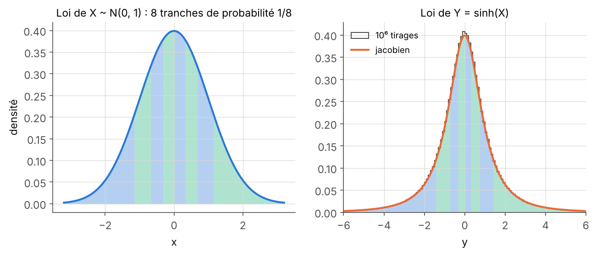
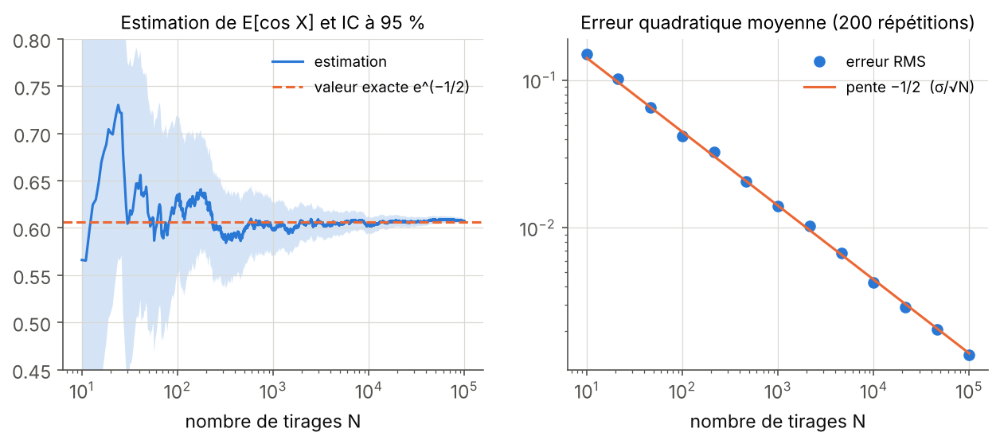
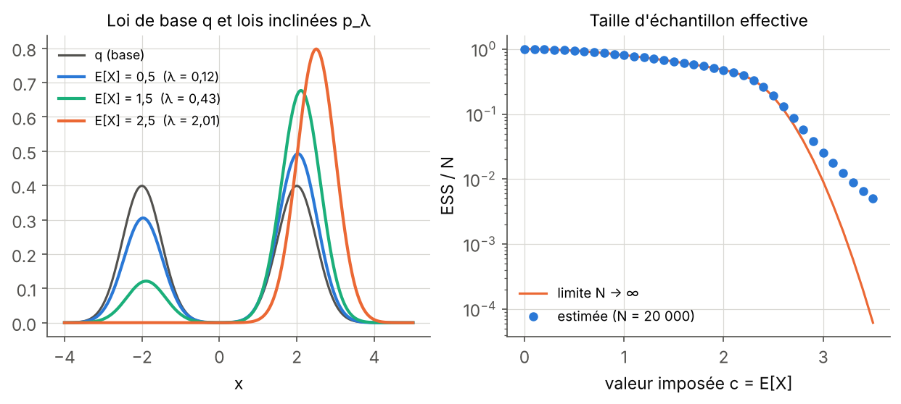
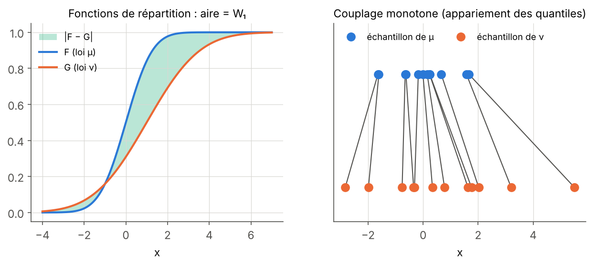
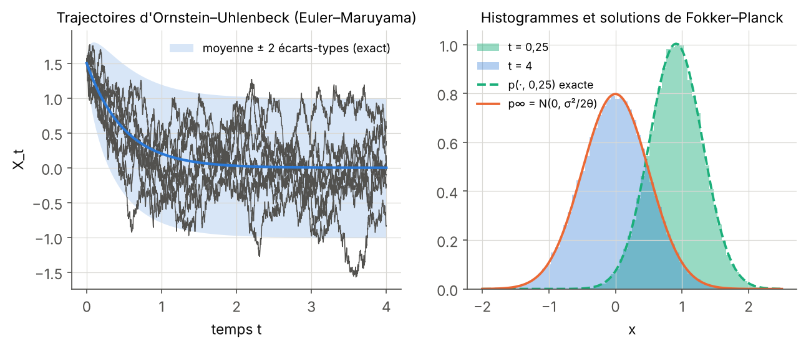
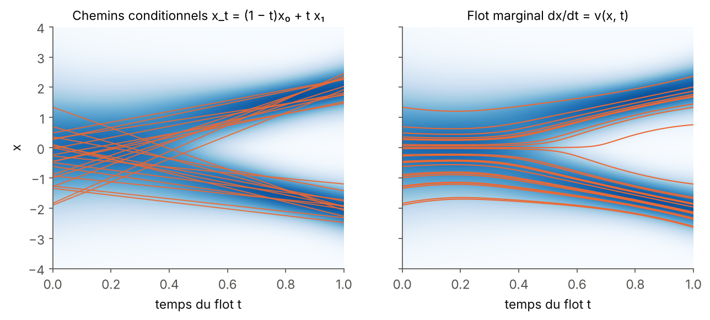

## Objectives {#objectifs}

A generative model does not produce “a” magnetic field: it produces a **probability distribution** over fields, which we observe through samples. All the questions of the MilaDy internship, whether learning this distribution, constraining it or evaluating it, are therefore written in the language of probability. This module provides the tools, from the L2 level up to the notions that underpin flow matching and “distributional” constraints.

By the end of the twenty-five planned hours of work, you will be able to:

1. handle random variables and random vectors, densities, expectation, variance and covariance, and compute with the multivariate Gaussian distribution (sampling via Cholesky, marginal and conditional distributions);
2. compute the pushforward of the distribution of a random variable by an invertible map with the Jacobian formula, and explain why this formula is the foundation of normalizing flows;
3. estimate an expectation by Monte Carlo with a confidence interval, justify the $1/\sqrt{N}$ error, use self-normalized importance sampling and diagnose its quality through the effective sample size (ESS);
4. prove the nonnegativity of the Kullback–Leibler divergence, obtain exponential families from the maximum entropy principle, prove by duality that the distribution closest to a distribution $q$ under a moment constraint is an exponential tilt of $q$, and compute it numerically with Newton's method;
5. compute the Wasserstein distances $W_1$ and $W_2$ in dimension 1 via quantiles, $W_2$ between two Gaussians, the energy distance and the MMD on samples, and choose a suitable metric to compare generated fields;
6. simulate a stochastic differential equation with the Euler–Maruyama scheme, state Itô's formula, derive the Fokker–Planck equation and its stationary solution for the Ornstein–Uhlenbeck process;
7. prove that a velocity field transports a distribution according to the continuity equation $\partial_t p + \nabla\cdot(p\,v) = 0$, and deduce from it why the “marginal” velocity of flow matching transports the noise to the data.

## Prerequisites {#prerequis}

The starting point is the level reached at the end of the second year of a science bachelor's degree (L2), but a motivated L1 student can follow Chapters 1 to 3 while reviewing multiple integrals along the way. You should know how to compute a single integral and a double integral, perform a change of variables in a double integral (Jacobian), handle symmetric matrices (eigenvalues, determinant, inverse) and series. A first encounter with discrete probability (dice rolls, binomial distribution) helps, without being essential: Chapter 1 starts everything again from the definitions.

On the programming side, it is enough to know how to handle NumPy arrays and write a function in Python. SciPy is used for a few special functions, and PyTorch only for automatic differentiation in Chapter 2.

The module [Vector calculus and Fourier analysis](../p1-calcul-vectoriel/index.html) is useful for Chapter 6 (divergence, Green–Ostrogradski theorem) and for Section 5.6 (spectra). The module [Dynamical systems, bifurcations and invariant measures](../p4-systemes-dynamiques/index.html) can be read in parallel: the notion of invariant measure is introduced there from the point of view of trajectories, whereas here, in Chapter 6, it appears from the point of view of the Fokker–Planck equation. This module directly prepares [Deep learning for physics](../p6-apprentissage-profond/index.html), [Generative models: diffusion and flow matching](../p7-modeles-generatifs/index.html) and [Generative models under physical constraints](../p8-contraintes-physiques/index.html).

## Work plan {#plan}

The level indicates the difficulty: 1 for the foundations, 2 for the core of the module, 3 for what already touches on the research questions of the internship. It never goes down from one session to the next.

| Session | Duration | Level | Content | Exercises |
|:---:|:---:|:---:|---|:---:|
| 1 | 3 h | 1 | Chapter 1, Sections 1.1 and 1.2: random variables, distributions, densities, expectation, variance, Jensen's and Chebyshev's inequalities | 1, 2 |
| 2 | 3 h | 1 | Chapter 1, Sections 1.3 and 1.4: random vectors, covariance, conditional expectation, multivariate Gaussian distribution | 3 |
| 3 | 3 h | 2 | Chapter 2: pushforward measure, Jacobian formula, normalizing flows | 4, 5 |
| 4 | 3.5 h | 2 | Chapter 3: Monte Carlo, law of large numbers, CLT, confidence intervals, importance sampling, ESS | 6, 7 |
| 5 | 3 h | 2 | Chapter 4, Sections 4.1 to 4.3: entropy, Kullback–Leibler divergence, maximum entropy, exponential families | 8, 9 |
| 6 | 3 h | 3 | Chapter 4, Sections 4.4 and 4.5: I-projection, dual and Newton's method, limits when the support is lacking | 10 |
| 7 | 3.5 h | 3 | Chapter 5: Monge and Kantorovich, Wasserstein in 1D and between Gaussians, sliced Wasserstein, energy distance, MMD, metrics for fields | 11, 12 |
| 8 | 3 h | 3 | Chapter 6: Brownian motion, SDEs, Euler–Maruyama, Itô, Fokker–Planck, continuity equation, marginal velocity of flow matching | 13, 14, 15 |
| **Total** | **25 h** | | 6 chapters, 6 figures, 5 interactive diagrams | 15 exercises |

Each session ends with the listed exercises, to be done before reading their solutions. The code blocks are short (under 30 seconds each on a single processor core): copy them, run them, then modify them. The interactive diagrams are manipulated directly in the page; they revisit the examples from the text, with sliders.

## 1. Random variables, distributions and moments {#ch1}

A set of MHD fields simulated at a given $Rm$ is not an unstructured collection of files: it is a sample from a distribution $\mu_{\boldsymbol\lambda}$, and what we ask of a generative model is to reproduce this distribution. This chapter fixes the vocabulary (random variable, distribution, density, moments) and ends with the multivariate Gaussian distribution, the starting point of all diffusion and flow matching models.

### 1.1 Probability space, random variable, distribution

::: def
[Definition 1.1 — Probability space]{.tag}
A probability space is a triple $(\mathcal{U}, \mathcal{F}, \mathbb{P})$ formed by a set $\mathcal{U}$ of the possible outcomes of an experiment, a family $\mathcal{F}$ of subsets of $\mathcal{U}$ called events (a σ-algebra: closed under complement and countable union), and a probability $\mathbb{P} : \mathcal{F} \to [0, 1]$ such that $\mathbb{P}(\mathcal{U}) = 1$ and $\mathbb{P}(\bigcup_n A_n) = \sum_n \mathbb{P}(A_n)$ for pairwise disjoint events.
:::

We denote the sample space by $\mathcal{U}$ rather than $\Omega$, the usual letter, so as not to confuse it with the physical domain $\Omega \subset \mathbb{R}^d$ of the other modules. In practice, we almost never handle $\mathcal{U}$ directly: we handle random variables and their distributions.

::: def
[Definition 1.2 — Random variable, distribution, cumulative distribution function]{.tag}
A real random variable is a function $X : \mathcal{U} \to \mathbb{R}$ such that $\{X \le x\}$ is an event for every $x$. Its **distribution** (or law) is the probability $\mu_X$ on $\mathbb{R}$ defined by

$$
\mu_X(A) = \mathbb{P}(X \in A)
$$

for every (Borel) subset $A$ of $\mathbb{R}$. Its **cumulative distribution function** (CDF) is $F_X(x) = \mathbb{P}(X \le x)$: it is nondecreasing, right-continuous, tends to 0 at $-\infty$ and to 1 at $+\infty$, and it characterizes the distribution.
:::

Definition 1.2 already says something important for what follows: the distribution of $X$ is the image of the probability $\mathbb{P}$ under the map $X$. Chapter 2 generalizes this “pushforward measure” operation to any map, and it is exactly what a generative model performs.

::: def
[Definition 1.3 — Density]{.tag}
The variable $X$ has density $p : \mathbb{R} \to [0, +\infty)$ if, for every interval $[a, b]$,

$$
\mathbb{P}(a \le X \le b) = \int_a^b p(x)\,\mathrm{d}x.
$$

We then have $\int_{\mathbb{R}} p = 1$ and $F_X' = p$ at every point of continuity of $p$. A density is not a probability: $p(x)$ can exceed 1; only the area under the curve is a probability.
:::

::: ex
[Example 1.4 — Three reference distributions]{.tag}
The **uniform** distribution on $[a, b]$ has density $\frac{1}{b-a}$ on $[a, b]$ and 0 elsewhere. The **exponential** distribution with parameter $a > 0$ has density $a\,e^{-ax}$ for $x \ge 0$; it models, for example, the waiting time between two polarity reversals in a regime where they occur at random and without memory. The **normal** (or Gaussian) distribution $\mathcal{N}(m, \sigma^2)$ has density

$$
p(x) = \frac{1}{\sqrt{2\pi\sigma^2}}\exp\Big(-\frac{(x - m)^2}{2\sigma^2}\Big).
$$

We denote by $\Phi$ the CDF of $\mathcal{N}(0, 1)$; it has no elementary expression, but $\Phi(1.96) \approx 0.975$, a value that will come back in Chapter 3.
:::

### 1.2 Expectation, variance and two inequalities

::: def
[Definition 1.5 — Expectation, transfer formula]{.tag}
If $X$ has density $p$ and $g$ is a function such that $\int |g(x)|\,p(x)\,\mathrm{d}x < \infty$, the expectation of $g(X)$ is

$$
\mathbb{E}[g(X)] = \int_{\mathbb{R}} g(x)\,p(x)\,\mathrm{d}x.
$$

For $g(x) = x$, we obtain the mean $\mathbb{E}[X]$. Expectation is linear, positive ($g \ge 0 \Rightarrow \mathbb{E}[g(X)] \ge 0$) and satisfies $\mathbb{E}[1] = 1$. For an event $A$, $\mathbb{E}[\mathbf{1}_A] = \mathbb{P}(A)$.
:::

The transfer formula (also called the law of the unconscious statistician) is the principle behind all the computations of this module: to compute the mean of an observable $g(X)$, we do not need to know the distribution of $g(X)$, only that of $X$.

:::: thm
[Theorem 1.6 — Jensen's inequality]{.tag}
If $\varphi$ is convex and $X$ and $\varphi(X)$ are integrable, then

$$
\varphi(\mathbb{E}[X]) \le \mathbb{E}[\varphi(X)].
$$

If $\varphi$ is strictly convex, equality holds if and only if $X$ is almost surely constant.

::: proof
A convex function lies above each of its tangent lines (or of its supporting lines if it is not differentiable): at $m = \mathbb{E}[X]$, there exists a slope $a$ such that $\varphi(x) \ge \varphi(m) + a(x - m)$ for all $x$. We replace $x$ by $X$ and take the expectation: $\mathbb{E}[\varphi(X)] \ge \varphi(m) + a(\mathbb{E}[X] - m) = \varphi(m)$. If $\varphi$ is strictly convex, the inequality $\varphi(x) > \varphi(m) + a(x - m)$ is strict for $x \neq m$; equality of the expectations therefore forces $X = m$ almost surely. [∎]{.qed}
:::
::::

::: def
[Definition 1.7 — Variance, standard deviation]{.tag}
If $\mathbb{E}[X^2] < \infty$, the variance of $X$ is $\mathrm{Var}(X) = \mathbb{E}\big[(X - \mathbb{E}[X])^2\big] = \mathbb{E}[X^2] - \mathbb{E}[X]^2$, and its standard deviation is $\sigma_X = \sqrt{\mathrm{Var}(X)}$. For real numbers $a$ and $b$, $\mathrm{Var}(aX + b) = a^2\,\mathrm{Var}(X)$.
:::

The identity $\mathbb{E}[(X - \mathbb{E}X)^2] = \mathbb{E}[X^2] - \mathbb{E}[X]^2$ is obtained by expanding the square and using linearity. Together with Jensen applied to $\varphi(x) = x^2$, it also shows that $\mathbb{E}[X]^2 \le \mathbb{E}[X^2]$.

:::: prop
[Proposition 1.8 — Markov's and Bienaymé–Chebyshev inequalities]{.tag}
(i) If $Y \ge 0$ and $a > 0$, then $\mathbb{P}(Y \ge a) \le \mathbb{E}[Y]/a$.

(ii) If $X$ has finite variance and $\varepsilon > 0$, then

$$
\mathbb{P}\big(|X - \mathbb{E}[X]| \ge \varepsilon\big) \le \frac{\mathrm{Var}(X)}{\varepsilon^2}.
$$

::: proof
(i) We have $Y \ge a\,\mathbf{1}_{\{Y \ge a\}}$ everywhere, since the right-hand side equals $a \le Y$ on the event and $0 \le Y$ elsewhere. Taking the expectation: $\mathbb{E}[Y] \ge a\,\mathbb{P}(Y \ge a)$. (ii) We apply (i) to $Y = (X - \mathbb{E}X)^2$ and $a = \varepsilon^2$. [∎]{.qed}
:::
::::

Chebyshev's inequality is crude, but it is enough to prove the law of large numbers in Chapter 3.

### 1.3 Random vectors, covariance, conditional expectation

A discretized field $\mathbf{x} \in \mathbb{R}^D$ is a random vector: each grid point is a coordinate, and all the physical information (spatial correlations, spectrum, helicity) lies in the **joint distribution** of the coordinates, not in the distributions of the coordinates taken one by one.

::: def
[Definition 1.9 — Joint distribution, marginals, independence]{.tag}
A random vector $\mathbf{X} = (X_1, \dots, X_d)$ has joint density $p : \mathbb{R}^d \to [0, \infty)$ if $\mathbb{P}(\mathbf{X} \in A) = \int_A p(\mathbf{x})\,\mathrm{d}\mathbf{x}$ for every subset $A$. The marginal density of $X_1$ is obtained by integrating out the other variables: $p_1(x_1) = \int p(x_1, x_2, \dots, x_d)\,\mathrm{d}x_2\cdots\mathrm{d}x_d$. The coordinates are **independent** if the joint density is the product of the marginals: $p(\mathbf{x}) = p_1(x_1)\cdots p_d(x_d)$.
:::

::: def
[Definition 1.10 — Covariance, covariance matrix]{.tag}
The covariance of two square-integrable variables is $\mathrm{Cov}(X, Y) = \mathbb{E}[(X - \mathbb{E}X)(Y - \mathbb{E}Y)] = \mathbb{E}[XY] - \mathbb{E}[X]\mathbb{E}[Y]$. The correlation coefficient is $\mathrm{Cov}(X, Y)/(\sigma_X\sigma_Y) \in [-1, 1]$. For a vector $\mathbf{X}$ with mean $\mathbf{m} = \mathbb{E}[\mathbf{X}]$, the covariance matrix is

$$
\Sigma = \mathbb{E}\big[(\mathbf{X} - \mathbf{m})(\mathbf{X} - \mathbf{m})^{\mathsf{T}}\big], \qquad \Sigma_{ij} = \mathrm{Cov}(X_i, X_j).
$$
:::

:::: prop
[Proposition 1.11 — Properties of the covariance]{.tag}
(i) $\Sigma$ is symmetric positive semidefinite: $\mathbf{a}^{\mathsf{T}}\Sigma\,\mathbf{a} \ge 0$ for all $\mathbf{a} \in \mathbb{R}^d$.

(ii) For a $k \times d$ matrix $A$ and $\mathbf{b} \in \mathbb{R}^k$, the vector $A\mathbf{X} + \mathbf{b}$ has mean $A\mathbf{m} + \mathbf{b}$ and covariance $A\Sigma A^{\mathsf{T}}$.

(iii) If $X$ and $Y$ are independent, $\mathrm{Cov}(X, Y) = 0$. The converse is false.

::: proof
(i) Symmetry is obvious. For fixed $\mathbf{a}$, $\mathbf{a}^{\mathsf{T}}\Sigma\,\mathbf{a} = \mathbb{E}\big[(\mathbf{a}^{\mathsf{T}}(\mathbf{X} - \mathbf{m}))^2\big] = \mathrm{Var}(\mathbf{a}^{\mathsf{T}}\mathbf{X}) \ge 0$. (ii) By linearity, $\mathbb{E}[A\mathbf{X} + \mathbf{b}] = A\mathbf{m} + \mathbf{b}$, then $\mathbb{E}[A(\mathbf{X} - \mathbf{m})(\mathbf{X} - \mathbf{m})^{\mathsf{T}}A^{\mathsf{T}}] = A\Sigma A^{\mathsf{T}}$. (iii) If the joint density is a product, the double integral $\mathbb{E}[XY]$ factorizes into $\mathbb{E}[X]\,\mathbb{E}[Y]$. For a counterexample, take $X \sim \mathcal{N}(0, 1)$ and $Y = X^2$: $\mathrm{Cov}(X, Y) = \mathbb{E}[X^3] = 0$ by symmetry, whereas $Y$ is a function of $X$ (Exercise 2). [∎]{.qed}
:::
::::

Point (iii) is a classic trap when validating a generative model: reproducing the covariances of the data does not guarantee reproducing their nonlinear dependencies, such as those that link the amplitude of a mode to its sign in a reversal regime.

::: def
[Definition 1.12 — Conditional density, conditional expectation]{.tag}
If $(X, Y)$ has density $p(x, y)$ and $Y$ has density $p_Y(y) > 0$, the conditional density of $X$ given $Y = y$ is $p(x \mid y) = p(x, y)/p_Y(y)$, and the conditional expectation is

$$
\mathbb{E}[X \mid Y = y] = \int x\,p(x \mid y)\,\mathrm{d}x.
$$

We denote by $\mathbb{E}[X \mid Y]$ the random variable $h(Y)$ where $h(y) = \mathbb{E}[X \mid Y = y]$. The definition extends as is to vectors.
:::

:::: thm
[Theorem 1.13 — Conditional expectation is the best quadratic prediction]{.tag}
Let $\mathbf{X}$ be square-integrable. Among all functions $h$ such that $h(Y)$ is square-integrable, the quantity $\mathbb{E}\big[|\mathbf{X} - h(Y)|^2\big]$ is minimal for $h(y) = \mathbb{E}[\mathbf{X} \mid Y = y]$. Moreover, the error $\mathbf{X} - \mathbb{E}[\mathbf{X} \mid Y]$ is orthogonal to every function $g$ of $Y$ such that $g(Y)$ is square-integrable: $\mathbb{E}\big[(\mathbf{X} - \mathbb{E}[\mathbf{X} \mid Y])\cdot g(Y)\big] = 0$.

::: proof
Let $h^\star(Y) = \mathbb{E}[\mathbf{X} \mid Y]$. For every $g$, $\mathbb{E}[\mathbf{X}\cdot g(Y)] = \iint \mathbf{x}\cdot g(y)\,p(\mathbf{x}\mid y)\,p_Y(y)\,\mathrm{d}\mathbf{x}\,\mathrm{d}y = \int h^\star(y)\cdot g(y)\,p_Y(y)\,\mathrm{d}y = \mathbb{E}[h^\star(Y)\cdot g(Y)]$, which gives the orthogonality. Next, for every $h$, we write $\mathbf{X} - h(Y) = (\mathbf{X} - h^\star(Y)) + (h^\star(Y) - h(Y))$; the second term is a function of $Y$, so the cross product has zero expectation and

$$
\mathbb{E}\big[|\mathbf{X} - h(Y)|^2\big] = \mathbb{E}\big[|\mathbf{X} - h^\star(Y)|^2\big] + \mathbb{E}\big[|h^\star(Y) - h(Y)|^2\big] \ge \mathbb{E}\big[|\mathbf{X} - h^\star(Y)|^2\big].
$$

Equality holds only if $h(Y) = h^\star(Y)$ almost surely. [∎]{.qed}
:::
::::

This elementary theorem is the mathematical mainspring of flow matching: there, a network is trained to predict a random quantity by least squares, and the optimum is a conditional expectation (Proposition 6.15).

### 1.4 The multivariate Gaussian distribution

::: def
[Definition 1.14 — Multivariate normal distribution]{.tag}
Let $\mathbf{m} \in \mathbb{R}^d$ and $\Sigma$ a symmetric positive definite $d \times d$ matrix. The distribution $\mathcal{N}(\mathbf{m}, \Sigma)$ has density

$$
p(\mathbf{x}) = \frac{1}{(2\pi)^{d/2}\sqrt{\det\Sigma}}\exp\Big(-\frac12(\mathbf{x} - \mathbf{m})^{\mathsf{T}}\Sigma^{-1}(\mathbf{x} - \mathbf{m})\Big).
$$

The distribution $\mathcal{N}(0, I)$ is the standard normal distribution: its coordinates are independent $\mathcal{N}(0, 1)$ variables, since the density factorizes.
:::

:::: prop
[Proposition 1.15 — Construction by affine transformation]{.tag}
Let $L$ be an invertible matrix such that $LL^{\mathsf{T}} = \Sigma$ (for example the Cholesky factor, lower triangular). If $\mathbf{Z} \sim \mathcal{N}(0, I)$, then $\mathbf{X} = \mathbf{m} + L\mathbf{Z} \sim \mathcal{N}(\mathbf{m}, \Sigma)$. More generally, every affine transformation $A\mathbf{X} + \mathbf{b}$ of a Gaussian vector is Gaussian, with covariance $A\Sigma A^{\mathsf{T}}$ (it has a density only if this matrix is invertible), and every marginal of a Gaussian vector is Gaussian.

::: proof
This is a special case of Theorem 2.5 (Jacobian formula), which can already be checked with the change of variables in multiple integrals seen in L2. The map $\mathbf{z} \mapsto \mathbf{m} + L\mathbf{z}$ has inverse $\mathbf{x} \mapsto L^{-1}(\mathbf{x} - \mathbf{m})$ and constant Jacobian $\det L$, with $|\det L| = \sqrt{\det\Sigma}$. The density of $\mathbf{X}$ is therefore $p_{\mathbf{Z}}(L^{-1}(\mathbf{x} - \mathbf{m}))/|\det L|$, and $|L^{-1}(\mathbf{x} - \mathbf{m})|^2 = (\mathbf{x} - \mathbf{m})^{\mathsf{T}}(LL^{\mathsf{T}})^{-1}(\mathbf{x} - \mathbf{m})$ gives back Definition 1.14. For an arbitrary affine transformation or a marginal, we take the result for granted; a short proof goes through the characteristic function $\mathbb{E}[e^{i\mathbf{u}\cdot\mathbf{X}}] = e^{i\mathbf{u}\cdot\mathbf{m} - \frac12\mathbf{u}^{\mathsf{T}}\Sigma\mathbf{u}}$. [∎]{.qed}
:::
::::

This proposition is used in all the generative models of the pathway: we draw $\mathbf{Z}$ coordinate by coordinate, then transform. Definition 1.14 also has a consequence specific to Gaussians, which is an exception to the warning of point (iii) of Proposition 1.11: **for a Gaussian vector, uncorrelated coordinates are independent**, because a diagonal matrix $\Sigma$ makes the density factorizable. The assumption concerns the joint distribution: two variables that are each Gaussian, without jointly forming a Gaussian vector, can be uncorrelated and dependent.

:::: prop
[Proposition 1.16 — Gaussian conditional distributions]{.tag}
Split $\mathbf{X} = (\mathbf{X}_1, \mathbf{X}_2) \sim \mathcal{N}(\mathbf{m}, \Sigma)$ into two blocks, with $\Sigma = \begin{pmatrix}\Sigma_{11} & \Sigma_{12}\\ \Sigma_{21} & \Sigma_{22}\end{pmatrix}$. The distribution of $\mathbf{X}_1$ given $\mathbf{X}_2 = \mathbf{x}_2$ is Gaussian:

$$
\mathbf{X}_1 \mid \mathbf{X}_2 = \mathbf{x}_2 \;\sim\; \mathcal{N}\big(\mathbf{m}_1 + \Sigma_{12}\Sigma_{22}^{-1}(\mathbf{x}_2 - \mathbf{m}_2),\; \Sigma_{11} - \Sigma_{12}\Sigma_{22}^{-1}\Sigma_{21}\big).
$$

::: proof
Let $A = \Sigma_{12}\Sigma_{22}^{-1}$ and $\mathbf{R} = \mathbf{X}_1 - A\mathbf{X}_2$. The pair $(\mathbf{R}, \mathbf{X}_2)$ is a linear transformation of $\mathbf{X}$, hence Gaussian. Its cross-covariance is $\mathrm{Cov}(\mathbf{R}, \mathbf{X}_2) = \Sigma_{12} - A\Sigma_{22} = 0$: $\mathbf{R}$ and $\mathbf{X}_2$ are uncorrelated, hence independent (Gaussian vector). Thus, given $\mathbf{X}_2 = \mathbf{x}_2$, $\mathbf{X}_1 = \mathbf{R} + A\mathbf{x}_2$ has the distribution of $\mathbf{R}$ shifted by $A\mathbf{x}_2$. Now $\mathbb{E}[\mathbf{R}] = \mathbf{m}_1 - A\mathbf{m}_2$ and $\mathrm{Var}(\mathbf{R}) = \Sigma_{11} - A\Sigma_{21} - \Sigma_{12}A^{\mathsf{T}} + A\Sigma_{22}A^{\mathsf{T}} = \Sigma_{11} - \Sigma_{12}\Sigma_{22}^{-1}\Sigma_{21}$. [∎]{.qed}
:::
::::

The conditional mean is affine in $\mathbf{x}_2$ and the conditional variance does not depend on $\mathbf{x}_2$: this is linear regression, and it is also the computation that gives the flow matching velocity between Gaussians (Exercise 15).

::: ex
[Example 1.17 — A worked numerical case]{.tag}
Take $\mathbf{m} = (1, -2)$ and $\Sigma = \begin{pmatrix}2 & 1.2\\ 1.2 & 1\end{pmatrix}$, whose determinant $0.56$ is positive. Given $X_2 = -1$, the mean of $X_1$ is $1 + \frac{1.2}{1}(-1 + 2) = 2.2$ and its variance $2 - 1.2^2/1 = 0.56$. The code below draws $4\times10^5$ points via Cholesky and checks these values on the slice $|X_2 + 1| < 0.01$.
:::

```python
import numpy as np

rng = np.random.default_rng(0)
m = np.array([1.0, -2.0])
S = np.array([[2.0, 1.2],
              [1.2, 1.0]])
L = np.linalg.cholesky(S)                 # S = L L^T, L lower triangular
N = 400_000
Z = rng.standard_normal((N, 2))           # Z ~ N(0, I)
X = m + Z @ L.T                           # X = m + L Z ~ N(m, S)
print("empirical mean       :", X.mean(axis=0).round(3))
print("empirical covariance :", np.cov(X.T).round(3).tolist())

# Conditional distribution of X1 given X2 = -1 (Proposition 1.16)
x2 = -1.0
mu_c = m[0] + S[0, 1] / S[1, 1] * (x2 - m[1])
var_c = S[0, 0] - S[0, 1] ** 2 / S[1, 1]
sel = np.abs(X[:, 1] - x2) < 0.01         # thin slice around X2 = -1
print(f"theory    : E[X1 | X2=-1] = {mu_c:.3f}, Var = {var_c:.3f}")
print(f"empirical : E[X1 | X2=-1] = {X[sel, 0].mean():.3f}, Var = {X[sel, 0].var():.3f}  ({sel.sum()} points)")

# Zero covariance does not imply independence
Y = rng.standard_normal(N)
print("Cov(Y, Y^2) =", round(np.cov(Y, Y ** 2)[0, 1], 3),
      "; Corr(|Y|, Y^2) =", round(np.corrcoef(np.abs(Y), Y ** 2)[0, 1], 3))
# output:
# empirical mean       : [ 1.003 -1.998]
# empirical covariance : [[2.002, 1.199], [1.199, 0.999]]
# theory    : E[X1 | X2=-1] = 2.200, Var = 0.560
# empirical : E[X1 | X2=-1] = 2.205, Var = 0.567  (1959 points)
# Cov(Y, Y^2) = 0.009 ; Corr(|Y|, Y^2) = 0.936
```

The gaps between theory and empirical values are of order $10^{-2}$ for the conditional slice, which contains only 1959 points: Chapter 3 explains why this order of magnitude is the expected one. The covariance of $Y$ and $Y^2$ is zero up to fluctuations, whereas $|Y|$ and $Y^2$ have a 94% correlation.

:::: recap
::: recap-title
Key takeaways — chapter 1
:::
- The distribution of a random variable is the image of $\mathbb{P}$ under this variable; we compute $\mathbb{E}[g(X)] = \int g\,p$ without knowing the distribution of $g(X)$.
- Jensen ($\varphi$ convex $\Rightarrow \varphi(\mathbb{E}X) \le \mathbb{E}\varphi(X)$) and Chebyshev are the two basic inequalities of the module.
- The covariance is positive semidefinite and transforms as $A\Sigma A^{\mathsf{T}}$; zero covariance does not imply independence, except for a Gaussian vector.
- $\mathbb{E}[\mathbf{X} \mid Y]$ is the best prediction of $\mathbf{X}$ by a function of $Y$ in the least-squares sense.
- $\mathbf{m} + L\mathbf{Z}$ with $LL^{\mathsf{T}} = \Sigma$ and $\mathbf{Z} \sim \mathcal{N}(0, I)$ realizes $\mathcal{N}(\mathbf{m}, \Sigma)$; Gaussian conditionals are linear regressions.
::::

## 2. Change of variables and pushforward measure {#ch2}

A generative model is, in its simplest form, a map $T_\theta$ that transforms a Gaussian noise $\mathbf{Z}$ into a field $T_\theta(\mathbf{Z})$. The generated distribution is therefore the **pushforward measure** of $\mathcal{N}(0, I)$ by $T_\theta$. This chapter defines this operation, gives the Jacobian formula that computes the pushforward density, and shows how it underpins normalizing flows; Chapter 6 will give its continuous-time version, which underpins flow matching.

### 2.1 Pushforward measure

::: def
[Definition 2.1 — Pushforward measure]{.tag}
Let $\mu$ be a distribution on $\mathbb{R}^d$ and $T : \mathbb{R}^d \to \mathbb{R}^k$ a (measurable) map. The pushforward measure of $\mu$ by $T$, denoted $T_\#\mu$, is the distribution on $\mathbb{R}^k$ defined by

$$
(T_\#\mu)(B) = \mu\big(T^{-1}(B)\big) = \mu\big(\{\mathbf{x} : T(\mathbf{x}) \in B\}\big).
$$

In other words, if $\mathbf{X} \sim \mu$, then $T(\mathbf{X}) \sim T_\#\mu$.
:::

:::: prop
[Proposition 2.2 — Transfer formula for a pushforward measure]{.tag}
For every nonnegative or integrable function $g$,

$$
\int g\,\mathrm{d}(T_\#\mu) = \int g\circ T\,\mathrm{d}\mu, \qquad \text{that is} \qquad \mathbb{E}[g(T(\mathbf{X}))] = \mathbb{E}_{T_\#\mu}[g].
$$

::: proof
For $g = \mathbf{1}_B$, both sides equal $\mu(T^{-1}(B))$ by definition. By linearity, the equality holds for simple functions (finite combinations of indicator functions), then for every nonnegative $g$ by monotone convergence (increasing limit of simple functions), and finally for integrable $g$ by writing $g = g^+ - g^-$. [∎]{.qed}
:::
::::

This formula is the reason why a generative model can be evaluated without ever writing down its density: to compute the mean of an observable (energy, helicity, divergence) under the generated distribution, it is enough to evaluate the observable on samples $T_\theta(\mathbf{Z}_i)$.

::: ex
[Example 2.3 — Symmetry of an invariant distribution]{.tag}
Gissinger's (2012) three-mode model for magnetic field reversals is invariant under the symmetry $S(Q, D, V) = (-Q, -D, V)$: if $(Q, D, V)$ is a solution, $(-Q, -D, V)$ is another one. If $\mu$ is an invariant distribution, $S_\#\mu$ is therefore another one; when the invariant distribution is unique, which is what we expect in a reversal regime where a typical trajectory visits both polarities, we have $S_\#\mu = \mu$. Proposition 2.2 applied to $g(Q, D, V) = D$ then gives $\mathbb{E}_\mu[D] = \mathbb{E}_\mu[-D]$, hence $\mathbb{E}_\mu[D] = 0$: on average over a long time, the dipole has no preferred polarity. In a regime without reversals, on the contrary, there can be two invariant distributions, one per polarity, which $S$ exchanges. Checking that a generated distribution satisfies $S_\#q = q$ is one of the tests of experiment E1 (see the [report](../../rapport/index.html#e1)).
:::

:::: prop
[Proposition 2.4 — Inverse CDF method]{.tag}
Let $F$ be a continuous and strictly increasing CDF, and $U$ uniform on $[0, 1]$. Then $X = F^{-1}(U)$ has CDF $F$. In other words, $F^{-1}$ transports the uniform distribution onto the distribution with CDF $F$: $(F^{-1})_\#\,\mathcal{U}[0, 1] = \mu_F$.

::: proof
Since $F$ is increasing, $\{F^{-1}(U) \le x\} = \{U \le F(x)\}$, hence $\mathbb{P}(X \le x) = \mathbb{P}(U \le F(x)) = F(x)$. [∎]{.qed}
:::
::::

In dimension 1, we therefore know how to transport any atomless distribution onto any other by a nondecreasing map: if $F$ is continuous, $F(X)$ is uniform and $G^{-1}\circ F$ sends the distribution with CDF $F$ onto the one with CDF $G$. This “quantile” map will reappear in Chapter 5 as optimal transport in dimension 1.

### 2.2 The Jacobian formula

:::: thm
[Theorem 2.5 — Density of a pushforward by a diffeomorphism]{.tag}
Let $T : U \to V$ be a $C^1$ diffeomorphism between two open subsets of $\mathbb{R}^d$, with Jacobian matrix $J_T(\mathbf{x}) = \big(\partial_j T_i(\mathbf{x})\big)_{ij}$. If $\mathbf{X}$ has density $p_{\mathbf{X}}$ on $U$, then $\mathbf{Y} = T(\mathbf{X})$ has density on $V$

$$
p_{\mathbf{Y}}(\mathbf{y}) = p_{\mathbf{X}}\big(T^{-1}(\mathbf{y})\big)\,\big|\det J_{T^{-1}}(\mathbf{y})\big| = \frac{p_{\mathbf{X}}(\mathbf{x})}{|\det J_T(\mathbf{x})|}\quad\text{with } \mathbf{x} = T^{-1}(\mathbf{y}). \tag{2.1}
$$

::: proof
For every subset $B \subset V$, $\mathbb{P}(\mathbf{Y} \in B) = \mathbb{P}(\mathbf{X} \in T^{-1}(B)) = \int_{T^{-1}(B)} p_{\mathbf{X}}(\mathbf{x})\,\mathrm{d}\mathbf{x}$. The change of variables theorem for multiple integrals (L2), applied with $\mathbf{x} = T^{-1}(\mathbf{y})$, transforms this integral into $\int_B p_{\mathbf{X}}(T^{-1}(\mathbf{y}))\,|\det J_{T^{-1}}(\mathbf{y})|\,\mathrm{d}\mathbf{y}$. This equality, true for every $B$, is the definition of a density. The second form of (2.1) comes from $J_{T^{-1}}(\mathbf{y}) = J_T(\mathbf{x})^{-1}$ (derivative of a composition $T\circ T^{-1} = \mathrm{id}$), so $\det J_{T^{-1}}(\mathbf{y}) = 1/\det J_T(\mathbf{x})$. [∎]{.qed}
:::
::::

The interpretation is one of mass conservation: the probability contained in a small volume $\mathrm{d}\mathbf{x}$ around $\mathbf{x}$ ends up in the volume $|\det J_T|\,\mathrm{d}\mathbf{x}$ around $T(\mathbf{x})$. If $T$ locally expands volumes, the density decreases accordingly. Figure 1 shows this on an example in dimension 1.

```{=html}
<figure class="schema">

<figcaption>Figure 1 — Pushforward of N(0, 1) by T(x) = sinh(x). Each colored slice keeps its probability 1/8; where T stretches the axis (large |x|), the pushforward density flattens out, and where T' = cosh(x) equals 1 (near 0), it is unchanged. The histogram of 10⁶ draws of sinh(X) coincides with formula (2.1).</figcaption>
</figure>
```

:::: cor
[Corollary 2.6 — Logarithmic form and composition]{.tag}
With the notation of Theorem 2.5,

$$
\log p_{\mathbf{Y}}(T(\mathbf{x})) = \log p_{\mathbf{X}}(\mathbf{x}) - \log\big|\det J_T(\mathbf{x})\big|.
$$

For a composition $T = T_K\circ\cdots\circ T_1$, writing $\mathbf{x}_0 = \mathbf{x}$ and $\mathbf{x}_k = T_k(\mathbf{x}_{k-1})$, we have $\log p_{\mathbf{Y}}(T(\mathbf{x})) = \log p_{\mathbf{X}}(\mathbf{x}) - \sum_{k=1}^K \log|\det J_{T_k}(\mathbf{x}_{k-1})|$.

::: proof
We take the logarithm of (2.1), then use $J_T(\mathbf{x}) = J_{T_K}(\mathbf{x}_{K-1})\cdots J_{T_1}(\mathbf{x}_0)$ (derivative of a composition) and the multiplicativity of the determinant. [∎]{.qed}
:::
::::

::: ex
[Example 2.7 — The hyperbolic sine]{.tag}
Let $X \sim \mathcal{N}(0, 1)$ and $Y = \sinh X$. The inverse is $T^{-1}(y) = \operatorname{argsh} y$, with derivative $1/\sqrt{1 + y^2}$. Formula (2.1) gives

$$
p_Y(y) = \frac{1}{\sqrt{2\pi}\sqrt{1 + y^2}}\exp\Big(-\frac{(\operatorname{argsh} y)^2}{2}\Big).
$$

At $y = 0$, $p_Y(0) = 1/\sqrt{2\pi} \approx 0.3989$, the same value as $p_X(0)$, because $T'(0) = \cosh 0 = 1$. On the other hand, $p_Y$ decays much more slowly than the Gaussian: $Y$ has heavy tails, like velocity increments in turbulence.
:::

:::: prop
[Proposition 2.8 — Matrix determinant lemma]{.tag}
For two vectors $\mathbf{u}, \boldsymbol\psi \in \mathbb{R}^d$, $\det(I + \mathbf{u}\boldsymbol\psi^{\mathsf{T}}) = 1 + \boldsymbol\psi^{\mathsf{T}}\mathbf{u}$.

::: proof
The matrix $\mathbf{u}\boldsymbol\psi^{\mathsf{T}}$ has rank at most 1. Every vector orthogonal to $\boldsymbol\psi$ is in its kernel, hence an eigenvector of $I + \mathbf{u}\boldsymbol\psi^{\mathsf{T}}$ for the eigenvalue 1; this gives $d - 1$ eigenvalues equal to 1. The trace equals $d + \boldsymbol\psi^{\mathsf{T}}\mathbf{u}$, so the last eigenvalue is $1 + \boldsymbol\psi^{\mathsf{T}}\mathbf{u}$, and the determinant is the product of the eigenvalues. [∎]{.qed}
:::
::::

::: ex
[Example 2.9 — A “planar” flow]{.tag}
Rezende and Mohamed (2015) propose the transformations $T(\mathbf{x}) = \mathbf{x} + \mathbf{u}\tanh(\mathbf{w}\cdot\mathbf{x} + b)$. The Jacobian matrix equals $I + \mathbf{u}\boldsymbol\psi(\mathbf{x})^{\mathsf{T}}$ with $\boldsymbol\psi(\mathbf{x}) = (1 - \tanh^2(\mathbf{w}\cdot\mathbf{x} + b))\,\mathbf{w}$, so, by Proposition 2.8,

$$
\det J_T(\mathbf{x}) = 1 + \big(1 - \tanh^2(\mathbf{w}\cdot\mathbf{x} + b)\big)\,\mathbf{u}\cdot\mathbf{w}.
$$

The cost is $O(d)$ instead of $O(d^3)$ for a general determinant. If $\mathbf{u}\cdot\mathbf{w} > -1$, the determinant stays positive and $T$ is invertible: setting $a = \mathbf{w}\cdot\mathbf{x} + b$, the equation $\mathbf{w}\cdot\mathbf{y} + b = a + (\mathbf{u}\cdot\mathbf{w})\tanh a$ is scalar and strictly increasing in $a$, and then $\mathbf{x} = \mathbf{y} - \mathbf{u}\tanh a$.
:::

Interactive diagram 1 lets you vary a monotone map in dimension 1 and watch the probability slices deform.

```{=html}
<div class="widget" data-widget="pushforward">
<p class="widget-title">Interactive diagram 1 — Pushforward measure and Jacobian formula</p>
<p class="widget-note">The map is T(x) = s (x + a sin 2x), increasing as long as |a| &lt; 1/2. The black lines connect the deciles of X to their images: each colored slice keeps the mass 0.1. The orange curve is formula (2.1), the gray outline the histogram of 20,000 draws of T(X). Bring |a| close to 0.45: min T′ approaches 0 and the pushforward density develops peaks where T flattens out.</p>
</div>
```

### 2.3 Normalizing flows

::: def
[Definition 2.10 — Normalizing flow]{.tag}
A normalizing flow is a family of diffeomorphisms $T_\theta : \mathbb{R}^D \to \mathbb{R}^D$, parameterized by the weights $\theta$ of a network, such that $T_\theta^{-1}$ and $\log|\det J_{T_\theta}|$ are cheap to compute. The generative model is $q_\theta = (T_\theta)_\#\mathcal{N}(0, I)$, with density

$$
\log q_\theta(\mathbf{x}) = \log p_{\mathbf{Z}}\big(T_\theta^{-1}(\mathbf{x})\big) + \log\big|\det J_{T_\theta^{-1}}(\mathbf{x})\big|.
$$

It is trained by maximum likelihood: we maximize $\frac1N\sum_i \log q_\theta(\mathbf{x}_i)$ over the data $\mathbf{x}_i \sim \mu$.
:::

Section 4.2 will show that maximizing the likelihood amounts to minimizing the Kullback–Leibler divergence $\mathrm{KL}(\mu\,\|\,q_\theta)$. The review by Papamakarios et al. (2021) describes the architectures that make the determinant cheap (affine couplings, autoregressive transformations, triangular Jacobians).

::: note
[Remark 2.11 — Why move to continuous time]{.tag}
For a 3D field discretized on $64^3$ points with 6 components ($\mathbf{u}$ and $\mathbf{B}$), $D \approx 1.6\times10^6$: a general determinant, in $O(D^3)$, is out of reach, and architectures with triangular Jacobians limit expressiveness. Another route is to define $T$ as the time-1 flow of a differential equation $\dot{\mathbf{x}} = v(\mathbf{x}, t)$. Corollary 6.14 will show that then $\frac{\mathrm{d}}{\mathrm{d}t}\log p_t(\mathbf{x}(t)) = -\nabla\cdot v$: the log-determinant becomes the integral of a divergence (Chen et al., 2018). Flow matching (Lipman et al., 2023) goes further: it trains $v$ by a simple regression, without ever computing this divergence during training (Section 6.5).
:::

The following code checks formula (2.1) in dimension 1, compares the log-determinant of the planar flow with the one obtained by automatic differentiation, then checks the pushforward density in dimension 2 in two independent ways: by integrating $p_{\mathbf{Y}}$ over a grid of $\mathbf{y}$ (which requires $T^{-1}$) and by counting samples.

```python
import numpy as np
import torch
torch.set_num_threads(1)
rng = np.random.default_rng(1)

# 1) Dimension 1: Y = sinh(X) with X ~ N(0, 1)
phi = lambda x: np.exp(-x ** 2 / 2) / np.sqrt(2 * np.pi)
p_Y = lambda y: phi(np.arcsinh(y)) / np.sqrt(1 + y ** 2)   # p_X(T^{-1}(y)) |(T^{-1})'(y)|
Y = np.sinh(rng.standard_normal(1_000_000))
hist, edges = np.histogram(Y, bins=80, range=(-4, 4))
centres = (edges[:-1] + edges[1:]) / 2
dens = hist / (len(Y) * (edges[1] - edges[0]))              # histogram normalized as a density
print("max gap histogram / formula :", f"{np.abs(dens - p_Y(centres)).max():.4f}",
      "; p_Y(0) =", f"{p_Y(0.0):.4f}")

# 2) Dimension 2: "planar" flow T(x) = x + u tanh(w.x + b)
u = torch.tensor([1.5, -0.5]); w = torch.tensor([2.0, 1.0]); b = 0.3
def T(x):
    return x + u * torch.tanh(x @ w + b).unsqueeze(-1)
def logdet(x):                      # det(I + u psi^T) = 1 + u.psi with psi = (1 - tanh^2) w
    return torch.log(torch.abs(1 + (1 - torch.tanh(x @ w + b) ** 2) * (u @ w)))
x = torch.tensor([0.4, -1.1])
J = torch.autograd.functional.jacobian(T, x)                # 2 x 2 Jacobian by autograd
print("log|det J| : autograd =", f"{torch.logdet(J).item():.6f}", "; formula =", f"{logdet(x).item():.6f}")

def T_inv(y, it=60):
    # a = w.x + b satisfies w.y + b = a + (u.w) tanh(a): increasing scalar equation (u.w > -1)
    c = y @ w + b
    a = c.clone()
    for _ in range(it):                                     # scalar Newton
        a = a - (a + (u @ w) * torch.tanh(a) - c) / (1 + (u @ w) * (1 - torch.tanh(a) ** 2))
    return y - u * torch.tanh(a).unsqueeze(-1)

# 3) Check: p_Y(y) = p_X(T^{-1}(y)) / |det J_T(T^{-1}(y))|
g = torch.linspace(-8, 8, 1601, dtype=torch.float64); h = (g[1] - g[0]).item()
u, w = u.double(), w.double()
GY = torch.stack(torch.meshgrid(g, g, indexing="ij"), -1).reshape(-1, 2)
GX = T_inv(GY)
print("max inversion error :", f"{(T(GX) - GY).abs().max().item():.1e}")
pY = torch.exp(-(GX ** 2).sum(-1) / 2 - logdet(GX)) / (2 * np.pi)
print("integral of p_Y over the grid :", f"{pY.sum().item() * h * h:.4f}")
region = (GY[:, 0] > 0.5) & (GY[:, 1] < 0.0)
Xs = torch.randn(400_000, 2, generator=torch.Generator().manual_seed(0), dtype=torch.float64)
Ys = T(Xs)
print("P(Y1 > 0.5, Y2 < 0) : formula =", f"{(pY * region).sum().item() * h * h:.4f}",
      "; samples =", f"{((Ys[:, 0] > 0.5) & (Ys[:, 1] < 0)).double().mean().item():.4f}")
# output:
# max gap histogram / formula : 0.0050 ; p_Y(0) = 0.3989
# log|det J| : autograd = 1.252763 ; formula = 1.252763
# max inversion error : 2.7e-15
# integral of p_Y over the grid : 1.0000
# P(Y1 > 0.5, Y2 < 0) : formula = 0.2799 ; samples = 0.2794
```

The gap of $0.005$ between histogram and formula in dimension 1 is the expected statistical error: the central bins, of width $0.1$, contain about $4\times10^4$ draws each, so that the density there is estimated to within $0.002$ (one standard deviation), and the maximum over 80 bins reaches two to three standard deviations. In dimension 2, the pushforward density integrates to 1 and predicts the probability of a region to within $5\times10^{-4}$, which is consistent with the Monte Carlo error of $400\,000$ draws (about $7\times10^{-4}$, see Chapter 3).

:::: recap
::: recap-title
Key takeaways — chapter 2
:::
- $T_\#\mu(B) = \mu(T^{-1}B)$: if $\mathbf{X} \sim \mu$ then $T(\mathbf{X}) \sim T_\#\mu$, and $\mathbb{E}[g(T(\mathbf{X}))] = \mathbb{E}_{T_\#\mu}[g]$.
- A distribution invariant under a symmetry $S$ satisfies $S_\#\mu = \mu$; this is a simple test for a generated distribution.
- Jacobian formula: $p_{\mathbf{Y}}(T(\mathbf{x})) = p_{\mathbf{X}}(\mathbf{x})/|\det J_T(\mathbf{x})|$; in logarithmic form, the log-determinants add up along a composition.
- A normalizing flow is a learned diffeomorphism whose log-determinant is cheap; in very high dimension, we move to continuous time (Chapter 6).
::::

## 3. Monte Carlo estimation {#ch3}

Every metric of a generative model (mean spectrum, mean helicity, dissipation rate, reversal frequency) is an expectation that we estimate with a finite number of samples. Before concluding that a model “satisfies the energy budget”, we need to know what error we make from sampling alone. This chapter gives this error bar, then shows how to reuse samples from one distribution to estimate expectations under another distribution, which will be used for the exponential tilting of Chapter 4.

### 3.1 The Monte Carlo estimator and the law of large numbers

::: def
[Definition 3.1 — Monte Carlo estimator]{.tag}
Let $\mathbf{X}_1, \dots, \mathbf{X}_N$ be independent draws from the same distribution $\mu$ (we say i.i.d.), and $f$ a function such that $I = \mathbb{E}_\mu[f]$ exists. The Monte Carlo estimator of $I$ is the empirical mean

$$
\hat I_N = \frac1N\sum_{i=1}^N f(\mathbf{X}_i).
$$
:::

:::: prop
[Proposition 3.2 — Bias and variance]{.tag}
$\mathbb{E}[\hat I_N] = I$ (the estimator is unbiased) and, if $\sigma^2 = \mathrm{Var}_\mu(f) < \infty$, $\mathrm{Var}(\hat I_N) = \sigma^2/N$.

::: proof
Linearity of expectation gives the first point. For the second, the $f(\mathbf{X}_i)$ are independent, so their cross-covariances vanish and the variance of a sum is the sum of the variances: $\mathrm{Var}(\sum_i f(\mathbf{X}_i)) = N\sigma^2$, then $\mathrm{Var}(\hat I_N) = N\sigma^2/N^2$. [∎]{.qed}
:::
::::

:::: thm
[Theorem 3.3 — Weak law of large numbers]{.tag}
If $\sigma^2 < \infty$, then for every $\varepsilon > 0$, $\mathbb{P}(|\hat I_N - I| \ge \varepsilon) \to 0$ as $N \to \infty$.

::: proof
By Bienaymé–Chebyshev (Proposition 1.8) and Proposition 3.2, $\mathbb{P}(|\hat I_N - I| \ge \varepsilon) \le \sigma^2/(N\varepsilon^2)$, which tends to 0. [∎]{.qed}
:::
::::

The strong law of large numbers, taken for granted here, states more: $\hat I_N \to I$ almost surely as soon as $\mathbb{E}_\mu|f| < \infty$ (Durrett, 2019). It justifies that a single long sequence of draws is enough.

### 3.2 Central limit theorem and confidence interval

:::: thm
[Theorem 3.4 — Central limit theorem (CLT)]{.tag}
If $0 < \sigma^2 < \infty$, the distribution of $\sqrt{N}\,(\hat I_N - I)/\sigma$ converges to $\mathcal{N}(0, 1)$: for all $a < b$,

$$
\mathbb{P}\Big(a \le \frac{\sqrt{N}(\hat I_N - I)}{\sigma} \le b\Big) \longrightarrow \Phi(b) - \Phi(a).
$$

::: proof
Sketch. Let $Y_i = (f(\mathbf{X}_i) - I)/\sigma$, with mean 0 and variance 1, and $S_N = \frac{1}{\sqrt N}\sum_i Y_i$. The characteristic function of $Y_1$ reads $\mathbb{E}[e^{iuY_1}] = 1 - \frac{u^2}{2} + o(u^2)$ (second-order Taylor expansion, valid since $\mathbb{E}[Y_1^2] < \infty$). By independence, $\mathbb{E}[e^{iuS_N}] = \big(1 - \frac{u^2}{2N} + o(\frac1N)\big)^N \to e^{-u^2/2}$, which is the characteristic function of $\mathcal{N}(0, 1)$. Lévy's continuity theorem (taken for granted) turns this convergence into convergence of the probabilities. [∎]{.qed}
:::
::::

:::: prop
[Proposition 3.5 — Asymptotic confidence interval]{.tag}
Let $\hat\sigma_N$ be the empirical standard deviation of the $f(\mathbf{X}_i)$. The interval

$$
\Big[\hat I_N - 1.96\,\frac{\hat\sigma_N}{\sqrt N},\; \hat I_N + 1.96\,\frac{\hat\sigma_N}{\sqrt N}\Big]
$$

contains $I$ with a probability that tends to $0.95$ as $N \to \infty$.

::: proof
By the CLT, $\mathbb{P}(|\hat I_N - I| \le 1.96\,\sigma/\sqrt N) \to \Phi(1.96) - \Phi(-1.96) \approx 0.95$. Since $\hat\sigma_N \to \sigma$ (law of large numbers applied to $f$ and $f^2$), we can replace $\sigma$ by $\hat\sigma_N$ without changing the limit (Slutsky's lemma, taken for granted). [∎]{.qed}
:::
::::

::: key
[Key point — The Monte Carlo error]{.tag}
The error of a Monte Carlo estimator is of order

$$
\frac{\sigma}{\sqrt N},
$$

whatever the dimension of $\mathbf{X}$. Dividing the error by 10 costs 100 times more draws. The dimension enters only through the constant $\sigma$.
:::

```{=html}
<figure class="schema">

<figcaption>Figure 2 — Monte Carlo for I = E[cos X] = e^(−1/2), X ~ N(0, 1). On the left, one estimate and its 95% confidence interval; on the right, the root-mean-square error over 200 repetitions closely follows σ/√N, with σ² = Var(cos X) = (1 + e⁻²)/2 − e⁻¹.</figcaption>
</figure>
```

::: note
[Remark 3.6 — Correlated samples]{.tag}
The CLT above assumes independent draws. When an invariant distribution is estimated from **trajectories** sampled at regular intervals (this is how the reference data of experiment E1 on Gissinger's model are produced), the successive points of a single trajectory are correlated. The variance of the mean then becomes approximately $\frac{\sigma^2}{N}\big(1 + 2\sum_{k \ge 1}\rho_k\big)$, where $\rho_k$ is the autocorrelation at lag $k$: everything happens as if we only had $N/(1 + 2\sum_k\rho_k)$ independent draws (see for example Robert and Casella, 2004). If we define the integrated correlation time $\tau = \int_0^\infty\rho(s)\,\mathrm{d}s$ and the sampling interval $\Delta$ is small compared with $\tau$, then $1 + 2\sum_k\rho_k \approx 2\tau/\Delta$: a trajectory of duration $100\,\tau$ is worth only about fifty independent draws, however many points are taken from it.
:::

### 3.3 Importance sampling

Rare events, such as a polarity reversal in a regime where reversals are exceptional, raise a problem: if $p = \mathbb{P}(A) = 3\times10^{-5}$, a naive Monte Carlo with $10^5$ draws sees the event three times, and the relative error is of order 60%. The idea of importance sampling is to draw elsewhere, then correct with weights.

::: def
[Definition 3.7 — Importance sampling]{.tag}
Let $p$ be the target density and $q$ a proposal density such that $q > 0$ wherever $f\,p \neq 0$. The ratio $w(\mathbf{x}) = p(\mathbf{x})/q(\mathbf{x})$ is the **importance weight**, and

$$
\mathbb{E}_p[f] = \int f\,\frac{p}{q}\,q = \mathbb{E}_q[f\,w], \qquad \hat I_N^{\mathrm{IS}} = \frac1N\sum_{i=1}^N f(\mathbf{Y}_i)\,w(\mathbf{Y}_i), \quad \mathbf{Y}_i \sim q \text{ i.i.d.}
$$
:::

:::: prop
[Proposition 3.8 — Variance and optimal proposal]{.tag}
$\hat I_N^{\mathrm{IS}}$ is unbiased, with variance $\frac1N\big(\mathbb{E}_q[f^2w^2] - I^2\big)$. If $f \ge 0$, the proposal $q^\star = f\,p/I$ gives zero variance; in general, $q^\star \propto |f|\,p$ minimizes the variance.

::: proof
Unbiasedness and the variance formula follow from Proposition 3.2 applied to $f w$ under $q$. For the minimization, the Cauchy–Schwarz inequality gives $\big(\int|f|p\big)^2 = \big(\int\frac{|f|p}{\sqrt q}\sqrt q\big)^2 \le \int\frac{f^2p^2}{q}\int q = \mathbb{E}_q[f^2w^2]$, with equality if and only if $|f|p/\sqrt q$ is proportional to $\sqrt q$, that is, $q \propto |f|p$. [∎]{.qed}
:::
::::

The optimal proposal cannot be used as is (it contains the unknown $I$), but it indicates the direction: draw where $|f|\,p$ is large. For $\mathbb{P}(X > 4)$ with $X \sim \mathcal{N}(0, 1)$, the proposal $q = \mathcal{N}(4, 1)$ places half of the draws in the event; the weight is $w(y) = e^{8 - 4y}$, and the code below obtains a relative error of $3\times10^{-3}$ with $10^5$ draws.

Often, the target density is known only up to a constant: $p = \tilde p/Z$ with $Z$ unknown. This is the case of a tilted distribution $q\,e^{\lambda g}/Z$ in Chapter 4.

::: def
[Definition 3.9 — Self-normalized weights]{.tag}
With $\tilde w_i = \tilde p(\mathbf{Y}_i)/q(\mathbf{Y}_i)$, the self-normalized estimator is

$$
\hat I_N^{\mathrm{AN}} = \frac{\sum_{i=1}^N \tilde w_i\,f(\mathbf{Y}_i)}{\sum_{i=1}^N \tilde w_i} = \sum_{i=1}^N \bar w_i\,f(\mathbf{Y}_i), \qquad \bar w_i = \frac{\tilde w_i}{\sum_j \tilde w_j}.
$$

It converges to $\mathbb{E}_p[f]$ (ratio of two means that converge to $Z\,\mathbb{E}_p[f]$ and $Z$), with a bias of order $1/N$.
:::

::: def
[Definition 3.10 — Effective sample size (ESS)]{.tag}
Kish's effective sample size associated with the weights $w_1, \dots, w_N \ge 0$ is

$$
\mathrm{ESS} = \frac{\big(\sum_i w_i\big)^2}{\sum_i w_i^2} = \frac{1}{\sum_i \bar w_i^2}.
$$
:::

:::: prop
[Proposition 3.11 — Properties of the ESS]{.tag}
(i) If the weights are not all zero, $1 \le \mathrm{ESS} \le N$, with $\mathrm{ESS} = N$ if and only if all the weights are equal, and $\mathrm{ESS} = 1$ if a single weight is nonzero.

(ii) As $N \to \infty$, $\mathrm{ESS}/N \to \mathbb{E}_q[w]^2/\mathbb{E}_q[w^2] = 1/\mathbb{E}_q[(w/\mathbb{E}_q w)^2]$.

::: proof
(i) Cauchy–Schwarz gives $(\sum_i w_i)^2 \le N\sum_i w_i^2$, with equality if and only if the $w_i$ are equal. Moreover $(\sum_i w_i)^2 = \sum_i w_i^2 + \sum_{i\neq j}w_iw_j \ge \sum_i w_i^2$, with equality if and only if at most one weight is nonzero. (ii) We divide the numerator and denominator by $N^2$: $\mathrm{ESS}/N = (\frac1N\sum w_i)^2/(\frac1N\sum w_i^2)$, and the law of large numbers applies to both means. [∎]{.qed}
:::
::::

The usual interpretation is that the variance of $\hat I_N^{\mathrm{AN}}$ is roughly that of a mean of $\mathrm{ESS}$ independent draws from $p$. This is a heuristic, useful but not a theorem: Elvira, Martino and Robert (2022) discuss its limits. Exercise 7 shows that for a target $\mathcal{N}(0, 1)$ and a proposal $\mathcal{N}(a, 1)$, $\mathrm{ESS}/N \to e^{-a^2}$: shifting the proposal by 2 standard deviations leaves only 1.8% of useful draws.

```python
import numpy as np
from scipy.stats import norm
rng = np.random.default_rng(2)

# 1) Estimate I = E[cos X], X ~ N(0, 1); exact value exp(-1/2)
I = np.exp(-0.5)
print("      N   estimate   95% CI half-width   |error|   |error| * sqrt(N)")
for N in [10 ** 2, 10 ** 3, 10 ** 4, 10 ** 5, 10 ** 6]:
    f = np.cos(rng.standard_normal(N))
    m, s = f.mean(), f.std(ddof=1)
    print(f"{N:>7d}   {m:.5f}    {1.96 * s / np.sqrt(N):.5f}             {abs(m - I):.5f}   {abs(m - I) * np.sqrt(N):.3f}")
# Coverage of the confidence interval over 2000 repetitions with N = 1000
f = np.cos(rng.standard_normal((2000, 1000)))
m, s = f.mean(1), f.std(1, ddof=1)
print("coverage rate of the 95% CI :", np.mean(np.abs(m - I) <= 1.96 * s / np.sqrt(1000)))

# 2) Rare event p = P(X > 4)
p = norm.sf(4)
N = 100_000
x = rng.standard_normal(N)
print(f"\nexact p = {p:.3e} ; naive MC : {np.mean(x > 4):.3e} ({np.sum(x > 4)} hits out of {N})")
# Importance sampling: proposal q = N(4, 1), weight w = p(y)/q(y) = exp(8 - 4y)
y = rng.normal(4.0, 1.0, N)
w = np.exp(8 - 4 * y)
est = np.mean(w * (y > 4))
se = np.std(w * (y > 4), ddof=1) / np.sqrt(N)
print(f"IS : {est:.4e} +/- {1.96 * se:.1e} (95% CI) ; relative error {abs(est - p) / p:.1e}")

# 3) Self-normalized weights and effective sample size (ESS)
def ess(w):
    return w.sum() ** 2 / (w ** 2).sum()
for mu_q in [0.0, 1.0, 2.0, 3.0]:                     # proposal N(mu_q, 1), target N(0, 1)
    y = rng.normal(mu_q, 1.0, N)
    logw = -y ** 2 / 2 + (y - mu_q) ** 2 / 2          # log p - log q
    w = np.exp(logw - logw.max())                     # numerical stabilization
    m2 = np.sum(w * y ** 2) / np.sum(w)               # self-normalized estimator of E_p[X^2] = 1
    print(f"q = N({mu_q:.0f}, 1) : ESS/N = {ess(w) / N:.3g} (theory exp(-mu^2) = {np.exp(-mu_q ** 2):.3g}) ; E_p[X^2] ~ {m2:.3f}")
# output:
#       N   estimate   95% CI half-width   |error|   |error| * sqrt(N)
#     100   0.63497    0.08392             0.02844   0.284
#    1000   0.59778    0.02829             0.00875   0.277
#   10000   0.60326    0.00884             0.00328   0.328
#  100000   0.60740    0.00277             0.00087   0.275
# 1000000   0.60644    0.00088             0.00009   0.089
# coverage rate of the 95% CI : 0.955
#
# exact p = 3.167e-05 ; naive MC : 3.000e-05 (3 hits out of 100000)
# IS : 3.1588e-05 +/- 4.2e-07 (95% CI) ; relative error 2.6e-03
# q = N(0, 1) : ESS/N = 1 (theory exp(-mu^2) = 1) ; E_p[X^2] ~ 1.002
# q = N(1, 1) : ESS/N = 0.367 (theory exp(-mu^2) = 0.368) ; E_p[X^2] ~ 1.001
# q = N(2, 1) : ESS/N = 0.0158 (theory exp(-mu^2) = 0.0183) ; E_p[X^2] ~ 1.114
# q = N(3, 1) : ESS/N = 0.00101 (theory exp(-mu^2) = 0.000123) ; E_p[X^2] ~ 0.882
```

Three lessons. The product $|\text{error}|\times\sqrt N$ remains of the order of $\sigma \approx 0.45$ (for a Gaussian error, its mean equals $\sigma\sqrt{2/\pi} \approx 0.36$); the confidence interval covers the true value in 95.5% of the repetitions. Importance sampling turns an invisible event into an estimate accurate to within $0.3$%. Finally, the last line contains a trap: for a proposal shifted by $a = 3$ (variable `mu_q` in the code), the **estimated** ESS ($10^{-3}$) is eight times larger than the **limiting** ESS ($1.2\times10^{-4}$). The draws have not yet visited the region that carries the largest weights, so that the empirical ESS is optimistic and the estimate $0.882$ of $\mathbb{E}_p[X^2] = 1$ is wrong without any warning sign. A low ESS is a reliable alarm signal; a decent ESS is not a guarantee.

:::: recap
::: recap-title
Key takeaways — chapter 3
:::
- The empirical mean is unbiased, with variance $\sigma^2/N$; the error is of order $\sigma/\sqrt N$ in any dimension.
- 95% confidence interval: $\hat I_N \pm 1.96\,\hat\sigma_N/\sqrt N$; with correlated samples, $N$ is replaced by a smaller effective number.
- Importance sampling: $\mathbb{E}_p[f] = \mathbb{E}_q[f\,p/q]$; draw where $|f|p$ is large.
- Self-normalized weights when $p$ is known up to a constant; diagnosis through $\mathrm{ESS} = (\sum w)^2/\sum w^2$, with $\mathrm{ESS}/N \to \mathbb{E}_q[w]^2/\mathbb{E}_q[w^2]$; an empirical ESS can be deceptively large.
::::

## 4. Entropy, Kullback–Leibler divergence and I-projection {#ch4}

Suppose that a trained generative model produces a distribution $q$ that is almost right, but violates the energy budget on average: the mean injection does not balance the mean dissipation. How can we correct $q$ **as little as possible** so that it satisfies this statistical constraint? This chapter answers: the gap between distributions must be measured by the Kullback–Leibler divergence, and the corrected distribution is then an exponential tilt of $q$. This is the mechanism of the “distributional” energy-budget constraint tested in experiment E2.

### 4.1 Entropy

::: def
[Definition 4.1 — Entropy]{.tag}
For a discrete distribution $(p_k)$, the Shannon entropy is $H(p) = -\sum_k p_k\log p_k$ (with $0\log 0 = 0$). For a density $p$ on $\mathbb{R}^d$, the differential entropy is

$$
h(p) = -\int p(\mathbf{x})\log p(\mathbf{x})\,\mathrm{d}\mathbf{x}.
$$

Entropy measures the spread of a distribution: the larger the volume over which the mass is spread, the larger the entropy.
:::

::: ex
[Example 4.2 — Reference entropies]{.tag}
For the uniform distribution on $[a, b]$, $h = \log(b - a)$, which is negative if $b - a < 1$: unlike discrete entropy, differential entropy is not always nonnegative. For $\mathcal{N}(m, \sigma^2)$, we have $-\log p(x) = \frac12\log(2\pi\sigma^2) + \frac{(x - m)^2}{2\sigma^2}$, whose expectation gives

$$
h = \frac12\log(2\pi e\,\sigma^2).
$$

For $\mathcal{N}(\mathbf{m}, \Sigma)$ in dimension $d$, the same computation gives $h = \frac12\log\big((2\pi e)^d\det\Sigma\big)$.
:::

### 4.2 Kullback–Leibler divergence

::: def
[Definition 4.3 — Kullback–Leibler divergence]{.tag}
For two densities $p$ and $q$, the Kullback–Leibler divergence (Kullback and Leibler, 1951) is

$$
\mathrm{KL}(p\,\|\,q) = \int p(\mathbf{x})\log\frac{p(\mathbf{x})}{q(\mathbf{x})}\,\mathrm{d}\mathbf{x} = \mathbb{E}_p\Big[\log\frac{p}{q}\Big],
$$

with the convention $\mathrm{KL}(p\,\|\,q) = +\infty$ if there is a region of positive probability under $p$ where $q = 0$.
:::

:::: thm
[Theorem 4.4 — Gibbs' inequality]{.tag}
$\mathrm{KL}(p\,\|\,q) \ge 0$, with equality if and only if $p = q$ almost everywhere.

::: proof
We use the inequality $\log t \le t - 1$ for $t > 0$, with equality if and only if $t = 1$ (the function $t \mapsto t - 1 - \log t$ has derivative $1 - 1/t$, and it is minimal at $t = 1$, where it vanishes). If $\mathrm{KL}(p\,\|\,q) = +\infty$, there is nothing to prove. Otherwise, we apply it to $t = q(\mathbf{x})/p(\mathbf{x})$ where $p > 0$:

$$
-\mathrm{KL}(p\,\|\,q) = \int_{p > 0} p\log\frac{q}{p} \le \int_{p > 0} p\Big(\frac{q}{p} - 1\Big) = \int_{p > 0} q - 1 \le 0.
$$

Equality forces $q/p = 1$ almost everywhere on $\{p > 0\}$ and $\int_{p > 0} q = 1$, hence $p = q$ almost everywhere. [∎]{.qed}
:::
::::

The Kullback–Leibler divergence is **not** a distance: it is not symmetric and does not satisfy the triangle inequality. Exercise 8 gives the formula between two Gaussians,

$$
\mathrm{KL}\big(\mathcal{N}(m_1, s_1^2)\,\|\,\mathcal{N}(m_2, s_2^2)\big) = \log\frac{s_2}{s_1} + \frac{s_1^2 + (m_1 - m_2)^2}{2s_2^2} - \frac12,
$$

whose asymmetry is visible as soon as $s_1 \neq s_2$.

:::: prop
[Proposition 4.5 — Invariance under change of variables]{.tag}
If $T$ is a diffeomorphism, $\mathrm{KL}(T_\#p\,\|\,T_\#q) = \mathrm{KL}(p\,\|\,q)$.

::: proof
By the Jacobian formula (2.1), the pushforward densities at the point $T(\mathbf{x})$ equal $p(\mathbf{x})/|\det J_T(\mathbf{x})|$ and $q(\mathbf{x})/|\det J_T(\mathbf{x})|$: their ratio is $p(\mathbf{x})/q(\mathbf{x})$, and the Jacobian cancels out. Proposition 2.2 applied to $g = \log\frac{T_\#p}{T_\#q}$ then gives $\mathbb{E}_{T_\#p}[g] = \mathbb{E}_p[g\circ T] = \mathbb{E}_p[\log(p/q)]$. [∎]{.qed}
:::
::::

This invariance distinguishes the Kullback–Leibler divergence from the Wasserstein distances of Chapter 5, which depend on the geometry of the space: changing units or variables does not change the KL, but does change $W_p$.

::: note
[Remark 4.6 — Maximum likelihood and KL]{.tag}
For a model $q_\theta$ and data with distribution $\mu$, $\mathrm{KL}(\mu\,\|\,q_\theta) = \mathbb{E}_\mu[\log\mu] - \mathbb{E}_\mu[\log q_\theta]$. The first term does not depend on $\theta$: minimizing $\mathrm{KL}(\mu\,\|\,q_\theta)$ amounts to maximizing the mean log-likelihood $\mathbb{E}_\mu[\log q_\theta]$, estimated by $\frac1N\sum_i\log q_\theta(\mathbf{x}_i)$. This “forward” KL heavily penalizes the regions where $\mu > 0$ and $q_\theta \approx 0$: the model is pushed to cover all the modes of the data. The “reverse” KL $\mathrm{KL}(q_\theta\,\|\,\mu)$, on the contrary, penalizes the regions where the model puts mass without data, and tolerates a forgotten mode.
:::

### 4.3 Maximum entropy and exponential families

The maximum entropy principle (Jaynes, 1957) says: among all the distributions compatible with what we know (mean values), choose the most spread out one, the one that adds no unjustified information.

:::: thm
[Theorem 4.7 — Maximum entropy under moment constraints]{.tag}
Let $\mathbf{g} = (g_1, \dots, g_m) : \mathbb{R}^d \to \mathbb{R}^m$ and $\mathbf{c} \in \mathbb{R}^m$. Assume that there exists $\lambda \in \mathbb{R}^m$ such that the density

$$
p_\lambda(\mathbf{x}) = \frac{\exp\big(\lambda\cdot\mathbf{g}(\mathbf{x})\big)}{Z(\lambda)}, \qquad Z(\lambda) = \int\exp\big(\lambda\cdot\mathbf{g}\big),
$$

satisfies $\mathbb{E}_{p_\lambda}[\mathbf{g}] = \mathbf{c}$. Then $p_\lambda$ has the largest entropy among all densities $p$ such that $\mathbb{E}_p[\mathbf{g}] = \mathbf{c}$, and it is the only one.

::: proof
Let $p$ be a density satisfying the constraint. Since $\log p_\lambda = \lambda\cdot\mathbf{g} - \log Z(\lambda)$, we have

$$
\mathrm{KL}(p\,\|\,p_\lambda) = -h(p) - \mathbb{E}_p[\lambda\cdot\mathbf{g}] + \log Z(\lambda) = -h(p) - \lambda\cdot\mathbf{c} + \log Z(\lambda).
$$

The same computation with $p = p_\lambda$ gives $0 = -h(p_\lambda) - \lambda\cdot\mathbf{c} + \log Z(\lambda)$. Subtracting, $h(p_\lambda) - h(p) = \mathrm{KL}(p\,\|\,p_\lambda) \ge 0$, with equality only if $p = p_\lambda$ (Theorem 4.4). [∎]{.qed}
:::
::::

::: ex
[Example 4.8 — Three familiar distributions]{.tag}
On $\mathbb{R}$ with $g(x) = (x, x^2)$ and fixed moments, the density $e^{\lambda_1 x + \lambda_2 x^2}/Z$ with $\lambda_2 < 0$ is a Gaussian: **the Gaussian is the maximum entropy distribution for a given mean and variance**. On $[0, \infty)$ with the single constraint $\mathbb{E}[X] = m$, we obtain the exponential distribution with mean $m$. For a physical system with energy $E(\mathbf{x})$ whose mean energy is fixed, we obtain the Gibbs distribution $e^{-\beta E}/Z$ of statistical physics, with $\lambda = -\beta$, where $\beta$ is the inverse temperature (Exercise 9).
:::

::: def
[Definition 4.9 — Exponential family]{.tag}
An exponential family is a family of densities of the form $p_\lambda(\mathbf{x}) = r(\mathbf{x})\exp\big(\lambda\cdot\mathbf{g}(\mathbf{x}) - A(\lambda)\big)$, where $r$ is a reference density, $\mathbf{g}$ the sufficient statistic and $A(\lambda) = \log\int r\,e^{\lambda\cdot\mathbf{g}}$ the log-partition function.
:::

:::: prop
[Proposition 4.10 — Derivatives of the partition function]{.tag}
In the interior of the domain where $A$ is finite, $\nabla A(\lambda) = \mathbb{E}_{p_\lambda}[\mathbf{g}]$ and $\nabla^2 A(\lambda) = \mathrm{Cov}_{p_\lambda}[\mathbf{g}]$. In particular, $A$ is convex.

::: proof
Differentiating under the integral sign, $\partial_j A = \frac{\int r\,g_j\,e^{\lambda\cdot\mathbf{g}}}{\int r\,e^{\lambda\cdot\mathbf{g}}} = \mathbb{E}_{p_\lambda}[g_j]$. Differentiating this quotient a second time, $\partial_k\partial_j A = \mathbb{E}_{p_\lambda}[g_jg_k] - \mathbb{E}_{p_\lambda}[g_j]\,\mathbb{E}_{p_\lambda}[g_k] = \mathrm{Cov}_{p_\lambda}(g_j, g_k)$. A covariance matrix is positive semidefinite (Proposition 1.11), so $A$ is convex. [∎]{.qed}
:::
::::

### 4.4 I-projection: the closest distribution under a constraint

We now replace the Lebesgue measure of maximum entropy by a reference distribution $q$, the one produced by the generative model. We denote the multipliers by $\lambda \in \mathbb{R}^m$; they must not be confused with the control parameters $\boldsymbol\lambda$ ($Re$, $Rm$…) of the other modules.

:::: thm
[Theorem 4.11 — I-projection (Csiszár, 1975)]{.tag}
Let $q$ be a distribution, $\mathbf{g} : \mathbb{R}^d \to \mathbb{R}^m$ and $\mathbf{c} \in \mathbb{R}^m$. We seek to solve

$$
\min_p\ \mathrm{KL}(p\,\|\,q) \quad\text{subject to}\quad \mathbb{E}_p[\mathbf{g}] = \mathbf{c}.
$$

For $\lambda \in \mathbb{R}^m$, let $Z(\lambda) = \mathbb{E}_q[e^{\lambda\cdot\mathbf{g}}]$, the tilted distribution $p_\lambda = q\,e^{\lambda\cdot\mathbf{g}}/Z(\lambda)$ and the dual function

$$
\psi(\lambda) = \log Z(\lambda) - \lambda\cdot\mathbf{c}.
$$

(i) **Weak duality.** For every distribution $p$ satisfying the constraint and every $\lambda$, $\mathrm{KL}(p\,\|\,q) = \mathrm{KL}(p\,\|\,p_\lambda) - \psi(\lambda) \ge -\psi(\lambda)$.

(ii) **Solution.** If there exists $\lambda^\star$ such that $\nabla\psi(\lambda^\star) = 0$, that is, $\mathbb{E}_{p_{\lambda^\star}}[\mathbf{g}] = \mathbf{c}$, then $p^\star = p_{\lambda^\star}$ is the unique solution of the problem, and the minimum equals $\mathrm{KL}(p^\star\,\|\,q) = -\psi(\lambda^\star) = \max_\lambda\big(-\psi(\lambda)\big)$.

(iii) **Pythagoras.** For every distribution $p$ satisfying the constraint, $\mathrm{KL}(p\,\|\,q) = \mathrm{KL}(p\,\|\,p^\star) + \mathrm{KL}(p^\star\,\|\,q)$.

::: proof
(i) Since $\log\frac{p}{q} = \log\frac{p}{p_\lambda} + \log\frac{p_\lambda}{q} = \log\frac{p}{p_\lambda} + \lambda\cdot\mathbf{g} - \log Z(\lambda)$, we take the expectation under $p$ and use $\mathbb{E}_p[\mathbf{g}] = \mathbf{c}$:

$$
\mathrm{KL}(p\,\|\,q) = \mathrm{KL}(p\,\|\,p_\lambda) + \lambda\cdot\mathbf{c} - \log Z(\lambda) = \mathrm{KL}(p\,\|\,p_\lambda) - \psi(\lambda).
$$

Theorem 4.4 gives the inequality. (ii) By Proposition 4.10 applied to the family $p_\lambda$ (with $r = q$), $\nabla\psi(\lambda) = \mathbb{E}_{p_\lambda}[\mathbf{g}] - \mathbf{c}$: if this gradient vanishes at $\lambda^\star$, the distribution $p_{\lambda^\star}$ satisfies the constraint. The identity of (i) with $p = p_{\lambda^\star}$ and $\lambda = \lambda^\star$ gives $\mathrm{KL}(p_{\lambda^\star}\,\|\,q) = -\psi(\lambda^\star)$; the lower bound of (i) is attained, so $p_{\lambda^\star}$ is optimal. For any other admissible distribution $p$, (i) with $\lambda = \lambda^\star$ shows that $\mathrm{KL}(p\,\|\,q)$ exceeds the minimum by $\mathrm{KL}(p\,\|\,p_{\lambda^\star})$, which vanishes only if $p = p_{\lambda^\star}$: the solution is unique. Since $-\psi$ is concave (Proposition 4.10) and its gradient vanishes at $\lambda^\star$, $\lambda^\star$ is a global maximum of it. (iii) This is (i) written with $\lambda = \lambda^\star$ and $-\psi(\lambda^\star) = \mathrm{KL}(p^\star\,\|\,q)$. [∎]{.qed}
:::
::::

::: key
[Key point — Exponential tilting]{.tag}
The distribution closest to $q$, in the sense of $\mathrm{KL}(\cdot\,\|\,q)$, among those that satisfy $\mathbb{E}[\mathbf{g}] = \mathbf{c}$ is

$$
p^\star(\mathbf{x}) = \frac{q(\mathbf{x})\,e^{\lambda^\star\cdot\mathbf{g}(\mathbf{x})}}{\mathbb{E}_q\big[e^{\lambda^\star\cdot\mathbf{g}}\big]}, \qquad \lambda^\star = \arg\min_\lambda\ \log\mathbb{E}_q\big[e^{\lambda\cdot\mathbf{g}}\big] - \lambda\cdot\mathbf{c}.
$$
:::

The proof above is complete, but it assumes that $\lambda^\star$ exists; this is the form of the result used in practice, and Section 4.5 says what happens when this assumption fails. Csiszár (1975) developed the general geometry of these projections (existence and characterization of the closest distribution in a convex set of distributions, a Pythagoras-type inequality, which becomes the equality (iii) for linear constraints as here); for the case of moment constraints, Cover and Thomas (2006, Chapters 11 and 12) give an elementary exposition. Khalifa, Elsahar and Dymetman (2021) apply this construction to a pretrained generative text model to impose moment constraints on the generated texts.

:::: prop
[Proposition 4.12 — Empirical version and Newton's method]{.tag}
If $q$ is known only through a sample $\mathbf{x}_1, \dots, \mathbf{x}_N$, we replace $q$ by the empirical distribution $q_N = \frac1N\sum_i\delta_{\mathbf{x}_i}$. The tilted distribution is then the weighted empirical distribution $p_\lambda = \sum_i\bar w_i\,\delta_{\mathbf{x}_i}$ with $\bar w_i \propto e^{\lambda\cdot\mathbf{g}(\mathbf{x}_i)}$, and

$$
\nabla\psi(\lambda) = \sum_i\bar w_i\,\mathbf{g}(\mathbf{x}_i) - \mathbf{c}, \qquad \nabla^2\psi(\lambda) = \sum_i\bar w_i\,\big(\mathbf{g}(\mathbf{x}_i) - \bar{\mathbf{g}}\big)\big(\mathbf{g}(\mathbf{x}_i) - \bar{\mathbf{g}}\big)^{\mathsf{T}},
$$

where $\bar{\mathbf{g}} = \sum_i\bar w_i\,\mathbf{g}(\mathbf{x}_i)$. The Newton iteration $\lambda \leftarrow \lambda - [\nabla^2\psi]^{-1}\nabla\psi$, equipped with a line search, converges to $\lambda^\star$ when it exists. The resulting divergence equals $\mathrm{KL}(p_{\lambda^\star}\,\|\,q_N) = \sum_i\bar w_i\log(N\bar w_i)$.

::: proof
This is Proposition 4.10 for the reference distribution $q_N$; the Hessian is a weighted covariance, so $\psi$ is convex and the damped Newton method converges (a classical result of convex optimization). The formula for the KL comes from $\frac{\mathrm{d}p_\lambda}{\mathrm{d}q_N}(\mathbf{x}_i) = \bar w_i/(1/N)$. [∎]{.qed}
:::
::::

The weights $\bar w_i$ are exactly the self-normalized weights of Definition 3.9 with $\tilde p = q\,e^{\lambda\cdot\mathbf{g}}$ and the proposal $q$: **the I-projection of a generative model is carried out by reweighting its samples**, and its quality is diagnosed by the ESS of Chapter 3.

::: ex
[Example 4.13 — The Gaussian case]{.tag}
Take $q = \mathcal{N}(0, 1)$, $g(x) = x$ and the constraint $\mathbb{E}[X] = c$. We have $Z(\lambda) = \mathbb{E}_q[e^{\lambda X}] = e^{\lambda^2/2}$, so $\psi(\lambda) = \lambda^2/2 - \lambda c$, minimal at $\lambda^\star = c$. The tilted distribution $e^{cx - c^2/2}\,q(x)$ is the density of $\mathcal{N}(c, 1)$: tilting a Gaussian translates it. The divergence equals $-\psi(c) = c^2/2$, and the limiting ESS equals $e^{-c^2}$ (Exercise 7): imposing a mean shifted by 2 standard deviations leaves 1.8% of useful weights.
:::

The following code implements Proposition 4.12 for a bimodal base distribution, $q = \frac12\mathcal{N}(-2, 0.5^2) + \frac12\mathcal{N}(2, 0.5^2)$, a simplified picture of the two polarities of a reversing dynamo. It compares the multiplier estimated on $N = 20\,000$ draws with the exact multiplier, which can be computed here because the tilt of a Gaussian mixture is a Gaussian mixture (Exercise 10).

```python
import numpy as np
from scipy.optimize import brentq
rng = np.random.default_rng(3)

def tilt(G, c, iters=50, tol=1e-10):
    """Empirical I-projection: weights w_i ∝ exp(lam . g(x_i)) such that sum_i w_i g(x_i) = c.
    G: (N, m) values of the constraint functions; c: (m,). Newton on the dual
    psi(lam) = log mean exp(lam . g) - lam . c (convex: gradient E_lam[g] - c, Hessian Cov_lam[g])."""
    N, m = G.shape
    lam = np.zeros(m)
    for k in range(iters):
        a = G @ lam
        w = np.exp(a - a.max()); w /= w.sum()           # self-normalized weights
        mean = w @ G
        grad = mean - c
        if np.linalg.norm(grad) < tol:
            break
        H = (G - mean).T @ ((G - mean) * w[:, None])    # weighted covariance
        step = np.linalg.solve(H + 1e-12 * np.eye(m), grad)
        t = 1.0                                         # line search (Armijo) on psi,
        psi = lambda l: np.log(np.mean(np.exp(G @ l - (G @ l).max()))) + (G @ l).max() - l @ c
        # with a margin of 1e-12 for rounding errors near the optimum
        while psi(lam - t * step) > psi(lam) - 1e-4 * t * grad @ step + 1e-12 and t > 1e-8:
            t /= 2
        lam = lam - t * step
    a = G @ lam; w = np.exp(a - a.max()); w /= w.sum()
    ess = 1.0 / np.sum(w ** 2)
    kl = np.sum(w * np.log(N * w + 1e-300))             # KL(p_lam || q_N) between empirical distributions
    return lam, w, ess, kl, k

# Base distribution q: mixture 0.5 N(-2, 0.5^2) + 0.5 N(2, 0.5^2) (two "polarities")
N, s = 20_000, 0.5
x = np.where(rng.random(N) < 0.5, -2.0, 2.0) + s * rng.standard_normal(N)
def mean_exact(lam):        # mean of the exact tilted distribution (analytical computation, Exercise 10)
    a = np.array([-2.0, 2.0]); logp = lam * a + lam ** 2 * s ** 2 / 2
    p = np.exp(logp - logp.max()); p /= p.sum()
    return p @ (a + lam * s ** 2)

print(" c     lambda (sample) lambda (exact)   ESS/N     KL     iterations")
for c in [0.0, 0.5, 1.5, 2.5, 3.0, 3.5]:
    lam, w, ess, kl, k = tilt(x[:, None], np.array([c]))
    lam_ex = brentq(lambda l: mean_exact(l) - c, -60, 60)
    print(f"{c:3.1f}   {lam[0]:9.4f}     {lam_ex:9.4f}     {ess / N:8.5f}   {kl:5.2f}     {k}")
lam, w, ess, kl, k = tilt(x[:, None], np.array([4.0]))
print(f"c = 4 : max x_i = {x.max():.3f} < 4, no convergence in {k + 1} iterations, lambda = {lam[0]:.1e}, ESS = {ess:.2f}")

# Two constraints at once: E[X] = 0.5 and E[X^2] = 4.5
G = np.stack([x, x ** 2], axis=1)
lam, w, ess, kl, k = tilt(G, np.array([0.5, 4.5]))
print("\ntwo constraints : lambda =", lam.round(4), "; moments obtained =", (w @ G).round(4),
      f"; ESS/N = {ess / N:.3f} ; KL = {kl:.3f}")
# output:
#  c     lambda (sample) lambda (exact)   ESS/N     KL     iterations
# 0.0      0.0011        0.0000      0.99999    0.00     2
# 0.5      0.1214        0.1198      0.94299    0.03     3
# 1.5      0.4328        0.4300      0.64044    0.29     5
# 2.5      2.0250        2.0053      0.18707    1.20     6
# 3.0      4.3169        4.0000      0.01898    2.76     6
# 3.5      9.3655        6.0000      0.00105    5.88     8
# c = 4 : max x_i = 3.711 < 4, no convergence in 50 iterations, lambda = 1.3e+13, ESS = 1.00
#
# two constraints : lambda = [0.1146 0.0555] ; moments obtained = [0.5 4.5] ; ESS/N = 0.927 ; KL = 0.037
```

```{=html}
<figure class="schema">
 2.5." loading="lazy">
<figcaption>Figure 3 — I-projection of a bimodal distribution q under the constraint E[X] = c. As long as c stays within the interval [−2, 2] covered by the two modes, the tilt mainly rebalances their weights (each mode is shifted by only λs²) and the ESS remains high; beyond it, the tilt has to move the right mode toward a sparsely populated region and the ESS collapses. For c > 2.5, the ESS estimated on 20,000 draws overestimates its limit, as in Chapter 3.</figcaption>
</figure>
```

The table shows two regimes. As long as $c \le 1.5$, the tilt transfers mass from one mode to the other, the estimated and exact multipliers agree to within $3\times10^{-3}$ and the ESS stays above 60%. For $c \ge 3$, the constraint requires moving the right mode beyond what the sample contains: the estimated multiplier departs from the true one (9.4 instead of 6 for $c = 3.5$), the divergence blows up and the ESS drops to 0.1%. Interactive diagram 2 lets you explore these two regimes continuously.

```{=html}
<div class="widget" data-widget="tilt">
<p class="widget-title">Interactive diagram 2 — Exponential tilting of a sample and effective sample size</p>
<p class="widget-note">The slider sets the imposed mean c. On the left, the gray outline is the histogram of 4,000 draws of q, the blue bars the histogram reweighted by the I-projection weights (Newton on the dual) and the orange curve the exact tilted distribution. On the right, ESS/N as a function of c: limiting curve (orange), estimated values (blue dots) and current position (circle). Beyond the largest draw, no tilt satisfies the constraint.</p>
</div>
```

### 4.5 When the support is lacking

:::: prop
[Proposition 4.14 — Existence condition]{.tag}
If $\mathbf{c}$ does not belong to the closed convex hull of $\{\mathbf{g}(\mathbf{x}) : \mathbf{x} \in \mathrm{supp}\,q\}$, no distribution $p$ absolutely continuous with respect to $q$ (in particular no distribution such that $\mathrm{KL}(p\,\|\,q) < \infty$) satisfies $\mathbb{E}_p[\mathbf{g}] = \mathbf{c}$. For a sample, the condition becomes $\mathbf{c} \in \mathrm{conv}\{\mathbf{g}(\mathbf{x}_1), \dots, \mathbf{g}(\mathbf{x}_N)\}$, and a finite multiplier $\lambda^\star$ exists only if $\mathbf{c}$ lies in the interior of this hull. For a single constraint ($m = 1$), as $c$ approaches $\max_i g(\mathbf{x}_i)$, we have $\lambda^\star \to +\infty$, and $\mathrm{ESS} \to 1$ if this maximum is attained by a single draw only.

::: proof
If $p$ is absolutely continuous with respect to $q$, it charges only the support of $q$, and $\mathbb{E}_p[\mathbf{g}]$ is an average of values $\mathbf{g}(\mathbf{x})$ with $\mathbf{x}$ in this support: it belongs to their closed convex hull. For a sample and $m = 1$, the weights $\bar w_i \propto e^{\lambda g(\mathbf{x}_i)}$ are all strictly positive for finite $\lambda$, so the weighted mean $\sum_i\bar w_i g(\mathbf{x}_i)$ is strictly less than $\max_i g(\mathbf{x}_i)$ (if the $g(\mathbf{x}_i)$ are not all equal); it can approach this maximum only if the weights concentrate on the draws that attain it, which forces $\lambda \to +\infty$. If a single draw attains the maximum, only one weight remains nonzero in the limit and the ESS tends to 1 (Proposition 3.11). In dimension $m \ge 2$, the weights similarly concentrate on the draws of the face of the hull that $\mathbf{c}$ approaches, and the ESS tends to 1 when $\mathbf{c}$ approaches a vertex of the hull; we do not detail this case. [∎]{.qed}
:::
::::

The practical consequences are important for the internship. Exponential tilting **reweights** the samples of a model; it does not create mass where the model puts none. It is therefore suitable for correcting a slight statistical bias (an energy budget violated by a few percent), not for making an absent regime appear, such as reversals that a model would never have produced. When the ESS drops, three remedies exist in the recent literature. The first consists in guiding the sampler during generation, with sequential Monte Carlo methods that resample particles along the denoising process (Wu et al., 2023; Singhal et al., 2025). Mun (2026) combines precisely these ingredients on a problem close to ours: for a diffusion-model-based emulator of simulations, he seeks the exponentially tilted distribution closest in KL to the model distribution under moment constraints, and carries out this tilt at generation time through such guidance. The second remedy consists in fine-tuning the model toward the tilted distribution, which Tauberschmidt et al. (2026) do for a flow matching model; their reward is a weak-form PDE residual, computed sample by sample, whereas a constraint such as the mean energy budget concerns the whole distribution (Remark 4.15). The third remedy is to impose the constraint right from training.

::: note
[Remark 4.15 — Constraints linear in the distribution]{.tag}
A constraint of the form $\mathbb{E}_p[g] = c$ is **linear in the distribution** $p$: no single sample satisfies it on its own, it is a property of the ensemble. The mean energy budget of a statistically stationary flow is of this type (mean injection = mean dissipation), and more generally all the stationarity identities $\mathbb{E}_\mu[\mathcal{L}\varphi] = 0$ of Chapter 6. Theorem 4.11 says how to impose such a constraint with the smallest deviation in KL; experiment E2 compares this “distributional” approach with constraints imposed sample by sample (see the [report](../../rapport/index.html#e2)).
:::

:::: recap
::: recap-title
Key takeaways — chapter 4
:::
- $\mathrm{KL}(p\,\|\,q) = \mathbb{E}_p[\log(p/q)] \ge 0$, zero only if $p = q$; not symmetric, invariant under change of variables; maximizing the likelihood minimizes $\mathrm{KL}(\mu\,\|\,q_\theta)$.
- Maximum entropy under $\mathbb{E}[\mathbf{g}] = \mathbf{c}$: exponential family $e^{\lambda\cdot\mathbf{g}}/Z$; the Gaussian maximizes entropy at fixed variance.
- I-projection: $\arg\min\{\mathrm{KL}(p\,\|\,q) : \mathbb{E}_p[\mathbf{g}] = \mathbf{c}\} = q\,e^{\lambda^\star\cdot\mathbf{g}}/Z$, with $\lambda^\star$ minimizing the convex dual $\log Z(\lambda) - \lambda\cdot\mathbf{c}$; Pythagorean identity.
- On a sample: self-normalized weights, Newton on the dual, diagnosis through the ESS; impossible if $\mathbf{c}$ leaves the convex hull of the $\mathbf{g}(\mathbf{x}_i)$.
::::

## 5. Distances between distributions and optimal transport {#ch5}

To say that a generative model is good, we need to measure the gap between the generated distribution $q_{\boldsymbol\lambda}$ and the data distribution $\mu_{\boldsymbol\lambda}$, using samples from both. The Kullback–Leibler divergence is poorly suited to this: it requires densities, and it is infinite as soon as the supports are disjoint, even if they are very close. Optimal transport distances, on the contrary, measure **how far the mass must be moved** to go from one distribution to the other; they take into account the geometry of the state space.

### 5.1 The Monge and Kantorovich problems

::: def
[Definition 5.1 — Monge problem]{.tag}
Given two distributions $\mu$ and $\nu$ on $\mathbb{R}^d$ and a cost $c(\mathbf{x}, \mathbf{y}) \ge 0$, the Monge problem consists in finding a map $T$ such that $T_\#\mu = \nu$ and that minimizes the total displacement cost $\int c(\mathbf{x}, T(\mathbf{x}))\,\mathrm{d}\mu(\mathbf{x})$.
:::

This problem may have no admissible solution at all: a deterministic map cannot split a point mass in two, so that there is no $T$ with $T_\#\delta_0 = \frac12\delta_{-1} + \frac12\delta_1$. Kantorovich removed this obstacle by allowing the mass to be split.

::: def
[Definition 5.2 — Couplings and the Kantorovich problem]{.tag}
A **coupling** (or transport plan) of $\mu$ and $\nu$ is a distribution $\pi$ on $\mathbb{R}^d\times\mathbb{R}^d$ whose marginals are $\mu$ and $\nu$; we denote their set by $\Pi(\mu, \nu)$. The Kantorovich problem is

$$
\min_{\pi \in \Pi(\mu, \nu)} \int c(\mathbf{x}, \mathbf{y})\,\mathrm{d}\pi(\mathbf{x}, \mathbf{y}).
$$

The independent coupling $\mu\otimes\nu$ is always admissible; a map $T$ defines the deterministic coupling $(\mathrm{id}, T)_\#\mu$.
:::

For discrete distributions $\mu = \sum_i a_i\delta_{\mathbf{x}_i}$ and $\nu = \sum_j b_j\delta_{\mathbf{y}_j}$, a coupling is a nonnegative matrix $(\pi_{ij})$ with row sums $a_i$ and column sums $b_j$: the Kantorovich problem is a linear program. Under mild assumptions (continuous and nonnegative cost), it has a solution (Villani, 2009, Theorem 4.1).

::: def
[Definition 5.3 — Wasserstein distance]{.tag}
For $p \ge 1$ and distributions with a finite moment of order $p$, the Wasserstein distance of order $p$ is

$$
W_p(\mu, \nu) = \Big(\min_{\pi \in \Pi(\mu, \nu)}\int|\mathbf{x} - \mathbf{y}|^p\,\mathrm{d}\pi(\mathbf{x}, \mathbf{y})\Big)^{1/p}.
$$

It is a distance on the set of these distributions: symmetric, zero only if $\mu = \nu$, and satisfying the triangle inequality (Villani, 2009, Chapter 6).
:::

::: ex
[Example 5.4 — Wasserstein versus Kullback–Leibler]{.tag}
For two Dirac masses, the only coupling is $\delta_{(a, b)}$, so $W_p(\delta_a, \delta_b) = |a - b|$: the distance decreases continuously as $b \to a$. The Kullback–Leibler divergence between $\delta_a$ and $\delta_b$ equals $+\infty$ for every $b \neq a$. To compare a model whose samples are “almost” in the right place, only the former is informative. Likewise, for $\mu = \delta_0$ and $\nu = \frac12\delta_{-1} + \frac12\delta_1$, the only coupling sends half of the mass to each point and $W_1 = 1$, whereas the Monge problem has no solution.
:::

:::: thm
[Theorem 5.5 — Brenier (statement)]{.tag}
If $\mu$ has a density and $\mu$ and $\nu$ have a finite second moment, the Kantorovich problem for the cost $|\mathbf{x} - \mathbf{y}|^2$ has a unique solution, and it is deterministic: $\pi^\star = (\mathrm{id}, T^\star)_\#\mu$ with $T^\star = \nabla\phi$, the gradient of a convex function $\phi$.

::: proof
Taken for granted; see Villani (2009, Chapter 9) or Santambrogio (2015, Chapter 1). In dimension 1, the gradient of a convex function is a nondecreasing function, which the next section recovers directly. [∎]{.qed}
:::
::::

We will also use the **Kantorovich–Rubinstein dual formula**, taken for granted: $W_1(\mu, \nu) = \sup\{\mathbb{E}_\mu[f] - \mathbb{E}_\nu[f]\}$, the supremum being taken over 1-Lipschitz functions $f$. It has a very concrete reading for evaluation: if $W_1(q, \mu)$ is small, the mean of **every** Lipschitz observable is close under the two distributions.

### 5.2 The one-dimensional case: quantiles

:::: thm
[Theorem 5.6 — Optimal transport in dimension 1]{.tag}
Let $p \ge 1$, and $\mu$ and $\nu$ two distributions on $\mathbb{R}$ with a finite moment of order $p$, with CDFs $F$ and $G$, and quantile functions $F^{-1}$ and $G^{-1}$. Then

$$
W_p^p(\mu, \nu) = \int_0^1\big|F^{-1}(u) - G^{-1}(u)\big|^p\,\mathrm{d}u,
$$

and, for $p = 1$,

$$
W_1(\mu, \nu) = \int_{\mathbb{R}}\big|F(x) - G(x)\big|\,\mathrm{d}x.
$$

::: proof
Sketch for two samples of the same size $N$, $\mu = \frac1N\sum_i\delta_{x_i}$ and $\nu = \frac1N\sum_i\delta_{y_i}$, sorted in increasing order. An optimal coupling can be chosen among permutations (vertices of the polytope of doubly stochastic matrices, Birkhoff's theorem, taken for granted). If a permutation pairs $x_i < x_j$ with $y_l > y_k$, it “crosses”; for a cost $h(x - y)$ with $h$ convex, the swap $(x_i, y_k), (x_j, y_l)$ costs no more, because for $a = x_i - y_l$, $b = x_j - y_k$ and $a' = x_i - y_k$, $b' = x_j - y_l$, we have $a' + b' = a + b$ with $a', b'$ between $a$ and $b$, and convexity gives $h(a') + h(b') \le h(a) + h(b)$. By successively uncrossing, we arrive at the sorted pairing $x_{(i)} \leftrightarrow y_{(i)}$, which is $F^{-1}(u) \leftrightarrow G^{-1}(u)$. The general case is obtained by approximation. For $p = 1$, the area between the graphs of $F^{-1}$ and $G^{-1}$ over $[0, 1]$ is the same as the area between the graphs of $F$ and $G$ over $\mathbb{R}$: they are the same regions of the plane, seen with the axes swapped. [∎]{.qed}
:::
::::

In practice, **computing $W_p$ between two 1D point clouds of the same size amounts to sorting them and comparing the values rank by rank**, in $O(N\log N)$.

::: ex
[Example 5.7 — Two Gaussians in dimension 1]{.tag}
For $\mu = \mathcal{N}(m_1, s_1^2)$ and $\nu = \mathcal{N}(m_2, s_2^2)$, the quantiles are $F^{-1}(u) = m_1 + s_1\Phi^{-1}(u)$ and $G^{-1}(u) = m_2 + s_2\Phi^{-1}(u)$. With $Z = \Phi^{-1}(U) \sim \mathcal{N}(0, 1)$,

$$
W_2^2 = \mathbb{E}\big[(m_1 - m_2 + (s_1 - s_2)Z)^2\big] = (m_1 - m_2)^2 + (s_1 - s_2)^2.
$$

For $\mathcal{N}(0, 1)$ and $\mathcal{N}(1, 2^2)$, $W_2 = \sqrt2 \approx 1.414$, and $W_1 = \mathbb{E}|1 + Z| \approx 1.167$. A translation $m$ gives $W_p = |m|$ for every $p$, whereas the KL equals $m^2/2$.
:::

```{=html}
<figure class="schema">

<figcaption>Figure 4 — Optimal transport in dimension 1. On the left, W₁ between μ = N(0, 1) and ν = N(1, 2²) is the area of the shaded region between the CDFs. On the right, the optimal coupling between two samples pairs the i-th smallest point of one with the i-th smallest of the other: the segments never cross.</figcaption>
</figure>
```

### 5.3 The Gaussian case in arbitrary dimension

:::: thm
[Theorem 5.8 — $W_2$ distance between Gaussians]{.tag}
For $\mu = \mathcal{N}(\mathbf{m}_1, \Sigma_1)$ and $\nu = \mathcal{N}(\mathbf{m}_2, \Sigma_2)$ on $\mathbb{R}^d$,

$$
W_2^2(\mu, \nu) = |\mathbf{m}_1 - \mathbf{m}_2|^2 + \mathrm{tr}\Big(\Sigma_1 + \Sigma_2 - 2\big(\Sigma_2^{1/2}\Sigma_1\Sigma_2^{1/2}\big)^{1/2}\Big).
$$

If $\Sigma_1$ and $\Sigma_2$ commute, the second term equals $\|\Sigma_1^{1/2} - \Sigma_2^{1/2}\|_F^2$ (Frobenius norm).

::: proof
Dowson and Landau (1982) establish the general formula, taken for granted here. We only prove the commuting case. In an orthonormal basis that simultaneously diagonalizes $\Sigma_1$ and $\Sigma_2$, both distributions are products of independent 1D Gaussians with variances $s_{1,k}^2$ and $s_{2,k}^2$. The coupling that applies the transport of Example 5.7 coordinate by coordinate costs $|\mathbf{m}_1 - \mathbf{m}_2|^2 + \sum_k(s_{1,k} - s_{2,k})^2$. We take for granted that no coupling does better; this coupling is in fact the map $\mathbf{x} \mapsto \mathbf{m}_2 + \Sigma_2^{1/2}\Sigma_1^{-1/2}(\mathbf{x} - \mathbf{m}_1)$, the gradient of a quadratic convex function, in accordance with Theorem 5.5. [∎]{.qed}
:::
::::

This formula is very widely used: the FID (Fréchet Inception Distance) of Heusel et al. (2017), the standard metric for image generative models, is exactly $W_2^2$ between two Gaussians fitted to image descriptors. For physical fields, it can be applied in the same way to chosen descriptors (energies per spectral band, helicities), keeping in mind that it compares only the first two moments.

### 5.4 Sliced Wasserstein

In dimension $d \ge 2$, computing $W_p$ between two clouds of $N$ points requires solving a linear program of size $N\times N$, which becomes costly beyond a few thousand points. The idea of “sliced” transport is to solve only 1D problems.

::: def
[Definition 5.9 — Sliced Wasserstein distance]{.tag}
For a unit direction $\boldsymbol\theta \in \mathbb{S}^{d-1}$, let $P_{\boldsymbol\theta}(\mathbf{x}) = \boldsymbol\theta\cdot\mathbf{x}$. The sliced Wasserstein distance of order $p$ is

$$
SW_p(\mu, \nu) = \Big(\int_{\mathbb{S}^{d-1}} W_p^p\big((P_{\boldsymbol\theta})_\#\mu, (P_{\boldsymbol\theta})_\#\nu\big)\,\mathrm{d}\sigma(\boldsymbol\theta)\Big)^{1/p},
$$

where $\sigma$ is the uniform measure on the sphere. It is estimated by Monte Carlo over the directions, each term being a 1D transport computed by sorting (Rabin et al., 2012; Bonneel et al., 2015).
:::

:::: prop
[Proposition 5.10 — Sliced transport is a lower bound for transport]{.tag}
$SW_p(\mu, \nu) \le W_p(\mu, \nu)$.

::: proof
Let $\pi$ be an optimal coupling of $\mu$ and $\nu$. For each $\boldsymbol\theta$, $(P_{\boldsymbol\theta}\times P_{\boldsymbol\theta})_\#\pi$ is a coupling of the projections, and $|\boldsymbol\theta\cdot\mathbf{x} - \boldsymbol\theta\cdot\mathbf{y}| \le |\mathbf{x} - \mathbf{y}|$. Hence $W_p^p$ between the projections is at most $\int|\mathbf{x} - \mathbf{y}|^p\,\mathrm{d}\pi = W_p^p(\mu, \nu)$; we average over $\boldsymbol\theta$. [∎]{.qed}
:::
::::

### 5.5 Energy distance and MMD

::: def
[Definition 5.11 — Energy distance]{.tag}
For $\mathbf{X}, \mathbf{X}'$ independent with distribution $\mu$ and $\mathbf{Y}, \mathbf{Y}'$ independent with distribution $\nu$, the energy distance of Székely and Rizzo (2013) is

$$
\mathcal{E}(\mu, \nu) = 2\,\mathbb{E}|\mathbf{X} - \mathbf{Y}| - \mathbb{E}|\mathbf{X} - \mathbf{X}'| - \mathbb{E}|\mathbf{Y} - \mathbf{Y}'|.
$$

It is nonnegative, zero if and only if $\mu = \nu$ (taken for granted), and can be estimated without any tuning by averages over pairs of points.
:::

:::: prop
[Proposition 5.12 — Energy distance in dimension 1]{.tag}
For two distributions on $\mathbb{R}$ with a finite first moment, with CDFs $F$ and $G$, $\mathcal{E}(\mu, \nu) = 2\int_{\mathbb{R}}\big(F(x) - G(x)\big)^2\,\mathrm{d}x$.

::: proof
For independent $X$ and $Y$, $|X - Y| = \int\big(\mathbf{1}_{X \le t < Y} + \mathbf{1}_{Y \le t < X}\big)\,\mathrm{d}t$; taking the expectation, $\mathbb{E}|X - Y| = \int\big[F(1 - G) + G(1 - F)\big]$. Likewise $\mathbb{E}|X - X'| = \int 2F(1 - F)$ and $\mathbb{E}|Y - Y'| = \int 2G(1 - G)$. Putting it together: $2(F + G - 2FG) - 2F + 2F^2 - 2G + 2G^2 = 2(F - G)^2$. [∎]{.qed}
:::
::::

We find the same structure as $W_1 = \int|F - G|$, but with a square: the energy distance is less sensitive to the tails.

::: def
[Definition 5.13 — Maximum mean discrepancy (MMD)]{.tag}
For a kernel $k$ (symmetric, positive definite), the squared MMD of Gretton et al. (2012) is

$$
\mathrm{MMD}_k^2(\mu, \nu) = \mathbb{E}\,k(\mathbf{X}, \mathbf{X}') + \mathbb{E}\,k(\mathbf{Y}, \mathbf{Y}') - 2\,\mathbb{E}\,k(\mathbf{X}, \mathbf{Y}).
$$

With the Gaussian kernel $k(\mathbf{x}, \mathbf{y}) = e^{-|\mathbf{x} - \mathbf{y}|^2/(2h^2)}$, it characterizes equality of distributions. The unbiased estimator replaces each expectation by an average over pairs of distinct points; it can be slightly negative.
:::

:::: prop
[Proposition 5.14 — The energy distance is an MMD]{.tag}
With the kernel $k(\mathbf{x}, \mathbf{y}) = |\mathbf{x}| + |\mathbf{y}| - |\mathbf{x} - \mathbf{y}|$, we have $\mathrm{MMD}_k^2(\mu, \nu) = \mathcal{E}(\mu, \nu)$.

::: proof
We expand: $\mathbb{E}\,k(\mathbf{X}, \mathbf{X}') = 2\mathbb{E}|\mathbf{X}| - \mathbb{E}|\mathbf{X} - \mathbf{X}'|$, $\mathbb{E}\,k(\mathbf{Y}, \mathbf{Y}') = 2\mathbb{E}|\mathbf{Y}| - \mathbb{E}|\mathbf{Y} - \mathbf{Y}'|$ and $\mathbb{E}\,k(\mathbf{X}, \mathbf{Y}) = \mathbb{E}|\mathbf{X}| + \mathbb{E}|\mathbf{Y}| - \mathbb{E}|\mathbf{X} - \mathbf{Y}|$. The terms $\mathbb{E}|\mathbf{X}|$ and $\mathbb{E}|\mathbf{Y}|$ cancel out in the combination of Definition 5.13, and what remains is $2\mathbb{E}|\mathbf{X} - \mathbf{Y}| - \mathbb{E}|\mathbf{X} - \mathbf{X}'| - \mathbb{E}|\mathbf{Y} - \mathbf{Y}'|$. Sejdinovic et al. (2013) show more generally that distance-based and kernel-based statistics coincide; they use the half kernel $\frac12(|\mathbf{x}| + |\mathbf{y}| - |\mathbf{x} - \mathbf{y}|)$, hence the relation $\mathcal{E} = 2\,\mathrm{MMD}^2$ that is also found in the literature. [∎]{.qed}
:::
::::

The following code checks the formulas of this section: $W_1$ and $W_2$ by sorting, compared with SciPy and with the exact values; the energy distance (denoted `D_E` in the code) via Proposition 5.12, compared with SciPy (beware: `scipy.stats.energy_distance` returns $\sqrt{\mathcal{E}}$); the Gaussian formula in dimension 2; and finally $SW_2$ and the Gaussian MMD, with the reference value obtained between two independent samples **from the same distribution**.

```python
import numpy as np
from scipy.stats import wasserstein_distance, energy_distance, norm
from scipy.linalg import sqrtm
rng = np.random.default_rng(4)

def wasserstein_1d(x, y, p=1):
    """W_p between two 1D clouds of the same size: we pair the quantiles (sorting)."""
    return np.mean(np.abs(np.sort(x) - np.sort(y)) ** p) ** (1 / p)

def energy_1d(x, y):
    """Energy distance D_E = 2E|X-Y| - E|X-X'| - E|Y-Y'| in O(N log N) via the 1D identity
    E|X-Y| = integral of F(1-G) + G(1-F), i.e. D_E = 2 * integral of (F - G)^2."""
    z = np.sort(np.concatenate([x, y]))
    F = np.searchsorted(np.sort(x), z[:-1], side="right") / len(x)
    G = np.searchsorted(np.sort(y), z[:-1], side="right") / len(y)
    return 2 * np.sum((F - G) ** 2 * np.diff(z))

# E|Z| for Z ~ N(m, s^2): s sqrt(2/pi) exp(-m^2 / 2s^2) + m (1 - 2 Phi(-m/s))
Eabs = lambda m, s: s * np.sqrt(2 / np.pi) * np.exp(-m ** 2 / (2 * s ** 2)) + m * (1 - 2 * norm.cdf(-m / s))

N = 100_000
x = rng.standard_normal(N)                  # mu = N(0, 1)
y = 1.0 + 2.0 * rng.standard_normal(N)      # nu = N(1, 2^2)
print(f"W1 : quantiles = {wasserstein_1d(x, y):.4f} ; scipy = {wasserstein_distance(x, y):.4f} ; exact E|1+Z| = {Eabs(1, 1):.4f}")
print(f"W2 : quantiles = {wasserstein_1d(x, y, 2):.4f} ; Gaussian formula sqrt(1^2 + (2-1)^2) = {np.sqrt(2):.4f}")
print(f"D_E : 2*int (F-G)^2 = {energy_1d(x, y):.4f} ; scipy energy_distance^2 = {energy_distance(x, y) ** 2:.4f}")
print(f"exact D_E = {2 * Eabs(1, np.sqrt(5)) - Eabs(0, np.sqrt(2)) - Eabs(0, np.sqrt(8)):.4f}")

# W2 between Gaussians in dimension d (Fréchet formula, Dowson and Landau 1982)
def w2_gauss(m1, S1, m2, S2):
    r = sqrtm(S2)
    c = np.real(sqrtm(r @ S1 @ r))
    return np.sqrt(np.sum((m1 - m2) ** 2) + np.trace(S1 + S2 - 2 * c))
S1 = np.array([[1.0, 0.0], [0.0, 1.0]]); S2 = np.array([[2.0, 1.2], [1.2, 1.0]])
print(f"\n2D Gaussian W2 : {w2_gauss(np.zeros(2), S1, np.array([1.0, -2.0]), S2):.4f}")

# Sliced Wasserstein and Gaussian MMD in 2D, with the "same distribution" reference
def sliced_w2(X, Y, n_dir=200):
    th = rng.standard_normal((n_dir, X.shape[1])); th /= np.linalg.norm(th, axis=1, keepdims=True)
    return np.sqrt(np.mean([wasserstein_1d(X @ t, Y @ t, 2) ** 2 for t in th]))
def mmd2(X, Y, h=1.0):
    k = lambda A, B: np.exp(-((A[:, None, :] - B[None, :, :]) ** 2).sum(-1) / (2 * h ** 2))
    n, m = len(X), len(Y)
    kxx, kyy = k(X, X), k(Y, Y)
    return ((kxx.sum() - np.trace(kxx)) / (n * (n - 1)) + (kyy.sum() - np.trace(kyy)) / (m * (m - 1))
            - 2 * k(X, Y).mean())                   # unbiased estimator
n = 2000
L = np.linalg.cholesky(S2)
A = rng.standard_normal((n, 2)); A2 = rng.standard_normal((n, 2))   # two samples from N(0, I)
B = rng.standard_normal((n, 2)) @ L.T                                # N(0, S2)
print(f"SW2 : same distribution = {sliced_w2(A, A2):.4f} ; N(0,I) vs N(0,S2) = {sliced_w2(A, B):.4f}")
print(f"MMD^2 : same distribution = {mmd2(A, A2):.5f} ; N(0,I) vs N(0,S2) = {mmd2(A, B):.5f}")
# output:
# W1 : quantiles = 1.1702 ; scipy = 1.1702 ; exact E|1+Z| = 1.1666
# W2 : quantiles = 1.4193 ; Gaussian formula sqrt(1^2 + (2-1)^2) = 1.4142
# D_E : 2*int (F-G)^2 = 0.5379 ; scipy energy_distance^2 = 0.5379
# exact D_E = 0.5341
#
# 2D Gaussian W2 : 2.3998
# SW2 : same distribution = 0.0475 ; N(0,I) vs N(0,S2) = 0.4485
# MMD^2 : same distribution = -0.00043 ; N(0,I) vs N(0,S2) = 0.04556
```

The estimates from $10^5$ draws deviate from the exact values by a few $10^{-3}$, as expected from Chapter 3. The last part illustrates a rule of practice: an estimated distance is meaningful only when compared with its value between two independent samples from the same distribution (here $SW_2 \approx 0.05$ and $\mathrm{MMD}^2 \approx 0$), which sets the noise level.

```{=html}
<div class="widget" data-widget="wasserstein">
<p class="widget-title">Interactive diagram 3 — Wasserstein, energy distance and KL between two 1D distributions</p>
<p class="widget-note">μ = N(0, 1) is fixed (blue); ν (orange) is the mixture ½ N(m − d, s²) + ½ N(m + d, s²), Gaussian if d = 0. On the right, the shaded area between the CDFs equals W₁. Try a pure translation (s = 1, d = 0): W₁ = W₂ = |m| whereas KL = m²/2. Decrease s toward 0.1: the KL grows without bound whereas W₁ and W₂ remain moderate.</p>
</div>
```

### 5.6 Which metric to compare generated fields?

A discretized MHD field lives in dimension $D \sim 10^5$ to $10^7$, and we only have a few hundred or thousand samples. Under these conditions, no distance can finely compare the complete joint distributions. Good practice consists in combining **targeted metrics**, each sensitive to a precise physical aspect, and always relating them to the “same distribution” noise level. The table summarizes what each family sees.

| Metric | What it compares | What it does not see |
|---|---|---|
| Paired squared error $\mathbb{E}\lvert\mathbf{x}_{\mathrm{gen}} - \mathbf{x}_{\mathrm{data}}\rvert^2$ | nothing relevant for a generative model: it rewards the mean field | everything |
| $W_1$ or energy distance on pointwise values | one-point distribution (histogram of the values) | spatial correlations, spectrum |
| Gap between spectra $E(k)$ (on a log scale) | two-point statistics, distribution of energy across scales | non-Gaussianity, intermittency, phases |
| $W_1$ between distributions of invariants (energy, helicities $H_K$, $H_M$, $H_C$, divergence) | distributions of global physical quantities | fine spatial structure |
| MMD, energy distance or $SW_2$ on whole fields | complete joint distribution in principle | little power in high dimension with few samples |
| Per-sample constraints ($\nabla\cdot\mathbf{B}$, boundary conditions) | physical validity of each field | statistical fidelity |

In this same spirit, Lienen et al. (2024) propose a $W_2$ distance between sets of turbulent kinetic energy spectra, to avoid learned FID-type descriptors. The code below makes these limits concrete on periodic Gaussian 1D fields with spectrum $E(k) \propto k^{-5/3}$ (the “data”), compared with four “models”: a perfect model, a model with too steep a spectrum, a model with the right spectrum but a distorted pointwise distribution, and the zero field.

```python
import numpy as np
rng = np.random.default_rng(5)
n, M = 128, 2000                                   # grid points, number of fields
k = np.fft.rfftfreq(n, 1 / n)                      # wavenumbers 0..64

def champs(alpha, M, transforme=False):
    """Periodic Gaussian 1D fields with spectrum E(k) ~ k^-alpha, normalized to unit variance."""
    amp = np.zeros_like(k); amp[1:] = k[1:] ** (-alpha / 2)
    c = amp * (rng.standard_normal((M, len(k))) + 1j * rng.standard_normal((M, len(k))))
    u = np.fft.irfft(c, n)
    u /= u.std()
    if transforme:                                 # non-Gaussian one-point distribution
        u = np.sign(u) * np.abs(u) ** 1.5; u /= u.std()
    return u

def spectre(u):
    return np.mean(np.abs(np.fft.rfft(u, axis=1)) ** 2, axis=0)[1:]

def energy(X, Y):                                  # energy distance between clouds in R^n
    d = lambda A, B: np.sqrt(((A[:, None, :] - B[None, :, :]) ** 2).sum(-1))
    nx, ny = len(X), len(Y)
    return 2 * d(X, Y).mean() - d(X, X).sum() / (nx * (nx - 1)) - d(Y, Y).sum() / (ny * (ny - 1))

ref = champs(5 / 3, M)                             # "data"
modeles = {"A: same distribution": champs(5 / 3, M),
           "B: spectrum k^-3": champs(3.0, M),
           "C: distorted 1-point law": champs(5 / 3, M, transforme=True),
           "D: zero field": np.zeros((M, n))}
E_ref = spectre(ref)
print(f"{'model':28s} {'paired MSE':>11s} {'W1 1-point':>10s} {'log-spectrum gap':>17s} {'D_E fields':>10s}")
for nom, u in modeles.items():
    mse = np.mean((u - ref) ** 2)
    w1 = np.mean(np.abs(np.sort(u.ravel()) - np.sort(ref.ravel())))
    dspec = np.mean(np.abs(np.log(spectre(u) + 1e-12) - np.log(E_ref)))
    de = energy(u[:500], ref[:500])
    print(f"{nom:28s} {mse:11.3f} {w1:10.3f} {dspec:17.3f} {de:10.3f}")
# output:
# model                         paired MSE W1 1-point  log-spectrum gap D_E fields
# A: same distribution               2.002      0.006             0.028      0.010
# B: spectrum k^-3                   1.996      0.004             3.792      0.228
# C: distorted 1-point law           2.028      0.179             0.119      0.012
# D: zero field                      1.000      0.798            30.568      6.403
```

Each column has its blind spot. The paired squared error ranks the zero field (1.0) ahead of the perfect model (2.0): for two independent fields with the same distribution, $\mathbb{E}|\mathbf{x} - \mathbf{x}'|^2 = 2\,\mathrm{Var}$, so that this metric penalizes the variability that a generative model must precisely reproduce. The distance $W_1$ on pointwise values does not distinguish the too-steep spectrum (0.004), since both one-point distributions are $\mathcal{N}(0, 1)$. The spectral gap detects B but barely sees C. The energy distance on whole fields detects B but confuses C with the perfect model (0.012 versus 0.010): with 500 fields in dimension 128, it lacks power for a defect in the marginal distribution. Only the combination of targeted metrics ranks the four models correctly.

:::: recap
::: recap-title
Key takeaways — chapter 5
:::
- Kantorovich: minimize $\int c\,\mathrm{d}\pi$ over couplings; $W_p$ is a true distance, finite between distributions with disjoint supports, sensitive to geometry.
- In 1D, optimal transport pairs the quantiles: $W_p^p = \int_0^1|F^{-1} - G^{-1}|^p$, $W_1 = \int|F - G|$; sort and compare.
- Between Gaussians, $W_2^2 = |\Delta\mathbf{m}|^2 + \mathrm{tr}(\Sigma_1 + \Sigma_2 - 2(\Sigma_2^{1/2}\Sigma_1\Sigma_2^{1/2})^{1/2})$ (basis of the FID).
- $SW_p \le W_p$ is computed through 1D projections; energy distance $= 2\int(F - G)^2$ in 1D $=$ MMD for the kernel $|\mathbf{x}| + |\mathbf{y}| - |\mathbf{x} - \mathbf{y}|$.
- For fields: combine targeted metrics (spectra, distributions of invariants, divergence) and always compare with the “same distribution” noise; never use the paired squared error to judge a generative model.
::::

## 6. Stochastic processes, Fokker–Planck and transport of distributions {#ch6}

Three objects of the internship belong to this chapter. A randomly forced physical dynamics, $\dot{\mathbf{x}} = F_{\boldsymbol\lambda}(\mathbf{x}) + \sigma\,\dot W$, makes a distribution evolve according to the Fokker–Planck equation, whose stationary solution is the invariant distribution we want to learn. A diffusion model is itself a stochastic differential equation (Song et al., 2021). Finally, flow matching transports the noise to the data through an ordinary differential equation, and the transported distribution obeys the continuity equation. This chapter connects these three points of view.

### 6.1 Brownian motion

::: def
[Definition 6.1 — Standard Brownian motion]{.tag}
A standard Brownian motion is a real-valued process $(W_t)_{t \ge 0}$ such that $W_0 = 0$, its increments over disjoint intervals are independent, $W_t - W_s \sim \mathcal{N}(0, t - s)$ for $s < t$, and its paths $t \mapsto W_t$ are continuous. In dimension $d$, we take $d$ independent Brownian motions.
:::

:::: prop
[Proposition 6.2 — Covariance and quadratic variation]{.tag}
(i) $\mathbb{E}[W_t] = 0$ and $\mathbb{E}[W_sW_t] = \min(s, t)$.

(ii) For a subdivision $0 = t_0 < t_1 < \dots < t_n = t$ with maximal step $\delta$, $\sum_k(W_{t_{k+1}} - W_{t_k})^2$ has expectation $t$ and variance $2\sum_k(t_{k+1} - t_k)^2 \le 2t\delta$: it tends to $t$ in mean square as $\delta \to 0$.

::: proof
(i) For $s < t$, $W_t = W_s + (W_t - W_s)$ with an increment that is centered and independent of $W_s$, so $\mathbb{E}[W_sW_t] = \mathbb{E}[W_s^2] = s$. (ii) Each $\Delta_k = W_{t_{k+1}} - W_{t_k}$ is $\mathcal{N}(0, h_k)$ with $h_k = t_{k+1} - t_k$, so $\mathbb{E}[\Delta_k^2] = h_k$ and $\mathrm{Var}(\Delta_k^2) = \mathbb{E}[\Delta_k^4] - h_k^2 = 3h_k^2 - h_k^2 = 2h_k^2$; we sum, the $\Delta_k$ being independent. [∎]{.qed}
:::
::::

Point (ii) is the heart of stochastic calculus: a Brownian increment over a step $\mathrm{d}t$ is of order $\sqrt{\mathrm{d}t}$, and its square $(\mathrm{d}W)^2$ behaves like $\mathrm{d}t$, deterministically. It also gives the intuition behind a classical result, taken for granted here: Brownian paths are almost surely nowhere differentiable, since the rate of increase $\Delta W/\Delta t$ is of order $1/\sqrt{\Delta t}$.

### 6.2 Stochastic differential equations and the Euler–Maruyama scheme

::: def
[Definition 6.3 — Stochastic differential equation (SDE)]{.tag}
An SDE reads $\mathrm{d}\mathbf{X}_t = \mathbf{b}(\mathbf{X}_t, t)\,\mathrm{d}t + \sigma(\mathbf{X}_t, t)\,\mathrm{d}\mathbf{W}_t$, where $\mathbf{b}$ is the drift and $\sigma$ a diffusion matrix. It stands for the integral equation

$$
\mathbf{X}_t = \mathbf{X}_0 + \int_0^t\mathbf{b}(\mathbf{X}_s, s)\,\mathrm{d}s + \int_0^t\sigma(\mathbf{X}_s, s)\,\mathrm{d}\mathbf{W}_s,
$$

where the second integral (Itô integral) is the limit of the sums $\sum_k\sigma(\mathbf{X}_{t_k}, t_k)(\mathbf{W}_{t_{k+1}} - \mathbf{W}_{t_k})$, evaluated at the **left endpoint** of each interval.
:::

::: def
[Definition 6.4 — Euler–Maruyama scheme]{.tag}
With a step $\Delta t$ and independent $\boldsymbol\xi_n \sim \mathcal{N}(0, I)$, the Euler–Maruyama scheme is

$$
\mathbf{X}_{n+1} = \mathbf{X}_n + \mathbf{b}(\mathbf{X}_n, t_n)\,\Delta t + \sigma(\mathbf{X}_n, t_n)\sqrt{\Delta t}\,\boldsymbol\xi_n.
$$

Under regularity assumptions, it converges with strong order $1/2$ (pathwise error) and weak order $1$ (error on expectations): see Kloeden and Platen (1992) and the practical introduction by Higham (2001).
:::

::: ex
[Example 6.5 — The Ornstein–Uhlenbeck process]{.tag}
The Ornstein–Uhlenbeck process (Uhlenbeck and Ornstein, 1930) is $\mathrm{d}X_t = -\theta X_t\,\mathrm{d}t + \sigma\,\mathrm{d}W_t$ with $\theta > 0$: a linear restoring force toward 0 perturbed by white noise. It is the simplest model of a relaxed, randomly forced physical variable, for example the amplitude of a stable mode excited by turbulence. Its solution reads

$$
X_t = x_0e^{-\theta t} + \sigma\int_0^te^{-\theta(t - s)}\,\mathrm{d}W_s,
$$

and we take for granted that the stochastic integral of a deterministic function is Gaussian, centered, with variance $\int_0^t e^{-2\theta(t - s)}\,\mathrm{d}s$ (Itô isometry). Hence $X_t \sim \mathcal{N}\big(x_0e^{-\theta t},\ \frac{\sigma^2}{2\theta}(1 - e^{-2\theta t})\big)$, which tends to the stationary distribution $\mathcal{N}(0, \sigma^2/(2\theta))$.
:::

:::: prop
[Proposition 6.6 — Time-step bias for Ornstein–Uhlenbeck]{.tag}
The Euler–Maruyama scheme applied to Ornstein–Uhlenbeck is stable if and only if $0 < \theta\Delta t < 2$, and its stationary distribution is then $\mathcal{N}\big(0, \frac{\sigma^2}{\theta(2 - \theta\Delta t)}\big)$ instead of $\mathcal{N}\big(0, \frac{\sigma^2}{2\theta}\big)$.

::: proof
The scheme reads $X_{n+1} = aX_n + \sigma\sqrt{\Delta t}\,\xi_n$ with $a = 1 - \theta\Delta t$. The variance $v_n$ satisfies $v_{n+1} = a^2v_n + \sigma^2\Delta t$, an arithmetico-geometric sequence that converges if and only if $|a| < 1$, that is, $0 < \theta\Delta t < 2$, to $v_\infty = \sigma^2\Delta t/(1 - a^2)$. Now $1 - a^2 = \theta\Delta t(2 - \theta\Delta t)$. The mean tends to 0 and the distribution remains Gaussian by induction. [∎]{.qed}
:::
::::

For $\theta = 2$, $\sigma = 1$, the exact variance is $0.25$; with $\Delta t = 0.1$, the scheme converges to $0.278$, an error of 11%. This $O(\Delta t)$ bias is the announced weak order 1; it must be kept in mind when producing training data by numerical integration.

### 6.3 Itô's formula

:::: thm
[Theorem 6.7 — Itô's formula (statement)]{.tag}
Let $\mathbf{X}_t$ be a solution of $\mathrm{d}\mathbf{X}_t = \mathbf{b}\,\mathrm{d}t + \sigma\,\mathrm{d}\mathbf{W}_t$ and $\varphi$ a function of class $C^2$. Then

$$
\mathrm{d}\varphi(\mathbf{X}_t) = \Big(\mathbf{b}\cdot\nabla\varphi + \frac12\sum_{i,j}(\sigma\sigma^{\mathsf{T}})_{ij}\,\partial_i\partial_j\varphi\Big)(\mathbf{X}_t)\,\mathrm{d}t + \nabla\varphi(\mathbf{X}_t)\cdot\sigma\,\mathrm{d}\mathbf{W}_t.
$$

The operator $\mathcal{L}\varphi = \mathbf{b}\cdot\nabla\varphi + \frac12(\sigma\sigma^{\mathsf{T}}):\nabla^2\varphi$ is called the **generator** of the process. For an isotropic additive noise ($\sigma$ a constant scalar) and a drift $F$, we recover the common notation of the pathway: $\mathcal{L}\varphi = F\cdot\nabla\varphi + \frac{\sigma^2}{2}\Delta\varphi$.

::: proof
Heuristic sketch in dimension 1: a second-order Taylor expansion gives $\mathrm{d}\varphi = \varphi'\,\mathrm{d}X + \frac12\varphi''\,(\mathrm{d}X)^2 + \dots$, with $\mathrm{d}X = b\,\mathrm{d}t + \sigma\,\mathrm{d}W$. In $(\mathrm{d}X)^2$, the terms $(\mathrm{d}t)^2$ and $\mathrm{d}t\,\mathrm{d}W$ are negligible, but $(\mathrm{d}W)^2 = \mathrm{d}t$ according to Proposition 6.2 (ii). What remains is $\frac12\sigma^2\varphi''\,\mathrm{d}t$, the term that does not exist in ordinary differential calculus. The rigorous proof can be found in Øksendal (2003, Chapter 4). [∎]{.qed}
:::
::::

::: ex
[Example 6.8 — Two computations]{.tag}
For $\varphi(x) = x^2$ and $X = W$ ($b = 0$, $\sigma = 1$): $\mathrm{d}(W_t^2) = 2W_t\,\mathrm{d}W_t + \mathrm{d}t$. Since the Itô integral has zero expectation, $\mathbb{E}[W_t^2] = t$. For Ornstein–Uhlenbeck and $\varphi(x) = x^2$: $\mathcal{L}\varphi = -2\theta x^2 + \sigma^2$, so $\frac{\mathrm{d}}{\mathrm{d}t}\mathbb{E}[X_t^2] = -2\theta\,\mathbb{E}[X_t^2] + \sigma^2$, whose stationary solution is $\sigma^2/(2\theta)$.
:::

:::: prop
[Proposition 6.9 — Dynkin's formula]{.tag}
For a smooth $\varphi$ with controlled growth, $\frac{\mathrm{d}}{\mathrm{d}t}\mathbb{E}[\varphi(\mathbf{X}_t)] = \mathbb{E}[\mathcal{L}\varphi(\mathbf{X}_t)]$.

::: proof
We integrate Itô's formula between $t$ and $t + h$, take the expectation (the $\mathrm{d}\mathbf{W}$ term has zero expectation), divide by $h$ and let $h$ tend to 0. [∎]{.qed}
:::
::::

### 6.4 The Fokker–Planck equation

:::: thm
[Theorem 6.10 — Fokker–Planck equation]{.tag}
If $\mathbf{X}_t$ has a smooth density $p(\mathbf{x}, t)$, then

$$
\partial_tp = -\nabla\cdot(\mathbf{b}\,p) + \frac12\sum_{i,j}\partial_i\partial_j\big((\sigma\sigma^{\mathsf{T}})_{ij}\,p\big) =: \mathcal{L}^*p.
$$

For an isotropic additive noise: $\partial_tp = -\nabla\cdot(F\,p) + \frac{\sigma^2}{2}\Delta p$.

::: proof
For every smooth compactly supported test function $\varphi$, Dynkin's formula reads $\frac{\mathrm{d}}{\mathrm{d}t}\int\varphi\,p = \int(\mathcal{L}\varphi)\,p$. In the right-hand side, we integrate by parts once the drift term and twice the diffusion term (the boundary terms vanish because $\varphi$ is compactly supported): $\int(\mathcal{L}\varphi)\,p = \int\varphi\,\mathcal{L}^*p$. We obtain $\int\varphi\,(\partial_tp - \mathcal{L}^*p) = 0$ for every $\varphi$, hence $\partial_tp = \mathcal{L}^*p$. [∎]{.qed}
:::
::::

:::: prop
[Proposition 6.11 — Stationary distributions]{.tag}
(i) A density $p_\infty$ is stationary if $\mathcal{L}^*p_\infty = 0$, which is equivalent to the **weak form**: $\mathbb{E}_{p_\infty}[\mathcal{L}\varphi] = 0$ for every test function $\varphi$.

(ii) For a gradient drift $\mathbf{b} = -\nabla V$ and a constant additive noise $\sigma$, $p_\infty \propto e^{-2V/\sigma^2}$ is stationary (if it is integrable).

::: proof
(i) This is the identity $\int(\mathcal{L}\varphi)\,p_\infty = \int\varphi\,\mathcal{L}^*p_\infty$ from the previous proof. (ii) We write the equation in flux form, $\mathcal{L}^*p = -\nabla\cdot\mathbf{J}$ with $\mathbf{J} = -\nabla V\,p - \frac{\sigma^2}{2}\nabla p$. For $p = e^{-2V/\sigma^2}$, $\nabla p = -\frac{2}{\sigma^2}\nabla V\,p$, so $\mathbf{J} = 0$ everywhere: the probability flux vanishes, and a fortiori so does its divergence. [∎]{.qed}
:::
::::

For Ornstein–Uhlenbeck, $V(x) = \theta x^2/2$ and $p_\infty \propto e^{-\theta x^2/\sigma^2}$: this is indeed $\mathcal{N}(0, \sigma^2/(2\theta))$. The weak form (i) is the most useful one for the internship, for two reasons. It does not require knowing $p_\infty$, only being able to evaluate $\mathcal{L}\varphi$ on samples: it is a checkable constraint on a generated distribution. And it remains valid when the invariant distribution has no density, which is the case for dissipative chaotic attractors without noise. With $\varphi$ equal to the energy, it expresses the equality on average of injection and dissipation; these “stationarity identities” are what experiment E1 tests on the generated distribution of Gissinger's model (see the [report](../../rapport/index.html#e1)).

The following code simulates Ornstein–Uhlenbeck with Euler–Maruyama, compares the empirical moments with the exact solution of Fokker–Planck at three times, then checks the time-step bias of Proposition 6.6.

```python
import numpy as np
rng = np.random.default_rng(6)

# Ornstein–Uhlenbeck: dX = -theta X dt + sigma dW, X_0 = x0; stationary distribution N(0, sigma^2 / (2 theta))
theta, sigma, x0 = 2.0, 1.0, 1.5
v_inf = sigma ** 2 / (2 * theta)

def euler_maruyama(dt, T, N, instants=()):
    X, sorties = np.full(N, x0), {}
    for n in range(1, int(round(T / dt)) + 1):
        X = X - theta * X * dt + sigma * np.sqrt(dt) * rng.standard_normal(N)
        for t in instants:
            if n == int(round(t / dt)):
                sorties[t] = X.copy()
    return X, sorties

N = 100_000
X, sorties = euler_maruyama(2e-3, 4.0, N, instants=(0.25, 1.0, 4.0))
for t, Xt in sorties.items():
    m_ex = x0 * np.exp(-theta * t)                       # exact solution of Fokker–Planck:
    v_ex = v_inf * (1 - np.exp(-2 * theta * t))          # p(., t) = N(m_ex, v_ex)
    print(f"t = {t:4.2f} : mean {Xt.mean():.4f} (exact {m_ex:.4f}), variance {Xt.var():.4f} (exact {v_ex:.4f})")

# Histogram at t = 4 compared with the stationary density p_inf
h, e = np.histogram(X, bins=60, range=(-2, 2), density=True)
c = (e[:-1] + e[1:]) / 2
p_inf = np.exp(-c ** 2 / (2 * v_inf)) / np.sqrt(2 * np.pi * v_inf)
print(f"max gap histogram / p_inf : {np.abs(h - p_inf).max():.3f} (p_inf(0) = {p_inf.max():.3f})")

# Time-step bias: the Euler–Maruyama chain has stationary variance
# sigma^2 dt / (1 - (1 - theta dt)^2) = sigma^2 / (theta (2 - theta dt)), not sigma^2 / (2 theta)
for dt in [0.01, 0.1, 0.4]:
    X, _ = euler_maruyama(dt, 8.0, N)
    print(f"dt = {dt:4.2f} : variance {X.var():.4f} ; discrete prediction {sigma ** 2 / (theta * (2 - theta * dt)):.4f} ; continuous {v_inf:.4f}")
# output:
# t = 0.25 : mean 0.9105 (exact 0.9098), variance 0.1575 (exact 0.1580)
# t = 1.00 : mean 0.2041 (exact 0.2030), variance 0.2443 (exact 0.2454)
# t = 4.00 : mean 0.0006 (exact 0.0005), variance 0.2506 (exact 0.2500)
# max gap histogram / p_inf : 0.017 (p_inf(0) = 0.796)
# dt = 0.01 : variance 0.2534 ; discrete prediction 0.2525 ; continuous 0.2500
# dt = 0.10 : variance 0.2800 ; discrete prediction 0.2778 ; continuous 0.2500
# dt = 0.40 : variance 0.4185 ; discrete prediction 0.4167 ; continuous 0.2500
```

```{=html}
<figure class="schema">

<figcaption>Figure 5 — Ornstein–Uhlenbeck (θ = 2, σ = 1, x₀ = 1.5) simulated with Euler–Maruyama (Δt = 0.002). On the left, paths and the exact band mean ± 2 standard deviations; on the right, the histograms of 10⁵ particles follow the Fokker–Planck solution at t = 0.25, then the stationary distribution N(0, σ²/(2θ)) at t = 4.</figcaption>
</figure>
```

```{=html}
<div class="widget" data-widget="ou">
<p class="widget-title">Interactive diagram 4 — Euler–Maruyama and the Fokker–Planck equation</p>
<p class="widget-note">“Run” evolves 3,000 Ornstein–Uhlenbeck particles starting from x₀. On the left, 25 paths and the exact band mean ± 2 standard deviations; on the right, the histogram, the exact solution p(·, t) (dashed) and the stationary distribution p∞ (solid). Increase Δt up to 0.4 or 0.5 with θ = 2: the stationary variance of the scheme departs markedly from σ²/(2θ); with θ Δt ≥ 2, the scheme diverges.</p>
</div>
```

::: note
[Remark 6.12 — Crossing frequency and Rice's formula]{.tag}
A stationary distribution does not contain only means: it also contains event frequencies. For a differentiable stationary process $X_t$, with joint density $p(x, \dot x)$ for the position and velocity at the same time, Rice (1944, 1945) shows that the mean number of upcrossings of the level $u$ per unit time equals

$$
\nu_u^+ = \int_0^{\infty}\dot x\,p(u, \dot x)\,\mathrm{d}\dot x.
$$

Applied to the dipole component of a dynamo, this formula relates the frequency of reversals to the joint invariant distribution of the state and its velocity; experiment E1 uses it to judge the generated distribution on a quantity that training does not see directly (see the [report](../../rapport/index.html#e1)).
:::

### 6.5 Continuity equation and transport of distributions by a velocity field

Let us now remove the noise: $\sigma = 0$. The particles follow the ordinary differential equation $\dot{\mathbf{x}} = v(\mathbf{x}, t)$, and the Fokker–Planck equation reduces to the continuity equation of fluid mechanics, where the probability density plays the role of the mass density.

:::: thm
[Theorem 6.13 — Transport of a distribution by a velocity field]{.tag}
Let $v(\mathbf{x}, t)$ be a smooth velocity field, $\Phi_t$ its flow ($\Phi_0 = \mathrm{id}$, $\partial_t\Phi_t(\mathbf{x}) = v(\Phi_t(\mathbf{x}), t)$) and $p_t = (\Phi_t)_\#p_0$ the distribution at time $t$ of particles started from $p_0$. Then

$$
\partial_tp_t + \nabla\cdot(p_t\,v) = 0. \tag{6.1}
$$

::: proof
For a compactly supported test function $\varphi$, Proposition 2.2 gives $\int\varphi\,p_t = \mathbb{E}[\varphi(\mathbf{X}_t)]$ with $\mathbf{X}_t = \Phi_t(\mathbf{X}_0)$. Differentiating, $\frac{\mathrm{d}}{\mathrm{d}t}\mathbb{E}[\varphi(\mathbf{X}_t)] = \mathbb{E}[\nabla\varphi(\mathbf{X}_t)\cdot v(\mathbf{X}_t, t)] = \int\nabla\varphi\cdot v\,p_t = -\int\varphi\,\nabla\cdot(p_t\,v)$ by integration by parts (Green–Ostrogradski theorem, module [p1](../p1-calcul-vectoriel/index.html)). Hence $\int\varphi\,(\partial_tp_t + \nabla\cdot(p_tv)) = 0$ for every $\varphi$. [∎]{.qed}
:::
::::

:::: cor
[Corollary 6.14 — Instantaneous change of variables]{.tag}
Along a trajectory $\mathbf{x}(t)$ of the flow,

$$
\frac{\mathrm{d}}{\mathrm{d}t}\log p_t(\mathbf{x}(t)) = -(\nabla\cdot v)(\mathbf{x}(t), t).
$$

::: proof
We expand (6.1): $\partial_tp + v\cdot\nabla p + p\,\nabla\cdot v = 0$. The first two terms form the derivative of $p_t(\mathbf{x}(t))$ along the trajectory; we divide by $p$. [∎]{.qed}
:::
::::

This is the continuous version of the Jacobian formula (Corollary 2.6): a field that expands volumes ($\nabla\cdot v > 0$) lowers the density along the trajectories, and a divergence-free field preserves the density of each particle, just as an incompressible flow preserves the mass density of a fluid particle. Chen et al. (2018) derive from it continuous normalizing flows, whose likelihood is obtained by integrating $\nabla\cdot v$ along the trajectories.

:::: prop
[Proposition 6.15 — Marginal velocity of flow matching]{.tag}
Let $(\mathbf{x}_0, \mathbf{x}_1)$ be a random pair with marginals $p_0$ (the noise $\mathcal{N}(0, I)$) and $p_1$ (the data), for example independent. Let $\mathbf{x}_t = (1 - t)\mathbf{x}_0 + t\,\mathbf{x}_1$, with distribution $p_t$, and

$$
v(\mathbf{x}, t) = \mathbb{E}\big[\mathbf{x}_1 - \mathbf{x}_0 \,\big|\, \mathbf{x}_t = \mathbf{x}\big].
$$

Then $(p_t, v)$ satisfies the continuity equation (6.1). Consequently, if the flow of $v$ is well defined, the equation $\dot{\mathbf{x}} = v(\mathbf{x}, t)$ started from $\mathbf{x}(0) \sim p_0$ gives $\mathbf{x}(t) \sim p_t$ for all $t$, and in particular $\mathbf{x}(1) \sim p_1$. Moreover, $v$ is the minimizer, unique up to a modification on a set of zero probability under $p_t$, of the conditional flow matching loss

$$
\mathcal{J}(u) = \int_0^1\mathbb{E}\Big[\big|u(\mathbf{x}_t, t) - (\mathbf{x}_1 - \mathbf{x}_0)\big|^2\Big]\,\mathrm{d}t.
$$

::: proof
For a test function $\varphi$, $\frac{\mathrm{d}}{\mathrm{d}t}\mathbb{E}[\varphi(\mathbf{x}_t)] = \mathbb{E}[\nabla\varphi(\mathbf{x}_t)\cdot(\mathbf{x}_1 - \mathbf{x}_0)]$, since $\frac{\mathrm{d}}{\mathrm{d}t}\mathbf{x}_t = \mathbf{x}_1 - \mathbf{x}_0$. By the orthogonality of Theorem 1.13 (with $Y = \mathbf{x}_t$ and $g = \nabla\varphi$), we can replace $\mathbf{x}_1 - \mathbf{x}_0$ by its conditional expectation given $\mathbf{x}_t$: $\frac{\mathrm{d}}{\mathrm{d}t}\int\varphi\,p_t = \int\nabla\varphi\cdot v\,p_t$. This is the weak form of (6.1), as in the proof of Theorem 6.13. The flow of $v$ transports $p_0$ along a solution of (6.1) that starts from $p_0$; we take for granted the uniqueness of this solution for a smooth field, which gives $\mathbf{x}(t) \sim p_t$. Finally, for each $t$, Theorem 1.13 says that $\mathbb{E}|u(\mathbf{x}_t, t) - (\mathbf{x}_1 - \mathbf{x}_0)|^2$ is minimal for $u(\cdot, t) = v(\cdot, t)$. [∎]{.qed}
:::
::::

::: key
[Key point — The principle of flow matching]{.tag}
We do not know $v$, but we know how to draw pairs $(\mathbf{x}_0, \mathbf{x}_1)$. We therefore train a network $v_\theta$ by the regression

$$
\min_\theta\ \mathbb{E}_{t, \mathbf{x}_0, \mathbf{x}_1}\Big[\big|v_\theta(\mathbf{x}_t, t) - (\mathbf{x}_1 - \mathbf{x}_0)\big|^2\Big],
$$

whose optimum is the marginal velocity, which transports the noise onto the data by virtue of the continuity equation.
:::

This principle is that of Lipman et al. (2023), of Liu, Gong and Liu (2023, “rectified flow”) and of Albergo and Vanden-Eijnden (2023, stochastic interpolants). The individual paths $\mathbf{x}_t = (1 - t)\mathbf{x}_0 + t\,\mathbf{x}_1$ are straight lines that cross; the trajectories of the marginal flow do not cross (for a Lipschitz field, two distinct solutions of the same ODE cannot meet), but they have **the same distributions at every time**. The code below checks this for a noise $\mathcal{N}(0, 1)$ and a bimodal target, for which $v$ can be computed exactly: given the component $k$ of the mixture, the pair $(\mathbf{x}_t, \mathbf{x}_1 - \mathbf{x}_0)$ is Gaussian and Proposition 1.16 gives the conditional expectation.

```python
import numpy as np
rng = np.random.default_rng(7)

# Source x0 ~ N(0, 1); target x1 ~ 0.5 N(-2, 0.4^2) + 0.5 N(2, 0.4^2); x_t = (1 - t) x0 + t x1
pis, ms, ss = np.array([0.5, 0.5]), np.array([-2.0, 2.0]), np.array([0.4, 0.4])

def gauss(x, m, v):
    return np.exp(-(x - m) ** 2 / (2 * v)) / np.sqrt(2 * np.pi * v)

def p_t(x, t):                      # distribution of x_t given the component k: N(t m_k, (1-t)^2 + t^2 s_k^2)
    x = np.asarray(x)[..., None]
    return np.sum(pis * gauss(x, t * ms, (1 - t) ** 2 + t ** 2 * ss ** 2), axis=-1)

def v(x, t):
    """Marginal velocity v(x, t) = E[x1 - x0 | x_t = x] (Gaussian regression per component)."""
    x = np.asarray(x)[..., None]
    var = (1 - t) ** 2 + t ** 2 * ss ** 2               # Var(x_t | k)
    cov = t * ss ** 2 - (1 - t)                          # Cov(x_t, x1 - x0 | k)
    post = pis * gauss(x, t * ms, var)                   # P(k | x_t = x), unnormalized
    v_k = ms + cov / var * (x - t * ms)                  # E[x1 - x0 | x_t = x, k]
    return np.sum(post * v_k, axis=-1) / np.sum(post, axis=-1)

def transporte(z, n_pas=100):
    """Integrates dx/dt = v(x, t) from t = 0 to t = 1 (fourth-order Runge–Kutta)."""
    tau = 1.0 / n_pas
    for i in range(n_pas):
        t = i * tau
        k1 = v(z, t); k2 = v(z + tau / 2 * k1, t + tau / 2)
        k3 = v(z + tau / 2 * k2, t + tau / 2); k4 = v(z + tau * k3, t + tau)
        z = z + tau / 6 * (k1 + 2 * k2 + 2 * k3 + k4)
    return z

# 1) Check of the continuity equation d_t p + d_x (p v) = 0 by finite differences
x = np.linspace(-4, 4, 2001); h = x[1] - x[0]; dt = 1e-5
for t in [0.2, 0.5, 0.8]:
    dpdt = (p_t(x, t + dt) - p_t(x, t - dt)) / (2 * dt)
    div = np.gradient(p_t(x, t) * v(x, t), h)
    print(f"t = {t} : max|d_t p + d_x(p v)| = {np.abs(dpdt + div).max():.1e}  (max|d_t p| = {np.abs(dpdt).max():.2f})")

# 2) Transport of 50,000 particles from the noise to the target by the ODE
z = transporte(rng.standard_normal(50_000))
cible = np.where(rng.random(50_000) < 0.5, -2.0, 2.0) + 0.4 * rng.standard_normal(50_000)
print(f"W1(transported particles, target) = {np.mean(np.abs(np.sort(z) - np.sort(cible))):.4f}")
print(f"fraction on the right : {np.mean(z > 0):.4f} ; mean of |x| : {np.abs(z).mean():.3f} (target {np.abs(cible).mean():.3f})")

# 3) The resulting map x0 -> x1 is increasing: the trajectories do not cross
z0 = np.linspace(-3, 3, 7)
print("x0 :", z0.round(2), "\nx1 :", transporte(z0).round(2))
# output:
# t = 0.2 : max|d_t p + d_x(p v)| = 2.8e-06  (max|d_t p| = 0.15)
# t = 0.5 : max|d_t p + d_x(p v)| = 2.3e-05  (max|d_t p| = 1.38)
# t = 0.8 : max|d_t p + d_x(p v)| = 7.4e-05  (max|d_t p| = 1.72)
# W1(transported particles, target) = 0.0173
# fraction on the right : 0.4976 ; mean of |x| : 1.998 (target 2.002)
# x0 : [-3. -2. -1.  0.  1.  2.  3.]
# x1 : [-3.11 -2.68 -2.19  0.    2.19  2.68  3.11]
```

The residual of the continuity equation is of order $10^{-5}$, that is, the truncation error of the finite differences, for time derivatives of order 1. The $5\times10^4$ transported particles are at $W_1 = 0.017$ from the target, and the map $\mathbf{x}_0 \mapsto \mathbf{x}(1)$ is increasing: in dimension 1, the marginal flow here realizes a monotone map, hence the optimal transport map of Theorem 5.6. The point $\mathbf{x}_0 = 0$ stays at 0 by symmetry: it is an unstable equilibrium point of the flow, which separates the particles sent toward each of the two modes.

```{=html}
<figure class="schema">

<figcaption>Figure 6 — Same evolution of distributions p_t (blue background), two families of trajectories. On the left, the conditional paths x_t = (1 − t)x₀ + t x₁ for independent pairs: straight lines that cross. On the right, the trajectories of the ODE dx/dt = v(x, t) with the marginal velocity: they do not cross and transport exactly the same distribution at every time (Proposition 6.15).</figcaption>
</figure>
```

```{=html}
<div class="widget" data-widget="flow">
<p class="widget-title">Interactive diagram 5 — Continuity equation: conditional paths and marginal flow</p>
<p class="widget-note">Move t or click “Animate”, then change the display. The 3,000 particles follow either the straight lines x_t = (1 − t)x₀ + t x₁ or the ODE with the marginal velocity. The histogram on the right stays the same in both cases, up to sampling fluctuations, and follows the exact density p_t: the distance W₁ between the two clouds stays at a few hundredths, the noise level expected for 3,000 particles, whereas the mean gap between the positions of the same particle exceeds 1 as soon as t ≈ 0.5.</p>
</div>
```

::: note
[Remark 6.16 — Three extensions]{.tag}
(i) **Probability flow of diffusion models.** For a constant additive noise, the Fokker–Planck equation can be rewritten $\partial_tp = -\nabla\cdot\big(p\,(\mathbf{b} - \frac{\sigma^2}{2}\nabla\log p)\big)$, since $\frac{\sigma^2}{2}\Delta p = \nabla\cdot(\frac{\sigma^2}{2}p\,\nabla\log p)$. This is a continuity equation with velocity $\mathbf{b} - \frac{\sigma^2}{2}\nabla\log p$: the ODE with this velocity has the same marginal distributions as the SDE. Song et al. (2021) derive from it the “probability flow ODE” of diffusion models, where the score $\nabla\log p$ is learned. (ii) **Benamou–Brenier.** Among all pairs $(p_t, v)$ satisfying (6.1) with $p_0 = \mu$ and $p_1 = \nu$, the minimum of the kinetic energy $\int_0^1\!\int|v|^2p_t\,\mathrm{d}\mathbf{x}\,\mathrm{d}t$ equals $W_2^2(\mu, \nu)$ (Benamou and Brenier, 2000): optimal transport is a fluid mechanics problem. This is why couplings $(\mathbf{x}_0, \mathbf{x}_1)$ computed by optimal transport on mini-batches straighten the trajectories of flow matching (Tong et al., 2024). (iii) **Wasserstein gradient.** The Fokker–Planck equation is the gradient flow of a free energy for the distance $W_2$ (Jordan, Kinderlehrer and Otto, 1998).
:::

:::: recap
::: recap-title
Key takeaways — chapter 6
:::
- Brownian motion: independent increments $\mathcal{N}(0, t - s)$, $(\mathrm{d}W)^2 = \mathrm{d}t$; Euler–Maruyama $\mathbf{X}_{n+1} = \mathbf{X}_n + \mathbf{b}\,\Delta t + \sigma\sqrt{\Delta t}\,\boldsymbol\xi_n$, weak order 1 (bias visible on the stationary variance of Ornstein–Uhlenbeck).
- Itô: $\mathrm{d}\varphi(\mathbf{X}) = \mathcal{L}\varphi\,\mathrm{d}t + \nabla\varphi\cdot\sigma\,\mathrm{d}\mathbf{W}$ with $\mathcal{L}\varphi = F\cdot\nabla\varphi + \frac{\sigma^2}{2}\Delta\varphi$; Dynkin: $\frac{\mathrm{d}}{\mathrm{d}t}\mathbb{E}\varphi = \mathbb{E}\mathcal{L}\varphi$.
- Fokker–Planck $\partial_tp = \mathcal{L}^*p$; weak stationarity $\mathbb{E}_{p_\infty}[\mathcal{L}\varphi] = 0$, a constraint linear in the distribution; gradient drift: $p_\infty \propto e^{-2V/\sigma^2}$.
- Without noise: $\partial_tp + \nabla\cdot(pv) = 0$; $\frac{\mathrm{d}}{\mathrm{d}t}\log p = -\nabla\cdot v$ along the trajectories.
- Flow matching: $v(\mathbf{x}, t) = \mathbb{E}[\mathbf{x}_1 - \mathbf{x}_0 \mid \mathbf{x}_t = \mathbf{x}]$ transports $p_0$ onto $p_1$ and minimizes the regression $\mathbb{E}|u(\mathbf{x}_t, t) - (\mathbf{x}_1 - \mathbf{x}_0)|^2$.
::::

## Exercises {#exercices}

The exercises are graded: ★ for a direct application of the course, ★★ for a computation or a proof in several steps, ★★★ for an exercise close to the questions of the internship. Work on each exercise before reading its solution.

1. **★ Exponential distribution.** Let $X$ have density $a\,e^{-ax}$ on $[0, \infty)$, with $a > 0$. Compute $\mathbb{P}(X > t)$, $\mathbb{E}[X]$ and $\mathrm{Var}(X)$, then show the memoryless property: $\mathbb{P}(X > s + t \mid X > s) = \mathbb{P}(X > t)$.

::: sol
*Solution.* $\mathbb{P}(X > t) = \int_t^\infty a\,e^{-ax}\,\mathrm{d}x = e^{-at}$. By integration by parts, $\mathbb{E}[X] = \int_0^\infty x\,a\,e^{-ax}\,\mathrm{d}x = \big[-x\,e^{-ax}\big]_0^\infty + \int_0^\infty e^{-ax}\,\mathrm{d}x = 1/a$, and likewise $\mathbb{E}[X^2] = \frac{2}{a}\mathbb{E}[X] = 2/a^2$, hence $\mathrm{Var}(X) = 2/a^2 - 1/a^2 = 1/a^2$. Finally $\mathbb{P}(X > s + t \mid X > s) = \mathbb{P}(X > s + t)/\mathbb{P}(X > s) = e^{-a(s + t)}/e^{-as} = e^{-at}$. If the reversals of a dynamo occur with exponential waiting times, the time already elapsed since the last reversal says nothing about the next one; a departure from the exponential distribution (measured for example by $W_1$ between distributions of waiting times) signals a memory in the dynamics.
:::

2. **★ Zero covariance without independence.** Let $X \sim \mathcal{N}(0, 1)$ and $Y = X^2$. Show that $\mathrm{Cov}(X, Y) = 0$, then that $X$ and $Y$ are not independent.

::: sol
*Solution.* $\mathrm{Cov}(X, Y) = \mathbb{E}[X^3] - \mathbb{E}[X]\,\mathbb{E}[X^2] = 0 - 0 = 0$, since the density of $X$ is even and $x^3$ is odd. If $X$ and $Y$ were independent, we would have $\mathbb{P}(|X| > 1, Y \le 1) = \mathbb{P}(|X| > 1)\,\mathbb{P}(Y \le 1)$. But the left-hand side is zero ($|X| > 1$ implies $Y > 1$), whereas the right-hand side equals $\mathbb{P}(|X| > 1)\,\mathbb{P}(|X| \le 1) \approx 0.317\times0.683 \approx 0.22$. The code of Chapter 1 shows that $|X|$ and $X^2$ have a 94% correlation.
:::

3. **★★ Gaussian conditioning.** With $\mathbf{m} = (1, -2)$ and $\Sigma = \begin{pmatrix}2 & 1.2\\ 1.2 & 1\end{pmatrix}$, (a) check that $\Sigma$ is positive definite; (b) show that $R = X_1 - 1.2\,X_2$ is independent of $X_2$ and compute its distribution; (c) deduce the distribution of $X_1$ given $X_2 = -1$ and recover Example 1.17; (d) compute the Cholesky factor $L$.

::: sol
*Solution.* (a) $\mathrm{tr}\,\Sigma = 3 > 0$ and $\det\Sigma = 2 - 1.44 = 0.56 > 0$: both eigenvalues are positive. (b) $\mathrm{Cov}(R, X_2) = \Sigma_{12} - 1.2\,\Sigma_{22} = 1.2 - 1.2 = 0$; $(R, X_2)$ is Gaussian (linear transformation of $\mathbf{X}$), so uncorrelated means independent. $\mathbb{E}[R] = 1 - 1.2\times(-2) = 3.4$ and $\mathrm{Var}(R) = \Sigma_{11} - 2\times1.2\,\Sigma_{12} + 1.44\,\Sigma_{22} = 2 - 2.88 + 1.44 = 0.56$. Hence $R \sim \mathcal{N}(3.4;\ 0.56)$. (c) Given $X_2 = -1$, $X_1 = R + 1.2\times(-1) = R - 1.2 \sim \mathcal{N}(2.2;\ 0.56)$, as in Example 1.17. (d) $L = \begin{pmatrix}\ell_{11} & 0\\ \ell_{21} & \ell_{22}\end{pmatrix}$ with $\ell_{11}^2 = 2$, $\ell_{11}\ell_{21} = 1.2$ and $\ell_{21}^2 + \ell_{22}^2 = 1$, that is, $\ell_{11} = \sqrt2 \approx 1.414$, $\ell_{21} = 1.2/\sqrt2 \approx 0.849$, $\ell_{22} = \sqrt{1 - 0.72} = \sqrt{0.28} \approx 0.529$.
:::

4. **★ Log-normal distribution.** Let $X \sim \mathcal{N}(m, s^2)$ and $Y = e^X$. Compute the density of $Y$ with the Jacobian formula, then $\mathbb{E}[Y]$.

::: sol
*Solution.* $T(x) = e^x$ is a diffeomorphism from $\mathbb{R}$ onto $(0, \infty)$, with inverse $\log y$ and inverse derivative $1/y$. By (2.1), for $y > 0$,

$$
p_Y(y) = \frac{1}{y\,\sqrt{2\pi s^2}}\exp\Big(-\frac{(\log y - m)^2}{2s^2}\Big).
$$

By the transfer formula, $\mathbb{E}[Y] = \mathbb{E}[e^X] = \int e^x\,\frac{e^{-(x - m)^2/(2s^2)}}{\sqrt{2\pi s^2}}\,\mathrm{d}x$; completing the square, $x - \frac{(x - m)^2}{2s^2} = m + \frac{s^2}{2} - \frac{(x - m - s^2)^2}{2s^2}$, hence $\mathbb{E}[Y] = e^{m + s^2/2}$. The term $s^2/2$ is a reminder that the mean of an exponential is not the exponential of the mean (Jensen, with $\varphi = \exp$ convex).
:::

5. **★★ Box–Muller method.** Let $U_1, U_2$ be independent and uniform on $(0, 1)$, $R = \sqrt{-2\log U_1}$ and $\Theta = 2\pi U_2$. Show that $(Z_1, Z_2) = (R\cos\Theta, R\sin\Theta)$ follows $\mathcal{N}(0, I_2)$.

::: sol
*Solution.* First, $\mathbb{P}(R > r) = \mathbb{P}(U_1 < e^{-r^2/2}) = e^{-r^2/2}$, so $R$ has density $r\,e^{-r^2/2}$ on $(0, \infty)$; $\Theta$ is uniform on $(0, 2\pi)$, independent of $R$. The joint density of $(R, \Theta)$ is $\frac{1}{2\pi}r\,e^{-r^2/2}$. The map $(r, \theta) \mapsto (r\cos\theta, r\sin\theta)$ is a diffeomorphism from $(0, \infty)\times(0, 2\pi)$ onto the plane minus a half-line (of measure zero), with Jacobian $r$. By Theorem 2.5, the density of $(Z_1, Z_2)$ equals $\frac{1}{2\pi}r\,e^{-r^2/2}/r = \frac{1}{2\pi}e^{-(z_1^2 + z_2^2)/2}$, which is the density of $\mathcal{N}(0, I_2)$. It is a (non-optimal) map that transports the uniform distribution on the square onto the Gaussian.
:::

6. **★ Monte Carlo for $\pi$.** We draw $N$ uniform points in $[0, 1]^2$ and estimate $\pi$ by 4 times the proportion of points such that $x^2 + y^2 \le 1$. How many points are needed for the half-width of the 95% confidence interval to be $10^{-3}$?

::: sol
*Solution.* The indicator $f = \mathbf{1}_{x^2 + y^2 \le 1}$ follows a Bernoulli distribution with parameter $p = \pi/4 \approx 0.7854$, with variance $p(1 - p) \approx 0.1686$, hence standard deviation $\sigma \approx 0.4106$. The estimator $4\hat p$ has standard deviation $4\sigma/\sqrt N$, and the half-width equals $1.96\times4\times0.4106/\sqrt N \approx 3.22/\sqrt N$. It equals $10^{-3}$ for $N \approx (3.22\times10^3)^2 \approx 1.04\times10^7$ points. Ten million draws for three decimal places: this is the price of the $1/\sqrt N$ error.
:::

7. **★★ ESS of a shifted proposal, and the curse of dimensionality.** Target $p = \mathcal{N}(0, I_d)$, proposal $q = \mathcal{N}(\mathbf{a}, I_d)$. (a) Compute $w = p/q$, $\mathbb{E}_q[w]$ and $\mathbb{E}_q[w^2]$. (b) Deduce the limit of $\mathrm{ESS}/N$. (c) Application: a generative model of fields with $d = 10^4$ grid points, each value of which is biased by $0.1$ standard deviation. What is the limiting ESS if we want to correct this bias by reweighting?

::: sol
*Solution.* (a) $\log w(\mathbf{y}) = -\frac{|\mathbf{y}|^2}{2} + \frac{|\mathbf{y} - \mathbf{a}|^2}{2} = -\mathbf{a}\cdot\mathbf{y} + \frac{|\mathbf{a}|^2}{2}$. Since $\mathbf{a}\cdot\mathbf{Y} \sim \mathcal{N}(|\mathbf{a}|^2, |\mathbf{a}|^2)$ under $q$ and $\mathbb{E}[e^{tG}] = e^{t\mu + t^2v/2}$ for $G \sim \mathcal{N}(\mu, v)$, we obtain $\mathbb{E}_q[w] = e^{|\mathbf{a}|^2/2}\,e^{-|\mathbf{a}|^2 + |\mathbf{a}|^2/2} = 1$ (as expected: $\int p = 1$) and $\mathbb{E}_q[w^2] = e^{|\mathbf{a}|^2}\,e^{-2|\mathbf{a}|^2 + 2|\mathbf{a}|^2} = e^{|\mathbf{a}|^2}$. (b) By Proposition 3.11, $\mathrm{ESS}/N \to 1/e^{|\mathbf{a}|^2} = e^{-|\mathbf{a}|^2}$; in dimension 1 we recover $e^{-a^2}$, checked by the code of Chapter 3. (c) $|\mathbf{a}|^2 = 10^4\times0.1^2 = 100$, so $\mathrm{ESS}/N \approx e^{-100} \approx 4\times10^{-44}$: no reweighting can correct a small but systematic bias on all the coordinates of a field. Exponential tilting is usable only for a few global constraints (an energy budget, a few moments), not for correcting the field point by point.
:::

8. **★★ Kullback–Leibler divergence between Gaussians.** Prove the formula $\mathrm{KL}(\mathcal{N}(m_1, s_1^2)\,\|\,\mathcal{N}(m_2, s_2^2)) = \log\frac{s_2}{s_1} + \frac{s_1^2 + (m_1 - m_2)^2}{2s_2^2} - \frac12$, then compute the two divergences between $\mathcal{N}(0, 1)$ and $\mathcal{N}(0, 4)$.

::: sol
*Solution.* For $X \sim \mathcal{N}(m_1, s_1^2)$, $\log\frac{p_1(X)}{p_2(X)} = \log\frac{s_2}{s_1} - \frac{(X - m_1)^2}{2s_1^2} + \frac{(X - m_2)^2}{2s_2^2}$. Taking the expectation: $\mathbb{E}[(X - m_1)^2] = s_1^2$ and $\mathbb{E}[(X - m_2)^2] = s_1^2 + (m_1 - m_2)^2$, which gives the formula. With $m_1 = m_2 = 0$: $\mathrm{KL}(\mathcal{N}(0, 1)\,\|\,\mathcal{N}(0, 4)) = \log 2 + \frac18 - \frac12 \approx 0.318$ and $\mathrm{KL}(\mathcal{N}(0, 4)\,\|\,\mathcal{N}(0, 1)) = -\log 2 + 2 - \frac12 \approx 0.807$. Let us read these values as forward KLs $\mathrm{KL}(\text{data}\,\|\,\text{model})$: modeling $\mathcal{N}(0, 1)$ by the too-spread distribution $\mathcal{N}(0, 4)$ costs $0.318$, whereas modeling $\mathcal{N}(0, 4)$ by the too-concentrated distribution $\mathcal{N}(0, 1)$ costs $0.807$. For the same scale ratio, the forward KL penalizes a too-concentrated model more, in accordance with Remark 4.6.
:::

9. **★★ Maximum entropy.** (a) On $[0, \infty)$, find the maximum entropy density with mean $m$. (b) On $\mathbb{R}$, find the maximum entropy density with mean $\mu$ and variance $v$. (c) On a finite set of states $\{1, \dots, K\}$ with energies $E_k$, find the maximum entropy distribution with fixed mean energy.

::: sol
*Solution.* We apply Theorem 4.7; it is enough to find, in the corresponding exponential family, the distribution that satisfies the constraints. (a) $g(x) = x$: $p_\lambda \propto e^{\lambda x}$ on $[0, \infty)$, integrable if $\lambda < 0$; it is an exponential distribution with parameter $-\lambda$, with mean $-1/\lambda$, hence $\lambda = -1/m$ and $p(x) = \frac1m e^{-x/m}$. (b) $\mathbf{g}(x) = (x, x^2)$: $p \propto e^{\lambda_1x + \lambda_2x^2}$ with $\lambda_2 < 0$, a Gaussian; the constraint imposes $\mathcal{N}(\mu, v)$, with entropy $\frac12\log(2\pi e v)$. Any other distribution with the same variance has a smaller entropy. (c) The discrete version of the theorem (sums instead of integrals, same proof) gives $p_k = e^{-\beta E_k}/Z(\beta)$ with $Z(\beta) = \sum_k e^{-\beta E_k}$, where $\beta = -\lambda$ is chosen so that $\sum_k p_kE_k$ equals the imposed energy: this is the Gibbs distribution, and $\beta$ is the inverse temperature (Jaynes, 1957).
:::

10. **★★★ Explicit I-projections.** (a) Let $q = \mathcal{N}(0, 1)$. Compute the I-projection under the constraint $\mathbb{E}[X^2] = v$ ($v > 0$), the multiplier $\lambda^\star$ and the minimal divergence. (b) Show that $\mathcal{N}(m, s^2)$ tilted by $e^{\lambda x}$ is proportional to $\mathcal{N}(m + \lambda s^2, s^2)$, with the constant $e^{\lambda m + \lambda^2s^2/2}$. Deduce the tilt of a Gaussian mixture, and the tilted mean of $q = \frac12\mathcal{N}(-2, s^2) + \frac12\mathcal{N}(2, s^2)$. (c) With $s = 0.5$, show that $\mathrm{ESS}/N \to \frac12e^{-\lambda^2/4}$ when $\lambda$ is large, and explain the gap between estimated and exact multipliers for $c = 3.5$ in the code of Chapter 4.

::: sol
*Solution.* (a) $q\,e^{\lambda x^2} \propto e^{-(1 - 2\lambda)x^2/2}$, integrable if $\lambda < 1/2$: it is $\mathcal{N}(0, 1/(1 - 2\lambda))$. The constraint gives $1/(1 - 2\lambda^\star) = v$, that is, $\lambda^\star = \frac12(1 - \frac1v)$. The minimal divergence is $\mathrm{KL}(\mathcal{N}(0, v)\,\|\,\mathcal{N}(0, 1)) = \frac12(v - 1 - \log v)$ by Exercise 8; we also recover it as $-\psi(\lambda^\star) = \lambda^\star v - \log Z(\lambda^\star)$ with $\log Z(\lambda^\star) = -\frac12\log(1 - 2\lambda^\star) = \frac12\log v$. (b) Completing the square, $-\frac{(x - m)^2}{2s^2} + \lambda x = -\frac{(x - m - \lambda s^2)^2}{2s^2} + \lambda m + \frac{\lambda^2s^2}{2}$. For a mixture $\sum_k\pi_k\mathcal{N}(m_k, s_k^2)$, the tilted distribution is the mixture $\sum_k\pi_k'\mathcal{N}(m_k + \lambda s_k^2, s_k^2)$ with $\pi_k' \propto \pi_k\,e^{\lambda m_k + \lambda^2s_k^2/2}$. For the two symmetric modes, $\pi_\pm' = e^{\pm2\lambda}/(e^{2\lambda} + e^{-2\lambda})$ and the tilted mean equals $2\tanh(2\lambda) + \lambda s^2$. With $s^2 = 0.25$: $c = 3$ gives $\lambda^\star \approx 4$ and $c = 3.5$ gives $\lambda^\star \approx 6$, because $\tanh(8)$ and $\tanh(12)$ equal 1 to within $3\times10^{-7}$; the exact solution gives $\lambda^\star = 4 + 1.8\times10^{-6}$ and $6 + 6\times10^{-10}$, the “exact” values of the table. (c) By Proposition 3.11, $\mathrm{ESS}/N \to \mathbb{E}_q[e^{\lambda X}]^2/\mathbb{E}_q[e^{2\lambda X}]$. With (b), $\mathbb{E}_q[e^{\lambda X}] = \cosh(2\lambda)\,e^{\lambda^2s^2/2} \approx \frac12e^{2\lambda + \lambda^2/8}$ and $\mathbb{E}_q[e^{2\lambda X}] \approx \frac12e^{4\lambda + \lambda^2/2}$, hence $\mathrm{ESS}/N \to \frac12e^{-\lambda^2/4}$. For $\lambda = 6$, this gives $\frac12e^{-9} \approx 6.2\times10^{-5}$, that is, about **one** effective draw out of $N = 20\,000$: the sample does not contain the region where the tilted distribution puts its mass (around $3.5$, beyond almost all the draws), and the estimated multiplier no longer makes sense.
:::

11. **★★ Computing Wasserstein distances.** (a) Compute $W_1$ and $W_2$ between $\mu = \frac12\delta_0 + \frac12\delta_1$ and $\nu = \frac12\delta_0 + \frac12\delta_3$, and compare with the cost of the independent coupling. (b) Compute $W_1$ and $W_2$ between $\delta_0$ and $\frac12\delta_{-1} + \frac12\delta_1$. (c) For a translation $\nu = \mu(\cdot - a)$ in dimension 1, show that $W_p(\mu, \nu) = |a|$ for every $p$.

::: sol
*Solution.* (a) By Theorem 5.6, we pair the quantiles: $0 \leftrightarrow 0$ and $1 \leftrightarrow 3$, each with mass $\frac12$. Hence $W_1 = \frac12(0 + 2) = 1$ and $W_2 = \sqrt{\frac12(0 + 4)} = \sqrt2$. The independent coupling costs $\mathbb{E}|X - Y| = \frac14(0 + 3 + 1 + 2) = 1.5 > 1$: it is not optimal. (b) The only coupling sends half of the mass to $-1$ and the other half to $1$: $W_1 = 1$ and $W_2 = 1$. (c) If $F$ is the CDF of $\mu$, that of $\nu$ is $F(\cdot - a)$, and its quantiles are $F^{-1}(u) + a$; hence $|F^{-1}(u) - G^{-1}(u)| = |a|$ for every $u$, and $W_p = |a|$. The KL between $\mathcal{N}(0, 1)$ and $\mathcal{N}(a, 1)$ equals $a^2/2$: it grows quadratically, and it becomes infinite for Dirac masses.
:::

12. **★★ Energy distance.** (a) Compute $\mathcal{E}(\delta_0, \delta_a)$ directly, then with Proposition 5.12. (b) For $\mu = \mathcal{N}(0, 1)$ and $\nu = \mathcal{N}(m, 1)$, show that $\mathcal{E} \approx m^2/\sqrt\pi$ as $m \to 0$. Compare with $W_1$ and the KL.

::: sol
*Solution.* (a) Directly: $2|a| - 0 - 0 = 2|a|$. With Proposition 5.12 (for $a > 0$), $F - G$ equals 1 on $[0, a)$ and 0 elsewhere, so $2\int(F - G)^2 = 2a$. (b) $X - X' \sim \mathcal{N}(0, 2)$ and $X - Y \sim \mathcal{N}(-m, 2)$. Let $f(m) = \mathbb{E}|m + \sqrt2Z|$ with $Z \sim \mathcal{N}(0, 1)$; then $\mathcal{E} = 2f(m) - 2f(0)$, since $\mathbb{E}|X - X'| = \mathbb{E}|Y - Y'| = f(0)$. The function $f$ is even and its second derivative equals $f''(m) = 2\,\rho(-m)$, where $\rho$ is the density of $\sqrt2Z$ (differentiating $|m + y|$ twice gives $2\delta$). Hence $f''(0) = 2/\sqrt{4\pi} = 1/\sqrt\pi$ and $\mathcal{E} \approx 2\cdot\frac12f''(0)\,m^2 = m^2/\sqrt\pi$. The energy distance, like the KL ($m^2/2$), is quadratic in $m$; $W_1 = |m|$ is linear. To detect small shifts, $W_1$ is therefore more sensitive; for tuning-free statistical tests, the energy distance has the advantage of a simple unbiased estimator.
:::

13. **★★ Itô computations.** (a) Compute $\mathrm{d}(e^{W_t})$ and deduce $\mathbb{E}[e^{W_t}]$. (b) For geometric Brownian motion $\mathrm{d}X = aX\,\mathrm{d}t + bX\,\mathrm{d}W$, compute $\mathrm{d}(\log X_t)$ and the solution. Compare the growth rate of $\mathbb{E}[X_t]$ with that of a typical path. (c) Check that $p(x, t) = \mathcal{N}(m(t), v(t))$ solves the Fokker–Planck equation of Ornstein–Uhlenbeck if and only if $m' = -\theta m$ and $v' = -2\theta v + \sigma^2$.

::: sol
*Solution.* (a) With $\varphi = \exp$, $b = 0$, $\sigma = 1$: $\mathrm{d}(e^{W_t}) = e^{W_t}\,\mathrm{d}W_t + \frac12e^{W_t}\,\mathrm{d}t$. Taking the expectation, $u(t) = \mathbb{E}[e^{W_t}]$ satisfies $u' = u/2$, $u(0) = 1$, so $u(t) = e^{t/2}$, the value given by the formula $\mathbb{E}[e^G] = e^{v/2}$ for $G \sim \mathcal{N}(0, v)$. (b) With $\varphi = \log$, $\varphi' = 1/x$, $\varphi'' = -1/x^2$: $\mathrm{d}\log X = (a - \frac{b^2}{2})\,\mathrm{d}t + b\,\mathrm{d}W$, so $X_t = x_0\exp\big((a - \frac{b^2}{2})t + bW_t\big)$. By Dynkin, $\mathbb{E}[X_t] = x_0e^{at}$; but $\frac1t\log X_t \to a - \frac{b^2}{2}$ almost surely (since $W_t/t \to 0$). For $0 < a < b^2/2$, the mean grows whereas almost all paths decay: the mean is dominated by rare exceptional paths. This is a warning for any “mean” growth rate of a magnetic field in a fluctuating flow. (c) With $p = (2\pi v)^{-1/2}e^{-(x - m)^2/(2v)}$, we have $\partial_xp = -p\,\frac{x - m}{v}$ and $\partial_x^2p = p\big(\frac{(x - m)^2}{v^2} - \frac1v\big)$, then $\partial_tp = p\big(-\frac{v'}{2v} + \frac{(x - m)m'}{v} + \frac{(x - m)^2v'}{2v^2}\big)$. The right-hand side $\theta\,\partial_x(xp) + \frac{\sigma^2}{2}\partial_x^2p$ equals $p\big(\theta - \frac{\theta x(x - m)}{v} + \frac{\sigma^2}{2}(\frac{(x - m)^2}{v^2} - \frac1v)\big)$; we write $x = (x - m) + m$ and identify the coefficients of $1$, $(x - m)$ and $(x - m)^2$. The first and the third give $v' = -2\theta v + \sigma^2$, the second $m' = -\theta m$. We recover the solution of Example 6.5.
:::

14. **★★★ Double well and stationarity identity (code).** Let $\mathrm{d}X = -V'(X)\,\mathrm{d}t + \sigma\,\mathrm{d}W$ with $V(x) = \frac{x^4}{4} - \frac{x^2}{2}$ and $\sigma = 0.8$. (a) Give the stationary density and the ratio $p_\infty(1)/p_\infty(0)$. (b) By applying the weak form $\mathbb{E}_{p_\infty}[\mathcal{L}\varphi] = 0$ to $\varphi(x) = x^2$, establish an identity between $\mathbb{E}[X^4]$ and $\mathbb{E}[X^2]$ that does not require knowing $p_\infty$. (c) Check (a) and (b) with Euler–Maruyama and by quadrature.

::: sol
*Solution.* (a) By Proposition 6.11 (ii), $p_\infty \propto e^{-2V/\sigma^2}$, bimodal with maxima at $x = \pm1$. The ratio equals $e^{-2(V(1) - V(0))/\sigma^2} = e^{1/(2\sigma^2)} = e^{0.78} \approx 2.18$. (b) With $\varphi = x^2$: $\mathcal{L}\varphi = -V'(x)\,2x + \sigma^2 = -2x^4 + 2x^2 + \sigma^2$. The identity $\mathbb{E}[\mathcal{L}\varphi] = 0$ gives $\mathbb{E}[X^4] - \mathbb{E}[X^2] = \sigma^2/2 = 0.32$: a balance “injection by the noise = dissipation by the restoring force”, an exact analogue of the distributional energy budget. (c) The following code checks it.

```python
import numpy as np
from scipy.integrate import quad
rng = np.random.default_rng(8)

# dX = -V'(X) dt + sigma dW with V(x) = x^4/4 - x^2/2; p_inf ∝ exp(-2 V / sigma^2)
sigma, dt, T, N = 0.8, 2e-3, 10.0, 10_000
V = lambda x: x ** 4 / 4 - x ** 2 / 2
X = rng.standard_normal(N)
for _ in range(int(T / dt)):
    X += -(X ** 3 - X) * dt + sigma * np.sqrt(dt) * rng.standard_normal(N)

Z = quad(lambda x: np.exp(-2 * V(x) / sigma ** 2), -np.inf, np.inf)[0]
mom = lambda k: quad(lambda x: x ** k * np.exp(-2 * V(x) / sigma ** 2), -np.inf, np.inf)[0] / Z
print(f"E[X^2] : EM = {np.mean(X ** 2):.4f} ; p_inf = {mom(2):.4f}")
print(f"E[X^4] : EM = {np.mean(X ** 4):.4f} ; p_inf = {mom(4):.4f}")
print(f"identity E[X^4] - E[X^2] = sigma^2/2 = {sigma ** 2 / 2:.4f} : EM = {np.mean(X ** 4 - X ** 2):.4f} ; p_inf = {mom(4) - mom(2):.4f}")
print(f"p_inf(1) / p_inf(0) = {np.exp(-2 * (V(1) - V(0)) / sigma ** 2):.4f} = exp(1/(2 sigma^2))")
# output:
# E[X^2] : EM = 0.8455 ; p_inf = 0.8447
# E[X^4] : EM = 1.1655 ; p_inf = 1.1647
# identity E[X^4] - E[X^2] = sigma^2/2 = 0.3200 : EM = 0.3200 ; p_inf = 0.3200
# p_inf(1) / p_inf(0) = 2.1842 = exp(1/(2 sigma^2))
```

The identity is satisfied by the exact distribution as well as by the simulation. The agreement of the simulation to within $10^{-4}$ is partly fortuitous: the standard deviation of $X^4 - X^2$ under $p_\infty$ is about $0.97$, so that the statistical error on $10^4$ particles is about $10^{-2}$. The identity is **necessary** but not sufficient: many distributions satisfy $\mathbb{E}[X^4] - \mathbb{E}[X^2] = 0.32$ (for example a distribution concentrated at $\pm x^\star$ with $x^{\star 4} - x^{\star 2} = 0.32$). This is why a stationarity constraint must accompany learning from data, not replace it.
:::

15. **★★★ Flow matching between two Gaussians.** Let $x_0 \sim \mathcal{N}(0, 1)$ and $x_1 \sim \mathcal{N}(m, s^2)$ be independent, $x_t = (1 - t)x_0 + t\,x_1$ and $\sigma_t^2 = (1 - t)^2 + t^2s^2$. (a) Give the distribution $p_t$. (b) Compute the marginal velocity $v(x, t) = \mathbb{E}[x_1 - x_0 \mid x_t = x]$. (c) Check that $x(t) = tm + \sigma_tx_0$ solves $\dot x = v(x, t)$, and identify the map $x_0 \mapsto x(1)$. (d) Show that the minimal value of the flow matching loss at time $t$ equals $s^2/\sigma_t^2$; what should be concluded about the training curve?

::: sol
*Solution.* (a) $x_t$ is a linear combination of independent Gaussians: $p_t = \mathcal{N}(tm, \sigma_t^2)$. (b) The pair $(x_t, x_1 - x_0)$ is Gaussian, with $\mathbb{E}[x_1 - x_0] = m$, $\mathrm{Var}(x_1 - x_0) = 1 + s^2$ and $\mathrm{Cov}(x_t, x_1 - x_0) = -(1 - t) + ts^2$. Proposition 1.16 gives

$$
v(x, t) = m + \frac{ts^2 - (1 - t)}{\sigma_t^2}\,(x - tm).
$$

(c) $\frac{\mathrm{d}}{\mathrm{d}t}(tm + \sigma_tx_0) = m + \sigma_t'x_0$ with $\sigma_t' = \frac{ts^2 - (1 - t)}{\sigma_t}$, and $x_0 = (x - tm)/\sigma_t$: we recover $v(x, t)$. At $t = 1$, $x(1) = m + s\,x_0$: the marginal flow realizes the increasing affine map that sends $\mathcal{N}(0, 1)$ onto $\mathcal{N}(m, s^2)$, that is, the optimal transport map of Example 5.7, even though the initial coupling was independent. (d) By Theorem 1.13, the minimal loss at time $t$ is $\mathbb{E}[\mathrm{Var}(x_1 - x_0 \mid x_t)] = (1 + s^2) - \frac{(ts^2 - (1 - t))^2}{\sigma_t^2}$. Expanding, the numerator $(1 + s^2)\sigma_t^2 - (ts^2 - 1 + t)^2$ simplifies to $s^2\big((1 - t) + t\big)^2 = s^2$, hence $s^2/\sigma_t^2$, which equals $s^2$ at $t = 0$ and $1$ at $t = 1$. The flow matching loss **does not tend to zero**, even for a perfect network: the convergence of training is not judged by the absolute value of the loss, but by its plateau and by the distributional metrics of Chapter 5.
:::

## Connection with the internship {#lien-stage}

The MilaDy internship calls for conditional generative models (diffusion, flow matching) of parametric MHD fields, which satisfy zero divergence, the energy budget and the boundary conditions, and which are evaluated through spectra, helicities, divergence and topological indicators. Each chapter of this module comes into play at a precise point.

- **What a generative model is (Chapters 2 and 6).** The generated distribution is a pushforward measure $(T_\theta)_\#\mathcal{N}(0, I)$; in flow matching, $T_\theta$ is the flow of a velocity $v_\theta$ trained by the regression of Proposition 6.15. The module [Generative models: diffusion and flow matching](../p7-modeles-generatifs/index.html) starts from there.
- **Experiment E1 (Chapters 2, 3 and 6).** There, conditional flow matching learns the invariant distribution of Gissinger's (2012) three-mode model. Three tests from this module are used: the symmetry $S_\#q = q$ with $S(Q, D, V) = (-Q, -D, V)$ (Example 2.3), the stationarity identities $\mathbb{E}_q[\mathcal{L}\varphi] = 0$ (Proposition 6.11) and the reversal frequency through Rice's formula (Remark 6.12). The reference data are sampled along trajectories, hence correlated in time: Remark 3.6 recalls that they are worth fewer independent draws than their number suggests, which must be kept in mind when reading the gaps between the generated and reference distributions. The results are in the [report, Section E1](../../rapport/index.html#e1).
- **Experiment E2 (Chapters 4 and 5).** Forced 2D MHD fields are generated conditionally on the diffusivity $\eta$, and five divergence-constraint mechanisms are compared (free, penalty, final projection, projected flow, potentials). The “distributional energy-budget constraint” component is an I-projection (Theorem 4.11) carried out by reweighting, whose cost is measured by the ESS (Propositions 3.11 and 4.14). The metrics follow Section 5.6. See the [report, Section E2](../../rapport/index.html#e2).
- **Experiment E3.** The growth rate of the kinematic ABC dynamo as a function of $Rm$ is a deterministic eigenvalue problem, and this module is not directly used there. It would be used in an extension that E3 does not carry out: generating random velocity fields around the ABC flow and comparing the distributions of the resulting growth rates. See the [report, Section E3](../../rapport/index.html#e3).
- **Formulation and taxonomy of constraints.** The distinction between per-sample constraints (zero divergence of each field) and constraints linear in the distribution (mean energy budget, stationarity identities, Remark 4.15) structures the [formulation of the report](../../rapport/index.html#formulation) and its [taxonomy of constraints](../../rapport/index.html#taxonomie).
- **PhD proposal.** The PhD proposal extends the internship. Its [theoretical part](../../these/index.html#theorie) can build on the I-projection (Chapter 4) and on the weak form of the Fokker–Planck equation (Chapter 6), and its [experimental plan](../../these/index.html#plan-experimental) on the distributional metrics of Chapter 5.

The following modules of the pathway take up these tools: [Deep learning for physics](../p6-apprentissage-profond/index.html) for training networks, and [Generative models under physical constraints](../p8-contraintes-physiques/index.html) for combining per-sample and distributional constraints.

## Further reading {#plus-loin}

- **G. Peyré and M. Cuturi, *Computational Optimal Transport* (2019).** The practical reference on numerical optimal transport: linear programs, entropic regularization (Sinkhorn algorithm), 1D and Gaussian cases, sliced transport. Chapters 2 and 3 directly extend Chapter 5.
- **F. Santambrogio, *Optimal Transport for Applied Mathematicians* (2015); C. Villani, *Optimal Transport: Old and New* (2009).** The first is the most readable exposition of the theory (Monge, Kantorovich, Brenier, Benamou–Brenier formulation, gradient flows); the second is the reference book, to be consulted for the proofs taken for granted here.
- **A. B. Owen, *Monte Carlo theory, methods and examples* (2013).** An open-access book, very clear on importance sampling, self-normalized weights and the ESS; to be complemented by Elvira, Martino and Robert (2022) for a critical discussion of the ESS.
- **G. A. Pavliotis, *Stochastic Processes and Applications* (2014).** Brownian motion, SDEs, the Fokker–Planck equation, the Ornstein–Uhlenbeck process and convergence to equilibrium, from a mathematical physicist's point of view; Higham (2001) for a practical introduction to Euler–Maruyama.
- **G. Papamakarios et al., “Normalizing Flows for Probabilistic Modeling and Inference” (2021), then Y. Lipman et al., “Flow Matching for Generative Modeling” (2023).** The review bridges the Jacobian formula and modern architectures; the flow matching paper shows how the marginal velocity of Proposition 6.15 is learned in practice. This is the natural transition to module p7.
- **T. M. Cover and J. A. Thomas, *Elements of Information Theory* (2006); I. Csiszár (1975).** Entropy, Kullback–Leibler divergence, maximum entropy (Chapter 12 of Cover and Thomas); Csiszár's paper is the geometric source of the I-projection and of the Pythagorean identity.

## Sources {#sources}

Verified references (DOI, arXiv or publisher page consulted).

- Albergo, M. S. and Vanden-Eijnden, E. (2023). Building Normalizing Flows with Stochastic Interpolants. *ICLR 2023*. arXiv:2209.15571. <https://arxiv.org/abs/2209.15571>
- Benamou, J.-D. and Brenier, Y. (2000). A computational fluid mechanics solution to the Monge–Kantorovich mass transfer problem. *Numerische Mathematik* 84, 375–393. <https://doi.org/10.1007/s002110050002>
- Bonneel, N., Rabin, J., Peyré, G. and Pfister, H. (2015). Sliced and Radon Wasserstein Barycenters of Measures. *Journal of Mathematical Imaging and Vision* 51(1), 22–45. <https://doi.org/10.1007/s10851-014-0506-3>
- Chen, R. T. Q., Rubanova, Y., Bettencourt, J. and Duvenaud, D. (2018). Neural Ordinary Differential Equations. *NeurIPS 2018*. arXiv:1806.07366. <https://arxiv.org/abs/1806.07366>
- Cover, T. M. and Thomas, J. A. (2006). *Elements of Information Theory*, 2nd ed. Wiley. <https://doi.org/10.1002/047174882X>
- Csiszár, I. (1975). I-Divergence Geometry of Probability Distributions and Minimization Problems. *The Annals of Probability* 3(1), 146–158. <https://doi.org/10.1214/aop/1176996454>
- Dowson, D. C. and Landau, B. V. (1982). The Fréchet distance between multivariate normal distributions. *Journal of Multivariate Analysis* 12(3), 450–455. <https://doi.org/10.1016/0047-259X(82)90077-X>
- Durrett, R. (2019). *Probability: Theory and Examples*, 5th ed. Cambridge University Press. <https://doi.org/10.1017/9781108591034>
- Elvira, V., Martino, L. and Robert, C. P. (2022). Rethinking the Effective Sample Size. *International Statistical Review* 90(3), 525–550. <https://doi.org/10.1111/insr.12500>
- Gissinger, C. (2012). A new deterministic model for chaotic reversals. *The European Physical Journal B* 85(4), 137. <https://doi.org/10.1140/epjb/e2012-20799-5>
- Gretton, A., Borgwardt, K. M., Rasch, M. J., Schölkopf, B. and Smola, A. (2012). A Kernel Two-Sample Test. *Journal of Machine Learning Research* 13(25), 723–773. <https://jmlr.org/papers/v13/gretton12a.html>
- Heusel, M., Ramsauer, H., Unterthiner, T., Nessler, B. and Hochreiter, S. (2017). GANs Trained by a Two Time-Scale Update Rule Converge to a Local Nash Equilibrium. *NeurIPS 2017*. arXiv:1706.08500. <https://arxiv.org/abs/1706.08500>
- Higham, D. J. (2001). An Algorithmic Introduction to Numerical Simulation of Stochastic Differential Equations. *SIAM Review* 43(3), 525–546. <https://doi.org/10.1137/S0036144500378302>
- Jaynes, E. T. (1957). Information Theory and Statistical Mechanics. *Physical Review* 106(4), 620–630. <https://doi.org/10.1103/PhysRev.106.620>
- Jordan, R., Kinderlehrer, D. and Otto, F. (1998). The Variational Formulation of the Fokker–Planck Equation. *SIAM Journal on Mathematical Analysis* 29(1), 1–17. <https://doi.org/10.1137/S0036141096303359>
- Khalifa, M., Elsahar, H. and Dymetman, M. (2021). A Distributional Approach to Controlled Text Generation. *ICLR 2021*. arXiv:2012.11635. <https://arxiv.org/abs/2012.11635>
- Kloeden, P. E. and Platen, E. (1992). *Numerical Solution of Stochastic Differential Equations*. Springer. <https://doi.org/10.1007/978-3-662-12616-5>
- Kullback, S. and Leibler, R. A. (1951). On Information and Sufficiency. *The Annals of Mathematical Statistics* 22(1), 79–86. <https://doi.org/10.1214/aoms/1177729694>
- Lienen, M., Lüdke, D., Hansen-Palmus, J. and Günnemann, S. (2024). From Zero to Turbulence: Generative Modeling for 3D Flow Simulation. *ICLR 2024*. arXiv:2306.01776. <https://arxiv.org/abs/2306.01776>
- Lipman, Y., Chen, R. T. Q., Ben-Hamu, H., Nickel, M. and Le, M. (2023). Flow Matching for Generative Modeling. *ICLR 2023*. arXiv:2210.02747. <https://arxiv.org/abs/2210.02747>
- Liu, X., Gong, C. and Liu, Q. (2023). Flow Straight and Fast: Learning to Generate and Transfer Data with Rectified Flow. *ICLR 2023*. arXiv:2209.03003. <https://arxiv.org/abs/2209.03003>
- Mun, J. (2026). Multifidelity Computer Model Emulation Via Diffusion Model Steering and Targeted Maximum Likelihood. Preprint arXiv:2608.30096. <https://arxiv.org/abs/2608.30096>
- Øksendal, B. (2003). *Stochastic Differential Equations: An Introduction with Applications*, 6th ed. Springer (Universitext). <https://doi.org/10.1007/978-3-642-14394-6>
- Owen, A. B. (2013). *Monte Carlo theory, methods and examples*. Online book. <https://artowen.su.domains/mc/>
- Papamakarios, G., Nalisnick, E., Rezende, D. J., Mohamed, S. and Lakshminarayanan, B. (2021). Normalizing Flows for Probabilistic Modeling and Inference. *Journal of Machine Learning Research* 22(57), 1–64. arXiv:1912.02762. <https://arxiv.org/abs/1912.02762>
- Pavliotis, G. A. (2014). *Stochastic Processes and Applications*. Springer (Texts in Applied Mathematics). <https://doi.org/10.1007/978-1-4939-1323-7>
- Peyré, G. and Cuturi, M. (2019). Computational Optimal Transport: With Applications to Data Science. *Foundations and Trends in Machine Learning* 11(5–6), 355–607. <https://doi.org/10.1561/2200000073>
- Rabin, J., Peyré, G., Delon, J. and Bernot, M. (2012). Wasserstein Barycenter and Its Application to Texture Mixing. *Scale Space and Variational Methods in Computer Vision (SSVM 2011)*, Lecture Notes in Computer Science, 435–446. <https://doi.org/10.1007/978-3-642-24785-9_37>
- Rezende, D. J. and Mohamed, S. (2015). Variational Inference with Normalizing Flows. *ICML 2015*. arXiv:1505.05770. <https://arxiv.org/abs/1505.05770>
- Rice, S. O. (1944). Mathematical Analysis of Random Noise. *Bell System Technical Journal* 23(3), 282–332. <https://doi.org/10.1002/j.1538-7305.1944.tb00874.x>
- Rice, S. O. (1945). Mathematical Analysis of Random Noise (continued, Parts III and IV). *Bell System Technical Journal* 24(1), 46–156. <https://doi.org/10.1002/j.1538-7305.1945.tb00453.x>
- Robert, C. P. and Casella, G. (2004). *Monte Carlo Statistical Methods*, 2nd ed. Springer. <https://doi.org/10.1007/978-1-4757-4145-2>
- Santambrogio, F. (2015). *Optimal Transport for Applied Mathematicians*. Birkhäuser. <https://doi.org/10.1007/978-3-319-20828-2>
- Sejdinovic, D., Sriperumbudur, B., Gretton, A. and Fukumizu, K. (2013). Equivalence of distance-based and RKHS-based statistics in hypothesis testing. *The Annals of Statistics* 41(5), 2263–2291. <https://doi.org/10.1214/13-AOS1140>
- Singhal, R., Horvitz, Z., Teehan, R., Ren, M., Yu, Z., McKeown, K. and Ranganath, R. (2025). A General Framework for Inference-time Scaling and Steering of Diffusion Models. *ICML 2025*, PMLR 267, 55810–55827. <https://proceedings.mlr.press/v267/singhal25b.html>
- Song, Y., Sohl-Dickstein, J., Kingma, D. P., Kumar, A., Ermon, S. and Poole, B. (2021). Score-Based Generative Modeling through Stochastic Differential Equations. *ICLR 2021*. arXiv:2011.13456. <https://arxiv.org/abs/2011.13456>
- Székely, G. J. and Rizzo, M. L. (2013). Energy statistics: A class of statistics based on distances. *Journal of Statistical Planning and Inference* 143(8), 1249–1272. <https://doi.org/10.1016/j.jspi.2013.03.018>
- Tauberschmidt, J., Fellenz, S., Vollmer, S. J. and Duncan, A. B. (2026). Physics-Constrained Fine-Tuning of Flow-Matching Models for Generation and Inverse Problems. *ICLR 2026*. arXiv:2508.09156. <https://arxiv.org/abs/2508.09156>
- Tong, A., Fatras, K., Malkin, N., Huguet, G., Zhang, Y., Rector-Brooks, J., Wolf, G. and Bengio, Y. (2024). Improving and generalizing flow-based generative models with minibatch optimal transport. *Transactions on Machine Learning Research*. arXiv:2302.00482. <https://arxiv.org/abs/2302.00482>
- Uhlenbeck, G. E. and Ornstein, L. S. (1930). On the Theory of the Brownian Motion. *Physical Review* 36(5), 823–841. <https://doi.org/10.1103/PhysRev.36.823>
- Villani, C. (2009). *Optimal Transport: Old and New*. Springer (Grundlehren der mathematischen Wissenschaften). <https://doi.org/10.1007/978-3-540-71050-9>
- Wu, L., Trippe, B. L., Naesseth, C. A., Blei, D. M. and Cunningham, J. P. (2023). Practical and Asymptotically Exact Conditional Sampling in Diffusion Models. *NeurIPS 2023*. arXiv:2306.17775. <https://arxiv.org/abs/2306.17775>

```{=html}
<script defer src="../../../prep/p5-probabilites-transport/widgets.js"></script>
```
