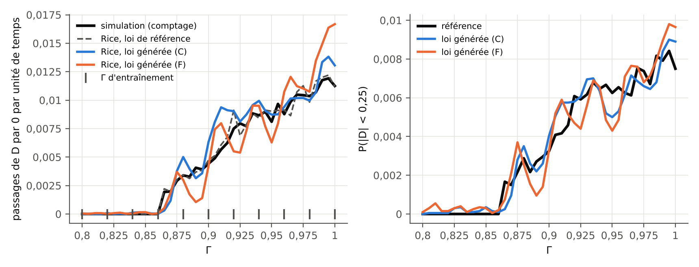
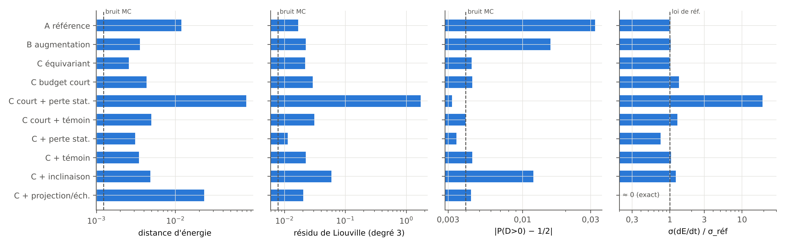
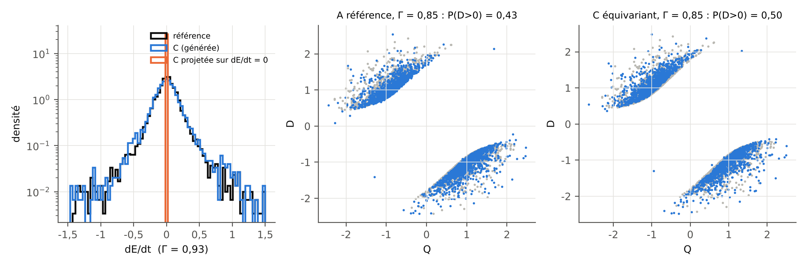
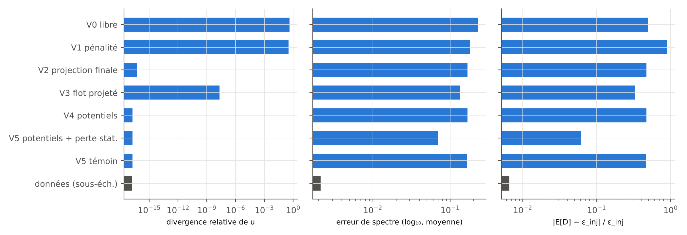
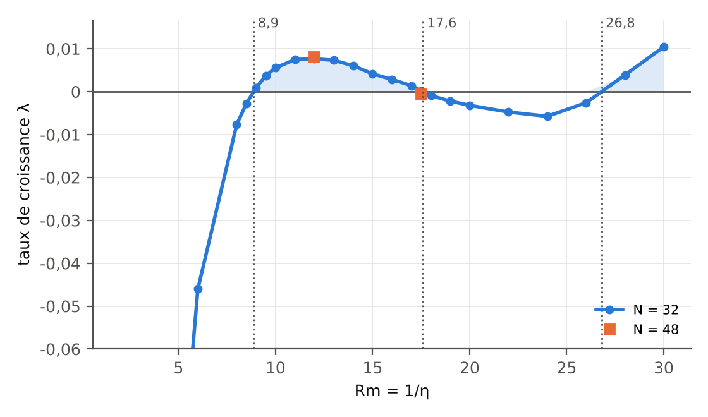

::: note
[À propos]{.tag}
Toutes les expériences de ce site tournent sur un processeur ordinaire (Intel Xeon, 4 cœurs, 2,30 GHz, sans GPU), en Python 3.13 avec NumPy 2.5, SciPy 1.18, Matplotlib 3.11 et PyTorch 2.15 (version CPU). Ce sont des **bancs d'essai à petite échelle** : ils testent des idées et des mécanismes, pas des performances sur des données de dynamo réelles. Les chiffres cités dans le [rapport](../rapport/index.html) viennent tous des fichiers de résultats décrits ici.
:::

## Organisation du code {#code}

Le dossier `experiences/` du dépôt contient tout le nécessaire pour reproduire les résultats.

| Fichier | Rôle |
|---|---|
| `common.py` | Flow matching conditionnel (chemin linéaire, schéma de Heun), réseaux (MLP, symétrisation équivariante), métriques (distance d'énergie, Wasserstein tranché), inclinaison exponentielle (I-projection régularisée). |
| `e1_gissinger.py` | E1 : loi invariante du modèle de renversements de Gissinger (2012), conditionnée par $\Gamma$ ; symétrie, identités de stationnarité, formule de Rice. Mise en cache des étapes coûteuses dans `resultats/cache_e1/`. |
| `mhd2d.py` | Solveur pseudo-spectral de la MHD 2D incompressible forcée, en potentiels $(\omega, a)$. |
| `e2_donnees.py` | E2 : instantanés MHD 2D pour onze valeurs de $\eta$ (six d'entraînement, cinq de test). |
| `e2_mhd2d.py` | E2 : cinq mécanismes de contrainte de divergence, perte de stationnarité en loi, inclinaison contre recalage par échantillon. |
| `e3_abc.py` | E3 : dynamo cinématique de l'écoulement ABC, taux de croissance en fonction de $Rm$. |
| `unet.py` | Petit U-Net périodique (non utilisé dans les résultats finaux : trop lent sur CPU, voir plus bas). |
| `figures.py` | Graphiques en français et en anglais (`figures/<nom>.png` et `figures/<nom>-en.png`). |
| `digest.py` | Condensé chiffré `resultats/digest.md`, source unique des tableaux du rapport. |

## Reproduire {#reproduire}

```bash
cd experiences
python3 e3_abc.py                 # E3, environ 25 min
python3 e2_donnees.py             # E2, données : environ 30 min
python3 e2_mhd2d.py               # E2, modèles : environ 70 min
python3 e1_gissinger.py           # E1, environ 2 à 3 h (reprenable)
python3 figures.py && python3 digest.py > resultats/digest.md
```

Chaque script accepte `--quick` pour une version réduite (de quelques minutes à une vingtaine de minutes pour E1), utile pour vérifier l'installation. Les graines sont fixées dans le code (0 et 1 pour les deux répétitions d'E1). Les durées indiquées ont été mesurées sur la machine décrite plus haut, en partie pendant que d'autres calculs tournaient.

## E1 — renversements du dipôle {#e1}

Le modèle à trois modes de Gissinger sert de « dynamo de poche » : il a la symétrie $\mathbf{B}\to-\mathbf{B}$, un seuil d'apparition des renversements (entre $\Gamma = 0{,}86$ et $0{,}865$) et une dynamique connue exactement. On y apprend la loi stationnaire $p(Q, D, V \mid \Gamma)$ par flow matching conditionnel, puis on mesure ce que changent la symétrie imposée par construction, la perte de stationnarité et la projection par échantillon. La fréquence des renversements est estimée à partir de la seule loi générée, par la formule de Rice.

En bref : le champ de vitesse équivariant garde la loi symétrique à toute valeur de $\Gamma$, alors que l'augmentation des données ne la symétrise qu'aux valeurs d'entraînement ; la projection de chaque échantillon sur $\mathrm{d}E/\mathrm{d}t = 0$ multiplie par 9 la distance d'énergie à la vraie loi ; la formule de Rice retrouve la fréquence des passages avec une erreur cumulée de 14 % loin du seuil (jusqu'à 65 % en un point) et de 42 % près du seuil ; la perte de stationnarité améliore les résidus d'un bon modèle, mais échoue sur un modèle biaisé.

Résultats et discussion : [rapport, section E1](../rapport/index.html#e1). Schéma interactif : [modèle de Gissinger](../interactifs/index.html#gissinger).

{width="100%" fig-alt="Deux graphiques en fonction de Gamma de 0,80 à 1,00 : à gauche la fréquence des passages de D par zéro, nulle sous 0,865 puis croissante ; à droite la probabilité que |D| soit inférieur à 0,25."}

{width="100%" fig-alt="Quatre diagrammes en barres horizontales, une barre par variante, avec une ligne en tirets pour le plancher de bruit ou la valeur de référence."}

{width="100%" fig-alt="Trois panneaux : histogrammes de dE/dt, puis deux nuages de points dans le plan Q-D superposés à la référence grise."}

## E2 — MHD 2D et contraintes de divergence {#e2}

La MHD 2D forcée produit des champs $(\mathbf{u}, \mathbf{B})$ à divergence nulle par construction. On génère ces champs conditionnellement au paramètre $\eta$ dans la base de Fourier tronquée (220 modes indépendants par champ scalaire), qui est la base POD d'une turbulence homogène sur domaine périodique. On compare cinq façons de gérer la divergence, puis l'effet d'une contrainte en loi sur le bilan d'énergie.

Résultats et discussion : [rapport, section E2](../rapport/index.html#e2).

{width="100%" fig-alt="Trois diagrammes en barres horizontales, échelle logarithmique, pour huit variantes."}

{width="100%" fig-alt="Trois diagrammes en barres horizontales pour quatre variantes."}

Un premier essai avec un U-Net périodique sur la grille $32\times32$ (fichier `unet.py`) coûtait environ 0,3 s par pas d'entraînement sur ce processeur : cinq variantes auraient demandé plusieurs heures chacune. Le passage à la base de Fourier tronquée garde la comparaison propre (même réseau, même budget pour toutes les variantes) à un coût compatible avec un CPU. Le stage proprement dit se ferait sur GPU, avec des architectures de champ (U-Net, transformeurs, décodeurs fonctionnels).

## E3 — dynamo cinématique ABC {#e3}

L'équation d'induction avec l'écoulement ABC imposé est résolue par une méthode pseudo-spectrale $32^3$. Le taux de croissance $\lambda(Rm)$ change de signe en $Rm \approx 8{,}87$, $17{,}60$ et $26{,}80$, en accord avec les fenêtres connues. La forme rotationnelle de l'équation garde $\nabla\cdot\mathbf{B}$ à la précision machine ($\sim 10^{-16}$).

Résultats : [rapport, section E3](../rapport/index.html#e3). Schéma interactif : [dynamo ABC](../interactifs/index.html#abc-dynamo).

{width="100%" fig-alt="Courbe du taux de croissance en fonction de Rm, positive entre 8,9 et 17,6 puis au-delà de 26,8."}

## Fichiers de résultats {#resultats}

| Fichier | Contenu |
|---|---|
| `resultats/digest.md` | Tableaux chiffrés de toutes les expériences (généré). |
| `resultats/e1_gissinger.json` | E1 : configuration, statistiques des données, évaluation par variante et par $\Gamma$ (moyenne et écart-type entre graines), grille fine, planchers de bruit. |
| `resultats/e2_mhd2d.json` | E2 : configuration, évaluation par variante et par $\eta$, volet « en loi ». |
| `resultats/e3_abc.json` | E3 : taux de croissance, convergence en résolution, seuils interpolés. |
| `resultats/*.npz` | Échantillons générés et modes propres, pour les figures et les widgets. |

Les fichiers sont dans le dépôt : <https://github.com/knoel99/milady-2027/tree/main/experiences>.
