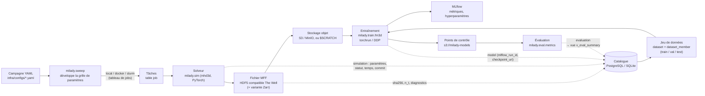
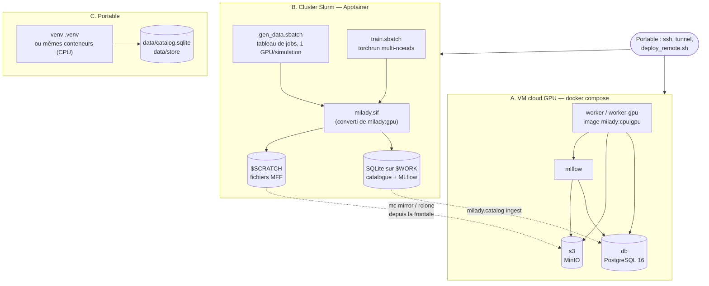

# Architecture de l'infrastructure MilaDy

Objectif : produire des **campagnes de simulations MHD paramétriques** (2D puis 3D), en faire des
**jeux de données** au format standard, **entraîner** des modèles génératifs conditionnels sous
contraintes physiques et **évaluer** leurs échantillons — de façon reproductible, sur trois cibles
(VM cloud GPU, cluster Slurm, portable), avec une trace de chaque résultat dans un catalogue.

Le contrat (arborescence, format MFF, schéma du catalogue) est dans [`../specs/infra.md`](../specs/infra.md) ;
le mode d'emploi dans [`README.md`](README.md).

## 1. Flux des données



Même chose en texte :

```
campagne YAML ──► milady.sweep ──► jobs (local | docker | slurm --array)
                                     │
                                     ▼
                         solveur milady.sim (CPU/GPU)
                                     │ écrit
                                     ▼
              fichier MFF (HDF5, The Well + attributs milady_*) ──► S3 / MinIO / $SCRATCH
                                     │ enregistre (uuid, sha256, paramètres, diagnostics)
                                     ▼
                     ┌──────────── catalogue (PostgreSQL ; SQLite hors ligne) ────────────┐
                     │ campaign · simulation · file · diagnostic · job                    │
                     │ dataset · dataset_member ─► entraînement (torchrun, MLflow) ─┐     │
                     │ model (mlflow_run_id, checkpoint_uri)  ◄─────────────────────┘     │
                     │ evaluation ─► v_eval_summary (moyenne, écart-type par métrique)    │
                     └────────────────────────────────────────────────────────────────────┘
```

Chaque objet porte un **UUID** : la simulation reçoit le même identifiant au catalogue et dans le
fichier (`milady_uuid`), ce qui permet de reconstruire ou de fusionner un catalogue à partir des
seuls fichiers (`python -m milady.catalog ingest`), par exemple après une campagne sur un cluster
sans accès réseau.

## 2. Déploiement sur les trois cibles



| | VM cloud (A) | Cluster Slurm (B) | Portable (C) |
|---|---|---|---|
| Exécution | conteneurs Docker | image Apptainer (`.sif`) | venv ou Docker |
| Image | `milady:gpu` (CUDA 12.6) / `milady:cpu` | conversion de `milady:gpu` | `milady:cpu` ou paquets PyPI |
| Catalogue | PostgreSQL (`db`) | SQLite sur `$WORK`, ingestion ultérieure | SQLite `data/` |
| Fichiers | S3 (MinIO ou bucket fournisseur) | `$SCRATCH` puis S3 | `data/store` |
| Suivi | serveur MLflow | MLflow SQLite local | MLflow (facultatif) |
| Installation | `bootstrap_vm.sh` / cloud-init / `deploy_remote.sh` | `make sif` + `sbatch` | `make setup` |

**Une seule image logicielle** : l'image GPU de la VM est la source de l'image Apptainer du cluster ;
les versions Python sont épinglées dans `infra/env/requirements*.txt`. Le dépôt est monté dans le
conteneur (`/opt/milady`, installation éditable), si bien qu'une modification du code n'exige pas de
reconstruire l'image, et que le commit exact est enregistré dans chaque fichier et au catalogue.

## 3. Choix techniques

### Format de données : HDF5 compatible *The Well*, plus attributs `milady_*`

- *The Well* (Ohana et al., NeurIPS 2024, Datasets & Benchmarks ; [format des
  données](https://polymathic-ai.org/the_well/data_format/)) est une collection de référence de
  simulations physiques pour l'apprentissage, avec une convention HDF5 simple : groupes
  `dimensions/`, `boundary_conditions/`, `t0_fields/` (scalaires), `t1_fields/` (vecteurs),
  `t2_fields/` (tenseurs), formes `(trajectoires, temps, espace…, composantes)`. S'y conformer rend nos
  données lisibles par les chargeurs et modèles de référence de la communauté, et inversement.
- HDF5 : format auto-descriptif, compressé par blocs (lecture d'un pas de temps sans tout charger),
  lu partout (h5py, Julia, ParaView/VisIt, Fortran/C des codes de simulation), sans serveur.
- Les métadonnées propres à MilaDy (code, version, commit, paramètres JSON, adimensionnement, UUID,
  diagnostics, coefficients spectraux) sont des attributs et groupes préfixés `milady_` : invisibles
  pour un lecteur *The Well*, validés par un schéma JSON (`milady/data/schema.json`).
- Variante **Zarr** (même hiérarchie) pour lire par morceaux depuis S3 sans téléchargement complet.
- Extension `fourier_fe_axisym` pour SFEMaNS (modes de Fourier × éléments finis méridiens), sans
  interpolation destructive.

### Catalogue : PostgreSQL (SQLite en mode hors ligne)

- Les résultats d'une thèse sont **relationnels** (campagne → simulations → fichiers → jeux de
  données → modèles → évaluations) et interrogés par paramètres physiques : PostgreSQL offre `JSONB`
  et ses index pour les paramètres (Rm, Re, Pm…), les contraintes d'intégrité, les vues
  (`v_eval_summary`) et des écritures concurrentes sûres depuis de nombreux jobs.
- Le même modèle SQLAlchemy fonctionne sur **SQLite** : mode portable et clusters sans réseau, puis
  ingestion dans la base centrale à partir des fichiers.
- Un fichier de schéma versionné (`infra/db/schema.sql`) et des requêtes SQL lisibles plutôt qu'un
  service supplémentaire. Le modèle SQLAlchemy (`milady/catalog/models.py`) en est l'équivalent exact
  (colonnes, types, `DEFAULT` côté serveur, contraintes, index, vue), ce que vérifie un test sur
  PostgreSQL.
- **Évolutions du schéma** : `CREATE TABLE IF NOT EXISTS` et `create_all` ne modifient jamais une table
  existante. Tant que le schéma est en version 1.0, une modification se fait à l'identique dans
  `schema.sql` et `models.py`. Dès qu'une base contient des résultats à conserver, passer à des
  migrations **Alembic** (déjà dans les dépendances) : `alembic init infra/db/migrations`,
  `target_metadata = Base.metadata`, `alembic revision --autogenerate` relu à la main, puis
  `alembic upgrade head` sur la base PostgreSQL et sur chaque catalogue SQLite de cluster.

### Stockage objet : API S3 (MinIO en local)

- L'API S3 est le standard de fait : le même code (`fsspec`/`s3fs`) écrit dans MinIO sur la VM, dans
  un bucket AWS S3, Scaleway ou OVHcloud, en changeant seulement `MILADY_STORAGE_URI` et le point
  d'accès. Les fichiers sont immuables et adressés par une convention d'URI
  (`{campagne}/{uuid}/fields.h5`), ce qui sépare clairement données lourdes et métadonnées.
- **MinIO** : serveur S3 en un seul binaire, adapté à une VM. MinIO Inc. a cessé fin 2025 de publier
  des images Docker de l'édition communautaire (constaté le 2026-11-07 : `minio/minio` et
  `quay.io/minio/minio` ne sont plus téléchargeables) ; le compose
  utilise le fork communautaire `pgsty/minio` (même code AGPLv3), remplaçable par `MINIO_IMAGE`, par
  un autre serveur compatible S3 (SeaweedFS, Garage…) ou par un bucket du fournisseur — le code MilaDy
  ne dépend que de l'API S3.

### Suivi des entraînements : MLflow

- Libre, auto-hébergeable, sans compte externe : métriques, hyperparamètres, artefacts et registre
  de modèles. Le serveur utilise PostgreSQL (base `mlflow`) et S3 (`s3://mlflow`) ; il **relaie** les
  artefacts, donc les conteneurs de calcul n'ont pas besoin des clés S3 pour journaliser.
- Sur un cluster sans Internet : base SQLite locale (`sqlite:///$WORK/milady/mlflow.db`) consultable
  après coup ; le lien avec le catalogue se fait par `model.mlflow_run_id`.

### Conteneurs : Docker sur VM, Apptainer sur HPC

- **Docker Compose** suffit pour une VM unique (pas de Kubernetes à administrer) : healthchecks,
  volumes nommés, profils `cpu` / `gpu` / `jupyter`, réservation des GPU NVIDIA.
- **Apptainer / Singularity** est le standard des centres de calcul : exécution sans root, image
  en un seul fichier `.sif`, conversion directe d'une image Docker, accès GPU par `--nv`, réseau de
  l'hôte (NCCL/InfiniBand). Jean Zay propose Singularity (Docker et Podman n'y sont pas disponibles).
- Images de base épinglées : `python:3.12.15-slim-trixie` (CPU), `pytorch/pytorch:2.14.1-cuda12.6-cudnn9-runtime`
  (GPU), `postgres:16.14-bookworm`, `ghcr.io/mlflow/mlflow:v3.17.2`.

### Ordonnancement : Slurm (tableaux de jobs, `torchrun`)

- Une simulation = un élément de tableau de jobs (1 GPU) : parallélisme trivial, relance d'un
  élément en échec, limitation du nombre simultané (`--array=0-N%16`).
- Entraînement : un `torchrun` par nœud avec rendez-vous `MASTER_ADDR:MASTER_PORT` ; le même code
  DDP tourne sur 1 GPU (VM), 8 GPU ou plusieurs nœuds (cluster).

## 4. Reproductibilité et provenance

| Élément | Où il est enregistré |
|---|---|
| Version du code | `milady_git_commit` (fichier), `simulation.git_commit`, `model.git_commit` |
| Dépendances | `infra/env/requirements*.txt` (verrou), étiquettes d'image |
| Paramètres physiques | `milady_parameters` (JSON, fichier) = `simulation.parameters` (JSONB) |
| Configuration de campagne | `campaign.config_yaml` (copie intégrale du YAML) |
| Machine et ressources | `simulation.host`, `n_gpus`, `n_cpus`, `wall_time_s`, `job.external_id` (identifiant Slurm) |
| Intégrité des données | `file.sha256`, `file.size_bytes` |
| Entraînement | `model.hyperparams`, `model.dataset_id`, `model.mlflow_run_id`, `model.checkpoint_uri` |
| Évaluation | `evaluation.seed`, `n_samples`, `parameters`, `details` |

## 5. Sécurité

Pas de secret dans le dépôt (`.env` généré sur la machine, droits 600, ignoré par git) ; ports liés
à `127.0.0.1` et accès par tunnel SSH ; compte S3 applicatif distinct du compte administrateur ;
conteneurs sans root ; sauvegardes (`pg_dump` + miroir S3) vers une cible externe avant toute
suppression de VM.
