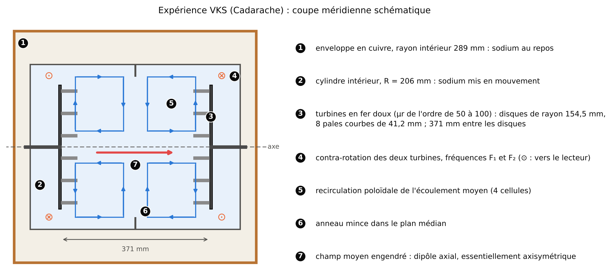

## Objectifs {#objectifs}

Un fluide conducteur en mouvement dans un champ magnétique est parcouru par des courants électriques, et ces courants créent à leur tour un champ magnétique. Si l'écoulement est assez rapide et bien organisé, le champ créé peut renforcer le champ initial au lieu de l'affaiblir : c'est l'**effet dynamo**, par lequel la Terre, le Soleil et trois expériences de sodium liquide fabriquent leur propre champ. Ce module part des équations de Maxwell vues en licence et conduit jusqu'aux questions que se pose aujourd'hui le projet MilaDy : seuils de dynamo, rôle des conditions aux limites, renversements du champ. À la fin des trente heures de travail prévues, vous saurez :

1. écrire les équations de Maxwell et la loi d'Ohm dans un conducteur en mouvement, justifier par des ordres de grandeur l'approximation qui néglige le courant de déplacement, et en déduire l'équation d'induction ;
2. calculer la diffusivité magnétique, le nombre de Reynolds magnétique $Rm$ et le nombre de Prandtl magnétique $Pm$ d'un métal liquide, et situer les expériences, le noyau terrestre et le Soleil dans le plan $(Rm, Pm)$ ;
3. démontrer le théorème du gel du flux d'Alfvén, le bilan d'énergie de la MHD et la conservation des hélicités magnétique et croisée en MHD idéale, puis établir la relation de dispersion des ondes d'Alfvén ;
4. écrire les conditions aux limites magnétiques (isolant, conducteur parfait, pseudo-vide, saut de perméabilité) et calculer les modes libres d'une sphère conductrice pour chacune d'elles ;
5. formuler la dynamo cinématique comme un problème aux valeurs propres, énoncer les théorèmes anti-dynamo de Cowling et de Zeldovich, et démontrer ce dernier en géométrie plane ;
6. résoudre la dynamo $\alpha^2$ de champ moyen (relation de dispersion, seuil, saturation), analytiquement et numériquement, et mesurer un effet $\alpha$ sur l'écoulement de G. O. Roberts ;
7. décrire les dynamos de laboratoire de Riga, Karlsruhe et Cadarache (VKS) et le projet DRESDYN, avec leurs chiffres clés et leurs sources ;
8. intégrer le modèle de renversements à trois modes de Gissinger, localiser ses points fixes et compter ses renversements en fonction du paramètre de forçage $\Gamma$.

## Prérequis {#prerequis}

Le point de départ est le niveau de deuxième année de licence (L2) en physique : les équations de Maxwell sous forme intégrale et locale dans le vide, la notion de force de Lorentz sur une charge, et les bases de la mécanique des fluides (dérivée particulaire, équation de continuité). Côté mathématiques, il faut savoir résoudre une équation différentielle linéaire à coefficients constants, diagonaliser une petite matrice et calculer une série de Fourier.

Le module [Calcul vectoriel et analyse de Fourier](../p1-calcul-vectoriel/index.html) est indispensable : on y utilise sans les redémontrer les identités vectorielles (section 2.2), les théorèmes de Stokes et de Green–Ostrogradski (chapitre 3), la fonction de courant, le potentiel vecteur et la décomposition poloïdale–toroïdale (chapitre 4), ainsi que la dérivation spectrale (chapitre 5). Le module [Mécanique des fluides et turbulence](../p2-mecanique-fluides/index.html) est recommandé pour l'équation de Navier–Stokes, le nombre de Reynolds et le bilan d'énergie cinétique, que l'on étend ici à la MHD. Pour les chapitres 5 et 7, il est utile de lire en parallèle le module [Systèmes dynamiques, bifurcations et mesures invariantes](../p4-systemes-dynamiques/index.html), qui traite les bifurcations fourche et de Hopf et les attracteurs chaotiques.

Côté programmation, il suffit de savoir utiliser NumPy et SciPy (tableaux, transformée de Fourier rapide, valeurs propres, intégration d'équations différentielles). Tous les blocs de code tournent en moins de 30 secondes sur un seul cœur.

## Plan de travail {#plan}

Le niveau indique la difficulté : 1 pour les fondations, 2 pour le cœur du module, 3 pour ce qui touche déjà aux questions de recherche du stage. Il ne redescend jamais d'une séance à la suivante.

| Séance | Durée | Niveau | Contenu | Exercices |
|:---:|:---:|:---:|---|:---:|
| 1 | 3 h | 1 | Chapitre 1 : équations de Maxwell, loi d'Ohm dans un conducteur en mouvement, approximation quasi stationnaire, $\nabla\cdot\mathbf{B} = 0$ | 1, 2 |
| 2 | 4 h | 1 | Chapitre 2 : équation d'induction, $\eta$, $Rm$, $Pm$, gel du flux, expulsion du flux par un tourbillon (code et widget) | 3, 4 |
| 3 | 5 h | 2 | Chapitre 3 : force de Lorentz, équations de la MHD, bilan d'énergie, hélicités, ondes d'Alfvén (code de bilan en MHD 2D) | 5, 6, 7 |
| 4 | 3 h | 2 | Chapitre 4 : conditions aux limites magnétiques, modes libres d'une sphère, turbines en fer doux | 8, 9 |
| 5 | 4 h | 2 | Chapitre 5, sections 5.1 à 5.3 : dynamo cinématique, borne énergétique, théorèmes anti-dynamo, exemples de dynamos | 10, 11 |
| 6 | 4 h | 3 | Chapitre 5, sections 5.4 et 5.5 : effet $\alpha$, dynamo $\alpha^2$, saturation, écoulement de Roberts (codes et widget) | 12 |
| 7 | 3 h | 3 | Chapitre 6 : dynamos de Riga, Karlsruhe, VKS et projet DRESDYN | 3 (b), 9 (c) |
| 8 | 4 h | 3 | Chapitre 7 : renversements, modèles de Pétrélis–Fauve, de Gissinger et DQVU, géodynamo, codes de simulation (code et widget) | 13, 14 |
| **Total** | **30 h** | | 7 chapitres | 14 exercices |

Chaque séance se termine par les exercices indiqués, à chercher avant de lire leur solution. Les blocs de code sont des programmes complets : recopiez-les, exécutez-les, puis modifiez leurs paramètres. Trois schémas interactifs (chapitres 2, 5 et 7) permettent de faire varier $Rm$, le nombre dynamo $C$ et le paramètre $\Gamma$ du modèle de Gissinger directement dans la page.

## 1. Rappels d'électromagnétisme {#ch1}

L'effet dynamo met en jeu des courants dans un métal liquide ou un plasma qui se déplace. Il faut donc partir des équations de Maxwell, y ajouter la loi d'Ohm écrite dans le référentiel du fluide, puis les simplifier en tenant compte de ce que les vitesses en jeu sont très petites devant celle de la lumière. Ce chapitre fait ces trois étapes et aboutit aux équations « pré-maxwelliennes » de la MHD.

### 1.1 Les équations de Maxwell

::: def
[Définition 1.1 — Équations de Maxwell]{.tag}
Dans le vide ou dans un milieu non magnétique, le champ électrique $\mathbf{E}$ et le champ magnétique $\mathbf{B}$ sont reliés à la densité de charge $\rho_e$ et à la densité de courant $\mathbf{j}$ par quatre équations locales (unités SI, $\varepsilon_0$ permittivité et $\mu_0 = 4\pi\times10^{-7}\ \mathrm{H\,m^{-1}}$ perméabilité du vide). L'équation de Maxwell–Gauss s'écrit

$$
\nabla\cdot\mathbf{E} = \frac{\rho_e}{\varepsilon_0}. \tag{1.1}
$$

L'absence de charge magnétique s'écrit

$$
\nabla\cdot\mathbf{B} = 0. \tag{1.2}
$$

La loi de Faraday relie le rotationnel du champ électrique à la variation du champ magnétique :

$$
\nabla\times\mathbf{E} = -\frac{\partial\mathbf{B}}{\partial t}. \tag{1.3}
$$

Enfin, l'équation de Maxwell–Ampère s'écrit

$$
\nabla\times\mathbf{B} = \mu_0\mathbf{j} + \mu_0\varepsilon_0\frac{\partial\mathbf{E}}{\partial t}. \tag{1.4}
$$
:::

Sous forme intégrale (théorèmes de Green–Ostrogradski et de Stokes, module 1, chapitre 3), (1.2) dit que le flux de $\mathbf{B}$ à travers toute surface fermée est nul : les lignes de champ n'ont ni source ni puits. La loi (1.3) dit que la circulation de $\mathbf{E}$ le long d'un circuit fixe vaut l'opposé de la dérivée du flux magnétique qui le traverse : c'est la force électromotrice d'induction. Le dernier terme de (1.4), $\mu_0\varepsilon_0\,\partial_t\mathbf{E}$, est le **courant de déplacement** de Maxwell ; c'est lui qui permet les ondes électromagnétiques, et c'est lui que la MHD va négliger.

:::: prop
[Proposition 1.2 — Conservation de la charge et de la contrainte $\nabla\cdot\mathbf{B} = 0$]{.tag}
(i) Les équations (1.1) et (1.4) entraînent la conservation de la charge, $\partial_t\rho_e + \nabla\cdot\mathbf{j} = 0$. (ii) La loi de Faraday (1.3) entraîne $\partial_t(\nabla\cdot\mathbf{B}) = 0$ : si $\nabla\cdot\mathbf{B} = 0$ à l'instant initial, cette propriété est conservée à tout instant.

::: proof
On utilise l'identité $\nabla\cdot(\nabla\times\mathbf{F}) = 0$ (module 1, section 2.1). (i) La divergence de (1.4) donne $0 = \mu_0\nabla\cdot\mathbf{j} + \mu_0\varepsilon_0\,\partial_t(\nabla\cdot\mathbf{E})$, et (1.1) remplace $\varepsilon_0\nabla\cdot\mathbf{E}$ par $\rho_e$. (ii) La divergence de (1.3) donne $0 = -\partial_t(\nabla\cdot\mathbf{B})$. [∎]{.qed}
:::
::::

::: note
[Remarque 1.3 — Une contrainte, pas une équation d'évolution]{.tag}
La proposition 1.2 (ii) montre que $\nabla\cdot\mathbf{B} = 0$ est une **contrainte sur la condition initiale**, que la dynamique exacte préserve. Un schéma numérique, ou un modèle génératif, ne la préserve pas automatiquement : une erreur de divergence, une fois créée, n'est pas corrigée par les équations. C'est pourquoi les codes de MHD imposent la contrainte par construction (potentiel vecteur, projection spectrale) et pourquoi le stage MilaDy demande des champs générés à divergence nulle.
:::

### 1.2 Loi d'Ohm dans un conducteur en mouvement

Dans un conducteur immobile, la densité de courant est proportionnelle au champ électrique, $\mathbf{j} = \sigma\mathbf{E}$, où $\sigma$ est la conductivité électrique (en $\mathrm{S\,m^{-1}}$). Pour un fluide, cette loi vaut dans le référentiel où l'élément de fluide est au repos.

::: def
[Définition 1.4 — Loi d'Ohm pour un fluide conducteur]{.tag}
Si le fluide a la vitesse $\mathbf{u}(\mathbf{x}, t)$ très petite devant la vitesse de la lumière $c$, le champ électrique vu par l'élément de fluide est $\mathbf{E}' = \mathbf{E} + \mathbf{u}\times\mathbf{B}$, et la loi d'Ohm s'écrit

$$
\mathbf{j} = \sigma\,(\mathbf{E} + \mathbf{u}\times\mathbf{B}). \tag{1.5}
$$
:::

Le terme $\mathbf{u}\times\mathbf{B}$ est le **champ électromoteur** : une charge $q$ entraînée par le fluide subit la force $q\,\mathbf{u}\times\mathbf{B}$, exactement comme les électrons d'une barre conductrice que l'on déplace dans un aimant. La transformation $\mathbf{E}' = \mathbf{E} + \mathbf{u}\times\mathbf{B}$ est la limite galiléenne de la transformation de Lorentz des champs ; les corrections sont d'ordre $(u/c)^2$, soit environ $10^{-15}$ pour un métal liquide à $10\ \mathrm{m\,s^{-1}}$. L'exercice 2 applique (1.5) au disque de Faraday, l'ancêtre de toutes les dynamos.

### 1.3 L'approximation quasi stationnaire

Dans un bon conducteur en mouvement lent, deux simplifications s'imposent : les charges se neutralisent presque instantanément, et le courant de déplacement est négligeable. On les justifie par des ordres de grandeur, en notant $L$ une longueur, $U$ une vitesse et $T = L/U$ un temps caractéristiques de l'écoulement.

:::: prop
[Proposition 1.5 — Approximation des régimes quasi stationnaires (ARQS)]{.tag}
On suppose $U \ll c$ et le temps de relaxation des charges $\tau_e = \varepsilon_0/\sigma$ très petit devant $T$. Alors (i) toute densité de charge libre disparaît en un temps de l'ordre de $\tau_e$ ; (ii) le courant de déplacement est d'ordre $(U/c)^2$ par rapport à $\nabla\times\mathbf{B}$ et peut être négligé ; (iii) la force électrique $\rho_e\mathbf{E}$ est négligeable devant la force magnétique $\mathbf{j}\times\mathbf{B}$. Les équations du champ se réduisent alors à

$$
\nabla\times\mathbf{B} = \mu_0\mathbf{j}, \qquad \nabla\cdot\mathbf{B} = 0, \qquad \nabla\times\mathbf{E} = -\partial_t\mathbf{B}, \qquad \mathbf{j} = \sigma(\mathbf{E} + \mathbf{u}\times\mathbf{B}), \tag{1.6}
$$

qui entraînent $\nabla\cdot\mathbf{j} = 0$.

::: proof
*Esquisse.* (i) Dans un conducteur au repos, la conservation de la charge et la loi d'Ohm donnent $\partial_t\rho_e = -\sigma\nabla\cdot\mathbf{E} = -(\sigma/\varepsilon_0)\rho_e$ : la charge décroît comme $e^{-t/\tau_e}$. Pour le sodium, $\tau_e \approx 10^{-18}$ s (code ci-dessous), si bien qu'à toute échelle de temps hydrodynamique la charge est en équilibre et n'intervient plus que par la condition $\nabla\cdot\mathbf{j} \approx 0$.

(ii) La loi d'Ohm montre que $\mathbf{E}$ est de l'ordre du champ électromoteur, $E \sim UB$. Le courant de déplacement est donc d'ordre $\mu_0\varepsilon_0 E/T \sim UB/(c^2 T) = U^2 B/(c^2 L)$, à comparer à $|\nabla\times\mathbf{B}| \sim B/L$. Le rapport vaut $(U/c)^2$.

(iii) La loi de Gauss donne $\rho_e \sim \varepsilon_0 E/L \sim \varepsilon_0 UB/L$, donc $\rho_e E \sim \varepsilon_0 U^2 B^2/L$, alors que $|\mathbf{j}\times\mathbf{B}| \sim B^2/(\mu_0 L)$. Le rapport vaut encore $\mu_0\varepsilon_0 U^2 = (U/c)^2$. Enfin la divergence de $\nabla\times\mathbf{B} = \mu_0\mathbf{j}$ donne $\nabla\cdot\mathbf{j} = 0$. [∎]{.qed}
:::
::::

::: ex
[Exemple 1.6 — Ordres de grandeur pour le sodium liquide]{.tag}
Le sodium liquide est le fluide des trois dynamos de laboratoire. Vers 120 °C, Nore et al. (2018, §2.1) donnent $\sigma = 9{,}6\times10^{6}\ \mathrm{S\,m^{-1}}$, $\rho = 932\ \mathrm{kg\,m^{-3}}$ et $\nu = 6{,}78\times10^{-7}\ \mathrm{m^2\,s^{-1}}$. Le code suivant calcule, pour une vitesse de $10\ \mathrm{m\,s^{-1}}$ et une longueur de $0{,}2$ m (des valeurs typiques d'une expérience, choisies ici à titre d'illustration), les grandeurs de la proposition 1.5 et les nombres sans dimension du chapitre 2.
:::

```python
import numpy as np

mu0, eps0, c = 4e-7 * np.pi, 8.854e-12, 2.998e8

# Sodium liquide vers 120 °C (valeurs de Nore et al. 2018, §2.1)
sigma, rho, nu = 9.6e6, 932.0, 6.78e-7
U, L = 10.0, 0.2                    # vitesse et rayon typiques d'une expérience (m/s, m)

eta = 1 / (mu0 * sigma)             # diffusivité magnétique (m²/s)
tau_e = eps0 / sigma                # temps de relaxation des charges (s)
print(f"eta        = {eta:.3f} m²/s")
print(f"tau_e      = {tau_e:.1e} s   (à comparer à L/U = {L/U:.2f} s)")
print(f"(U/c)^2    = {(U/c)**2:.1e}  (poids du courant de déplacement)")
print(f"tau_eta    = L²/eta = {L**2/eta:.2f} s")
print(f"Re = {U*L/nu:.1e},  Rm = {U*L/eta:.1f},  Pm = nu/eta = {nu/eta:.2e}")
# Vitesse d'Alfvén d'un champ de 40 G = 4 mT dans le sodium
B = 4e-3
vA = B / np.sqrt(mu0 * rho)
print(f"v_A(40 G)  = {vA:.3f} m/s,  rapport U/v_A = {U/vA:.0f}")
# sortie :
# eta        = 0.083 m²/s
# tau_e      = 9.2e-19 s   (à comparer à L/U = 0.02 s)
# (U/c)^2    = 1.1e-15  (poids du courant de déplacement)
# tau_eta    = L²/eta = 0.48 s
# Re = 2.9e+06,  Rm = 24.1,  Pm = nu/eta = 8.18e-06
# v_A(40 G)  = 0.117 m/s,  rapport U/v_A = 86
```

Le temps de relaxation des charges ($10^{-18}$ s) et le poids du courant de déplacement ($10^{-15}$) sont si petits que l'ARQS est exacte en pratique. Le nombre de Prandtl magnétique obtenu, $8{,}2\times10^{-6}$, est celui que donnent Nore et al. (2018), $0{,}82\times10^{-5}$. La dernière ligne anticipe le chapitre 3 : un champ de 40 gauss, l'ordre de grandeur mesuré dans VKS au-dessus du seuil (Monchaux et al., 2007), correspond à une vitesse d'Alfvén de $0{,}12\ \mathrm{m\,s^{-1}}$, très inférieure à la vitesse du fluide ; l'énergie magnétique y reste faible devant l'énergie cinétique.

:::: recap
::: recap-title
Ce qu'il faut retenir — chapitre 1
:::
- La loi d'Ohm s'écrit dans le référentiel du fluide : $\mathbf{j} = \sigma(\mathbf{E} + \mathbf{u}\times\mathbf{B})$ ; le terme $\mathbf{u}\times\mathbf{B}$ est le champ électromoteur.
- Pour $U \ll c$ et $\tau_e = \varepsilon_0/\sigma \ll L/U$, on néglige le courant de déplacement et la charge : $\nabla\times\mathbf{B} = \mu_0\mathbf{j}$ et $\nabla\cdot\mathbf{j} = 0$.
- $\nabla\cdot\mathbf{B} = 0$ est une contrainte initiale conservée par la dynamique exacte, mais pas par un schéma numérique ou un modèle génératif qui ne l'impose pas.
::::

## 2. Équation d'induction, nombre de Reynolds magnétique et gel du flux {#ch2}

L'équation d'induction décrit comment l'écoulement transporte, étire et diffuse le champ magnétique. Elle est le cœur de toute la théorie de la dynamo : selon la valeur d'un seul nombre sans dimension, le nombre de Reynolds magnétique, le champ se comporte comme un colorant qui diffuse ou comme un ensemble de fils élastiques attachés au fluide.

### 2.1 Établissement

:::: thm
[Théorème 2.1 — Équation d'induction]{.tag}
Sous les hypothèses de l'ARQS (proposition 1.5) et pour une conductivité uniforme, le champ magnétique vérifie

$$
\frac{\partial\mathbf{B}}{\partial t} = \nabla\times(\mathbf{u}\times\mathbf{B}) + \eta\,\Delta\mathbf{B}, \qquad \eta = \frac{1}{\mu_0\sigma}, \tag{2.1}
$$

où $\eta$ (en $\mathrm{m^2\,s^{-1}}$) est la **diffusivité magnétique**. Si $\sigma$ varie en espace, le terme de diffusion devient $-\nabla\times(\eta\,\nabla\times\mathbf{B})$.

::: proof
D'après (1.6), $\mathbf{j} = \nabla\times\mathbf{B}/\mu_0$ et la loi d'Ohm donne $\mathbf{E} = \mathbf{j}/\sigma - \mathbf{u}\times\mathbf{B} = \eta\,\nabla\times\mathbf{B} - \mathbf{u}\times\mathbf{B}$. La loi de Faraday s'écrit alors

$$
\frac{\partial\mathbf{B}}{\partial t} = -\nabla\times\mathbf{E} = \nabla\times(\mathbf{u}\times\mathbf{B}) - \nabla\times(\eta\,\nabla\times\mathbf{B}).
$$

Si $\eta$ est uniforme, l'identité $\nabla\times(\nabla\times\mathbf{B}) = \nabla(\nabla\cdot\mathbf{B}) - \Delta\mathbf{B}$ (module 1, section 2.1) et $\nabla\cdot\mathbf{B} = 0$ donnent $-\eta\,\nabla\times\nabla\times\mathbf{B} = \eta\,\Delta\mathbf{B}$. [∎]{.qed}
:::
::::

Trois propriétés de (2.1) reviendront sans cesse. D'abord, l'équation est **linéaire** en $\mathbf{B}$ quand $\mathbf{u}$ est donné : c'est le point de départ de la dynamo cinématique (chapitre 5). Ensuite, elle est invariante par $\mathbf{B} \to -\mathbf{B}$ ; comme la force de Lorentz est quadratique en $\mathbf{B}$, toute la MHD l'est aussi, et c'est l'origine des deux polarités équivalentes du champ terrestre (chapitre 7). Enfin, le premier terme est un rotationnel, donc sa divergence est nulle : (2.1) préserve $\nabla\cdot\mathbf{B} = 0$, comme la proposition 1.2 l'annonçait.

:::: prop
[Proposition 2.2 — Advection, étirement, diffusion]{.tag}
Si l'écoulement est incompressible ($\nabla\cdot\mathbf{u} = 0$), l'équation d'induction s'écrit

$$
\frac{\partial\mathbf{B}}{\partial t} + (\mathbf{u}\cdot\nabla)\mathbf{B} = (\mathbf{B}\cdot\nabla)\mathbf{u} + \eta\,\Delta\mathbf{B}. \tag{2.2}
$$

::: proof
La formule de produit $\nabla\times(\mathbf{u}\times\mathbf{B}) = \mathbf{u}(\nabla\cdot\mathbf{B}) - \mathbf{B}(\nabla\cdot\mathbf{u}) + (\mathbf{B}\cdot\nabla)\mathbf{u} - (\mathbf{u}\cdot\nabla)\mathbf{B}$ (module 1, section 2.2) se réduit à ses deux derniers termes quand $\nabla\cdot\mathbf{B} = \nabla\cdot\mathbf{u} = 0$. [∎]{.qed}
:::
::::

Le membre de gauche de (2.2) est la dérivée particulaire : le champ est **transporté** par le fluide. Le terme $(\mathbf{B}\cdot\nabla)\mathbf{u}$ mesure la variation de la vitesse le long d'une ligne de champ : il **étire** les lignes et les amplifie. Le laplacien les **diffuse**. L'équation (2.2) a exactement la forme de l'équation de la vorticité d'un fluide incompressible, $\partial_t\boldsymbol\omega + (\mathbf{u}\cdot\nabla)\boldsymbol\omega = (\boldsymbol\omega\cdot\nabla)\mathbf{u} + \nu\Delta\boldsymbol\omega$, avec une différence essentielle soulignée par Tobias (2021) : la vorticité est liée à la vitesse, alors que $\mathbf{B}$ est un champ indépendant tant qu'il est faible.

### 2.2 Diffusivité, temps de diffusion et nombres sans dimension

::: def
[Définition 2.3 — Temps de diffusion, $Rm$ et $Pm$]{.tag}
Pour une longueur $L$ et une vitesse $U$ caractéristiques, on définit le **temps de diffusion magnétique** $\tau_\eta = L^2/\eta$, le temps d'advection $\tau_u = L/U$, le **nombre de Reynolds magnétique** et le **nombre de Prandtl magnétique** :

$$
Rm = \frac{UL}{\eta} = \frac{\tau_\eta}{\tau_u}, \qquad Pm = \frac{\nu}{\eta} = \frac{Rm}{Re}, \tag{2.3}
$$

où $\nu$ est la viscosité cinématique et $Re = UL/\nu$ le nombre de Reynolds.
:::

En prenant $L$ comme unité de longueur et $L/U$ comme unité de temps, l'équation d'induction devient $\partial_t\mathbf{B} = \nabla\times(\mathbf{u}\times\mathbf{B}) + Rm^{-1}\Delta\mathbf{B}$. Quand $Rm \ll 1$, la diffusion domine et le champ suit à peu près le champ qu'on lui impose de l'extérieur ; quand $Rm \gg 1$, l'induction domine. Sans écoulement, chaque mode de Fourier $e^{i\mathbf{k}\cdot\mathbf{x}}$ du champ décroît comme $e^{-\eta k^2 t}$ : un champ que rien n'entretient disparaît en un temps de l'ordre de $\tau_\eta$. Tobias (2021) donne quelques ordres de grandeur : de l'ordre de $10^4$ ans pour un champ à l'échelle du noyau terrestre et de $10^9$ ans pour le Soleil. Le champ terrestre, vieux de plusieurs milliards d'années, doit donc être **entretenu** : c'est l'argument fondateur de la théorie de la dynamo.

Le tableau suivant situe les systèmes rencontrés dans ce module. Les valeurs sont des ordres de grandeur publiés, avec leur source ; elles montrent que $Pm$ est minuscule dans les métaux liquides et dans les étoiles, alors que les simulations numériques travaillent presque toujours à $Pm$ proche de 1.

| Système | $Pm$ | $Rm$ | Source |
|---|---|---|---|
| Sodium liquide (VKS, 120 °C) | $0{,}82\times10^{-5}$ | jusqu'à 49 (définition de l'article) | Nore et al. (2018) ; Monchaux et al. (2007) |
| Noyau terrestre (fer liquide) | $O(10^{-6})$ | $O(10^{3})$ | Rincon (2019) |
| Zone convective du Soleil | $10^{-6}$ à $10^{-2}$ | $10^{6}$ à $10^{10}$ | Rincon (2019) |
| Simulations numériques usuelles | $0{,}1$ à $10$ | — | Rincon (2019) |
| Simulation de VKS de référence (code LATU) | $\approx 0{,}33$ | 531 ($Re = 1594$) | Bousquet et al. (2026) |

Un $Pm$ petit a deux conséquences. D'abord, pour atteindre $Rm \sim 50$ dans le sodium, il faut $Re = Rm/Pm \sim 10^6$ à $10^7$ : l'écoulement d'une dynamo de laboratoire est toujours turbulent, et sa mise en mouvement demande des centaines de kilowatts. Ensuite, l'échelle de dissipation magnétique $\ell_\eta$ tombe dans la zone inertielle de la turbulence ; Rincon (2019, éq. 2.25) estime $\ell_\eta \sim Pm^{-3/4}\ell_\nu$, où $\ell_\nu$ est l'échelle de Kolmogorov. Le champ « voit » donc toute la turbulence aux échelles plus grandes que $\ell_\eta$, ce qui rend la dynamo plus difficile à obtenir qu'à $Pm \sim 1$ (voir le chapitre 6 et Ponty et al., 2005).

### 2.3 Le gel du flux magnétique

Quand $Rm \to \infty$, la diffusion disparaît de (2.1) et le champ devient littéralement attaché au fluide. Pour l'énoncer, on appelle **surface matérielle** une surface $S(t)$ dont chaque point se déplace à la vitesse locale du fluide.

::: prop
[Lemme 2.4 — Dérivée d'un flux à travers une surface matérielle]{.tag}
Pour tout champ $\mathbf{F}$ régulier et toute surface matérielle $S(t)$,

$$
\frac{\mathrm{d}}{\mathrm{d}t}\int_{S(t)}\mathbf{F}\cdot\mathrm{d}\mathbf{S} = \int_{S(t)}\Big[\frac{\partial\mathbf{F}}{\partial t} + \mathbf{u}\,(\nabla\cdot\mathbf{F}) - \nabla\times(\mathbf{u}\times\mathbf{F})\Big]\cdot\mathrm{d}\mathbf{S}. \tag{2.4}
$$
:::

*Esquisse de démonstration.* Entre $t$ et $t + \delta t$, la surface passe de $S$ à $S'$ ; son bord $C$ balaie une bande latérale d'aire élémentaire $(\mathbf{u}\,\delta t)\times\mathrm{d}\boldsymbol\ell$. Le théorème de Green–Ostrogradski appliqué au volume compris entre $S$, $S'$ et la bande donne

$$
\int_{S'}\mathbf{F}\cdot\mathrm{d}\mathbf{S} - \int_{S}\mathbf{F}\cdot\mathrm{d}\mathbf{S} = \delta t\int_S(\nabla\cdot\mathbf{F})\,\mathbf{u}\cdot\mathrm{d}\mathbf{S} - \delta t\oint_C\mathbf{F}\cdot(\mathbf{u}\times\mathrm{d}\boldsymbol\ell) + o(\delta t),
$$

le champ étant pris à l'instant $t$. Le produit mixte s'écrit $\mathbf{F}\cdot(\mathbf{u}\times\mathrm{d}\boldsymbol\ell) = (\mathbf{F}\times\mathbf{u})\cdot\mathrm{d}\boldsymbol\ell$, et le théorème de Stokes transforme la circulation en $\int_S\nabla\times(\mathbf{F}\times\mathbf{u})\cdot\mathrm{d}\mathbf{S} = -\int_S\nabla\times(\mathbf{u}\times\mathbf{F})\cdot\mathrm{d}\mathbf{S}$. Il reste à ajouter la variation de $\mathbf{F}$ entre $t$ et $t + \delta t$ à surface fixée, $\delta t\int_S\partial_t\mathbf{F}\cdot\mathrm{d}\mathbf{S}$, puis à diviser par $\delta t$. ∎

:::: thm
[Théorème 2.5 — Gel du flux (Alfvén, 1942)]{.tag}
Si $\eta = 0$, (i) le flux magnétique à travers toute surface matérielle est constant dans le temps ; (ii) les lignes de champ sont des lignes matérielles : deux particules de fluide situées sur une même ligne de champ y restent.

::: proof
(i) On applique (2.4) à $\mathbf{F} = \mathbf{B}$ : $\nabla\cdot\mathbf{B} = 0$, et l'équation d'induction idéale $\partial_t\mathbf{B} = \nabla\times(\mathbf{u}\times\mathbf{B})$ annule le crochet. (ii) Soit $\delta\boldsymbol\ell$ un petit segment matériel joignant deux particules voisines. Sa dérivée particulaire est la différence des vitesses de ses extrémités, $\mathrm{D}\,\delta\boldsymbol\ell/\mathrm{D}t = (\delta\boldsymbol\ell\cdot\nabla)\mathbf{u}$. En écoulement incompressible et pour $\eta = 0$, (2.2) donne $\mathrm{D}\mathbf{B}/\mathrm{D}t = (\mathbf{B}\cdot\nabla)\mathbf{u}$ : $\mathbf{B}$ et $\delta\boldsymbol\ell$ obéissent à la même équation linéaire. Si $\mathbf{B} = \lambda\,\delta\boldsymbol\ell$ à l'instant initial, l'unicité des solutions donne $\mathbf{B} = \lambda\,\delta\boldsymbol\ell$ à tout instant, avec le même $\lambda$. Un segment tangent à une ligne de champ le reste donc. [∎]{.qed}
:::
::::

La démonstration de (ii) dit plus : en écoulement incompressible et idéal, **l'intensité du champ est proportionnelle à l'allongement des lignes matérielles**. Un écoulement qui étire les éléments de fluide amplifie donc le champ ; dans un écoulement chaotique, les longueurs croissent exponentiellement et le champ aussi, au moins jusqu'à ce que la diffusion intervienne aux petites échelles. Comme $Rm$ n'est jamais infini, cette intervention est inévitable : en étirant, l'écoulement rapproche des lignes de sens opposés jusqu'à des distances où la diffusion les **reconnecte**. L'exercice 4 quantifie ce mécanisme sur un tube de flux.

### 2.4 Un exemple complet : l'expulsion du flux par un tourbillon

Plaçons un champ initialement uniforme $\mathbf{B}_0 = B_0\,\mathbf{e}_x$ dans l'écoulement cellulaire bidimensionnel de fonction de courant $\psi = \sin x\sin y$, sur la boîte $[0, 2\pi]^2$ périodique. Avec les conventions du site, $\mathbf{u} = (\partial_y\psi, -\partial_x\psi) = (\sin x\cos y, \; -\cos x\sin y)$ : quatre tourbillons de signes alternés. Le champ plan s'écrit $\mathbf{B} = (\partial_y a, -\partial_x a)$, où $a$ est le potentiel magnétique (module 1, section 4.1) ; le champ uniforme correspond à $a = B_0 y$. En « décurlant » l'équation d'induction plane, on obtient une équation d'advection–diffusion pour $a$ :

$$
\frac{\partial a}{\partial t} + \mathbf{u}\cdot\nabla a = \eta\,\Delta a. \tag{2.5}
$$

Les lignes de champ sont les lignes de niveau de $a$. On écrit $a = B_0 y + a'(x, y, t)$ avec $a'$ périodique ; $a'$ obéit à (2.5) avec le terme source $-B_0 u_y$. La moyenne de $B_x = B_0 + \partial_y a'$ reste égale à $B_0$ : le flux horizontal total est imposé.

La physique se déroule en deux temps, décrits par Weiss (1966). D'abord, chaque tourbillon enroule les lignes de champ comme un fil sur une bobine ; le champ croît linéairement en temps, parce que les lignes s'allongent. Ensuite, quand les spires deviennent assez serrées, la diffusion reconnecte les lignes de sens opposés : le champ est **expulsé** du cœur des tourbillons et se concentre dans des couches minces le long de leurs bords.

::: prop
[Proposition 2.6 — Lois d'échelle de l'expulsion (argument de couche limite)]{.tag}
À grand $Rm = UL/\eta$, l'état stationnaire concentre le flux dans des couches d'épaisseur $\delta \sim L\,Rm^{-1/2}$, où le champ vaut $B \sim B_0\,Rm^{1/2}$. L'énergie magnétique moyenne vérifie $\langle|\mathbf{B}|^2\rangle \sim B_0^2\,Rm^{1/2}$.
:::

*Argument.* Une particule longe le bord d'un tourbillon en un temps $L/U$ ; pendant ce temps, la diffusion agit sur une épaisseur $\delta$ telle que $\delta^2/\eta \sim L/U$, soit $\delta \sim L\,Rm^{-1/2}$. Le flux horizontal $B_0 L$, conservé, passe dans ces couches, d'où $B\,\delta \sim B_0 L$ et $B \sim B_0\,Rm^{1/2}$. L'énergie moyenne vaut enfin $B^2\,\delta/L \sim B_0^2\,Rm^{1/2}$. Ce n'est pas une démonstration, mais une estimation que le code suivant vérifie.

Le programme intègre $a'$ par une méthode pseudo-spectrale (dérivées en Fourier, règle des 2/3 du module 1, Runge–Kutta d'ordre 4 avec un facteur intégrant qui traite la diffusion exactement), puis mesure l'énergie et le champ maximal à l'état stationnaire pour trois valeurs de $Rm$.

```python
import numpy as np

def expulsion(Rm, N=96, T=60.0, dt=0.04):
    """Champ uniforme B0 = (1, 0) dans l'écoulement cellulaire psi = sin x sin y (boîte 2*pi).
    Potentiel a = y + a'(x, y, t) avec a' périodique :  d_t a' + u.grad a' + u_y = eta Lap a'."""
    eta = 1.0 / Rm                                  # U = L = 1, donc Rm = 1/eta
    x = np.arange(N) * 2 * np.pi / N
    X, Y = np.meshgrid(x, x, indexing="ij")
    ux, uy = np.sin(X) * np.cos(Y), -np.cos(X) * np.sin(Y)   # u = (d_y psi, -d_x psi)
    KX, KY = np.meshgrid(np.fft.fftfreq(N, 1 / N), np.fft.rfftfreq(N, 1 / N), indexing="ij")
    K2 = KX**2 + KY**2
    keep = (np.abs(KX) < N / 3) & (KY < N / 3)      # règle des 2/3
    F, iF = np.fft.rfft2, lambda h: np.fft.irfft2(h, s=(N, N))

    def rhs(ah):                                    # advection + source, en Fourier
        return -F(ux * iF(1j * KX * ah) + uy * iF(1j * KY * ah) + uy) * keep

    E = np.exp(-eta * K2 * dt / 2)                  # facteur intégrant (diffusion exacte)
    ah, hist = np.zeros(K2.shape, complex), []
    for n in range(int(round(T / dt))):             # Runge-Kutta 4 à facteur intégrant
        k1 = rhs(ah)
        k2 = rhs(E * (ah + dt / 2 * k1))
        k3 = rhs(E * ah + dt / 2 * k2)
        k4 = rhs(E**2 * ah + dt * E * k3)
        ah = E**2 * ah + dt / 6 * (E**2 * k1 + 2 * E * (k2 + k3) + k4)
        bx, by = 1 + iF(1j * KY * ah), -iF(1j * KX * ah)
        hist.append(((bx**2 + by**2).mean(), np.hypot(bx, by).max()))
    return np.array(hist)

print(" Rm   <B²>/B0²   max|B|/B0   pic transitoire de <B²>")
res = {}
for Rm in [10, 40, 160]:
    h = expulsion(Rm)
    res[Rm] = h[-1]
    print(f"{Rm:4d}   {h[-1,0]:7.2f}     {h[-1,1]:6.2f}       {h[:,0].max():6.2f}"
          f"   (variation sur les 5 derniers temps : {abs(h[-1,0]-h[-126,0]):.1e})")
p = np.polyfit(np.log([10, 40, 160]), np.log([res[r][0] for r in res]), 1)[0]
q = np.polyfit(np.log([10, 40, 160]), np.log([res[r][1] for r in res]), 1)[0]
print(f"pentes log-log : <B²> ~ Rm^{p:.2f},  max|B| ~ Rm^{q:.2f}")
# sortie :
#  Rm   <B²>/B0²   max|B|/B0   pic transitoire de <B²>
#   10      3.42       5.71         4.18   (variation sur les 5 derniers temps : 1.2e-09)
#   40      6.78      11.28        11.75   (variation sur les 5 derniers temps : 8.4e-05)
#  160     13.52      22.22        29.63   (variation sur les 5 derniers temps : 6.3e-03)
# pentes log-log : <B²> ~ Rm^0.50,  max|B| ~ Rm^0.49
```

Les pentes mesurées, $0{,}50$ et $0{,}49$, confirment la proposition 2.6. Le maximum transitoire de l'énergie dépasse nettement la valeur finale à grand $Rm$ : c'est la phase d'enroulement, avant la reconnexion. La figure montre les lignes de champ stationnaires : le flux contourne les tourbillons et se concentre sur leurs frontières.

{width="100%" fig-alt="Trois panneaux carrés montrant des lignes de champ bleues et quatre tourbillons gris ; de gauche à droite, les lignes bleues évitent de plus en plus le centre des tourbillons et se resserrent le long des lignes y = 0, y = pi et x = pi."}

Le schéma interactif suivant résout la même équation dans votre navigateur (différences finies d'ordre 3 sur une grille $128^2$, ce qui donne des valeurs à quelques pourcents près de celles du code spectral). Faites varier $Rm$ : à petit $Rm$, les lignes sont à peine déformées ; à grand $Rm$, observez l'enroulement, le pic transitoire de $\langle|\mathbf{B}|^2\rangle$, puis l'expulsion.

```{=html}
<div class="widget" id="w-expulsion" role="group" aria-label="Expulsion du flux magnétique par un écoulement cellulaire" data-en-label="Magnetic flux expulsion by a cellular flow">
  <p class="widget-title" data-en="Interactive: flux expulsion by a cellular flow">Interactif : expulsion du flux par un écoulement cellulaire</p>
  <div class="widget-controls">
    <label><span data-en="Magnetic Reynolds number Rm">Nombre de Reynolds magnétique Rm</span>
      <input type="range" name="rm" min="1" max="2.5" step="0.01" value="1.6"> <output class="rm-val">40</output></label>
    <button type="button" class="play">Pause</button>
    <button type="button" class="reset" data-en="Restart">Recommencer</button>
  </div>
  <canvas style="max-width:520px;margin:0 auto" aria-label="Lignes de champ magnétique dans quatre tourbillons" data-en-label="Magnetic field lines in four eddies"></canvas>
  <p class="widget-readout" aria-live="off"></p>
  <p class="widget-note" data-en="Blue: field lines (contours of a = y + a'). Grey: streamlines of ψ = sin x sin y. The mean horizontal flux is imposed (B₀ = 1). The simulation stops at t = 400.">En bleu : lignes de champ (iso-valeurs de a = y + a'). En gris : lignes de courant de ψ = sin x sin y. Le flux horizontal moyen est imposé (B₀ = 1). La simulation s'arrête à t = 400.</p>
</div>
```

Cet exemple n'est **pas** une dynamo : le champ est entretenu par les courants extérieurs qui imposent $B_0$. Si l'on pose $B_0 = 0$, tout champ initial finit par disparaître ; c'est le théorème de Zeldovich du chapitre 5, qui interdit toute dynamo bidimensionnelle.

:::: recap
::: recap-title
Ce qu'il faut retenir — chapitre 2
:::
- Équation d'induction : $\partial_t\mathbf{B} = \nabla\times(\mathbf{u}\times\mathbf{B}) + \eta\Delta\mathbf{B}$ avec $\eta = 1/(\mu_0\sigma)$ ; elle est linéaire en $\mathbf{B}$, invariante par $\mathbf{B} \to -\mathbf{B}$, et préserve $\nabla\cdot\mathbf{B} = 0$.
- $Rm = UL/\eta$ compare induction et diffusion ; $Pm = \nu/\eta$ vaut environ $10^{-5}$ pour le sodium, $O(10^{-6})$ dans le noyau terrestre, d'où des écoulements de dynamo toujours turbulents.
- À $\eta = 0$, le flux est gelé dans le fluide et le champ croît comme l'allongement des lignes matérielles (Alfvén) ; à $Rm$ fini, la diffusion reconnecte aux petites échelles.
- Un tourbillon expulse le flux vers ses bords, dans des couches d'épaisseur $L\,Rm^{-1/2}$ (Weiss) ; $\langle|\mathbf{B}|^2\rangle \propto Rm^{1/2}$, vérifié numériquement.
::::

## 3. Force de Lorentz, équations de la MHD et invariants {#ch3}

Le chapitre 2 traitait l'écoulement comme imposé. En réalité, les courants induits subissent la force de Lorentz, qui agit en retour sur le fluide : c'est cette rétroaction qui limite la croissance d'une dynamo. Ce chapitre écrit le système couplé, puis établit ses lois de conservation, qui fournissent les contraintes physiques et les métriques utilisées dans le stage.

### 3.1 La force de Lorentz : tension et pression magnétiques

Un volume de fluide parcouru par la densité de courant $\mathbf{j}$ subit la force volumique $\mathbf{j}\times\mathbf{B}$ (on a vu à la proposition 1.5 que la force électrique est négligeable).

:::: prop
[Proposition 3.1 — Décomposition de la force de Lorentz]{.tag}
Avec $\mathbf{j} = \nabla\times\mathbf{B}/\mu_0$,

$$
\mathbf{j}\times\mathbf{B} = \frac{1}{\mu_0}(\mathbf{B}\cdot\nabla)\mathbf{B} - \nabla\Big(\frac{|\mathbf{B}|^2}{2\mu_0}\Big). \tag{3.1}
$$

Le premier terme est une **tension magnétique** dirigée vers le centre de courbure des lignes de champ, d'intensité $|\mathbf{B}|^2/(\mu_0 R_c)$ où $R_c$ est le rayon de courbure ; le second est le gradient d'une **pression magnétique** $|\mathbf{B}|^2/(2\mu_0)$.

::: proof
L'identité $(\nabla\times\mathbf{B})\times\mathbf{B} = (\mathbf{B}\cdot\nabla)\mathbf{B} - \nabla(|\mathbf{B}|^2/2)$ se vérifie en notation indicielle : $[(\nabla\times\mathbf{B})\times\mathbf{B}]_i = \varepsilon_{ijk}\varepsilon_{jlm}\,\partial_l B_m\,B_k = (\delta_{kl}\delta_{im} - \delta_{km}\delta_{il})\,\partial_l B_m\,B_k = B_k\partial_k B_i - B_k\partial_i B_k$ (module 1, lemme 1.12). Pour l'interprétation, on écrit $\mathbf{B} = B\,\mathbf{t}$ avec $\mathbf{t}$ le vecteur unitaire tangent et $s$ l'abscisse le long de la ligne : $(\mathbf{B}\cdot\nabla)\mathbf{B} = B\,\partial_s(B\mathbf{t}) = \mathbf{t}\,\partial_s(B^2/2) + B^2\,\mathbf{n}/R_c$, où $\mathbf{n}$ est la normale principale (formule de Frenet). [∎]{.qed}
:::
::::

Les lignes de champ se comportent donc comme des **élastiques tendus** qui se repoussent latéralement. La partie $\mathbf{t}\,\partial_s(B^2/2)$ de la tension compense exactement la composante de la pression le long des lignes : la force de Lorentz est toujours perpendiculaire à $\mathbf{B}$, ce qui se voit aussi sur $\mathbf{j}\times\mathbf{B}$. L'exercice 5 calcule ces deux termes pour le champ d'un fil.

### 3.2 Les équations de la MHD incompressible

::: def
[Définition 3.2 — MHD incompressible et unités d'Alfvén]{.tag}
Pour un fluide de masse volumique $\rho$ uniforme, de viscosité $\nu$ et de diffusivité magnétique $\eta$, soumis à une force volumique $\rho\mathbf{f}$, les équations de la MHD incompressible sont l'équation de Navier–Stokes avec force de Lorentz,

$$
\frac{\partial\mathbf{u}}{\partial t} + (\mathbf{u}\cdot\nabla)\mathbf{u} = -\frac{1}{\rho}\nabla p + \frac{1}{\rho}\,\mathbf{j}\times\mathbf{B} + \nu\Delta\mathbf{u} + \mathbf{f}, \tag{3.2}
$$

l'équation d'induction (2.1), et les contraintes $\nabla\cdot\mathbf{u} = 0$, $\nabla\cdot\mathbf{B} = 0$. En mesurant le champ en **unités d'Alfvén**, c'est-à-dire en remplaçant $\mathbf{B}$ par $\mathbf{B}/\sqrt{\mu_0\rho}$ (une vitesse), et en notant $\mathbf{j} = \nabla\times\mathbf{B}$, le système devient

$$
\partial_t\mathbf{u} + (\mathbf{u}\cdot\nabla)\mathbf{u} = -\nabla P + \mathbf{j}\times\mathbf{B} + \nu\Delta\mathbf{u} + \mathbf{f}, \qquad \partial_t\mathbf{B} = \nabla\times(\mathbf{u}\times\mathbf{B}) + \eta\Delta\mathbf{B}, \tag{3.3}
$$

avec $P = p/\rho$. La norme $v_A = |\mathbf{B}|/\sqrt{\mu_0\rho}$ du champ en unités d'Alfvén s'appelle la **vitesse d'Alfvén**.
:::

C'est la convention adoptée dans tout le site et celle des codes pseudo-spectraux (Ponty et al., 2005). En adimensionnant par $L$ et $U$, les coefficients deviennent $1/Re$ et $1/Rm$. Les codes qui simulent les expériences ajoutent des propriétés matérielles variables : SFEMaNS résout par exemple $\partial_t\mathbf{B} = \nabla\times(\mathbf{u}\times\mathbf{B}) - Rm^{-1}\nabla\times\big(\sigma_r^{-1}\nabla\times(\mathbf{B}/\mu_r)\big)$, où $\sigma_r$ et $\mu_r$ sont la conductivité et la perméabilité relatives (Nore et al., 2018) ; on y revient au chapitre 4.

### 3.3 Le bilan d'énergie

On se place dans une boîte périodique (ou dans un domaine dont les bords n'échangent ni énergie ni flux) et on note $\langle\cdot\rangle$ la moyenne spatiale. Les énergies cinétique et magnétique par unité de masse sont $E_K = \tfrac12\langle|\mathbf{u}|^2\rangle$ et $E_M = \tfrac12\langle|\mathbf{B}|^2\rangle$ (unités d'Alfvén).

:::: thm
[Théorème 3.3 — Bilan d'énergie de la MHD]{.tag}
Pour une solution régulière de (3.3) dans une boîte périodique, avec $\boldsymbol\omega = \nabla\times\mathbf{u}$,

$$
\frac{\mathrm{d}E_K}{\mathrm{d}t} = \langle\mathbf{u}\cdot(\mathbf{j}\times\mathbf{B})\rangle - \nu\langle|\boldsymbol\omega|^2\rangle + \langle\mathbf{u}\cdot\mathbf{f}\rangle, \tag{3.4}
$$

$$
\frac{\mathrm{d}E_M}{\mathrm{d}t} = -\langle\mathbf{u}\cdot(\mathbf{j}\times\mathbf{B})\rangle - \eta\langle|\mathbf{j}|^2\rangle. \tag{3.5}
$$

L'énergie totale $E = E_K + E_M$ vérifie donc $\mathrm{d}E/\mathrm{d}t = \langle\mathbf{u}\cdot\mathbf{f}\rangle - \nu\langle|\boldsymbol\omega|^2\rangle - \eta\langle|\mathbf{j}|^2\rangle$ : le terme d'échange disparaît.

::: proof
*Énergie cinétique.* On multiplie scalairement (3.3) par $\mathbf{u}$ et on prend la moyenne. Le terme d'advection donne $\langle\mathbf{u}\cdot(\mathbf{u}\cdot\nabla)\mathbf{u}\rangle = \langle\mathbf{u}\cdot\nabla(|\mathbf{u}|^2/2)\rangle = -\langle(\nabla\cdot\mathbf{u})\,|\mathbf{u}|^2/2\rangle = 0$, par intégration par parties sur la boîte périodique. De même $\langle\mathbf{u}\cdot\nabla P\rangle = -\langle P\,\nabla\cdot\mathbf{u}\rangle = 0$. Le terme visqueux donne $\nu\langle\mathbf{u}\cdot\Delta\mathbf{u}\rangle = -\nu\langle|\nabla\mathbf{u}|^2\rangle$, et pour un champ périodique à divergence nulle $\langle|\nabla\mathbf{u}|^2\rangle = \langle|\boldsymbol\omega|^2\rangle$ (égalité de Parseval, module 1, chapitre 5 : $|\mathbf{k}|^2|\hat{\mathbf{u}}|^2 = |\mathbf{k}\times\hat{\mathbf{u}}|^2$ quand $\mathbf{k}\cdot\hat{\mathbf{u}} = 0$).

*Énergie magnétique.* On multiplie l'équation d'induction par $\mathbf{B}$. L'identité $\nabla\cdot(\mathbf{F}\times\mathbf{G}) = \mathbf{G}\cdot(\nabla\times\mathbf{F}) - \mathbf{F}\cdot(\nabla\times\mathbf{G})$ donne, en moyenne sur la boîte, $\langle\mathbf{B}\cdot\nabla\times\mathbf{F}\rangle = \langle\mathbf{F}\cdot\nabla\times\mathbf{B}\rangle$. Avec $\mathbf{F} = \mathbf{u}\times\mathbf{B}$, on obtient $\langle\mathbf{j}\cdot(\mathbf{u}\times\mathbf{B})\rangle = -\langle\mathbf{u}\cdot(\mathbf{j}\times\mathbf{B})\rangle$ par antisymétrie du produit mixte. Enfin $\eta\langle\mathbf{B}\cdot\Delta\mathbf{B}\rangle = -\eta\langle|\mathbf{j}|^2\rangle$ comme pour la vitesse. [∎]{.qed}
:::
::::

Le terme $W = \langle\mathbf{u}\cdot(\mathbf{j}\times\mathbf{B})\rangle$ est la puissance de la force de Lorentz sur l'écoulement. Quand $W < 0$, l'écoulement travaille contre la force de Lorentz et cède de l'énergie au champ : c'est ainsi qu'une dynamo convertit l'énergie mécanique (fournie par les moteurs dans VKS, par la convection dans le noyau terrestre) en énergie magnétique. En unités SI, (3.5) s'écrit $\frac{\mathrm{d}}{\mathrm{d}t}\int\frac{|\mathbf{B}|^2}{2\mu_0}\,\mathrm{d}V = -\int\mathbf{u}\cdot(\mathbf{j}\times\mathbf{B})\,\mathrm{d}V - \int\frac{|\mathbf{j}|^2}{\sigma}\,\mathrm{d}V$, où le dernier terme est l'effet Joule (Tobias, 2021, éq. 2.11–2.12). Dans un domaine borné, il s'ajoute un flux du vecteur de Poynting à travers le bord.

::: key
[À retenir — Bilan moyen en régime stationnaire]{.tag}
En régime statistiquement stationnaire, la moyenne temporelle (ou d'ensemble) de $\mathrm{d}E/\mathrm{d}t$ est nulle, d'où

$$
\mathbb{E}\big[\langle\mathbf{u}\cdot\mathbf{f}\rangle\big] = \nu\,\mathbb{E}\big[\langle|\boldsymbol\omega|^2\rangle\big] + \eta\,\mathbb{E}\big[\langle|\mathbf{j}|^2\rangle\big].
$$

Cette égalité porte sur la **loi** des champs, pas sur chaque instantané : un champ isolé peut avoir une énergie qui croît ou décroît. C'est la forme sous laquelle le stage impose le bilan d'énergie à un modèle génératif.
:::

### 3.4 Hélicités et invariants idéaux

::: def
[Définition 3.4 — Hélicités]{.tag}
Pour $\mathbf{B} = \nabla\times\mathbf{A}$, on définit l'**hélicité magnétique** $H_M = \langle\mathbf{A}\cdot\mathbf{B}\rangle$, l'**hélicité croisée** $H_C = \langle\mathbf{u}\cdot\mathbf{B}\rangle$ et l'**hélicité cinétique** $H_K = \langle\mathbf{u}\cdot\boldsymbol\omega\rangle$.
:::

Le potentiel vecteur n'est défini qu'à un gradient près ; dans une boîte périodique où $\langle\mathbf{B}\rangle = 0$, $H_M$ ne dépend pourtant pas de ce choix, car $\langle\nabla\chi\cdot\mathbf{B}\rangle = -\langle\chi\,\nabla\cdot\mathbf{B}\rangle = 0$. En domaine borné, cette invariance exige $\mathbf{B}\cdot\mathbf{n} = 0$ au bord (Berger et Field, 1984 ; module 1, proposition 4.10). Moffatt (1969) a montré que l'hélicité mesure l'**enlacement** des tubes de flux : deux tubes fermés enlacés une fois, de flux $\Phi_1$ et $\Phi_2$, contribuent $\pm2\Phi_1\Phi_2$ à l'intégrale de $\mathbf{A}\cdot\mathbf{B}$.

:::: thm
[Théorème 3.5 — Invariants de la MHD idéale]{.tag}
Dans une boîte périodique, avec $\langle\mathbf{B}\rangle = 0$, les solutions régulières de (3.3) vérifient

$$
\frac{\mathrm{d}H_M}{\mathrm{d}t} = -2\eta\,\langle\mathbf{j}\cdot\mathbf{B}\rangle, \qquad \frac{\mathrm{d}H_C}{\mathrm{d}t} = -(\nu + \eta)\,\langle\boldsymbol\omega\cdot\mathbf{j}\rangle + \langle\mathbf{f}\cdot\mathbf{B}\rangle. \tag{3.6}
$$

En MHD idéale ($\nu = \eta = 0$, $\mathbf{f} = 0$), l'énergie $E$, l'hélicité magnétique $H_M$ et l'hélicité croisée $H_C$ sont donc conservées ; l'invariance de $H_M$ a été établie par Woltjer (1958). L'hélicité cinétique, invariante en hydrodynamique idéale (Moffatt, 1969), ne l'est plus en MHD (Pouquet et al., 2019).

::: proof
*Hélicité magnétique.* L'équation d'induction « décurlée » s'écrit $\partial_t\mathbf{A} = \mathbf{u}\times\mathbf{B} - \eta\,\mathbf{j} - \nabla\phi$, où $\phi$ dépend de la jauge. Alors

$$
\frac{\mathrm{d}H_M}{\mathrm{d}t} = \langle\partial_t\mathbf{A}\cdot\mathbf{B}\rangle + \langle\mathbf{A}\cdot\nabla\times\partial_t\mathbf{A}\rangle = 2\,\langle\partial_t\mathbf{A}\cdot\mathbf{B}\rangle,
$$

car $\langle\mathbf{A}\cdot\nabla\times\mathbf{G}\rangle = \langle\mathbf{G}\cdot\nabla\times\mathbf{A}\rangle$ (identité utilisée au théorème 3.3). Or $(\mathbf{u}\times\mathbf{B})\cdot\mathbf{B} = 0$ et $\langle\nabla\phi\cdot\mathbf{B}\rangle = 0$, d'où le résultat.

*Hélicité croisée.* On écrit l'équation de la vitesse sous la forme $\partial_t\mathbf{u} = \mathbf{u}\times\boldsymbol\omega + \mathbf{j}\times\mathbf{B} - \nabla\Pi + \nu\Delta\mathbf{u} + \mathbf{f}$, avec $\Pi = P + |\mathbf{u}|^2/2$. Dans $\mathrm{d}H_C/\mathrm{d}t = \langle\mathbf{B}\cdot\partial_t\mathbf{u}\rangle + \langle\mathbf{u}\cdot\partial_t\mathbf{B}\rangle$, les termes non linéaires sont $\langle\mathbf{B}\cdot(\mathbf{u}\times\boldsymbol\omega)\rangle + \langle\mathbf{u}\cdot\nabla\times(\mathbf{u}\times\mathbf{B})\rangle = \langle\mathbf{B}\cdot(\mathbf{u}\times\boldsymbol\omega)\rangle + \langle\boldsymbol\omega\cdot(\mathbf{u}\times\mathbf{B})\rangle$, et ces deux produits mixtes sont opposés. Les termes $\langle\mathbf{B}\cdot(\mathbf{j}\times\mathbf{B})\rangle$ et $\langle\mathbf{B}\cdot\nabla\Pi\rangle$ sont nuls. Il reste $\nu\langle\mathbf{B}\cdot\Delta\mathbf{u}\rangle + \eta\langle\mathbf{u}\cdot\Delta\mathbf{B}\rangle = -(\nu + \eta)\langle\mathbf{j}\cdot\boldsymbol\omega\rangle$ (même argument de Parseval qu'au théorème 3.3) et le terme de forçage. [∎]{.qed}
:::
::::

Les invariants quadratiques organisent la turbulence MHD. Comme l'énergie se dissipe plus vite que l'hélicité magnétique, l'énergie cascade vers les petites échelles tandis que $H_M$ subit une **cascade inverse** vers les grandes échelles, qui peut favoriser l'apparition de champs à grande échelle (Tobias, 2021 ; Pouquet et al., 2019). En deux dimensions, $\mathbf{A} = a\,\mathbf{e}_z$ est perpendiculaire au champ plan et $H_M = 0$ ; les invariants quadratiques idéaux sont alors l'énergie, l'hélicité croisée et le **potentiel quadratique** $\langle a^2\rangle$ (Krstulovic et al., 2011). L'exercice 7 montre qu'un champ hélicitaire ne peut pas se dissiper sans perdre son hélicité.

### 3.5 Les ondes d'Alfvén

La tension magnétique joue le rôle de la tension d'une corde : une ligne de champ déplacée revient vers sa position d'équilibre et oscille. Alfvén (1942) en a déduit l'existence d'ondes propres aux fluides conducteurs.

:::: prop
[Proposition 3.6 — Relation de dispersion des ondes d'Alfvén]{.tag}
On linéarise (3.3) sans dissipation ni forçage autour du repos et d'un champ uniforme $\mathbf{B}_0$ (unités d'Alfvén), en écrivant $\mathbf{B} = \mathbf{B}_0 + \mathbf{b}$ avec $\mathbf{u}$ et $\mathbf{b}$ petits. Les perturbations obéissent à $\partial_t\mathbf{u} = (\mathbf{B}_0\cdot\nabla)\mathbf{b}$ et $\partial_t\mathbf{b} = (\mathbf{B}_0\cdot\nabla)\mathbf{u}$. Une perturbation en $e^{i(\mathbf{k}\cdot\mathbf{x} - \omega t)}$ vérifie

$$
\omega^2 = (\mathbf{k}\cdot\mathbf{B}_0)^2. \tag{3.7}
$$

Les **variables d'Elsässer** $\mathbf{z}^\pm = \mathbf{u} \pm \mathbf{b}$ découplent le système : $\partial_t\mathbf{z}^\pm = \pm(\mathbf{B}_0\cdot\nabla)\mathbf{z}^\pm$.

::: proof
Au premier ordre, $\mathbf{j}\times\mathbf{B} \approx (\nabla\times\mathbf{b})\times\mathbf{B}_0 = (\mathbf{B}_0\cdot\nabla)\mathbf{b} - \nabla(\mathbf{B}_0\cdot\mathbf{b})$ d'après (3.1), et $\nabla\times(\mathbf{u}\times\mathbf{B}_0) = (\mathbf{B}_0\cdot\nabla)\mathbf{u}$ d'après la formule de produit, $\mathbf{B}_0$ étant uniforme et $\mathbf{u}$ à divergence nulle. Le gradient se regroupe avec la pression totale perturbée $P' + \mathbf{B}_0\cdot\mathbf{b}$ ; en prenant la divergence de l'équation de la vitesse, cette pression totale est harmonique, donc nulle dans une boîte périodique. On obtient les deux équations annoncées ; en ajoutant et en retranchant, $\partial_t\mathbf{z}^\pm = \pm(\mathbf{B}_0\cdot\nabla)\mathbf{z}^\pm$, et chaque mode de Fourier donne $\omega = \mp\,\mathbf{k}\cdot\mathbf{B}_0$. [∎]{.qed}
:::
::::

Les ondes d'Alfvén sont transverses (car $\mathbf{k}\cdot\hat{\mathbf{u}} = 0$), non dispersives, et transportent l'énergie le long des lignes de champ à la vitesse $v_A$, quelle que soit la direction de $\mathbf{k}$. Les paquets $\mathbf{z}^+$ et $\mathbf{z}^-$ se propagent en sens opposés ; dans les équations complètes, la non-linéarité s'écrit $(\mathbf{z}^\mp\cdot\nabla)\mathbf{z}^\pm$, si bien que seuls des paquets qui se croisent interagissent. L'exercice 6 ajoute la viscosité et la diffusivité.

::: ex
[Exemple 3.7 — Vérification numérique des bilans en MHD 2D]{.tag}
En 2D, avec $\mathbf{u} = (\partial_y\psi, -\partial_x\psi)$ et $\mathbf{B} = (\partial_y a, -\partial_x a)$, la vorticité et le courant sont des scalaires, $\omega = -\Delta\psi$ et $j = -\Delta a$, et (3.3) devient

$$
\partial_t\omega + \mathbf{u}\cdot\nabla\omega = \mathbf{B}\cdot\nabla j + \nu\Delta\omega, \qquad \partial_t a + \mathbf{u}\cdot\nabla a = \eta\Delta a.
$$

Le code suivant part de la condition initiale d'Orszag et Tang (1979), sous la forme $\psi = 2(\cos x + \cos y)$, $a = 2\cos x + \cos 2y$ donnée par Krstulovic et al. (2011). Il vérifie d'abord qu'en MHD idéale tronquée (règle des 2/3), $E$, $H_C$ et $\langle a^2\rangle$ sont conservés alors que $E_K$ et $E_M$ échangent de l'énergie ; puis, avec $\nu = \eta = 0{,}02$, il compare les dérivées temporelles mesurées aux membres de droite de (3.4), (3.5), (3.6) et de $\mathrm{d}\langle a^2\rangle/\mathrm{d}t = -2\eta\langle|\mathbf{B}|^2\rangle$.
:::

```python
import numpy as np

N = 128
x = np.arange(N) * 2 * np.pi / N
X, Y = np.meshgrid(x, x, indexing="ij")
KX, KY = np.meshgrid(np.fft.fftfreq(N, 1 / N), np.fft.rfftfreq(N, 1 / N), indexing="ij")
K2 = KX**2 + KY**2
K2i = np.where(K2 > 0, 1 / np.where(K2 > 0, K2, 1), 0)
keep = (np.abs(KX) < N / 3) & (KY < N / 3)
F, iF = np.fft.rfft2, lambda h: np.fft.irfft2(h, s=(N, N))

def champs(wh, ah):
    """Vorticité w = -Lap psi et potentiel a -> u = (d_y psi, -d_x psi), B = (d_y a, -d_x a), j = -Lap a."""
    ph = wh * K2i
    u = (iF(1j * KY * ph), -iF(1j * KX * ph))
    B = (iF(1j * KY * ah), -iF(1j * KX * ah))
    return u, B, iF(wh), iF(K2 * ah)

def rhs(wh, ah, nu, eta):
    u, B, w, j = champs(wh, ah)
    adv_w = u[0] * iF(1j * KX * wh) + u[1] * iF(1j * KY * wh)
    lor = B[0] * iF(1j * KX * K2 * ah) + B[1] * iF(1j * KY * K2 * ah)        # B.grad j
    adv_a = u[0] * iF(1j * KX * ah) + u[1] * iF(1j * KY * ah)
    return (F(lor - adv_w) * keep - nu * K2 * wh, -F(adv_a) * keep - eta * K2 * ah)

def diagnostics(wh, ah):
    u, B, w, j = champs(wh, ah)
    a = iF(ah)
    EK = 0.5 * (u[0]**2 + u[1]**2).mean()
    EM = 0.5 * (B[0]**2 + B[1]**2).mean()
    TL = (u[0] * (-j * B[1]) + u[1] * (j * B[0])).mean()     # <u.(j x B)>, j x B = j(-B_y, B_x)
    return dict(EK=EK, EM=EM, HC=(u[0] * B[0] + u[1] * B[1]).mean(), A=(a**2).mean(),
                w2=(w**2).mean(), j2=(j**2).mean(), wj=(w * j).mean(), B2=2 * EM, TL=TL)

def run(nu, eta, T, dt=1e-3):
    # Condition initiale d'Orszag-Tang : psi = 2(cos x + cos y), a = 2 cos x + cos 2y
    wh = F(2 * (np.cos(X) + np.cos(Y)))          # w = -Lap psi = psi ici (|k| = 1)
    ah = F(2 * np.cos(X) + np.cos(2 * Y))
    out = [diagnostics(wh, ah)]
    for n in range(int(round(T / dt))):
        k1 = rhs(wh, ah, nu, eta)
        k2 = rhs(wh + dt / 2 * k1[0], ah + dt / 2 * k1[1], nu, eta)
        k3 = rhs(wh + dt / 2 * k2[0], ah + dt / 2 * k2[1], nu, eta)
        k4 = rhs(wh + dt * k3[0], ah + dt * k3[1], nu, eta)
        wh = wh + dt / 6 * (k1[0] + 2 * k2[0] + 2 * k3[0] + k4[0])
        ah = ah + dt / 6 * (k1[1] + 2 * k2[1] + 2 * k3[1] + k4[1])
        out.append(diagnostics(wh, ah))
    return out, dt

# 1) Cas idéal (nu = eta = 0) : E, H_C et A = <a²> sont conservés
d, dt = run(0.0, 0.0, 0.5)
for key in ["EK", "EM", "HC", "A"]:
    print(f"idéal  {key:2s} : t=0 {d[0][key]:+.6f}   t=0.5 {d[-1][key]:+.6f}")
E0, E1 = d[0]["EK"] + d[0]["EM"], d[-1]["EK"] + d[-1]["EM"]
print(f"idéal  dérive relative de E : {abs(E1 - E0) / E0:.1e}")

# 2) Cas dissipatif : on compare dE/dt (différences centrées) aux termes du bilan
nu = eta = 0.02
d, dt = run(nu, eta, 0.6)
for n in [100, 300, 500]:
    dEK = (d[n+1]["EK"] - d[n-1]["EK"]) / (2 * dt)
    dEM = (d[n+1]["EM"] - d[n-1]["EM"]) / (2 * dt)
    dHC = (d[n+1]["HC"] - d[n-1]["HC"]) / (2 * dt)
    dA = (d[n+1]["A"] - d[n-1]["A"]) / (2 * dt)
    q = d[n]
    print(f"t={n*dt:.1f}  dEK/dt={dEK:+.5f} vs  T_L - nu<w²>={q['TL'] - nu*q['w2']:+.5f} | "
          f"dEM/dt={dEM:+.5f} vs -T_L - eta<j²>={-q['TL'] - eta*q['j2']:+.5f}")
    print(f"        dHC/dt={dHC:+.6f} vs -(nu+eta)<wj>={-(nu+eta)*q['wj']:+.6f} | "
          f"dA/dt={dA:+.6f} vs -2 eta<B²>={-2*eta*q['B2']:+.6f}")
# sortie :
# idéal  EK : t=0 +2.000000   t=0.5 +1.722202
# idéal  EM : t=0 +2.000000   t=0.5 +2.277798
# idéal  HC : t=0 +2.000000   t=0.5 +2.000000
# idéal  A  : t=0 +2.500000   t=0.5 +2.500000
# idéal  dérive relative de E : 2.3e-13
# t=0.1  dEK/dt=-0.18930 vs  T_L - nu<w²>=-0.18930 | dEM/dt=-0.09584 vs -T_L - eta<j²>=-0.09584
#         dHC/dt=-0.075942 vs -(nu+eta)<wj>=-0.075942 | dA/dt=-0.158776 vs -2 eta<B²>=-0.158776
# t=0.3  dEK/dt=-0.74490 vs  T_L - nu<w²>=-0.74490 | dEM/dt=+0.38293 vs -T_L - eta<j²>=+0.38293
#         dHC/dt=-0.047763 vs -(nu+eta)<wj>=-0.047763 | dA/dt=-0.160630 vs -2 eta<B²>=-0.160630
# t=0.5  dEK/dt=-1.42340 vs  T_L - nu<w²>=-1.42340 | dEM/dt=+0.84178 vs -T_L - eta<j²>=+0.84179
#         dHC/dt=-0.007340 vs -(nu+eta)<wj>=-0.007340 | dA/dt=-0.170934 vs -2 eta<B²>=-0.170934
```

Les bilans sont vérifiés à cinq ou six chiffres, la précision des différences centrées en temps : le solveur pseudo-spectral désaliasé respecte exactement, à l'arrondi près, les identités du théorème 3.3. En idéal, l'énergie passe du réservoir cinétique au réservoir magnétique ($E_K$ baisse de 0,28, $E_M$ augmente d'autant) ; c'est le terme d'échange $W$ au travail. Ce type de vérification est exactement celui qu'on applique aux champs **générés** par un modèle : on calcule les termes du bilan sur chaque échantillon et on teste l'égalité en moyenne.

:::: recap
::: recap-title
Ce qu'il faut retenir — chapitre 3
:::
- $\mathbf{j}\times\mathbf{B}$ = tension $(\mathbf{B}\cdot\nabla)\mathbf{B}/\mu_0$ moins gradient de pression magnétique $|\mathbf{B}|^2/(2\mu_0)$.
- Bilan : $\mathrm{d}E_K/\mathrm{d}t = W - \nu\langle|\boldsymbol\omega|^2\rangle + \langle\mathbf{u}\cdot\mathbf{f}\rangle$ et $\mathrm{d}E_M/\mathrm{d}t = -W - \eta\langle|\mathbf{j}|^2\rangle$, avec $W = \langle\mathbf{u}\cdot(\mathbf{j}\times\mathbf{B})\rangle$ ; en régime stationnaire, injection = dissipations, en moyenne.
- En MHD idéale, $E$, $H_M = \langle\mathbf{A}\cdot\mathbf{B}\rangle$ et $H_C = \langle\mathbf{u}\cdot\mathbf{B}\rangle$ sont conservées ; $H_M$ mesure l'enlacement des lignes de champ.
- Ondes d'Alfvén : $\omega = \pm\mathbf{k}\cdot\mathbf{B}_0$, transverses, guidées par le champ ; $\mathbf{z}^\pm = \mathbf{u}\pm\mathbf{b}$.
::::

## 4. Conditions aux limites magnétiques {#ch4}

Une dynamo de laboratoire est un récipient de métal liquide entouré d'air, de parois en cuivre ou en acier, et parfois de pièces en fer. Le champ magnétique ne s'arrête pas aux parois : il se prolonge à l'extérieur. Les conditions aux limites magnétiques modifient les seuils de dynamo de plusieurs dizaines de pourcents (Nore et al., 2018), et certaines sont **non locales**, ce qui est une difficulté majeure pour les méthodes numériques comme pour les modèles génératifs.

### 4.1 Relations de passage

Dans un milieu de perméabilité $\mu = \mu_0\mu_r$, on introduit l'excitation magnétique $\mathbf{H} = \mathbf{B}/\mu$, et l'équation d'Ampère de l'ARQS devient $\nabla\times\mathbf{H} = \mathbf{j}$.

::: prop
[Proposition 4.1 — Relations de passage à une interface]{.tag}
À la traversée d'une surface de normale $\mathbf{n}$ séparant deux milieux, en notant $[\cdot]$ le saut :

$$
[\mathbf{n}\cdot\mathbf{B}] = 0, \qquad [\mathbf{n}\times\mathbf{H}] = \mathbf{K}_s, \qquad [\mathbf{n}\times\mathbf{E}] = 0, \tag{4.1}
$$

où $\mathbf{K}_s$ est une éventuelle densité surfacique de courant, nulle si les conductivités sont finies (Tobias, 2021, éq. 2.7). La première relation vient de $\nabla\cdot\mathbf{B} = 0$ appliquée à une petite boîte plate traversant la surface (théorème de Green–Ostrogradski) ; les deux autres viennent des équations d'Ampère et de Faraday appliquées à un petit rectangle à cheval sur la surface (théorème de Stokes).
:::

Avec des conductivités finies, la composante normale de $\mathbf{B}$ et la composante tangentielle de $\mathbf{H} = \mathbf{B}/(\mu_0\mu_r)$ sont continues. Si $\mu_r$ saute, la composante tangentielle de $\mathbf{B}$ saute donc d'un facteur $\mu_{r,2}/\mu_{r,1}$ : les lignes de champ se **réfractent** (exercice 8).

### 4.2 Isolant extérieur : raccord à un champ potentiel

Si le conducteur occupe un domaine borné $V$ entouré d'un isolant (air, vide) de même perméabilité, aucun courant ne circule à l'extérieur. Alors $\nabla\times\mathbf{B} = 0$ hors de $V$, d'où $\mathbf{B} = -\nabla\Phi$ avec $\Delta\Phi = 0$ ; le champ extérieur est **potentiel**. Le champ doit être continu à travers $\partial V$ et décroître à l'infini au moins comme un dipôle ($|\mathbf{B}| = O(r^{-3})$).

Cette condition est **non locale** : la valeur de $\mathbf{B}$ sur le bord dépend de la solution d'un problème de Laplace dans tout l'extérieur. Dans une sphère, elle devient locale mode par mode. On écrit le champ avec la décomposition poloïdale–toroïdale (module 1, section 4.3) $\mathbf{B} = \nabla\times\nabla\times(P\,\mathbf{x}) + \nabla\times(T\,\mathbf{x})$ et on développe $P$ et $T$ en harmoniques sphériques. À l'extérieur, $T = 0$ et la composante de degré $l$ de $P$ est proportionnelle à $r^{-(l+1)}$ ; la continuité de $P$, de $\partial_r P$ et de $T$ en $r = R$ donne

$$
T_l(R) = 0, \qquad \frac{\mathrm{d}P_l}{\mathrm{d}r}(R) + \frac{l+1}{R}\,P_l(R) = 0. \tag{4.2}
$$

C'est une condition de Robin, une par degré $l$. Dans un cylindre fini comme VKS, aucune séparation de ce type n'existe : SFEMaNS résout le champ dans les conducteurs et un potentiel scalaire dans l'isolant, et raccorde les deux par une méthode de pénalité intérieure (Guermond et al., 2007 ; Nore et al., 2018).

### 4.3 Paroi parfaitement conductrice

Si le domaine extérieur est un conducteur parfait au repos ($\sigma \to \infty$), le champ ne peut pas y pénétrer, et le champ électrique tangentiel y est nul. Sur la face fluide du bord, on impose alors $\mathbf{n}\cdot\mathbf{B} = 0$ et $\mathbf{n}\times\mathbf{j} = 0$ (Tobias, 2021, éq. 2.8). Pour une paroi plane $z = z_0$ (constante), cela s'écrit $B_z = \partial_z B_x = \partial_z B_y = 0$. Une telle paroi « piège » le flux : un champ tangentiel uniforme entre deux plaques parfaitement conductrices ne décroît pas.

### 4.4 Pseudo-vide et parois ferromagnétiques

::: def
[Définition 4.2 — Condition de pseudo-vide]{.tag}
On appelle **pseudo-vide** la condition $\mathbf{n}\times\mathbf{B} = 0$ sur le bord : le champ y est normal à la paroi. Elle est appelée aussi condition « ferromagnétique parfaite » ($\mathbf{H}\times\mathbf{n} = 0$) dans SFEMaNS (Nore et al., 2018).
:::

Cette condition est la limite d'une paroi de perméabilité infinie : la composante tangentielle de $\mathbf{H}$ est continue, et dans un matériau où $\mu_r \to \infty$ avec $\mathbf{B}$ fini, $\mathbf{H} = \mathbf{B}/(\mu_0\mu_r) \to 0$ ; donc $\mathbf{H}$, puis $\mathbf{B}$, a une composante tangentielle nulle côté fluide. Contrairement à la condition d'isolant, elle est **locale**, d'où sa popularité dans les codes spectraux ou aux différences finies. Mais elle ne décrit pas le même problème physique, et elle change les seuils.

:::: prop
[Proposition 4.3 — Mode dipolaire libre d'une sphère]{.tag}
Dans une sphère conductrice immobile de rayon $R$, le mode dipolaire axisymétrique qui décroît le plus lentement s'écrit $\mathbf{B} = \nabla\times\big(f(r)\sin\theta\,\mathbf{e}_\varphi\big)$ avec $f(r) = j_1(kr)$, où $j_1$ est la fonction de Bessel sphérique d'ordre 1, et il décroît comme $e^{-\eta k^2 t}$. La valeur de $kR$ dépend de la condition aux limites :

- isolant extérieur : $j_0(kR) = 0$, soit $kR = \pi$ ;
- pseudo-vide ($B_\theta = 0$) : $kR\,j_0(kR) = j_1(kR)$, soit $kR \approx 2{,}744$ ;
- conducteur parfait ($B_r = 0$) : $j_1(kR) = 0$, soit $kR \approx 4{,}493$.

::: proof
Le potentiel vecteur $A_\varphi = f(r)\sin\theta$ donne $B_r = 2f\cos\theta/r$ et $B_\theta = -(rf)'\sin\theta/r$. L'équation de diffusion $\partial_t\mathbf{B} = \eta\Delta\mathbf{B}$, pour un mode en $e^{-\eta k^2 t}$, impose $f'' + 2f'/r - 2f/r^2 = -k^2 f$, dont la solution régulière en $r = 0$ est $j_1(kr)$. *Isolant* : à l'extérieur, le champ potentiel dipolaire correspond à $f = c/r^2$ ; la continuité de $B_r$ et $B_\theta$ impose la continuité de $f$ et de $(rf)'$, d'où $(rf)'(R) = -f(R)$, c'est-à-dire $R f'(R) + 2f(R) = 0$ (la condition (4.2) avec $l = 1$). Avec la relation de récurrence $j_1'(x) = j_0(x) - 2j_1(x)/x$, cela devient $x\,j_0(x) = 0$ pour $x = kR$. *Pseudo-vide* : $B_\theta(R) = 0$ impose $(rf)'(R) = 0$, soit $j_1 + x j_1' = x j_0 - j_1 = 0$. *Conducteur parfait* : $B_r(R) = 0$ impose $f(R) = 0$. Les racines se calculent numériquement (code ci-dessous). [∎]{.qed}
:::
::::

Le temps de décroissance $R^2/(\eta\,(kR)^2)$ est le « coût » que l'écoulement doit compenser pour entretenir un dipôle. La condition de pseudo-vide abaisse $kR$ de $\pi$ à $2{,}744$ : le dipôle décroît $(\pi/2{,}744)^2 \approx 1{,}31$ fois plus lentement qu'avec un isolant, ce qui facilite la dynamo. C'est la tendance observée dans les simulations : pour VKS à $Re = 1{,}5\times10^3$ et $\mu_r = 50$, Nore et al. (2018, tableau 3) trouvent $Rm_c = 90 \pm 5$ avec la condition $\mathbf{H}\times\mathbf{n} = 0$ et $130 \pm 10$ avec la condition de vide ; pour la dynamo de précession, Botez et al. (2026) concluent que la condition simplifiée de champ tangentiel nul **sous-estime systématiquement** le seuil. Le code vérifie les racines par un calcul de valeurs propres aux différences finies (avec la condition de Robin $Rf' + cf = 0$ par un point fantôme) et donne les temps de décroissance d'une sphère de sodium de 20 cm.

```python
import numpy as np
from scipy.optimize import brentq
from scipy.special import spherical_jn as jn
from scipy.sparse import diags
from scipy.sparse.linalg import eigs

# Mode dipolaire libre (l = 1) d'une sphère conductrice de rayon R : A_phi = f(r) sin(theta),
# f'' + 2 f'/r - 2 f/r² = -k² f, f = j_1(k r), taux de décroissance eta k².
conditions = {
    "vide (isolant)":        lambda x: jn(0, x),                  # raccord potentiel : j_0(kR) = 0
    "pseudo-vide (B_t = 0)": lambda x: x * jn(0, x) - jn(1, x),  # d(r f)/dr = 0
    "conducteur parfait":    lambda x: jn(1, x),                  # B_r = 0 : j_1(kR) = 0
}
racines = {}
for nom, g in conditions.items():
    xs = np.linspace(0.5, 6, 2000)
    i = np.where(np.sign(g(xs[:-1])) != np.sign(g(xs[1:])))[0][0]
    racines[nom] = brentq(g, xs[i], xs[i + 1])

# Vérification par différences finies (problème radial avec condition de Robin R f' + c f = 0)
def kR_fd(c, N=2000):
    h = 1.0 / N
    r = h * np.arange(1, N + 1)
    lo, hi = 1 / h**2 - 1 / (h * r[1:]), 1 / h**2 + 1 / (h * r[:-1])
    main = -2 / h**2 - 2 / r**2
    if c is not None:                               # point fantôme f_{N+1} = f_{N-1} - 2 h c f_N
        g = 1 / h**2 + 1 / (h * r[-1])
        lo[-1] += g
        main[-1] -= g * 2 * h * c
        M = diags([lo, main, hi], [-1, 0, 1], format="csc")
    else:                                           # Dirichlet f(1) = 0
        M = diags([lo[:-1], main[:-1], hi[:-1]], [-1, 0, 1], format="csc")
    lam = eigs(M, k=1, sigma=0, which="LM", return_eigenvectors=False)
    return np.sqrt(-lam[0].real)

fd = {"vide (isolant)": kR_fd(2), "pseudo-vide (B_t = 0)": kR_fd(1), "conducteur parfait": kR_fd(None)}
eta, R = 1 / (4e-7 * np.pi * 9.6e6), 0.2          # sodium, sphère de 20 cm
for nom, x in racines.items():
    print(f"{nom:22s} kR = {x:.4f} (diff. finies {fd[nom]:.4f}),  "
          f"tau = R²/(eta x²) = {R**2 / (eta * x**2) * 1e3:5.1f} ms")
# sortie :
# vide (isolant)         kR = 3.1416 (diff. finies 3.1416),  tau = R²/(eta x²) =  48.9 ms
# pseudo-vide (B_t = 0)  kR = 2.7437 (diff. finies 2.7437),  tau = R²/(eta x²) =  64.1 ms
# conducteur parfait     kR = 4.4934 (diff. finies 4.4934),  tau = R²/(eta x²) =  23.9 ms
```

{width="100%" fig-alt="Trois cercles avec des lignes de champ bleues : à gauche, les lignes sortent du cercle et forment un dipôle à l'extérieur ; au centre, les lignes traversent le bord perpendiculairement et l'extérieur est grisé ; à droite, les lignes forment deux familles de boucles fermées à l'intérieur du cercle."}

### 4.5 Sauts de perméabilité : les turbines en fer doux de VKS

Dans l'expérience VKS (chapitre 6), le sodium est mis en mouvement par deux turbines. Avec des disques en acier inoxydable, aucune dynamo n'a été observée jusqu'à la vitesse maximale de 26 Hz ; avec des disques en **fer doux**, une dynamo apparaît au-dessus de $Rm \approx 30$ (Monchaux et al., 2007). Boisson et al. (2012) ont confirmé qu'il faut au moins une turbine en fer tournant à plus de 15 Hz. La perméabilité relative de ces turbines est de l'ordre de 50 à 100 : Monchaux et al. (2009) indiquent $\mu_r \approx 100$, Giesecke et al. (2010) citent des mesures de $65$ à $70$ sur une turbine de type VKS.

Le champ satisfait alors l'équation d'induction avec un terme de diffusion $-\nabla\times\big(\eta\,\nabla\times(\mathbf{B}/\mu_r)\big)$ et, à chaque interface fer–sodium, la continuité de $\mathbf{B}\cdot\mathbf{n}$ et de $(\mathbf{B}/\mu_r)\times\mathbf{n}$ (proposition 4.1). Les simulations expliquent l'effet du fer : la perméabilité favorise le mode axisymétrique observé (Giesecke et al., 2010) et abaisse le seuil. À $Re = 500$, Nore et al. (2016) trouvent pour la famille de modes axisymétrique $Rm_c = 240 \pm 5$ avec $\mu_r = 5$, $130 \pm 2$ avec $\mu_r = 50$ et $82 \pm 2$ avec $\mu_r = 100$. Kreuzahler et al. (2017) obtiennent des dynamos à $Rm = 500$ dès $\mu_r \geq 12$ dans un code pseudo-spectral, alors que le seuil sans fer y est d'environ 740 à $Re = 1500$.

Numériquement, un saut de $\mu_r$ d'un facteur 100 est une difficulté : SFEMaNS le traite par une méthode de Galerkin à pénalité intérieure conçue pour les perméabilités discontinues (Guermond et al., 2011), et le code pseudo-spectral de Kreuzahler et al. (2017) lisse le saut par un filtre avant de pénaliser. Pour un modèle génératif, ces relations de passage sont des **contraintes dures** supplémentaires, qui portent sur la trace du champ de part et d'autre d'une surface.

:::: recap
::: recap-title
Ce qu'il faut retenir — chapitre 4
:::
- À une interface : $\mathbf{B}\cdot\mathbf{n}$ et $(\mathbf{B}/\mu_r)\times\mathbf{n}$ continus (conductivités finies).
- Isolant : raccord à un champ potentiel extérieur, condition **non locale** (locale par harmonique sphérique dans une sphère : $P_l' + (l+1)P_l/R = 0$).
- Conducteur parfait : $\mathbf{B}\cdot\mathbf{n} = 0$, $\mathbf{n}\times\mathbf{j} = 0$. Pseudo-vide : $\mathbf{n}\times\mathbf{B} = 0$, limite d'une paroi de $\mu_r$ infini.
- Le dipôle libre d'une sphère a $kR = \pi$ (vide), $2{,}744$ (pseudo-vide), $4{,}493$ (conducteur parfait) ; le pseudo-vide abaisse les seuils, ce que confirment les simulations de VKS.
- Les turbines en fer doux ($\mu_r \sim 50$ à $100$) sont nécessaires à la dynamo VKS et sélectionnent le mode axisymétrique.
::::

## 5. L'effet dynamo {#ch5}

Une dynamo est un écoulement qui entretient un champ magnétique contre la diffusion ohmique, sans courant extérieur. Le schéma ci-dessous résume la boucle : l'écoulement étire le champ (induction), le champ freine l'écoulement (force de Lorentz), et l'énergie fournie par le forçage est dissipée par viscosité et par effet Joule. Ce chapitre étudie d'abord la première flèche seule (dynamo cinématique), puis la saturation par la seconde.

```{=html}
<figure class="schema">
<svg viewBox="0 0 720 300" role="img" aria-labelledby="boucle-titre" style="width:100%;height:auto;color:var(--ink)">
  <title id="boucle-titre">Boucle de la dynamo : l'écoulement crée le champ par induction, le champ freine l'écoulement par la force de Lorentz</title>
  <defs>
    <marker id="fl" viewBox="0 0 10 10" refX="9" refY="5" markerWidth="8" markerHeight="8" orient="auto-start-reverse"><path d="M0,0 L10,5 L0,10 z" fill="currentColor"/></marker>
  </defs>
  <rect x="40" y="105" width="190" height="80" rx="10" style="fill:var(--def-bg);stroke:var(--def-bar)" stroke-width="2"/>
  <text x="135" y="140" text-anchor="middle" font-size="17" font-weight="700" fill="currentColor">Écoulement u</text>
  <text x="135" y="164" text-anchor="middle" font-size="13" fill="currentColor">énergie cinétique E_K</text>
  <rect x="490" y="105" width="190" height="80" rx="10" style="fill:var(--key-bg);stroke:var(--key-bar)" stroke-width="2"/>
  <text x="585" y="140" text-anchor="middle" font-size="17" font-weight="700" fill="currentColor">Champ B</text>
  <text x="585" y="164" text-anchor="middle" font-size="13" fill="currentColor">énergie magnétique E_M</text>
  <path d="M200,100 C280,30 440,30 520,100" fill="none" stroke="currentColor" stroke-width="2.2" marker-end="url(#fl)"/>
  <text x="360" y="38" text-anchor="middle" font-size="13.5" fill="currentColor">induction ∇×(u×B) : étire et replie les lignes de champ</text>
  <path d="M520,190 C440,260 280,260 200,190" fill="none" stroke="currentColor" stroke-width="2.2" marker-end="url(#fl)"/>
  <text x="360" y="272" text-anchor="middle" font-size="13.5" fill="currentColor">force de Lorentz j×B : freine l'écoulement (saturation)</text>
  <text x="360" y="150" text-anchor="middle" font-size="13" fill="currentColor">transfert −⟨u·(j×B)⟩ &gt; 0</text>
  <text x="360" y="168" text-anchor="middle" font-size="13" fill="currentColor">quand la dynamo fonctionne</text>
  <path d="M15,145 L38,145" stroke="currentColor" stroke-width="2.2" marker-end="url(#fl)"/>
  <text x="12" y="98" font-size="12.5" fill="currentColor">forçage f</text>
  <text x="12" y="114" font-size="12.5" fill="currentColor">(moteurs, convection)</text>
  <path d="M135,186 L135,226" stroke="currentColor" stroke-width="2" stroke-dasharray="5 4" marker-end="url(#fl)"/>
  <text x="145" y="222" font-size="12.5" fill="currentColor">dissipation visqueuse ν⟨|ω|²⟩</text>
  <path d="M585,186 L585,226" stroke="currentColor" stroke-width="2" stroke-dasharray="5 4" marker-end="url(#fl)"/>
  <text x="575" y="222" text-anchor="end" font-size="12.5" fill="currentColor">effet Joule η⟨|j|²⟩</text>
</svg>
<figcaption>La boucle de la dynamo. Flèches pleines : couplages ; flèches tiretées : pertes d'énergie. La dynamo cinématique (sections 5.1 à 5.4) ne garde que la flèche du haut ; la saturation (section 5.5) fait intervenir celle du bas.</figcaption>
</figure>
```

### 5.1 La dynamo cinématique, un problème aux valeurs propres

Tant que le champ est faible, la force de Lorentz est négligeable et l'écoulement est celui qu'on impose. L'équation d'induction est alors linéaire en $\mathbf{B}$.

::: def
[Définition 5.1 — Dynamo cinématique, taux de croissance et seuil]{.tag}
Soit $\mathbf{u}$ un écoulement stationnaire donné dans un domaine $V$, avec des conditions aux limites magnétiques du chapitre 4. On note $\mathcal{L}_\eta\mathbf{B} = \nabla\times(\mathbf{u}\times\mathbf{B}) + \eta\Delta\mathbf{B}$ l'opérateur d'induction, agissant sur les champs à divergence nulle. Les solutions de la forme $\mathbf{B}(\mathbf{x}, t) = e^{\lambda t}\hat{\mathbf{B}}(\mathbf{x})$ vérifient le problème aux valeurs propres

$$
\mathcal{L}_\eta\hat{\mathbf{B}} = \lambda\,\hat{\mathbf{B}}. \tag{5.1}
$$

Le **taux de croissance** est $\sigma(Rm) = \max\operatorname{Re}\lambda$. L'écoulement est une **dynamo cinématique** si $\sigma > 0$ : un champ germe arbitrairement faible croît alors exponentiellement. Le **seuil** $Rm_c$ est la plus petite valeur de $Rm$ où $\sigma$ s'annule ; si la valeur propre critique est complexe, le champ qui naît oscille (bifurcation de Hopf). On parle de **dynamo rapide** si $\sigma$ reste minoré par une constante positive quand $Rm \to \infty$, et de **dynamo lente** sinon.
:::

L'opérateur $\mathcal{L}_\eta$ n'est pas autoadjoint ; ses vecteurs propres ne sont pas orthogonaux et des croissances transitoires sont possibles même quand $\sigma < 0$. Pour un écoulement dépendant du temps, périodique ou turbulent, on remplace la valeur propre par un exposant de Floquet ou de Lyapunov. Une première condition nécessaire découle d'un simple bilan d'énergie.

:::: prop
[Proposition 5.2 — Borne énergétique nécessaire]{.tag}
Dans une boîte périodique de côté $L$, pour un écoulement incompressible donné et un champ de moyenne nulle, notons $S = \tfrac12(\nabla\mathbf{u} + \nabla\mathbf{u}^{\mathsf T})$ le tenseur des taux de déformation et $s_{\max}$ le maximum, sur le domaine et dans le temps, de sa plus grande valeur propre. Alors

$$
\frac{\mathrm{d}E_M}{\mathrm{d}t} \le 2\Big(s_{\max} - \eta\,\frac{4\pi^2}{L^2}\Big)E_M. \tag{5.2}
$$

Une dynamo exige donc $s_{\max}L^2/\eta \ge 4\pi^2$.

::: proof
D'après (2.2), $\mathrm{d}E_M/\mathrm{d}t = \langle\mathbf{B}\cdot(\mathbf{B}\cdot\nabla)\mathbf{u}\rangle - \langle\mathbf{B}\cdot(\mathbf{u}\cdot\nabla)\mathbf{B}\rangle + \eta\langle\mathbf{B}\cdot\Delta\mathbf{B}\rangle$. Le deuxième terme vaut $\langle\mathbf{u}\cdot\nabla(|\mathbf{B}|^2/2)\rangle = 0$. Le premier s'écrit $\langle B_i B_j\,\partial_j u_i\rangle = \langle\mathbf{B}\cdot S\mathbf{B}\rangle$, car seule la partie symétrique du gradient contribue à une forme quadratique ; il est majoré par $s_{\max}\langle|\mathbf{B}|^2\rangle = 2s_{\max}E_M$. Enfin $\eta\langle\mathbf{B}\cdot\Delta\mathbf{B}\rangle = -\eta\sum_{\mathbf{k}}|\mathbf{k}|^2|\hat{\mathbf{B}}_{\mathbf{k}}|^2 \le -\eta\,(2\pi/L)^2\langle|\mathbf{B}|^2\rangle$, puisque le mode $\mathbf{k} = 0$ est absent et que les autres vérifient $|\mathbf{k}| \ge 2\pi/L$. [∎]{.qed}
:::
::::

Cette borne est loin d'être optimale (l'exercice 10 l'évalue pour l'écoulement ABC), mais elle dit l'essentiel : il faut que l'écoulement étire plus vite que la diffusion ne détruit. Des bornes plus fines, dans des géométries sphériques, remontent à Backus (1958).

### 5.2 Les théorèmes anti-dynamo

Un étirement intense ne suffit pas : certaines géométries interdisent la dynamo quelle que soit l'intensité de l'écoulement. Ces théorèmes négatifs ont longtemps fait douter de l'existence même des dynamos.

::: thm
[Théorème 5.3 — Cowling (1933)]{.tag}
Un champ magnétique axisymétrique qui s'annule à l'infini ne peut pas être entretenu par effet dynamo. Dans sa version cartésienne, aucun champ indépendant d'une coordonnée $z$ et s'annulant à l'infini ne peut être entretenu (énoncés repris de Tobias, 2021, §2.4).
:::

*Idée de la démonstration.* Si l'écoulement n'est pas axisymétrique, il engendre immédiatement un champ qui ne l'est pas ; on se ramène donc à un écoulement axisymétrique. On écrit le champ comme $\mathbf{B} = \nabla\times(A\,\mathbf{e}_\varphi) + B_\varphi\mathbf{e}_\varphi$ en coordonnées cylindriques $(s, \varphi, z)$. La partie poloïdale, décrite par $A$, n'a pas de terme source : la quantité $sA$ est simplement transportée et diffusée, et Tobias (2021) montre que $\frac{\mathrm{d}}{\mathrm{d}t}\int\tfrac12 s^2A^2\,\mathrm{d}V = -\eta\int|\nabla(sA)|^2\,\mathrm{d}V$. La partie poloïdale décroît donc. La partie toroïdale $B_\varphi$, elle, peut être produite à partir de la partie poloïdale par la rotation différentielle (l'« effet $\omega$ »), mais une fois la partie poloïdale disparue, elle n'a plus de source et décroît à son tour. Le point clé est l'absence de mécanisme qui régénère le champ poloïdal à partir du champ toroïdal en géométrie axisymétrique.

L'équivalent pour les écoulements plans est le théorème de Zeldovich (1957) : un écoulement dont la vitesse n'a que deux composantes, $\mathbf{u} = (u_x, u_y, 0)$, ne peut pas être une dynamo, même si ces composantes dépendent des trois coordonnées. Nous démontrons la version bidimensionnelle, qui suffit pour la MHD 2D du stage.

:::: thm
[Théorème 5.4 — Zeldovich, version bidimensionnelle]{.tag}
Dans une boîte périodique, soit $\mathbf{u}(x, y, t)$ un écoulement régulier, à divergence nulle, de gradient borné ($\|\nabla\mathbf{u}\| \le \gamma$), indépendant de $z$, et $\mathbf{B}(x, y, t)$ une solution de l'équation d'induction de moyenne nulle. Alors $\mathbf{B} \to 0$ quand $t \to \infty$.

::: proof
On écrit le champ comme $\mathbf{B} = (\partial_y a, -\partial_x a, B_z)$, avec $\langle a\rangle = 0$, et on note $\mathbf{u}_\perp = (u_x, u_y)$. Les composantes $x$ et $y$ de l'équation d'induction se « décurlent » en l'équation (2.5), $\partial_t a + \mathbf{u}_\perp\cdot\nabla a = \eta\Delta a$.

*Étape 1 : le potentiel décroît.* En multipliant par $a$ et en moyennant, le terme d'advection disparaît (il vaut $\langle\mathbf{u}_\perp\cdot\nabla(a^2/2)\rangle = 0$), d'où, avec $Y = \langle a^2\rangle$ et $X = \langle|\nabla a|^2\rangle$,

$$
\frac{\mathrm{d}Y}{\mathrm{d}t} = -2\eta X \le -2\eta k_{\min}^2\,Y,
$$

par l'inégalité de Parseval utilisée à la proposition 5.2. Donc $Y(t) \le Y(0)\,e^{-2\eta k_{\min}^2 t} \to 0$.

*Étape 2 : le champ plan décroît.* $X$ est l'énergie du champ plan. En dérivant $X$ et en intégrant par parties, le terme d'advection donne $-2\langle\partial_k a\,\partial_k u_j\,\partial_j a\rangle$, majoré par $2\gamma X$, et la diffusion donne $-2\eta\langle(\Delta a)^2\rangle$. Par ailleurs $X = -\langle a\,\Delta a\rangle \le \sqrt{Y}\sqrt{\langle(\Delta a)^2\rangle}$ (Cauchy–Schwarz), donc $\langle(\Delta a)^2\rangle \ge X^2/Y$. On obtient

$$
\frac{\mathrm{d}X}{\mathrm{d}t} \le 2X\Big(\gamma - \eta\,\frac{X}{Y}\Big).
$$

Dès que $X > \gamma Y/\eta$, $X$ décroît. Fixons $\varepsilon > 0$. Comme $Y \to 0$, il existe un instant $t_0$ après lequel $Y < \eta\varepsilon/(2\gamma)$. Après $t_0$, tant que $X \ge \varepsilon$, on a $\eta X/Y > 2\gamma$, donc $\mathrm{d}X/\mathrm{d}t \le -2\gamma X \le -2\gamma\varepsilon$ : $X$ passe sous $\varepsilon$ en un temps fini. Il ne peut ensuite plus remonter au-dessus, puisque sa dérivée est négative dès que $X \ge \varepsilon$. Comme $\varepsilon$ est arbitraire, $X \to 0$.

*Étape 3 : la composante $B_z$ décroît.* La composante $z$ de l'équation d'induction est $\partial_t B_z + \mathbf{u}_\perp\cdot\nabla B_z = \eta\Delta B_z + \mathbf{B}_\perp\cdot\nabla u_z$ : une équation d'advection–diffusion dont le terme source tend vers zéro (étape 2). L'énergie $\langle B_z^2\rangle$ vérifie $\tfrac12\frac{\mathrm{d}}{\mathrm{d}t}\langle B_z^2\rangle \le -\eta k_{\min}^2\langle B_z^2\rangle + \gamma\sqrt{X}\sqrt{\langle B_z^2\rangle}$, et le lemme de Grönwall montre qu'elle tend vers zéro. [∎]{.qed}
:::
::::

La démonstration montre où se cache la difficulté : le champ plan peut croître transitoirement (le facteur $2\gamma X$), ce que l'on a vu au chapitre 2 avec le pic d'énergie de la phase d'enroulement, mais le potentiel $a$, qui est un scalaire transporté, ne peut que diffuser. Pour le stage, la conséquence est directe : un champ MHD bidimensionnel statistiquement stationnaire, comme ceux de l'expérience E2 du dépôt, ne peut exister que si l'on **force** aussi le champ magnétique ; c'est pourquoi E2 ajoute un forçage aléatoire à l'équation de $a$ (voir le [rapport](../../rapport/index.html#e2)). Une vraie dynamo exige trois dimensions et un écoulement non plan.

### 5.3 Trois écoulements dynamos

Les théorèmes anti-dynamo ont été contournés par des écoulements choisis avec soin, qui sont devenus les modèles des expériences.

::: ex
[Exemple 5.5 — Ponomarenko, Roberts, ABC]{.tag}
**Ponomarenko (1973).** Un cylindre conducteur rigide de rayon $R$, en rotation $\Omega$ et en translation $V$ le long de son axe (un mouvement hélicoïdal), glisse dans un milieu infini de même conductivité au repos. Le seuil vaut $Rm_c = 17{,}7$ pour l'instabilité convective, le rayon étant pris comme longueur (Gailitis et Freibergs, 1976, cités par Gailitis et al., 2008) ; Pétrélis, Mordant et Fauve (2007) précisent que ce minimum est atteint pour un rapport $V/(R\Omega) \approx 1{,}3$ avec $Rm = \mu_0\sigma R\sqrt{(R\Omega)^2 + V^2}$, et d'autres auteurs utilisent d'autres définitions. Le saut de vitesse à la surface du cylindre et la présence du conducteur au repos sont essentiels. C'est le principe de la dynamo de Riga.

**G. O. Roberts (1972).** L'écoulement périodique $\mathbf{u} = (\cos y - \cos z, \; \sin z, \; \sin y)$, dont les trois composantes ne dépendent que de $(y, z)$, est une dynamo « pour presque toutes les résistivités » (résumé de l'article). On vérifie que $\nabla\times\mathbf{u} = \mathbf{u}$ : c'est un écoulement de Beltrami, d'hélicité maximale. Le champ qui croît varie lentement en $x$, à une échelle bien plus grande que celle de l'écoulement : c'est une dynamo **à deux échelles**, principe de l'expérience de Karlsruhe.

**ABC.** L'écoulement $\mathbf{u} = (\sin z + \cos y, \; \sin x + \cos z, \; \sin y + \cos x)$, lui aussi de Beltrami et à lignes de courant en partie chaotiques, est une dynamo dans deux fenêtres, $8{,}9 < Rm < 17{,}5$ puis $Rm > 27$, avec $Rm = 1/\eta$ (Galloway et Frisch, 1984, cités par Archontis et al., 2003). Bouya et Dormy (2013) trouvent encore un taux de croissance d'environ $0{,}1$ à $Rm = 25\,000$. L'expérience E3 du dépôt calcule ce taux en fonction de $Rm$ (voir le [rapport](../../rapport/index.html#e3)).
:::

### 5.4 L'effet $\alpha$ et la dynamo $\alpha^2$ de champ moyen

L'écoulement de Roberts suggère une idée féconde : un écoulement à petite échelle, s'il est hélicitaire, peut engendrer un champ à grande échelle. La théorie du **champ moyen** de Steenbeck, Krause et Rädler (1966) la formalise. On décompose vitesse et champ en une moyenne (sur les petites échelles, ou sur un ensemble) et une fluctuation, $\mathbf{u} = \bar{\mathbf{u}} + \mathbf{u}'$ et $\mathbf{B} = \bar{\mathbf{B}} + \mathbf{b}$. La moyenne de l'équation d'induction donne

$$
\frac{\partial\bar{\mathbf{B}}}{\partial t} = \nabla\times\big(\bar{\mathbf{u}}\times\bar{\mathbf{B}} + \boldsymbol{\mathcal{E}}\big) + \eta\Delta\bar{\mathbf{B}}, \qquad \boldsymbol{\mathcal{E}} = \overline{\mathbf{u}'\times\mathbf{b}}, \tag{5.3}
$$

où la **force électromotrice moyenne** $\boldsymbol{\mathcal{E}}$ est le seul endroit où les petites échelles agissent sur le champ moyen. Comme $\mathbf{b}$ dépend linéairement de $\bar{\mathbf{B}}$, on la développe en $\mathcal{E}_i = \alpha_{ij}\bar B_j - \beta_{ijk}\,\partial_j\bar B_k + \dots$ ; pour une turbulence isotrope, $\boldsymbol{\mathcal{E}} = \alpha\bar{\mathbf{B}} - \beta\,\nabla\times\bar{\mathbf{B}}$. Le coefficient $\alpha$, qui crée un courant **parallèle** au champ, est l'**effet $\alpha$** ; $\beta$ s'ajoute à $\eta$ comme une diffusivité turbulente $\eta_T = \eta + \beta$. Pour une turbulence de temps de corrélation $\tau$, l'estimation classique au premier ordre est $\alpha \approx -\tfrac{\tau}{3}\overline{\mathbf{u}'\cdot\boldsymbol\omega'}$ et $\beta \approx \tfrac{\tau}{3}\overline{|\mathbf{u}'|^2}$ (Rincon, 2019, éq. 4.23) : l'effet $\alpha$ est proportionnel à l'hélicité cinétique, et il change de signe avec elle.

:::: prop
[Proposition 5.6 — Effet $\alpha$ de l'écoulement de Roberts au premier ordre]{.tag}
Pour l'écoulement de Roberts de l'exemple 5.5 et un champ moyen uniforme $\bar{\mathbf{B}}$, la fluctuation stationnaire au premier ordre en $Rm = 1/\eta$ vaut $\mathbf{b} = (\bar{\mathbf{B}}\cdot\nabla)\mathbf{u}/\eta$, et la force électromotrice moyenne est $\boldsymbol{\mathcal{E}} = \alpha\,(0, \bar B_y, \bar B_z)$ avec $\alpha = -1/\eta$.

::: proof
À l'ordre le plus bas en $Rm$, l'équation de la fluctuation se réduit à l'équilibre entre production et diffusion : $0 = \nabla\times(\mathbf{u}\times\bar{\mathbf{B}}) + \eta\Delta\mathbf{b} = (\bar{\mathbf{B}}\cdot\nabla)\mathbf{u} + \eta\Delta\mathbf{b}$ (on néglige le terme $\nabla\times(\mathbf{u}\times\mathbf{b})$, d'ordre $Rm$ relativement). Toutes les composantes de $\mathbf{u}$ sont des modes de Fourier de nombre d'onde 1, donc $\Delta(\bar{\mathbf{B}}\cdot\nabla)\mathbf{u} = -(\bar{\mathbf{B}}\cdot\nabla)\mathbf{u}$ et $\mathbf{b} = (\bar{\mathbf{B}}\cdot\nabla)\mathbf{u}/\eta$. Comme $\mathbf{u}$ ne dépend pas de $x$, $\bar B_x$ ne contribue pas. Pour $\bar{\mathbf{B}} = \bar B_y\mathbf{e}_y$, on a $\partial_y\mathbf{u} = (-\sin y, 0, \cos y)$ et

$$
\mathbf{u}\times\partial_y\mathbf{u} = \big(\sin z\cos y, \; -\sin^2 y - (\cos y - \cos z)\cos y, \; \sin z\sin y\big),
$$

dont la moyenne vaut $(0, -1, 0)$ ; donc $\mathcal{E}_y = -\bar B_y/\eta$. Le calcul avec $\partial_z\mathbf{u} = (\sin z, \cos z, 0)$ donne de même $\mathcal{E}_z = -\bar B_z/\eta$. [∎]{.qed}
:::
::::

Considérons maintenant un champ moyen qui ne dépend que d'une coordonnée, avec $\alpha$ et $\eta_T$ uniformes ; pour l'écoulement de Roberts, ce sera $x$ et le champ $(\bar B_y, \bar B_z)$. Pour fixer les notations, on écrit le modèle sous sa forme usuelle, avec un champ $\bar{\mathbf{B}} = (B_x(z, t), B_y(z, t), 0)$ :

$$
\partial_t B_x = -\alpha\,\partial_z B_y + \eta_T\,\partial_z^2 B_x, \qquad \partial_t B_y = \alpha\,\partial_z B_x + \eta_T\,\partial_z^2 B_y. \tag{5.4}
$$

:::: prop
[Proposition 5.7 — Dynamo $\alpha^2$ : relation de dispersion et seuils]{.tag}
(i) Les modes de Fourier $e^{ikz}$ de (5.4) ont pour taux de croissance

$$
\sigma_\pm(k) = \pm\alpha k - \eta_T k^2, \tag{5.5}
$$

maximal pour $|k| = |\alpha|/(2\eta_T)$, où il vaut $\alpha^2/(4\eta_T)$. Dans une boîte périodique de longueur $L$, les nombres d'onde permis sont $k_n = 2\pi n/L$, et il y a dynamo si et seulement si le **nombre dynamo** $C = |\alpha| L/\eta_T$ dépasse $2\pi$.

(ii) Dans la couche $0 < z < L$ avec $B_x = B_y = 0$ aux deux bords, les valeurs propres sont réelles et valent

$$
\lambda_n = \frac{\alpha^2}{4\eta_T} - \eta_T\,\frac{n^2\pi^2}{L^2}, \qquad n = 1, 2, \dots \tag{5.6}
$$

Le seuil est encore $C = 2\pi$.

::: proof
On pose $\Psi = B_x + iB_y$. En combinant les deux équations de (5.4), $\partial_t\Psi = -\alpha\,\partial_z B_y + i\alpha\,\partial_z B_x + \eta_T\partial_z^2\Psi = i\alpha\,\partial_z\Psi + \eta_T\,\partial_z^2\Psi$. De même $\bar\Psi = B_x - iB_y$ vérifie $\partial_t\bar\Psi = -i\alpha\,\partial_z\bar\Psi + \eta_T\,\partial_z^2\bar\Psi$. (i) Pour $\Psi \propto e^{ikz + \sigma t}$, on trouve $\sigma = -\alpha k - \eta_T k^2$, et pour $\bar\Psi$, $\sigma = \alpha k - \eta_T k^2$ : ce sont les deux polarisations circulaires (champs hélicoïdaux de sens opposés). Le maximum d'une parabole et la condition $\sigma_+(2\pi/L) > 0 \Leftrightarrow |\alpha| > 2\pi\eta_T/L$ sont immédiats. (ii) On cherche $\Psi = e^{\lambda t}\phi(z)$ avec $\phi(0) = \phi(L) = 0$, soit $\eta_T\phi'' + i\alpha\phi' - \lambda\phi = 0$. Le changement de fonction $\phi = e^{-i\alpha z/(2\eta_T)}\chi$ élimine le terme du premier ordre : un calcul direct donne $\eta_T\chi'' + \big(\alpha^2/(4\eta_T) - \lambda\big)\chi = 0$, avec $\chi(0) = \chi(L) = 0$. Les solutions sont $\chi = \sin(n\pi z/L)$ et $\lambda_n$ est donné par (5.6). La condition $\lambda_1 > 0$ s'écrit $\alpha^2 L^2/\eta_T^2 > 4\pi^2$. [∎]{.qed}
:::
::::

Le mode qui croît est **hélicoïdal** : le champ tourne avec $z$, et c'est la variation de sa direction qui permet à l'effet $\alpha$ de régénérer chaque composante à partir de l'autre. Le premier code de ce chapitre vérifie la proposition 5.7 (ii) par différences finies : valeurs propres et seuil numérique.

```python
import numpy as np
from scipy.optimize import brentq

# Dynamo alpha² de champ moyen, B(z, t) = (Bx, By, 0), unités L = 1, eta_T = 1, C = alpha L / eta_T :
#   dBx/dt = -C dBy/dz + Bxzz,   dBy/dt = C dBx/dz + Byzz.

# 1) Couche 0 < z < 1 avec Bx = By = 0 aux bords : problème aux valeurs propres
def operateur(C, N=200):
    h = 1.0 / N
    I = np.eye(N - 1)
    D1 = (np.eye(N - 1, k=1) - np.eye(N - 1, k=-1)) / (2 * h)
    D2 = (np.eye(N - 1, k=1) - 2 * I + np.eye(N - 1, k=-1)) / h**2
    return np.block([[D2, -C * D1], [C * D1, D2]])

def taux(C):
    return np.linalg.eigvals(operateur(C)).real.max()

for C in [4.0, 8.0, 12.0]:
    print(f"C = {C:4.1f} : taux numérique {taux(C):+8.3f},  théorie C²/4 - pi² = {C**2/4 - np.pi**2:+8.3f}")
Cc = brentq(taux, 4.0, 8.0, xtol=1e-6)
print(f"seuil numérique C_c = {Cc:.4f}   (théorie 2*pi = {2*np.pi:.4f})")

# 2) Boîte périodique et saturation par « alpha-quenching » : alpha = C / (1 + |B|²)
def sature(C, N=32, T=12.0, dt=1e-3, seed=0):
    k = 2 * np.pi * np.fft.rfftfreq(N, 1.0 / N)
    rng = np.random.default_rng(seed)
    bx, by = 1e-3 * rng.standard_normal(N), 1e-3 * rng.standard_normal(N)
    E = np.exp(-k**2 * dt)                          # diffusion traitée exactement
    phi = np.where(k > 0, (1 - E) / np.where(k > 0, k**2, 1), dt)   # schéma ETD1
    for _ in range(int(T / dt)):
        a = C / (1 + bx**2 + by**2)
        fx, fy = np.fft.rfft(bx), np.fft.rfft(by)
        nx = -1j * k * np.fft.rfft(a * by)          # -d/dz (alpha By)
        ny = 1j * k * np.fft.rfft(a * bx)           #  d/dz (alpha Bx)
        bx = np.fft.irfft(E * fx + phi * nx, N)
        by = np.fft.irfft(E * fy + phi * ny, N)
    return (bx**2 + by**2).mean(), (bx**2 + by**2).std()

print("   C    <B²> sature   théorie C/2pi - 1   (écart-type spatial de |B|²)")
for C in [7.0, 8.0, 10.0, 12.0]:
    m, s = sature(C)
    print(f"{C:5.1f}    {m:8.4f}      {C / (2 * np.pi) - 1:8.4f}          {s:.1e}")
# sortie :
# C =  4.0 : taux numérique   -5.870,  théorie C²/4 - pi² =   -5.870
# C =  8.0 : taux numérique   +6.127,  théorie C²/4 - pi² =   +6.130
# C = 12.0 : taux numérique  +26.118,  théorie C²/4 - pi² =  +26.130
# seuil numérique C_c = 6.2837   (théorie 2*pi = 6.2832)
#    C    <B²> sature   théorie C/2pi - 1   (écart-type spatial de |B|²)
#   7.0      0.1141        0.1141          1.4e-04
#   8.0      0.2732        0.2732          2.0e-04
#  10.0      0.5915        0.5915          2.6e-04
#  12.0      0.9099        0.9099          3.0e-04
```

Le seuil numérique, $6{,}2837$, coïncide avec $2\pi$ à $10^{-4}$ près (l'erreur de discrétisation en $h^2$). La seconde partie du code, qui ajoute une saturation non linéaire, est commentée à la section 5.5.

{width="100%" fig-alt="Deux graphiques. À gauche, deux paraboles croissantes en fonction de C, la bleue (n = 1) coupe zéro en 2 pi, la orange (n = 2) en 4 pi ; des cercles numériques sont posés sur la bleue. À droite, l'énergie saturée est nulle jusqu'à C = 2 pi puis croît linéairement ; les points de simulation sont sur la droite."}

Le schéma interactif suivant trace la relation de dispersion pour les deux géométries. Faites varier $C$ : en boîte périodique, le mode le plus instable passe de $n = 1$ à $n = 2$ puis au-delà quand $C$ grandit ; entre parois, c'est toujours $n = 1$.

```{=html}
<div class="widget" id="w-alpha2" role="group" aria-label="Dynamo alpha carré : modes et seuil" data-en-label="Alpha-squared dynamo: modes and threshold">
  <p class="widget-title" data-en="Interactive: α² dynamo, modes and threshold">Interactif : dynamo α², modes et seuil</p>
  <div class="widget-controls">
    <label><span data-en="Dynamo number C = |α|L/η_T">Nombre dynamo C = |α|L/η_T</span>
      <input type="range" name="c" min="0" max="16" step="0.05" value="8"> <output class="c-val">8</output></label>
  </div>
  <svg role="img" aria-label="Taux de croissance des modes en fonction de leur indice" data-en-label="Growth rate of the modes versus their index"></svg>
  <p class="widget-readout"></p>
  <p class="widget-note" data-en="Circles: periodic box, σ = C kL − (kL)² at kL = 2πn. Squares: walls with B = 0, λₙ = C²/4 − n²π². Growth rates in units of η_T/L².">Cercles : boîte périodique, σ = C kL − (kL)² en kL = 2πn. Carrés : parois avec B = 0, λₙ = C²/4 − n²π². Taux en unités de η_T/L².</p>
</div>
```

Revenons à l'écoulement de Roberts pour vérifier la proposition 5.6 sans aucune hypothèse de séparation d'échelles. Le code construit exactement l'opérateur d'induction pour les champs de la forme $e^{ikx}\,\mathbf{b}(y, z)$, avec une base de Fourier de $11\times11$ modes en $(y, z)$, puis calcule sa valeur propre dominante. À petit $k$, la théorie de champ moyen prédit $\sigma \approx |\alpha|k - \eta k^2$ avec $|\alpha| = 1/\eta$ : on mesure donc $|\alpha|\,\eta$.

```python
import numpy as np

# Dynamo cinématique de G.O. Roberts : u = (cos y - cos z, sin z, sin y), B = exp(i k x) b(y, z).
# Galerkin de Fourier en (y, z), modes -K..K ; l'opérateur d'induction est construit exactement.
K = 5                       # 11 x 11 modes : résultats inchangés avec K = 7 ou 10
M = 2 * K + 1
m = np.arange(-K, K + 1)
MY, NZ = np.meshgrid(m, m, indexing="ij")

def decale(f, dy, dz):
    """Multiplie par exp(i(dy y + dz z)) : décalage des indices de Fourier, troncature aux bords."""
    g = np.zeros_like(f)
    ys, yd = (slice(0, M - dy), slice(dy, M)) if dy >= 0 else (slice(-dy, M), slice(0, M + dy))
    zs, zd = (slice(0, M - dz), slice(dz, M)) if dz >= 0 else (slice(-dz, M), slice(0, M + dz))
    g[yd, zd] = f[ys, zs]
    return g

def cos_y(f): return 0.5 * (decale(f, 1, 0) + decale(f, -1, 0))
def sin_y(f): return (decale(f, 1, 0) - decale(f, -1, 0)) / 2j
def cos_z(f): return 0.5 * (decale(f, 0, 1) + decale(f, 0, -1))
def sin_z(f): return (decale(f, 0, 1) - decale(f, 0, -1)) / 2j

def induction(B, k, eta):
    bx, by, bz = B                                   # coefficients de Fourier (M, M, ...)
    ux_b = lambda f: cos_y(f) - cos_z(f)             # multiplication par u_x, u_y, u_z
    uy_b, uz_b = sin_z, sin_y
    Ex = uy_b(bz) - uz_b(by)                         # E = u x B
    Ey = uz_b(bx) - ux_b(bz)
    Ez = ux_b(by) - uy_b(bx)
    iy, iz = 1j * MY[..., None], 1j * NZ[..., None]
    rot = np.array([iy * Ez - iz * Ey, iz * Ex - 1j * k * Ez, 1j * k * Ey - iy * Ex])
    lap = -(k**2 + MY**2 + NZ**2)[..., None]
    return rot + eta * lap * B

def taux_max(k, eta):
    n = 3 * M * M
    I = np.eye(n, dtype=complex).reshape(3, M, M, n)  # base canonique, appliquée en bloc
    L = induction(I, k, eta).reshape(n, n)
    lam = np.linalg.eigvals(L)
    return lam[np.argmax(lam.real)]

# 1) Effet alpha : à petit k, sigma = |alpha| k - eta k² ; la théorie (ordre 1) prédit |alpha| = 1/eta
k = 0.01
print("  Rm = 1/eta   |alpha| mesuré x eta   (théorie au premier ordre : 1)")
for eta in [10.0, 2.0, 1.0, 0.5]:
    s = taux_max(k, eta).real
    print(f"  {1/eta:8.1f}      {(s + eta * k**2) / k * eta:.4f}")
# 2) Taux de croissance du mode dynamo à Rm = 5
eta = 0.2
print("Rm = 5 :", ", ".join(f"k = {k}: sigma = {taux_max(k, eta).real:+.4f}" for k in [0.1, 0.2, 0.4, 0.6, 0.8]))
# sortie :
#   Rm = 1/eta   |alpha| mesuré x eta   (théorie au premier ordre : 1)
#        0.1      0.9850
#        0.5      0.8783
#        1.0      0.6519
#        2.0      0.3108
# Rm = 5 : k = 0.1: sigma = +0.0350, k = 0.2: sigma = +0.0754, k = 0.4: sigma = +0.1590, k = 0.6: sigma = +0.1461, k = 0.8: sigma = +0.0528
```

Pour $Rm = 0{,}1$, l'effet $\alpha$ mesuré vaut 98,5 % de la prédiction au premier ordre ; l'écart restant vient surtout des corrections en $k$ (la diffusivité turbulente $\beta$). L'écart grandit avec $Rm$ : à $Rm = 2$, l'effet $\alpha$ n'est plus que 31 % de la valeur du premier ordre, qui n'est plus valable. L'écoulement reste pourtant une dynamo : à $Rm = 5$, le taux de croissance est positif pour tous les nombres d'onde testés et maximal entre $k = 0{,}4$ et $k = 0{,}6$, c'est-à-dire pour un champ d'échelle environ deux fois plus grande que celle de l'écoulement. C'est le mécanisme que l'expérience de Karlsruhe a réalisé avec 52 cellules hélicoïdales (chapitre 6).

### 5.5 Saturation non linéaire

Une dynamo cinématique croît exponentiellement, sans limite. En réalité, quand le champ devient assez fort, la force de Lorentz modifie l'écoulement (flèche du bas du schéma) et la croissance s'arrête. Le théorème 3.3 donne une borne : en régime stationnaire, la dissipation ohmique ne peut dépasser la puissance injectée. Le modèle le plus simple de cette rétroaction, dans le cadre du champ moyen, est l'**étouffement de l'effet $\alpha$** (« $\alpha$-quenching ») : on suppose que l'effet $\alpha$ décroît quand le champ approche l'équipartition, $\alpha = \alpha_0/(1 + |\bar{\mathbf{B}}|^2/B_{\mathrm{eq}}^2)$.

::: prop
[Proposition 5.8 — Saturation de la dynamo $\alpha^2$ périodique]{.tag}
Dans une boîte périodique, avec l'effet $\alpha$ étouffé et $2\pi < C < 4\pi$ (un seul mode instable), le champ sature sur le mode hélicoïdal $n = 1$, de norme uniforme, avec

$$
\frac{|\bar{\mathbf{B}}|^2}{B_{\mathrm{eq}}^2} = \frac{C}{2\pi} - 1. \tag{5.7}
$$
:::

*Démonstration.* Le mode hélicoïdal $\bar{\mathbf{B}} = B(\cos kz, \sin kz, 0)$ a une norme uniforme, donc un $\alpha$ uniforme, et reste une solution exacte de (5.4) avec ce $\alpha$. Il est stationnaire si son taux (5.5) est nul : $\alpha(B)k = \eta_T k^2$ avec $k = 2\pi/L$, soit $\alpha_0/(1 + B^2/B_{\mathrm{eq}}^2) = 2\pi\eta_T/L$, d'où (5.7). ∎

La seconde partie du code ci-dessus intègre (5.4) avec $\alpha$ étouffé à partir d'un bruit faible : l'énergie saturée coïncide avec (5.7) à quatre chiffres. La loi $|\bar{\mathbf{B}}|^2 \propto C - C_c$ est la signature d'une **bifurcation fourche supercritique** (module 4). Les expériences la retrouvent : dans VKS, $\langle B^2\rangle$ croît linéairement avec $(Rm - Rm_c)/Rm_c$ et regroupe les données prises à différentes températures, sans hystérésis (Monchaux et al., 2007). Ce n'est pas universel : Ponty et al. (2007) ont trouvé une bifurcation **sous-critique**, avec hystérésis, dans l'écoulement de Taylor–Green ; l'hystérésis y est liée aux modifications de l'écoulement induites par la force de Lorentz. La rétroaction peut aussi briser des symétries de l'écoulement : dans les simulations de VKS analysées par POD, la saturation brise la symétrie du champ de vitesse même en contra-rotation exacte (Botez et al., 2025).

::: note
[Remarque 5.9 — Étouffement « catastrophique » et hélicité magnétique]{.tag}
La loi d'étouffement de la proposition 5.8 est une hypothèse de fermeture, pas une conséquence des équations. À grand $Rm$, la conservation de l'hélicité magnétique (théorème 3.5) impose une contrainte plus sévère : une dynamo hélicitaire qui crée de l'hélicité d'un signe aux grandes échelles en crée autant de signe opposé aux petites échelles, et cette dernière ne disparaît que par diffusion ohmique. Dans une boîte périodique, cet argument conduit à une loi de la forme $\alpha = \alpha_{\mathrm{kin}}/(1 + Rm\,|\bar{\mathbf{B}}|^2/B_{\mathrm{eq}}^2)$, dite **catastrophique** : l'effet $\alpha$ s'effondre dès que $|\bar{\mathbf{B}}|^2 \sim B_{\mathrm{eq}}^2/Rm$, et le champ moyen ne peut ensuite croître que sur le temps de diffusion résistif, très long à grand $Rm$ (Rincon, 2019, §4.6.3 et éq. 4.85 ; voir aussi la revue de Brandenburg et Subramanian, 2005). Les flux d'hélicité à travers les bords du domaine sont l'une des voies de sortie discutées. Pour le stage, la leçon est que l'hélicité magnétique n'est pas seulement une métrique : elle contraint la dynamique de saturation.
:::

:::: recap
::: recap-title
Ce qu'il faut retenir — chapitre 5
:::
- Dynamo cinématique : problème aux valeurs propres $\mathcal{L}_\eta\hat{\mathbf{B}} = \lambda\hat{\mathbf{B}}$ ; seuil $Rm_c$ où $\max\operatorname{Re}\lambda = 0$. Condition nécessaire : l'étirement maximal doit dépasser $\eta k_{\min}^2$.
- Anti-dynamo : pas de champ axisymétrique (Cowling), pas de dynamo plane (Zeldovich) ; en 2D, le potentiel $a$ ne fait que diffuser, donc tout champ non forcé disparaît.
- Ponomarenko (hélice), Roberts (cellules hélicoïdales) et ABC sont des dynamos ; les deux premiers ont inspiré Riga et Karlsruhe.
- Effet $\alpha$ : force électromotrice moyenne parallèle au champ, liée à l'hélicité. Dynamo $\alpha^2$ : $\sigma = \pm\alpha k - \eta_T k^2$, seuil $|\alpha|L/\eta_T = 2\pi$ en périodique comme entre parois.
- Saturation : la force de Lorentz arrête la croissance ; avec $\alpha$ étouffé, $|\bar{\mathbf{B}}|^2/B_{\mathrm{eq}}^2 = C/2\pi - 1$, une fourche supercritique, comme dans VKS.
::::

## 6. Les dynamos de laboratoire {#ch6}

Obtenir une dynamo en laboratoire est difficile pour une raison que le chapitre 2 a déjà donnée : avec $Pm \approx 10^{-5}$, atteindre $Rm \sim 10$ à $50$ exige $Re \sim 10^6$ à $10^7$, donc des mètres cubes de sodium liquide mis en mouvement par des moteurs de plusieurs centaines de kilowatts. Le résumé du projet ANR MilaDy rappelle que seules trois expériences, dont celle de Cadarache, ont obtenu un effet dynamo avec du sodium liquide. Ce chapitre les présente, avec les chiffres publiés, puis le projet DRESDYN qui intéresse directement MilaDy. Les valeurs de $Rm$ ne sont **pas comparables** d'une expérience à l'autre, ni même d'un article à l'autre pour VKS : chacune utilise sa propre vitesse et sa propre longueur de référence.

### 6.1 Riga : une dynamo de Ponomarenko

L'installation de Riga (Lettonie) réalise l'écoulement de Ponomarenko (exemple 5.5) : le sodium circule en hélice dans un tube central de 0,25 m de diamètre et de 2,91 m de long, revient par un tube coaxial de 0,43 m, et le tout est entouré d'une couche de sodium au repos (Gailitis et al., 2000). Une hélice mue par deux moteurs met en mouvement environ 2 m³ de sodium à des vitesses de l'ordre de 15 m/s dans le tube central. La première auto-excitation d'un mode magnétique a été observée en novembre 1999, à 2150 tours par minute et 205 °C : le mode croissait avec un taux de $0{,}0315 \pm 0{,}0009\ \mathrm{s^{-1}}$ et une fréquence de $1{,}326$ Hz, en accord avec les prédictions numériques (Gailitis et al., 2000). Comme le prévoit la théorie, seul le mode azimutal $m = 1$ intervient : le champ est alternatif, de basse fréquence, et tourne lentement autour de l'axe. La campagne de juillet 2000 a atteint le régime saturé, avec un champ radial de 7 mT au capteur (Gailitis et al., 2001).

### 6.2 Karlsruhe : une dynamo à deux échelles

L'expérience de Karlsruhe (Allemagne) réalise l'idée de G. O. Roberts reprise par Busse : 52 « générateurs de spin », des cellules où le sodium circule en hélice, sont rangés dans un cylindre de rayon 0,85 m et de hauteur 0,71 m. Le dimensionnement visait un $Rm$ critique inférieur à 10, avec des débits de 115 à 143 m³/h (Müller et al., 2008). Le premier fonctionnement en dynamo date de décembre 1999, quelques semaines après Riga (Rädler et Brandenburg, 2003), et la démonstration a été publiée par Stieglitz et Müller (2001). Le champ saturé est stationnaire et de type dipolaire ; à 115 m³/h, la composante principale moyenne vaut environ 260 G avec des fluctuations de l'ordre de 0,2 % seulement, tant l'écoulement est contraint (Müller et al., 2008). L'effet $\alpha$ de la section 5.4, appliqué à l'échelle des cellules, décrit bien ce dispositif.

### 6.3 VKS : une dynamo turbulente

L'expérience VKS (von Kármán Sodium, CEA Cadarache) est très différente : le sodium est brassé par deux turbines contrarotatives dans un cylindre, sans aucune canalisation. L'écoulement moyen comporte deux cellules toroïdales tournant en sens opposés et une recirculation poloïdale, mais les fluctuations turbulentes ont une énergie comparable à celle de l'écoulement moyen.

{width="100%" fig-alt="Coupe d'un cylindre horizontal entouré d'une enveloppe en cuivre ; deux turbines verticales à pales près des extrémités tournent en sens opposés ; quatre boucles bleues de recirculation ; une flèche rouge le long de l'axe représente le dipôle axial engendré ; une légende numérotée détaille les éléments."}

Les dimensions publiées sont les suivantes (Monchaux et al., 2007) : un cylindre de diamètre intérieur 412 mm, des disques de rayon 154,5 mm distants de 371 mm et munis de 8 pales courbes, une enveloppe de sodium au repos, 150 litres de sodium au total, et des moteurs fournissant jusqu'à 300 kW pour des fréquences de rotation allant jusqu'à 26 Hz. Avec la définition $Rm = K\mu_0\sigma R^2\Omega$ ($K \approx 0{,}6$ mesure l'efficacité des turbines), $Re$ atteint $5\times10^6$ et $Rm$ au plus 49 à 120 °C.

Les résultats principaux sont les suivants.

- **Seuil.** Avec des turbines en fer doux, une dynamo apparaît pour $Rm_c \approx 31$ ; avec des disques en acier inoxydable, il n'y en a pas jusqu'à 26 Hz (Monchaux et al., 2007). Le champ atteint environ 40 G à 30 % au-dessus du seuil et $\langle B^2\rangle$ croît comme $(Rm - Rm_c)/Rm_c$, sans hystérésis (section 5.5). Le mode est essentiellement **axisymétrique** (Monchaux et al., 2009). Comme le théorème de Cowling interdit une dynamo purement axisymétrique, des ingrédients non axisymétriques sont nécessaires ; Laguerre et al. (2008) ont montré qu'un effet $\alpha$ porté par les pales des turbines, avec des conditions aux limites ferromagnétiques, permet d'atteindre le seuil observé.
- **Renversements.** Quand les deux turbines tournent à des fréquences différentes, le champ peut se renverser de façon irrégulière. Berhanu et al. (2007) ont observé, à $F_1 = 16$ Hz et $F_2 = 22$ Hz, des polarités de durées moyennes 120 s et 50 s, séparées par des renversements d'environ 5 s, à comparer à un temps de diffusion ohmique d'environ 0,4 s. Pendant les renversements, la puissance consommée chute de plus de 20 %. Monchaux et al. (2009) décrivent toute une famille de régimes dynamiques (renversements, oscillations), de faible dimension malgré la turbulence.
- **Définitions du seuil.** Selon la vitesse et la longueur de référence, le même seuil s'écrit $Rm_c \approx 31$ (Monchaux et al., 2007), $Rm_c \simeq 44$ avec une autre définition (Miralles et al., 2013), ou $52 \le Rm_c \le 71$ avec la définition $\mu_0\sigma\,2\pi f R^2$ sans facteur $K$ (Nore et al., 2018). Ce n'est pas une contradiction, mais un rappel : un modèle conditionné par $Rm$ doit préciser sa définition.

Les simulations de VKS par SFEMaNS reproduisent le dipôle axial observé avec des turbines de perméabilité finie, et donnent un seuil asymptotique $Rm_c \approx 70$ dans la définition de Nore et al. (2018), compatible avec l'intervalle expérimental $[52, 71]$.

### 6.4 DRESDYN : une dynamo de précession

Le projet DRESDYN (Helmholtz-Zentrum Dresden-Rossendorf) vise une dynamo sans hélice ni turbine : un cylindre de sodium tourne autour de son axe, lui-même entraîné en rotation lente autour d'un second axe (précession). Stefani et al. (2015) en décrivent la conception. Nore et al. (2011) avaient montré numériquement qu'une précession peut engendrer une dynamo dans un cylindre, et Giesecke et al. (2018) ont étudié l'écoulement de grande échelle non linéaire qui pourrait l'entretenir. Botez et al. (2026), dans le cadre de MilaDy, calculent la dynamo cinématique portée par des écoulements de précession moyennés et trouvent qu'elle n'existe que dans une plage étroite du nombre de Poincaré (le rapport des fréquences de précession et de rotation) ; ils montrent aussi que les conditions aux limites (parois conductrices ou perméables) peuvent favoriser ou supprimer la dynamo. L'expérience est **en cours** selon le résumé du projet ANR, dont le second objectif est d'optimiser DRESDYN par des modèles réduits paramétriques.

| Expérience | Écoulement | Première dynamo | Chiffres clés | Sources |
|---|---|---|---|---|
| Riga | hélice de Ponomarenko + retour + sodium au repos | novembre 1999 | 2 m³ de sodium ; taux $0{,}0315\ \mathrm{s^{-1}}$, $f = 1{,}326$ Hz | Gailitis et al. (2000, 2001, 2008) |
| Karlsruhe | 52 cellules hélicoïdales (Roberts–Busse) | décembre 1999 | $Rm_c < 10$ visé ; champ stationnaire de type dipôle | Stieglitz et Müller (2001) ; Müller et al. (2008) |
| VKS | von Kármán turbulent, turbines en fer doux | 2006 (publié en 2007) | $Re \le 5\times10^6$ ; $Rm_c \approx 31$ ; renversements | Monchaux et al. (2007, 2009) ; Berhanu et al. (2007) |
| DRESDYN | précession d'un cylindre | en cours | plage étroite du nombre de Poincaré (simulations) | Stefani et al. (2015) ; Botez et al. (2026) |

:::: recap
::: recap-title
Ce qu'il faut retenir — chapitre 6
:::
- Le petit $Pm$ du sodium impose $Re \sim 10^6$–$10^7$ : toute dynamo de laboratoire est turbulente et coûteuse en puissance.
- Riga (Ponomarenko) et Karlsruhe (Roberts–Busse) ont fonctionné fin 1999 avec des écoulements très contraints, proches des modèles cinématiques.
- VKS (2006–2007) est la première dynamo dans un écoulement pleinement turbulent ; elle exige des turbines en fer doux, son champ est un dipôle axial essentiellement axisymétrique, et elle présente des renversements.
- DRESDYN, en cours, cherche une dynamo de précession ; c'est l'une des deux cibles du projet MilaDy.
- Les $Rm_c$ publiés dépendent de la définition choisie : toujours la préciser.
::::

## 7. Renversements, géodynamo et codes de simulation {#ch7}

Le champ terrestre s'est renversé de nombreuses fois, de façon irrégulière, sur des échelles de temps de cent mille à un million d'années (Rincon, 2019) ; la dynamo VKS se renverse elle aussi. Comment un système turbulent, gouverné par des équations invariantes par $\mathbf{B} \to -\mathbf{B}$, peut-il basculer d'une polarité à l'autre ? Des modèles de très basse dimension répondent étonnamment bien à cette question, et ils sont au cœur de l'expérience E1 du dépôt et de l'objectif (i) de MilaDy.

### 7.1 Couplage dipôle–quadrupôle : le modèle de Pétrélis et Fauve

Pétrélis et Fauve (2008) décrivent le champ par deux amplitudes, celle d'un mode dipolaire $D$ et celle d'un mode quadrupolaire $Q$, qu'ils combinent en $A = D + iQ$. La symétrie $\mathbf{B} \to -\mathbf{B}$ impose que l'équation d'évolution de $A$ soit invariante par $A \to -A$ ; elle ne contient donc que des termes de degré impair. Lorsque le forçage brise la symétrie entre les deux turbines, un développement au voisinage du seuil et le passage en coordonnées polaires $A = Re^{i(\theta + \theta_0)}$ réduisent la dynamique de la phase à

$$
\dot\theta = \mu_i - \rho\,\sin 2\theta. \tag{7.1}
$$

Si $|\mu_i| < \rho$, cette équation a quatre points fixes, deux stables (deux polarités opposées du champ, $\theta_c$ et $\theta_c + \pi$) et deux instables. À $\mu_i = \rho$, les points fixes stables et instables se rejoignent deux à deux : c'est une **bifurcation nœud-col**. Au-delà, $\theta$ tourne indéfiniment et le champ se renverse périodiquement. Juste sous le seuil, le bruit turbulent suffit à faire franchir la barrière, et les renversements deviennent aléatoires (Pétrélis et Fauve, 2008). Pétrélis et al. (2009) ont appliqué ce mécanisme au champ terrestre, en ajoutant un bruit à (7.1). L'exercice 14 calcule la période des renversements.

### 7.2 Le modèle de Gissinger (2012)

Gissinger (2012) propose un modèle **déterministe** à trois modes : le quadrupôle $Q$, le dipôle $D$ et un mode de vitesse $V$ qui brise la symétrie miroir de l'écoulement (dans VKS, la différence de vitesse entre les deux turbines). Avec les conventions de l'article (Gissinger et al., 2010, échangent les rôles de $D$ et de $Q$) :

$$
\dot Q = \mu Q - VD, \qquad \dot D = -\nu D + VQ, \qquad \dot V = \Gamma - V + QD. \tag{7.2}
$$

Le paramètre $\mu$ mesure la croissance du quadrupôle, $\nu$ l'amortissement du dipôle, et $\Gamma$ le forçage qui brise la symétrie ; le terme $QD$ représente la force de Lorentz. Le système est invariant par $(Q, D, V) \to (-Q, -D, V)$, image de $\mathbf{B} \to -\mathbf{B}$ : $V$ ne change pas de signe lors d'un renversement. La divergence du champ de vecteurs vaut $\mu - \nu - 1$, négative pour les paramètres étudiés : le système est dissipatif et ses trajectoires convergent vers un attracteur de volume nul.

:::: prop
[Proposition 7.1 — Points fixes du modèle de Gissinger]{.tag}
(i) Le point $O = (0, 0, \Gamma)$ est toujours point fixe ; ses valeurs propres sont $-1$ et $\lambda_\pm = \tfrac{\mu - \nu}{2} \pm \tfrac12\sqrt{(\mu + \nu)^2 - 4\Gamma^2}$. Pour $2\Gamma > \mu + \nu$ et $\mu > \nu$, $O$ est un foyer instable dans le plan $(Q, D)$.
(ii) Les points fixes non triviaux vérifient $V^2 = \mu\nu$. Les points $N_\pm$, avec $V = -\sqrt{\mu\nu}$, existent toujours et valent

$$
Q = \pm\sqrt{\nu + \Gamma\sqrt{\nu/\mu}}, \qquad D = \mp\sqrt{\mu + \Gamma\sqrt{\mu/\nu}}. \tag{7.3}
$$

Les points $M_\pm$, avec $V = +\sqrt{\mu\nu}$, n'existent que si $\sqrt{\mu\nu} > \Gamma$.

::: proof
(i) En $O$, la jacobienne est triangulaire par blocs : le bloc $(Q, D)$ vaut $\begin{pmatrix}\mu & -\Gamma\\ \Gamma & -\nu\end{pmatrix}$, de trace $\mu - \nu$ et de déterminant $\Gamma^2 - \mu\nu$, et la direction $V$ donne $-1$. Les valeurs propres annoncées en découlent ; elles sont complexes si $(\mu + \nu)^2 < 4\Gamma^2$, de partie réelle $(\mu - \nu)/2 > 0$ si $\mu > \nu$. (ii) Si $(Q, D) \neq 0$, les deux premières équations forment le système linéaire $\mu Q = VD$, $\nu D = VQ$, qui a une solution non nulle si et seulement si son déterminant $V^2 - \mu\nu$ s'annule. Avec $V = -\sqrt{\mu\nu}$, on a $D = \mu Q/V = -\sqrt{\mu/\nu}\,Q$, et la troisième équation $\Gamma - V + QD = 0$ donne $Q^2\sqrt{\mu/\nu} = \Gamma + \sqrt{\mu\nu}$, soit $Q^2 = \nu + \Gamma\sqrt{\nu/\mu}$, toujours positif. Avec $V = +\sqrt{\mu\nu}$, on trouve $Q^2 = \nu - \Gamma\sqrt{\nu/\mu}$, positif si et seulement si $\sqrt{\mu\nu} > \Gamma$. [∎]{.qed}
:::
::::

Gissinger (2012) étudie le régime $\nu = 0{,}1$, $\Gamma = 0{,}9$ en faisant varier $\mu$ : des orbites périodiques autour des points $N_\pm$ subissent une cascade de doublements de période, puis les deux attracteurs symétriques fusionnent lors d'une **crise** vers $\mu_c \approx 0{,}11928$. Juste en dessous de la crise ($\mu = 0{,}119 < \mu_c$), la trajectoire passe chaotiquement du voisinage de $N_+$ à celui de $N_-$ : ce sont des renversements chaotiques. Les temps d'attente entre renversements suivent une loi exponentielle aux temps longs, comme pour le champ terrestre. L'expérience E1 du dépôt (voir le [rapport](../../rapport/index.html#e1)) fixe $\mu = 0{,}119$, $\nu = 0{,}1$ et prend $\Gamma$ comme paramètre de conditionnement : le code suivant montre ce que fait $\Gamma$. Il calcule les points fixes, puis intègre 4 trajectoires par valeur de $\Gamma$ et compte les renversements, définis comme un passage de $D > 0{,}5$ à $D < -0{,}5$ ou l'inverse (le seuil évite de compter les petites excursions autour de zéro).

```python
import numpy as np

mu, nu = 0.119, 0.1                               # Gissinger (2012)
gammas = np.array([0.80, 0.84, 0.86, 0.87, 0.88, 0.90, 0.95, 1.00])

def F(X, G):
    Q, D, V = X
    return np.array([mu * Q - V * D, -nu * D + V * Q, G - V + Q * D])

def jacobienne(X):
    Q, D, V = X
    return np.array([[mu, -V, -D], [V, -nu, Q], [D, Q, -1.0]])

# Points fixes à Gamma = 0.9 : O = (0, 0, Gamma) et N± (M± n'existe que si sqrt(mu nu) > Gamma)
G = 0.9
O = np.array([0.0, 0.0, G])
Np = np.array([np.sqrt(nu + G * np.sqrt(nu / mu)), -np.sqrt(mu + G * np.sqrt(mu / nu)), -np.sqrt(mu * nu)])
for nom, P in [("O ", O), ("N+", Np)]:
    print(f"{nom} = {np.round(P, 4)},  |F| = {np.abs(F(P, G)).max():.1e},  valeurs propres :",
          np.round(np.linalg.eigvals(jacobienne(P)), 4))

# Intégration RK4 de 4 trajectoires par valeur de Gamma (toutes en parallèle)
rng = np.random.default_rng(0)
Gv = np.repeat(gammas, 4)
X = rng.normal(size=(3, Gv.size)) * 0.8
X[2] = np.abs(X[2])
dt, T, T0 = 0.02, 5000.0, 500.0
dernier = np.zeros(Gv.size)
nrev = np.zeros(Gv.size, int)
for i in range(int(T / dt)):
    k1 = F(X, Gv); k2 = F(X + dt / 2 * k1, Gv); k3 = F(X + dt / 2 * k2, Gv); k4 = F(X + dt * k3, Gv)
    X = X + dt / 6 * (k1 + 2 * k2 + 2 * k3 + k4)
    if i * dt >= T0:                              # renversement : D passe de > 0.5 à < -0.5 (ou l'inverse)
        p = np.where(X[1] > 0.5, 1.0, np.where(X[1] < -0.5, -1.0, 0.0))
        nrev += (p != 0) & (dernier != 0) & (p != dernier)
        dernier = np.where(p != 0, p, dernier)
duree = 4 * (T - T0)
for g, r in zip(gammas, nrev.reshape(-1, 4).sum(1)):
    attente = f"{duree / r:7.0f}" if r else "      –"
    print(f"Gamma = {g:.2f} : {r:4d} renversements sur {duree:.0f} unités de temps, attente moyenne {attente}")
# sortie :
# O  = [0.  0.  0.9],  |F| = 0.0e+00,  valeurs propres : [ 0.0095+0.8933j  0.0095-0.8933j -1.    +0.j    ]
# N+ = [ 0.9618 -1.0492 -0.1091],  |F| = 1.4e-17,  valeurs propres : [-1.1691+0.j      0.094 +0.6065j  0.094 -0.6065j]
# Gamma = 0.80 :    0 renversements sur 18000 unités de temps, attente moyenne       –
# Gamma = 0.84 :    0 renversements sur 18000 unités de temps, attente moyenne       –
# Gamma = 0.86 :    0 renversements sur 18000 unités de temps, attente moyenne       –
# Gamma = 0.87 :   41 renversements sur 18000 unités de temps, attente moyenne     439
# Gamma = 0.88 :   63 renversements sur 18000 unités de temps, attente moyenne     286
# Gamma = 0.90 :   87 renversements sur 18000 unités de temps, attente moyenne     207
# Gamma = 0.95 :  163 renversements sur 18000 unités de temps, attente moyenne     110
# Gamma = 1.00 :  196 renversements sur 18000 unités de temps, attente moyenne      92
```

Les valeurs propres de $O$ ont une partie réelle positive ($0{,}0095$) et une partie imaginaire proche de $\Gamma$ : c'est un foyer instable, condition nécessaire aux renversements selon Gissinger (2012). Les points $N_\pm$ sont eux aussi instables (paire complexe de partie réelle $0{,}094$) : il n'y a aucun attracteur simple, d'où le chaos. Le comptage montre une transition nette : **aucun renversement pour $\Gamma \le 0{,}86$**, des renversements dès $\Gamma = 0{,}87$, de plus en plus fréquents quand $\Gamma$ augmente (attente moyenne de 207 unités de temps à $\Gamma = 0{,}9$, de 92 à $\Gamma = 1$). Pour $\Gamma \le 0{,}86$, la trajectoire reste chaotique mais confinée autour d'une seule polarité. Ces chiffres sont mesurés par ce code ; la durée finie des intégrations ne permet pas de dater la transition à mieux que $0{,}01$ près.

{width="100%" fig-alt="Deux séries temporelles du dipôle D : la première reste négative, la seconde alterne irrégulièrement entre des plateaux positifs et négatifs. À droite, une courbe croissante du nombre de renversements, nulle jusqu'à Gamma = 0,86 puis croissant jusqu'à environ 11 pour Gamma = 1."}

Le schéma interactif suivant intègre le modèle en direct. Faites varier $\Gamma$ autour de $0{,}86$–$0{,}87$, puis $\mu$ autour de la crise $\mu_c \approx 0{,}1193$ à $\Gamma = 0{,}9$ : à droite, le portrait de phase $(Q, D)$ montre les deux attracteurs symétriques, séparés ou reliés.

```{=html}
<div class="widget" id="w-gissinger" role="group" aria-label="Modèle de renversements de Gissinger" data-en-label="Gissinger reversal model">
  <p class="widget-title" data-en="Interactive: chaotic reversals in the Gissinger model">Interactif : renversements chaotiques du modèle de Gissinger</p>
  <div class="widget-controls">
    <label>Γ <input type="range" name="gamma" min="0.80" max="1.00" step="0.005" value="0.90"> <output class="g-val">0,900</output></label>
    <label>μ <input type="range" name="mu" min="0.100" max="0.140" step="0.0005" value="0.119"> <output class="mu-val">0,119</output></label>
    <button type="button" class="play">Pause</button>
    <button type="button" class="reset" data-en="New initial condition">Nouvelle condition initiale</button>
  </div>
  <canvas aria-label="Série temporelle du dipôle et portrait de phase" data-en-label="Time series of the dipole and phase portrait"></canvas>
  <p class="widget-readout"></p>
  <p class="widget-note" data-en="ν = 0.1 is fixed. A reversal is counted when D goes from above 0.5 to below −0.5 (or the reverse), after a transient of 200 time units. Changing a parameter resets the counter.">ν = 0,1 est fixé. Un renversement est compté quand D passe de plus de 0,5 à moins de −0,5 (ou l'inverse), après un transitoire de 200 unités de temps. Changer un paramètre remet le compteur à zéro.</p>
</div>
```

### 7.3 Du modèle DQV au modèle DQVU

Le modèle de Gissinger est phénoménologique : ses coefficients ne sont pas dérivés des équations de la MHD. Bousquet et al. (2026), dans le cadre de MilaDy, franchissent ce pas pour VKS. Ils simulent l'expérience avec deux codes (LATU et SFEMaNS), des turbines en fer doux non axisymétriques de perméabilité $\mu_r = 16$ et un forçage légèrement asymétrique ; la simulation de référence a $Re = 1594$ et $Rm = 531$. Ils observent des renversements, qui exigent un milieu conducteur autour du cylindre dans la gamme explorée, et les décrivent en cinq étapes : dipôle, affaiblissement près de la turbine rapide, état quadrupolaire, affaiblissement près de la turbine lente, dipôle inversé. Une décomposition orthogonale aux valeurs propres (POD) de 2000 instantanés de $\mathbf{u}$ et $\mathbf{H}$ fait apparaître quatre modes axisymétriques dominants : un dipôle $D$, un quadrupôle $Q$, un mode zonal de vitesse $V$ antisymétrique et un mode de vitesse symétrique $U$. La projection de Galerkin des équations de la MHD sur ces modes donne le modèle **DQVU**, qui se réduit au modèle DQV quand on supprime $U$ ; ses coefficients sont identifiés par une régression de Galerkin contrainte (PySINDy), qui impose la conservation de l'énergie par les termes quadratiques et une contrainte statistique sur le moment d'ordre trois. Le modèle DQVU reproduit la distribution bimodale asymétrique de $V$, ce que DQV ne fait pas. Les données de cette étude ne sont pas publiques.

Cette démarche (des simulations à un modèle réduit contraint, puis à des statistiques de renversement) est exactement celle que le stage prolonge avec des modèles génératifs : apprendre la **loi** des états du système, conditionnée par les paramètres, en respectant les symétries et les bilans.

### 7.4 La géodynamo

Le champ terrestre est engendré dans le noyau externe de fer liquide par la convection en rotation rapide. Les paramètres y sont hors de portée de toute simulation : Rincon (2019) donne $Rm = O(10^3)$, $Pm = O(10^{-6})$, un nombre d'Ekman $E = \nu/(\Omega L^2) = O(10^{-15})$ et un nombre de Rossby $O(10^{-6})$, alors que l'une des simulations les plus poussées qu'il cite fonctionne à $Rm = 514$, $Pm = 0{,}1$ et $E = 10^{-7}$. Contrairement aux expériences, le champ y est très fort : Rincon (2019) estime à $O(10^{-2})$ le nombre d'Alfvén $A$ du noyau, dont le carré est le rapport de l'énergie cinétique à l'énergie magnétique ; l'énergie magnétique y est donc environ $10^4$ fois plus grande que l'énergie cinétique. Les simulations directes de dynamos sphériques montrent que les mécanismes de renversement dépendent de $Pm$ : à $Pm < 0{,}5$, les renversements font surtout intervenir le dipôle et le quadrupôle axiaux, couplés par une brisure de symétrie de l'écoulement, comme dans le modèle de Gissinger (Gissinger et al., 2010).

### 7.5 Les codes de simulation

Trois familles de codes produisent les données dont le stage aura besoin.

- **SFEMaNS** (Spectral/Finite Elements for Maxwell and Navier–Stokes) résout la MHD dans des domaines axisymétriques hétérogènes : décomposition de Fourier en azimut, éléments finis de Lagrange dans le plan méridien, champ magnétique dans les conducteurs et potentiel scalaire dans les isolants, raccordés par pénalité intérieure, perméabilités et conductivités discontinues, turbines par pseudo-pénalisation, et viscosité entropique pour les grands $Re$ (Guermond et al., 2007, 2011 ; Nore et al., 2018). Il est distribué sous licence GPL. Ses sorties vivent sur un maillage non structuré du plan méridien, ce qui complique l'usage direct de réseaux convolutifs.
- **LATU**, le code pseudo-spectral de H. Homann utilisé par Kreuzahler et al. (2017) et par Bousquet et al. (2026), résout la MHD complète dans une boîte périodique, représente les turbines par pénalisation volumique et traite les sauts de perméabilité par un filtre de lissage (Kreuzahler et al., 2017).
- **Les codes pseudo-spectraux en boîte périodique**, comme ceux utilisés pour la dynamo de Taylor–Green (Ponty et al., 2005, avec Runge–Kutta d'ordre 2 et désaliasage), GHOST (Mininni et al., 2011) ou Dedalus (Burns et al., 2020). La contrainte $\nabla\cdot\mathbf{B} = 0$ y est exacte grâce à la projection en Fourier (module 1, chapitre 6), comme dans les codes de ce module.

:::: recap
::: recap-title
Ce qu'il faut retenir — chapitre 7
:::
- La symétrie $\mathbf{B} \to -\mathbf{B}$ et un forçage qui brise la symétrie de l'écoulement suffisent à expliquer des renversements, via un couplage dipôle–quadrupôle (Pétrélis et Fauve).
- Modèle de Gissinger : $\dot Q = \mu Q - VD$, $\dot D = -\nu D + VQ$, $\dot V = \Gamma - V + QD$ ; renversements chaotiques après une crise ; avec $\mu = 0{,}119$ et $\nu = 0{,}1$, aucun renversement pour $\Gamma \le 0{,}86$ et des renversements dès $0{,}87$ (mesuré ici).
- DQVU (Bousquet et al., 2026) : modèle de Galerkin à 4 modes POD issu de simulations de VKS, identifié sous contraintes.
- Géodynamo : $Pm \sim 10^{-6}$, $E \sim 10^{-15}$, hors de portée des simulations ; les modèles réduits et génératifs servent de pont.
- Codes : SFEMaNS (Fourier + éléments finis, matériaux hétérogènes), LATU et codes pseudo-spectraux périodiques.
::::

## Exercices {#exercices}

Les exercices suivent l'ordre des séances du plan de travail. Une étoile (★) signale une application directe du cours, deux étoiles (★★) un exercice qui enchaîne plusieurs résultats, trois étoiles (★★★) une démonstration ou un programme plus long, proche des questions du stage. Cherchez chaque exercice au moins vingt minutes avant de lire sa solution. Les exercices 10 et 14 demandent d'exécuter du code ; les valeurs numériques marquées « hypothèse » sont des ordres de grandeur choisis pour l'exercice, pas des données publiées.

1. **★ L'ARQS en chiffres (séance 1).** On prend pour le sodium liquide $\sigma = 10^7\ \mathrm{S\,m^{-1}}$ (Berhanu et al., 2007). (a) Calculer le temps de relaxation des charges $\tau_e = \varepsilon_0/\sigma$. (b) Pour un champ qui varie à la fréquence de 1 kHz, comparer le courant de déplacement $\varepsilon_0\,\partial_t\mathbf{E}$ au courant de conduction $\sigma\mathbf{E}$. (c) Un champ alternatif de 50 Hz pénètre dans le sodium sur l'épaisseur de peau $\delta = \sqrt{2\eta/\omega}$. La calculer et l'interpréter en termes de diffusion magnétique.

   ::: sol
   *Solution.* (a) $\tau_e = 8{,}85\times10^{-12}/10^7 \approx 8{,}9\times10^{-19}$ s : la neutralité électrique est rétablie quasi instantanément.

   *(b)* Pour une dépendance en $e^{i\omega t}$, le rapport des amplitudes vaut $\varepsilon_0\omega/\sigma = 8{,}85\times10^{-12}\times2\pi\times10^3/10^7 \approx 5{,}6\times10^{-15}$ : le courant de déplacement est totalement négligeable, même à des fréquences bien supérieures à celles de l'écoulement.

   *(c)* Avec $\eta = 1/(\mu_0\sigma) \approx 0{,}080\ \mathrm{m^2\,s^{-1}}$ et $\omega = 2\pi\times50 \approx 314\ \mathrm{s^{-1}}$, on trouve $\delta = \sqrt{2\times0{,}080/314} \approx 2{,}3$ cm. L'épaisseur de peau est la distance que la diffusion magnétique parcourt pendant une période, $\delta \sim \sqrt{\eta T}$ : au-delà, le champ alternatif est écranté par les courants induits. Un champ qui varie vite ne « voit » donc qu'une couche mince du conducteur.
   :::

2. **★ Le disque de Faraday (séance 1).** Un disque conducteur de rayon $R$ tourne à la vitesse angulaire $\Omega$ autour de son axe, dans un champ uniforme $B_0\,\mathbf{e}_z$ parallèle à l'axe. (a) En circuit ouvert ($\mathbf{j} = 0$), calculer le champ électrique dans le disque et la différence de potentiel entre l'axe et la périphérie. Application numérique : $R = 10$ cm, 10 tours par seconde, $B_0 = 0{,}1$ T. (b) On relie la périphérie et l'axe par un fil de résistance $R_c$ qui forme une boucle autour de l'axe, de sorte que le courant $I$ crée lui-même à travers le disque un flux $\Phi = MI$. En négligeant la résistance du disque et en notant $L_c$ l'inductance du circuit, écrire l'équation de $I(t)$ et montrer que le courant peut croître spontanément au-delà d'une vitesse critique. Pourquoi ce système n'est-il pas un bon modèle des dynamos naturelles ?

   ::: sol
   *Solution.* (a) La vitesse d'un point du disque est $\mathbf{u} = \Omega r\,\mathbf{e}_\theta$, donc $\mathbf{u}\times\mathbf{B} = \Omega r B_0\,(\mathbf{e}_\theta\times\mathbf{e}_z) = \Omega r B_0\,\mathbf{e}_r$. Avec $\mathbf{j} = 0$, la loi d'Ohm (1.5) impose $\mathbf{E} = -\mathbf{u}\times\mathbf{B} = -\Omega r B_0\,\mathbf{e}_r$, et la tension entre l'axe et le bord vaut

   $$
   U = \int_0^R\Omega r B_0\,\mathrm{d}r = \frac{\Omega B_0 R^2}{2}.
   $$

   Numériquement, $U = 2\pi\times10\times0{,}1\times0{,}01/2 \approx 31$ mV.

   *(b)* La force électromotrice s'écrit $U = \Omega B_0 R^2/2 = \Omega\Phi/(2\pi)$ avec $\Phi = \pi R^2 B_0 = MI$. La loi des mailles donne $L_c\,\mathrm{d}I/\mathrm{d}t + R_c I = \Omega MI/(2\pi)$, d'où $I \propto e^{st}$ avec $s = (\Omega M/(2\pi) - R_c)/L_c$. Le courant, et donc le champ, croît spontanément à partir d'un champ germe dès que $\Omega > 2\pi R_c/M$ : c'est une dynamo homopolaire. Ce modèle repose sur un **circuit** imposé (le fil guide les courants dans une géométrie choisie), alors que dans un fluide homogène les courants circulent librement ; c'est précisément ce qui rend possibles les théorèmes anti-dynamo et difficile la dynamo homogène.
   :::

3. **★ Nombres sans dimension de VKS et du noyau terrestre (séances 2 et 7).** (a) Avec les définitions de Monchaux et al. (2007), $Rm = K\mu_0\sigma R^2\Omega$ et $Re = KR^2\Omega/\nu$, où $K = 0{,}6$, $R = 0{,}206$ m et $\Omega = 2\pi F$, calculer $Rm$ et $Re$ pour $F = 16$ Hz et pour $F = 26$ Hz avec les propriétés du sodium de l'exemple 1.6. Comparer aux valeurs publiées ($Rm \le 49$, $Re$ jusqu'à $5\times10^6$). (b) Pour le noyau terrestre, on prend (hypothèses) $U = 10^{-3}\ \mathrm{m\,s^{-1}}$ (l'ordre de grandeur des vitesses déduites des observations, d'après Tobias, 2021), $L = 2\times10^6$ m, $\eta = 1\ \mathrm{m^2\,s^{-1}}$ et $\nu = 10^{-6}\ \mathrm{m^2\,s^{-1}}$. Calculer $Rm$, $Re$ et $Pm$ et comparer aux ordres de grandeur de Rincon (2019).

   ::: sol
   *Solution.* (a) Avec $\sigma = 9{,}6\times10^6\ \mathrm{S\,m^{-1}}$, $\mu_0\sigma = 12{,}06\ \mathrm{s\,m^{-2}}$ et $R^2 = 0{,}0424\ \mathrm{m^2}$. À 16 Hz, $\Omega = 100{,}5\ \mathrm{s^{-1}}$, d'où $Rm = 0{,}6\times12{,}06\times0{,}0424\times100{,}5 \approx 31$ et $Re = 0{,}6\times0{,}0424\times100{,}5/(6{,}78\times10^{-7}) \approx 3{,}8\times10^6$. À 26 Hz, les deux nombres sont multipliés par $26/16$ : $Rm \approx 50$ et $Re \approx 6{,}1\times10^6$. On retrouve l'ordre de grandeur publié ; les petits écarts tiennent aux propriétés du sodium retenues (elles varient avec la température) et à la valeur exacte de $K$.

   *(b)* $Rm = UL/\eta = 10^{-3}\times2\times10^6/1 = 2\times10^3$, $Re = UL/\nu = 2\times10^9$ et $Pm = \nu/\eta = 10^{-6}$, conformes aux ordres de grandeur $Rm = O(10^3)$ et $Pm = O(10^{-6})$ de Rincon (2019). Le noyau a un $Rm$ seulement quelques dizaines de fois plus grand que VKS, mais un $Re$ plusieurs centaines de fois plus grand.
   :::

4. **★★ Étirement d'un tube de flux (séance 2).** Un tube de flux rectiligne, de section $S$, de longueur $\ell$ et de flux $\Phi$, est étiré par un écoulement incompressible. (a) En supposant le flux gelé, montrer que $B \propto \ell$ et que l'énergie magnétique du tube est proportionnelle à $\ell^2$. D'où vient cette énergie ? (b) On étire le tube à taux constant $s$, $\ell(t) = \ell_0 e^{st}$. Montrer que son rayon décroît comme $e^{-st/2}$ et déterminer l'instant où la diffusion ne peut plus être négligée. (c) En déduire l'épaisseur minimale des structures magnétiques quand $s = U/L$, et la comparer à l'épaisseur des couches de la proposition 2.6.

   ::: sol
   *Solution.* (a) Le flux $\Phi = BS$ est conservé (théorème 2.5) et le volume $V = S\ell$ aussi (incompressibilité), donc $B = \Phi/S = \Phi\ell/V \propto \ell$. L'énergie magnétique du tube vaut $E_M = \frac{B^2}{2\mu_0}V = \frac{\Phi^2\ell^2}{2\mu_0 V} \propto \ell^2$ : doubler la longueur quadruple l'énergie. Elle provient du travail de l'écoulement contre la tension magnétique (le terme $W$ du théorème 3.3) : étirer un élastique demande de l'énergie.

   *(b)* La section vérifie $S = V/\ell \propto e^{-st}$, donc le rayon $a \propto \sqrt{S} \propto e^{-st/2}$. Le temps de diffusion à travers le tube, $a^2/\eta = a_0^2e^{-st}/\eta$, diminue jusqu'à devenir comparable au temps d'étirement $1/s$ : la diffusion intervient à l'instant $t^* = s^{-1}\ln(s a_0^2/\eta)$, quand le rayon atteint $a^* = \sqrt{\eta/s}$.

   *(c)* Avec $s = U/L$, $a^* = \sqrt{\eta L/U} = L\,Rm^{-1/2}$, exactement l'épaisseur $\delta$ des couches de la proposition 2.6. C'est l'échelle universelle où l'étirement par l'écoulement de grande échelle et la diffusion s'équilibrent.
   :::

5. **★ Tension et pression magnétiques autour d'un fil (séance 3).** Un cylindre conducteur de rayon $a$ porte un courant total $I$ réparti uniformément le long de son axe $\mathbf{e}_z$. Le champ vaut $B_\theta = \mu_0 I r/(2\pi a^2)$ à l'intérieur et $\mu_0 I/(2\pi r)$ à l'extérieur. (a) Calculer $\mathbf{j}\times\mathbf{B}$ à l'intérieur ; dans quel sens agit-elle ? (b) Calculer séparément la tension et le gradient de pression magnétique à l'intérieur et vérifier (3.1). (c) Même question à l'extérieur. Que conclure ?

   ::: sol
   *Solution.* (a) À l'intérieur, $\mathbf{j} = \frac{I}{\pi a^2}\mathbf{e}_z$ et $\mathbf{j}\times\mathbf{B} = \frac{I}{\pi a^2}B_\theta\,(\mathbf{e}_z\times\mathbf{e}_\theta) = -\frac{\mu_0 I^2 r}{2\pi^2a^4}\,\mathbf{e}_r$ : la force est dirigée vers l'axe, elle comprime le conducteur (effet de striction, ou « pinch »).

   *(b)* Pour un champ purement azimutal $B_\theta(r)$, les lignes sont des cercles de rayon $r$ et la tension vaut $\frac{1}{\mu_0}(\mathbf{B}\cdot\nabla)\mathbf{B} = -\frac{B_\theta^2}{\mu_0 r}\mathbf{e}_r$. Avec $B_\theta = \beta r$ et $\beta = \mu_0 I/(2\pi a^2)$, la tension vaut $-\beta^2 r/\mu_0$ et le terme de pression $-\partial_r\big(\beta^2r^2/(2\mu_0)\big) = -\beta^2 r/\mu_0$. La somme, $-2\beta^2 r/\mu_0 = -\mu_0I^2r/(2\pi^2a^4)$, redonne bien (a).

   *(c)* À l'extérieur, $B_\theta = c/r$ avec $c = \mu_0 I/(2\pi)$ : la tension vaut $-c^2/(\mu_0 r^3)$ et le terme de pression $-\partial_r\big(c^2/(2\mu_0 r^2)\big) = +c^2/(\mu_0 r^3)$. Ils s'annulent, ce qui est normal puisque $\mathbf{j} = 0$ hors du fil. Tension et pression magnétiques sont des termes **non nuls séparément** dans un champ sans courant ; seule leur somme a un sens physique.
   :::

6. **★★ Ondes d'Alfvén dissipatives (séance 3).** On reprend la proposition 3.6 avec viscosité et diffusivité : $\partial_t\mathbf{u} = (\mathbf{B}_0\cdot\nabla)\mathbf{b} + \nu\Delta\mathbf{u}$ et $\partial_t\mathbf{b} = (\mathbf{B}_0\cdot\nabla)\mathbf{u} + \eta\Delta\mathbf{b}$. (a) Pour des modes en $e^{i\mathbf{k}\cdot\mathbf{x} + st}$, établir l'équation caractéristique et la résoudre. (b) Cas $\nu = \eta$ : interpréter avec les variables d'Elsässer. (c) Cas d'un métal liquide, $\nu \ll \eta$, avec $\mathbf{k}\parallel\mathbf{B}_0$ : à quelle condition l'onde n'oscille-t-elle plus ? Application au sodium avec $v_A = 0{,}12\ \mathrm{m\,s^{-1}}$ (exemple 1.6).

   ::: sol
   *Solution.* (a) En notant $\omega_A = \mathbf{k}\cdot\mathbf{B}_0$, le système devient $(s + \nu k^2)\hat{\mathbf{u}} = i\omega_A\hat{\mathbf{b}}$ et $(s + \eta k^2)\hat{\mathbf{b}} = i\omega_A\hat{\mathbf{u}}$. Une solution non nulle exige $(s + \nu k^2)(s + \eta k^2) + \omega_A^2 = 0$, soit

   $$
   s = -\frac{(\nu + \eta)k^2}{2} \pm \sqrt{\frac{(\nu - \eta)^2k^4}{4} - \omega_A^2}.
   $$

   *(b)* Si $\nu = \eta$, $s = -\nu k^2 \pm i\omega_A$ : l'onde se propage à $v_A$ et s'amortit au taux $\nu k^2$. Les équations de $\mathbf{z}^\pm = \mathbf{u}\pm\mathbf{b}$ restent découplées, $\partial_t\mathbf{z}^\pm = \pm(\mathbf{B}_0\cdot\nabla)\mathbf{z}^\pm + \nu\Delta\mathbf{z}^\pm$.

   *(c)* La racine carrée devient réelle, et l'onde purement amortie, si $|\omega_A| < |\nu - \eta|k^2/2 \approx \eta k^2/2$, soit pour $\mathbf{k}\parallel\mathbf{B}_0$, $k > 2v_A/\eta$. Avec $v_A = 0{,}12\ \mathrm{m\,s^{-1}}$ et $\eta \approx 0{,}083\ \mathrm{m^2\,s^{-1}}$, $k > 2{,}9\ \mathrm{m^{-1}}$, c'est-à-dire pour toutes les longueurs d'onde inférieures à environ 2 m. Dans une expérience de sodium de quelques dizaines de centimètres, les ondes d'Alfvén sont donc suramorties : le **nombre de Lundquist** $v_A L/\eta$ y est inférieur à 1.
   :::

7. **★★ Hélicité magnétique et énergie (séance 3).** On se place dans une boîte périodique de côté $2\pi$, avec $\langle\mathbf{B}\rangle = 0$, et en jauge de Coulomb ($\nabla\cdot\mathbf{A} = 0$). (a) Montrer que $\hat{\mathbf{A}}_{\mathbf{k}} = i\mathbf{k}\times\hat{\mathbf{B}}_{\mathbf{k}}/|\mathbf{k}|^2$ et en déduire l'inégalité $|H_M| \le \langle|\mathbf{B}|^2\rangle/k_{\min}$ avec $k_{\min} = 1$. (b) En déduire qu'une énergie magnétique qui décroît impose à l'hélicité de décroître aussi, et commenter avec (3.6). (c) Calculer $H_M$ pour le champ ABC $\mathbf{B} = (\sin z + \cos y, \; \sin x + \cos z, \; \sin y + \cos x)$, qui vérifie $\nabla\times\mathbf{B} = \mathbf{B}$, et montrer que l'inégalité de (a) est une égalité.

   ::: sol
   *Solution.* (a) En Fourier, $\nabla\times\mathbf{A} = \mathbf{B}$ s'écrit $i\mathbf{k}\times\hat{\mathbf{A}} = \hat{\mathbf{B}}$. Avec $\mathbf{k}\cdot\hat{\mathbf{A}} = 0$, on a $\mathbf{k}\times(\mathbf{k}\times\hat{\mathbf{A}}) = -|\mathbf{k}|^2\hat{\mathbf{A}}$, d'où $\hat{\mathbf{A}} = i\mathbf{k}\times\hat{\mathbf{B}}/|\mathbf{k}|^2$ et $|\hat{\mathbf{A}}| = |\hat{\mathbf{B}}|/|\mathbf{k}|$ (car $\mathbf{k}\perp\hat{\mathbf{B}}$). Par Parseval et Cauchy–Schwarz mode par mode, $|H_M| = |\sum_{\mathbf{k}}\hat{\mathbf{A}}_{\mathbf{k}}\cdot\hat{\mathbf{B}}_{\mathbf{k}}^*| \le \sum_{\mathbf{k}}|\hat{\mathbf{B}}_{\mathbf{k}}|^2/|\mathbf{k}| \le \langle|\mathbf{B}|^2\rangle/k_{\min}$.

   *(b)* L'inégalité s'écrit $E_M \ge k_{\min}|H_M|/2$. Tant que l'hélicité reste grande, l'énergie ne peut pas tomber sous ce plancher. Or d'après (3.6) l'hélicité ne décroît que par diffusion, au taux $2\eta\langle\mathbf{j}\cdot\mathbf{B}\rangle$, qui est faible si le champ est à grande échelle : un champ hélicitaire est « protégé » contre la dissipation, ce qui est l'une des raisons de l'importance de l'hélicité dans la théorie des dynamos et de sa cascade inverse.

   *(c)* Comme $\nabla\times\mathbf{B} = \mathbf{B}$ et $\nabla\cdot\mathbf{B} = 0$, on peut prendre $\mathbf{A} = \mathbf{B}$, qui est en jauge de Coulomb. Alors $H_M = \langle|\mathbf{B}|^2\rangle$ ; chaque composante est une somme de deux sinusoïdes indépendantes d'amplitude 1, de carré moyen $1/2 + 1/2 = 1$, donc $H_M = 3$. Tous les modes ont $|\mathbf{k}| = 1 = k_{\min}$, d'où $\langle|\mathbf{B}|^2\rangle/k_{\min} = 3$ : l'égalité est atteinte, le champ est **maximalement hélicitaire**.
   :::

8. **★★ Réfraction des lignes de champ (séance 4).** Une interface plane sépare un milieu 1 de perméabilité relative $\mu_1$ (le sodium, $\mu_1 = 1$) et un milieu 2 de perméabilité $\mu_2$ ; il n'y a pas de courant surfacique. On note $\theta_i$ l'angle entre le champ $\mathbf{B}_i$ et la normale. (a) Montrer que $\tan\theta_2/\tan\theta_1 = \mu_2/\mu_1$. (b) Dans le fer doux ($\mu_2 = 100$), une ligne de champ fait un angle de 80° avec la normale. Quel angle fait-elle dans le sodium ? (c) Que devient la condition quand $\mu_2 \to \infty$ ? Relier au pseudo-vide et commenter la remarque de Giesecke et al. (2010) selon laquelle cette idéalisation n'est pas justifiée pour les turbines réelles de VKS.

   ::: sol
   *Solution.* (a) La continuité de la composante normale de $\mathbf{B}$ donne $B_1\cos\theta_1 = B_2\cos\theta_2$, celle de la composante tangentielle de $\mathbf{H} = \mathbf{B}/(\mu_0\mu_r)$ donne $B_1\sin\theta_1/\mu_1 = B_2\sin\theta_2/\mu_2$. En divisant la seconde par la première, $\tan\theta_1/\mu_1 = \tan\theta_2/\mu_2$.

   *(b)* $\tan\theta_1 = \tan 80°/100 \approx 5{,}67/100 = 0{,}057$, soit $\theta_1 \approx 3{,}2°$ : côté sodium, la ligne arrive presque perpendiculairement au fer.

   *(c)* Pour $\mu_2 \to \infty$ et $\theta_2 < 90°$ fixé, $\tan\theta_1 \to 0$ : le champ est normal à la paroi côté fluide, $\mathbf{n}\times\mathbf{B} = 0$, c'est la condition de pseudo-vide (définition 4.2). Giesecke et al. (2010) estiment toutefois que cette condition n'est pas justifiée pour les turbines de VKS, dont la perméabilité est finie (au plus 60 dans leur modèle, pour des mesures de 65 à 70) et la géométrie complexe ; ils modélisent donc explicitement la distribution de $\mu_r$ au lieu d'imposer un champ tangentiel nul.
   :::

9. **★★ Temps de décroissance d'une sphère (séances 4 et 7).** (a) À partir de la proposition 4.3, montrer que le dipôle libre le plus lent d'une sphère entourée d'isolant décroît en $\tau = R^2/(\pi^2\eta)$. (b) Application à une sphère de sodium de 20 cm. (c) Application au noyau terrestre avec (hypothèses) $R = 3{,}5\times10^6$ m et $\eta = 1\ \mathrm{m^2\,s^{-1}}$. Comparer à l'ordre de grandeur de Tobias (2021) et conclure. (d) Dans VKS, un renversement dure environ 5 s et le temps ohmique vaut environ 0,4 s (Berhanu et al., 2007). Qu'en déduire sur le mécanisme des renversements ?

   ::: sol
   *Solution.* (a) Le mode décroît en $e^{-\eta k^2 t}$ avec $kR = \pi$, d'où $\tau = 1/(\eta k^2) = R^2/(\pi^2\eta)$.

   *(b)* Avec $\eta = 0{,}083\ \mathrm{m^2\,s^{-1}}$, $\tau = 0{,}04/(9{,}87\times0{,}083) \approx 49$ ms, la valeur affichée par le code du chapitre 4.

   *(c)* $\tau = (3{,}5\times10^6)^2/9{,}87 \approx 1{,}2\times10^{12}$ s, soit environ $4\times10^4$ ans, du même ordre que les $10^4$ ans de Tobias (2021). Le champ terrestre existe et se renverse sur des durées de centaines de milliers à millions d'années (Rincon, 2019), bien plus longues : il ne peut pas être un champ fossile, il est régénéré en permanence par une dynamo.

   *(d)* Un renversement dure une dizaine de temps ohmiques : ce n'est pas une simple décroissance libre suivie d'une repousse, mais une évolution lente de la dynamique couplée champ–écoulement, ce que décrivent les modèles de basse dimension du chapitre 7.
   :::

10. **★★ Borne énergétique pour l'écoulement ABC (séance 5).** (a) Pour l'écoulement ABC $\mathbf{u} = (\sin z + \cos y, \; \sin x + \cos z, \; \sin y + \cos x)$, écrire la matrice jacobienne et vérifier que le tenseur $S$ est de trace nulle. (b) Calculer numériquement $s_{\max}$ sur une grille et en déduire, par la proposition 5.2, une valeur de $Rm = 1/\eta$ en dessous de laquelle aucune dynamo n'est possible dans la boîte $2\pi$-périodique. (c) Comparer à la première fenêtre dynamo connue.

    ::: sol
    *Solution.* (a) Les dérivées non nulles sont $\partial_y u_x = -\sin y$, $\partial_z u_x = \cos z$, $\partial_x u_y = \cos x$, $\partial_z u_y = -\sin z$, $\partial_x u_z = -\sin x$, $\partial_y u_z = \cos y$ : la diagonale de la jacobienne est nulle, donc $\operatorname{tr}S = \nabla\cdot\mathbf{u} = 0$.

    *(b)* Le programme suivant calcule les valeurs propres de $S$ en chaque point d'une grille $64^3$.

    ```python
    import numpy as np

    # Écoulement ABC (A = B = C = 1) : u = (sin z + cos y, sin x + cos z, sin y + cos x)
    n = 64
    x = np.arange(n) * 2 * np.pi / n
    X, Y, Z = np.meshgrid(x, x, x, indexing="ij")
    J = np.zeros((n, n, n, 3, 3))                 # J[..., i, j] = d u_i / d x_j
    J[..., 0, 1], J[..., 0, 2] = -np.sin(Y), np.cos(Z)
    J[..., 1, 0], J[..., 1, 2] = np.cos(X), -np.sin(Z)
    J[..., 2, 0], J[..., 2, 1] = -np.sin(X), np.cos(Y)
    S = 0.5 * (J + np.swapaxes(J, -1, -2))
    lam = np.linalg.eigvalsh(S)                   # valeurs propres croissantes
    smax = lam[..., -1].max()
    print(f"trace de S (= div u) max : {np.abs(lam.sum(-1)).max():.1e}")
    print(f"s_max = {smax:.4f}  ->  dynamo impossible si Rm = 1/eta < 1/s_max = {1/smax:.3f}")
    # sortie :
    # trace de S (= div u) max : 2.0e-15
    # s_max = 1.4142  ->  dynamo impossible si Rm = 1/eta < 1/s_max = 0.707
    ```

    Avec $k_{\min} = 1$, la proposition 5.2 exige $s_{\max} \ge \eta$, soit $Rm \ge 1/s_{\max} \approx 0{,}71$ (la valeur numérique $1{,}4142$ suggère $s_{\max} = \sqrt2$).

    *(c)* La première fenêtre dynamo commence à $Rm \approx 8{,}9$ (Galloway et Frisch, 1984, cités par Archontis et al., 2003) : la borne énergétique est correcte mais plus de dix fois trop faible. Elle ignore que l'étirement maximal n'est atteint qu'en quelques points et que le champ doit être réorienté pour être étiré de façon cohérente.
    :::

11. **★★ Zeldovich pour un écoulement plan tridimensionnel (séance 5).** Soit $\mathbf{u} = (u_x, u_y, 0)$, à divergence nulle, dont les composantes dépendent de $(x, y, z, t)$. (a) Montrer que $B_z$ obéit à une équation d'advection–diffusion sans terme source, et en déduire que $\langle B_z^2\rangle \to 0$ pour un champ de moyenne nulle dans une boîte périodique. (b) Expliquer pourquoi, si l'on avait exactement $B_z \equiv 0$, on se ramènerait au théorème 5.4.

    ::: sol
    *Solution.* (a) La composante $z$ de $\nabla\times(\mathbf{u}\times\mathbf{B}) = (\mathbf{B}\cdot\nabla)\mathbf{u} - (\mathbf{u}\cdot\nabla)\mathbf{B}$ (écoulement et champ à divergence nulle) vaut $(\mathbf{B}\cdot\nabla)u_z - (\mathbf{u}\cdot\nabla)B_z = -(\mathbf{u}\cdot\nabla)B_z$ puisque $u_z = 0$. Donc $\partial_t B_z + \mathbf{u}\cdot\nabla B_z = \eta\Delta B_z$. En multipliant par $B_z$ et en moyennant, l'advection disparaît et $\frac{\mathrm{d}}{\mathrm{d}t}\langle B_z^2\rangle = -2\eta\langle|\nabla B_z|^2\rangle \le -2\eta k_{\min}^2\langle B_z^2\rangle$ ; la moyenne de $B_z$ est conservée, et nulle par hypothèse.

    *(b)* Si $B_z \equiv 0$, alors $\partial_x B_x + \partial_y B_y = 0$ dans chaque plan $z = z_0$ (constante), donc $(B_x, B_y) = (\partial_y a, -\partial_x a)$ pour une fonction $a(x, y, z, t)$. Le champ électromoteur $\mathbf{u}\times\mathbf{B}$ n'a alors qu'une composante $z$, égale à $-\mathbf{u}\cdot\nabla a$, et $a$ obéit à $\partial_t a + \mathbf{u}\cdot\nabla a = \eta\Delta a$ (à une fonction de jauge près) : les étapes 1 et 2 de la démonstration du théorème 5.4 s'appliquent mot pour mot. La démonstration complète doit traiter le couplage pendant que $B_z$ décroît, ce que fait l'article de Zeldovich (1957).
    :::

12. **★★★ La dynamo $\alpha\Omega$ et les ondes de dynamo (séance 6).** Dans le Soleil, la rotation différentielle (cisaillement $S$) produit beaucoup plus de champ azimutal que l'effet $\alpha$. On remplace (5.4) par $\partial_t B_x = -\alpha\,\partial_z B_y + \eta_T\partial_z^2 B_x$ et $\partial_t B_y = S B_x + \eta_T\partial_z^2 B_y$. (a) Pour des modes en $e^{ikz + \sigma t}$, établir que $(\sigma + \eta_T k^2)^2 = -i\alpha kS$. (b) En déduire $\operatorname{Re}\sigma$ et $\operatorname{Im}\sigma$, et la condition de dynamo en fonction du nombre dynamo $D = \alpha S/(\eta_T^2k^3)$. (c) Interpréter la partie imaginaire.

    ::: sol
    *Solution.* (a) Les deux équations deviennent $(\sigma + \eta_T k^2)\hat B_x = -i\alpha k\hat B_y$ et $(\sigma + \eta_T k^2)\hat B_y = S\hat B_x$. En multipliant, $(\sigma + \eta_T k^2)^2\hat B_x\hat B_y = -i\alpha kS\,\hat B_x\hat B_y$, d'où le résultat pour une solution non nulle.

    *(b)* Pour $\alpha kS > 0$, les racines carrées de $-i\alpha kS$ sont $\pm(1 - i)\sqrt{\alpha kS/2}$, puisque $(1 - i)^2 = -2i$. La racine de partie réelle positive donne

    $$
    \operatorname{Re}\sigma = \sqrt{\frac{|\alpha kS|}{2}} - \eta_T k^2, \qquad \operatorname{Im}\sigma = -\sqrt{\frac{|\alpha kS|}{2}}
    $$

    (le signe de la partie imaginaire change avec celui de $\alpha kS$). Il y a croissance si $|\alpha kS|/2 > \eta_T^2k^4$, c'est-à-dire $|D| > 2$.

    *(c)* La partie imaginaire non nulle signifie que le mode est une **onde** qui se propage en $z$ : c'est l'onde de dynamo de Parker (1955), dont le sens de propagation dépend du signe de $\alpha S$ et que Parker a proposée pour expliquer le cycle solaire. Contrairement à la dynamo $\alpha^2$ (proposition 5.7), le seuil est oscillant : c'est une bifurcation de Hopf.
    :::

13. **★★ Structure du modèle de Gissinger (séance 8).** (a) Vérifier que (7.2) est invariant par $(Q, D, V) \to (-Q, -D, V)$. (b) Montrer que $\frac{\mathrm{d}}{\mathrm{d}t}\frac{Q^2 + D^2}{2} = \mu Q^2 - \nu D^2$ : que fait le terme en $V$ dans le plan $(Q, D)$ ? En déduire l'interprétation géométrique d'un renversement. (c) Pour $\mu = \nu = 0{,}35$ et $\Gamma = 0{,}1$ (un régime étudié par Gissinger, 2012), calculer les quatre points fixes non triviaux.

    ::: sol
    *Solution.* (a) Les seconds membres de $\dot Q$ et $\dot D$ sont impairs en $(Q, D)$ à $V$ fixé ($\mu Q - VD$ et $-\nu D + VQ$ changent de signe), et celui de $\dot V$ contient $QD$, invariant. Les équations sont donc inchangées.

    *(b)* $Q\dot Q + D\dot D = \mu Q^2 - VQD - \nu D^2 + VQD = \mu Q^2 - \nu D^2$. Le terme en $V$ ne change pas la norme du vecteur $(Q, D)$ : il le **fait tourner** à la vitesse angulaire $V$ (le système $\dot Q = -VD$, $\dot D = VQ$ est une rotation). Un renversement est une rotation d'un demi-tour dans le plan $(Q, D)$, qui fait passer de $(Q, D)$ à $(-Q, -D)$ en traversant un état quadrupolaire ($D = 0$) : c'est le transfert dipôle → quadrupôle → dipôle inversé observé dans VKS par Bousquet et al. (2026).

    *(c)* Ici $\sqrt{\mu\nu} = 0{,}35 > \Gamma$, donc $M_\pm$ existent. D'après la proposition 7.1, $M_\pm = (\pm\sqrt{0{,}35 - 0{,}1}, \; \pm\sqrt{0{,}35 - 0{,}1}, \; 0{,}35) = (\pm0{,}5, \pm0{,}5, 0{,}35)$ et $N_\pm = (\pm\sqrt{0{,}45}, \mp\sqrt{0{,}45}, -0{,}35) \approx (\pm0{,}671, \mp0{,}671, -0{,}35)$.
    :::

14. **★★★ Le modèle de Pétrélis et Fauve (séance 8).** On étudie $\dot\theta = \mu_i - \rho\sin 2\theta$ avec $\rho > 0$, le dipôle étant $D = R\cos(\theta + \theta_0)$. (a) Pour $0 \le \mu_i < \rho$, trouver les points fixes et leur stabilité. (b) Que se passe-t-il en $\mu_i = \rho$ ? (c) Pour $\mu_i > \rho$, montrer que le dipôle change de signe à intervalles réguliers $T = \pi/\sqrt{\mu_i^2 - \rho^2}$, et donner le comportement de $T$ près du seuil. (d) Vérifier la formule numériquement.

    ::: sol
    *Solution.* (a) Les points fixes vérifient $\sin 2\theta = \mu_i/\rho$. En notant $2\theta_c = \arcsin(\mu_i/\rho) \in [0, \pi/2)$, ce sont $\theta_c$, $\pi/2 - \theta_c$ et leurs translatés de $\pi$. La dérivée du second membre vaut $-2\rho\cos 2\theta$ : elle est négative en $\theta_c$ et $\theta_c + \pi$ (points stables, deux polarités opposées du dipôle) et positive en $\pi/2 - \theta_c$ et $3\pi/2 - \theta_c$ (points instables).

    *(b)* En $\mu_i = \rho$, $\theta_c = \pi/4 = \pi/2 - \theta_c$ : chaque point stable rejoint un point instable et ils disparaissent ensemble. C'est une bifurcation nœud-col (module 4).

    *(c)* Le second membre ne s'annule plus et $\theta$ croît indéfiniment. Le dipôle change de signe chaque fois que $\theta$ avance de $\pi$, ce qui prend le temps

    $$
    T = \int_0^\pi\frac{\mathrm{d}\theta}{\mu_i - \rho\sin 2\theta} = \frac12\int_0^{2\pi}\frac{\mathrm{d}\varphi}{\mu_i - \rho\sin\varphi} = \frac{\pi}{\sqrt{\mu_i^2 - \rho^2}},
    $$

    par l'intégrale classique $\int_0^{2\pi}\mathrm{d}\varphi/(a - b\sin\varphi) = 2\pi/\sqrt{a^2 - b^2}$ pour $a > |b|$ (théorème des résidus ou substitution $t = \tan(\varphi/2)$). Près du seuil, $\mu_i^2 - \rho^2 \approx 2\rho(\mu_i - \rho)$ et $T \approx \pi/\sqrt{2\rho(\mu_i - \rho)}$ diverge comme $(\mu_i - \rho)^{-1/2}$ : la trajectoire passe l'essentiel de son temps près du « fantôme » des points fixes disparus, ce qui produit de longues polarités séparées par des renversements rapides.

    *(d)* On intègre l'équation jusqu'à ce que $\theta$ atteigne $\pi$ :

    ```python
    import numpy as np
    from scipy.integrate import solve_ivp

    rho = 1.0
    for mu_i in [1.01, 1.1, 1.5, 3.0]:
        passage = lambda t, th: th[0] - np.pi          # theta a avancé de pi : un renversement
        passage.terminal = True
        sol = solve_ivp(lambda t, th: [mu_i - rho * np.sin(2 * th[0])], [0, 1e4], [0.0],
                        events=passage, rtol=1e-11, atol=1e-12)
        T_num = sol.t_events[0][0]
        print(f"mu_i = {mu_i:4.2f} : T numérique = {T_num:8.4f},  pi/sqrt(mu_i² - rho²) = {np.pi / np.sqrt(mu_i**2 - rho**2):8.4f}")
    # sortie :
    # mu_i = 1.01 : T numérique =  22.1591,  pi/sqrt(mu_i² - rho²) =  22.1591
    # mu_i = 1.10 : T numérique =   6.8555,  pi/sqrt(mu_i² - rho²) =   6.8555
    # mu_i = 1.50 : T numérique =   2.8099,  pi/sqrt(mu_i² - rho²) =   2.8099
    # mu_i = 3.00 : T numérique =   1.1107,  pi/sqrt(mu_i² - rho²) =   1.1107
    ```

    L'accord est parfait aux précisions demandées.
    :::

## Lien avec le stage {#lien-stage}

L'[offre de stage](https://scheng2024.github.io/stage_milady_2027.pdf) demande des modèles génératifs conditionnels de champs MHD paramétriques, conditionnés par $Re$, $Rm$ et des propriétés matérielles, qui respectent la divergence nulle, le bilan d'énergie et les conditions aux limites, validés d'abord sur des EDP simples puis sur des dynamos, avec des métriques de spectres, d'hélicité, de divergence et de topologie. Chaque élément de cette phrase a son chapitre dans ce module.

**Les paramètres de conditionnement.** Le vecteur de paramètres $\boldsymbol\lambda$ des notations du site contient ici $Re$, $Rm$, $Pm$ (chapitre 2), la perméabilité $\mu_r$ des turbines (chapitre 4) ou le forçage $\Gamma$ du modèle de Gissinger (chapitre 7). Deux leçons de ce module s'appliquent directement : la définition de $Rm$ varie d'un article à l'autre (chapitre 6), et la réponse du système à $\boldsymbol\lambda$ n'est pas lisse, puisqu'elle passe par des **seuils** (dynamo ou non, renversements ou non). Un modèle génératif conditionnel doit reproduire ces transitions, et pas seulement interpoler entre des champs voisins.

**Les contraintes.** La divergence nulle de $\mathbf{B}$ est une contrainte initiale que la dynamique conserve mais qu'un générateur ne respecte pas spontanément (remarque 1.3). Le bilan d'énergie (théorème 3.3) ne vaut qu'**en loi** en régime stationnaire, ce qui justifie la contrainte statistique étudiée dans le second volet de l'expérience E2 du dépôt (génération conditionnelle par $\eta$ de champs MHD 2D forcés, comparaison de cinq mécanismes de contrainte de divergence ; voir le [rapport](../../rapport/index.html#e2) et la [formulation](../../rapport/index.html#formulation)). Le théorème de Zeldovich explique pourquoi ces champs 2D doivent être forcés magnétiquement. Les conditions aux limites du chapitre 4 sont la difficulté propre aux données d'expériences : isolant non local, pseudo-vide local, relations de passage aux sauts de $\mu_r$. Ces contraintes portent sur des traces de champs à une interface, et la [taxonomie](../../rapport/index.html#taxonomie) du rapport discute où les imposer (architecture, perte, échantillonnage).

**Les métriques.** Les spectres d'énergie cinétique et magnétique, les hélicités magnétique et croisée (définition 3.4) et leurs bilans (théorème 3.5), la divergence et la topologie des lignes de champ (enlacement mesuré par $H_M$) sont les diagnostics naturels d'un champ MHD généré. Le code de l'exemple 3.7 montre le principe : on calcule chaque terme du bilan sur un échantillon et l'on teste l'identité.

**Les trois expériences du dépôt.** L'expérience E1 apprend par flow matching conditionnel la loi invariante du modèle de Gissinger en fonction de $\Gamma$, avec la symétrie $(Q, D, V) \to (-Q, -D, V)$, des identités de stationnarité et la formule de Rice pour la fréquence des renversements (voir le [rapport](../../rapport/index.html#e1)) ; la transition entre $\Gamma = 0{,}86$ et $0{,}87$ mesurée au chapitre 7 est exactement le genre de seuil que la loi générée doit respecter. L'expérience E2 a été décrite ci-dessus. L'expérience E3 calcule le taux de croissance de la dynamo cinématique ABC en fonction de $Rm$, c'est-à-dire la fonction $\sigma(Rm)$ de la définition 5.1 (voir le [rapport](../../rapport/index.html#e3)).

**Vers la thèse.** Les deux objectifs du projet MilaDy, les renversements dans VKS (modèle DQVU, section 7.3) et l'optimisation de DRESDYN (section 6.4), demandent de passer des boîtes périodiques aux cylindres avec parois, conditions d'isolant et matériaux hétérogènes. C'est l'une des questions théoriques du [sujet de thèse](../../these/index.html#theorie), et son [plan expérimental](../../these/index.html#plan-experimental) prévoit ce passage par paliers.

Ce module s'appuie sur [Calcul vectoriel et analyse de Fourier](../p1-calcul-vectoriel/index.html) et [Mécanique des fluides et turbulence](../p2-mecanique-fluides/index.html). Il se prolonge naturellement dans [Systèmes dynamiques, bifurcations et mesures invariantes](../p4-systemes-dynamiques/index.html) (bifurcations fourche, nœud-col et de Hopf, crises, lois invariantes), puis dans [Modèles génératifs : diffusion et flow matching](../p7-modeles-generatifs/index.html) et [Modèles génératifs sous contraintes physiques](../p8-contraintes-physiques/index.html).

## Pour aller plus loin {#plus-loin}

1. **K. Moffatt et E. Dormy (2019), *Self-Exciting Fluid Dynamos*.** La nouvelle édition du traité de référence de Moffatt. On y trouve les démonstrations complètes des théorèmes anti-dynamo, la théorie du champ moyen, les dynamos rapides et une présentation détaillée des expériences. C'est la suite naturelle des chapitres 2 et 5.
2. **P. A. Davidson (2016), *Introduction to Magnetohydrodynamics* (2e édition).** Un manuel très pédagogique, au niveau master, qui part de l'électromagnétisme et couvre la MHD des métaux liquides (freinage, ondes, applications industrielles) avant la géodynamo. Idéal pour consolider les chapitres 1 à 4.
3. **F. Rincon (2019), « Dynamo theories », *Journal of Plasma Physics*.** Une revue récente, longue et lisible, en accès libre sur arXiv, qui relie les dynamos à petite et grande échelle, le rôle de $Pm$ et les simulations. Les sections 2 et 4 complètent les chapitres 2 et 5 de ce module.
4. **S. M. Tobias (2021), « The turbulent dynamo », *Journal of Fluid Mechanics*.** Un article de perspective destiné aux mécaniciens des fluides, qui présente l'équation d'induction, les bilans, les théorèmes anti-dynamo et les grandes questions ouvertes sur les dynamos turbulentes.
5. **F. Pétrélis, N. Mordant et S. Fauve (2007), « On the magnetic fields generated by experimental dynamos ».** Une revue comparée de Riga, Karlsruhe et VKS, qui explique ce que chaque expérience a appris et pourquoi le conducteur au repos est essentiel. Elle complète le chapitre 6.
6. **C. Gissinger (2012), « A new deterministic model for chaotic reversals ».** Un article court et clair, qui sert de point de départ à l'expérience E1 ; à lire avec le module 4 pour la crise et les temps d'attente.

## Sources {#sources}

Les numéros d'équations cités pour Rincon (2019) et Tobias (2021) sont ceux des versions arXiv.

- Alfvén, H. (1942). Existence of electromagnetic-hydrodynamic waves. *Nature*, 150, 405–406. [doi:10.1038/150405d0](https://doi.org/10.1038/150405d0)
- Archontis, V., Dorch, S. B. F., Nordlund, Å. (2003). Numerical simulations of kinematic dynamo action. *Astronomy & Astrophysics*, 397, 393–399. [doi:10.1051/0004-6361:20021568](https://doi.org/10.1051/0004-6361:20021568)
- Backus, G. (1958). A class of self-sustaining dissipative spherical dynamos. *Annals of Physics*, 4(4), 372–447. [doi:10.1016/0003-4916(58)90054-X](https://doi.org/10.1016/0003-4916(58)90054-X)
- Berger, M. A., Field, G. B. (1984). The topological properties of magnetic helicity. *Journal of Fluid Mechanics*, 147, 133–148. [doi:10.1017/S0022112084002019](https://doi.org/10.1017/S0022112084002019)
- Berhanu, M., Monchaux, R., Fauve, S., Mordant, N., Pétrélis, F., Chiffaudel, A., Daviaud, F., Dubrulle, B., Marié, L., Ravelet, F., Bourgoin, M., Odier, P., Pinton, J.-F., Volk, R. (2007). Magnetic field reversals in an experimental turbulent dynamo. *EPL*, 77, 59001. [doi:10.1209/0295-5075/77/59001](https://doi.org/10.1209/0295-5075/77/59001)
- Boisson, J., Aumaître, S., Bonnefoy, N., Bourgoin, M., Daviaud, F., Dubrulle, B., Odier, P., Pinton, J.-F., Plihon, N., Verhille, G. (2012). Symmetry and couplings in stationary Von Kármán sodium dynamos. *New Journal of Physics*, 14, 013044. [doi:10.1088/1367-2630/14/1/013044](https://doi.org/10.1088/1367-2630/14/1/013044)
- Botez, V., Bousquet, R., Nore, C. (2025). Large scale analysis of the von Kármán sodium experiment using proper orthogonal decomposition. *Magnetohydrodynamics*, 61(1/2), 13–24. [doi:10.22364/mhd.61.1-2.2](https://doi.org/10.22364/mhd.61.1-2.2)
- Botez, V., Giesecke, A., Nore, C., Cappanera, L., Stefani, F. (2026). Impact of boundary conditions on onset and symmetry of precession-driven dynamos. *Physical Review Fluids*, 11(8), 083701. [doi:10.1103/rx1h-5zxp](https://doi.org/10.1103/rx1h-5zxp)
- Bousquet, R., Ponty, Y., Botez, V., Plihon, N., Nore, C. (2026). Magnetic field reversals in numerical simulations of the von Kármán sodium experiment. *Physical Review Fluids*, 11(6), 063703. [doi:10.1103/9tx2-1m13](https://doi.org/10.1103/9tx2-1m13)
- Bouya, I., Dormy, E. (2013). Revisiting the ABC flow dynamo. *Physics of Fluids*, 25, 037103. [doi:10.1063/1.4795546](https://doi.org/10.1063/1.4795546)
- Brandenburg, A., Subramanian, K. (2005). Astrophysical magnetic fields and nonlinear dynamo theory. *Physics Reports*, 417, 1–209. [doi:10.1016/j.physrep.2005.06.005](https://doi.org/10.1016/j.physrep.2005.06.005)
- Burns, K. J., Vasil, G. M., Oishi, J. S., Lecoanet, D., Brown, B. P. (2020). Dedalus: a flexible framework for numerical simulations with spectral methods. *Physical Review Research*, 2, 023068. [doi:10.1103/PhysRevResearch.2.023068](https://doi.org/10.1103/PhysRevResearch.2.023068)
- Cowling, T. G. (1933). The magnetic field of sunspots. *Monthly Notices of the Royal Astronomical Society*, 94, 39–48. [doi:10.1093/mnras/94.1.39](https://doi.org/10.1093/mnras/94.1.39)
- Davidson, P. A. (2016). *Introduction to Magnetohydrodynamics* (2e édition). Cambridge University Press. [doi:10.1017/9781316672853](https://doi.org/10.1017/9781316672853)
- Gailitis, A., Freibergs, Ya. (1976). *Magnetohydrodynamics*, 12, 127–129 (référence citée d'après Gailitis et al., 2008 ; original non consulté).
- Gailitis, A., Lielausis, O., Dement'ev, S., Platacis, E., Cifersons, A., Gerbeth, G., Gundrum, T., Stefani, F., Christen, M., Hänel, H., Will, G. (2000). Detection of a flow induced magnetic field eigenmode in the Riga dynamo facility. *Physical Review Letters*, 84, 4365–4368. [doi:10.1103/PhysRevLett.84.4365](https://doi.org/10.1103/PhysRevLett.84.4365)
- Gailitis, A., Lielausis, O., Platacis, E., Dement'ev, S., Cifersons, A., Gerbeth, G., Gundrum, T., Stefani, F., Christen, M., Will, G. (2001). Magnetic field saturation in the Riga dynamo experiment. *Physical Review Letters*, 86, 3024–3027. [doi:10.1103/PhysRevLett.86.3024](https://doi.org/10.1103/PhysRevLett.86.3024)
- Gailitis, A., Gerbeth, G., Gundrum, T., Lielausis, O., Platacis, E., Stefani, F. (2008). History and results of the Riga dynamo experiments. *Comptes Rendus Physique*, 9, 721–728. [doi:10.1016/j.crhy.2008.07.004](https://doi.org/10.1016/j.crhy.2008.07.004)
- Galloway, D., Frisch, U. (1984). A numerical investigation of magnetic field generation in a flow with chaotic streamlines. *Geophysical & Astrophysical Fluid Dynamics*, 29, 13–18. [doi:10.1080/03091928408248180](https://doi.org/10.1080/03091928408248180)
- Giesecke, A., Stefani, F., Gerbeth, G. (2010). Role of soft-iron impellers on the mode selection in the von Kármán–sodium dynamo experiment. *Physical Review Letters*, 104, 044503. [doi:10.1103/PhysRevLett.104.044503](https://doi.org/10.1103/PhysRevLett.104.044503)
- Giesecke, A., Vogt, T., Gundrum, T., Stefani, F. (2018). Nonlinear large scale flow in a precessing cylinder and its ability to drive dynamo action. *Physical Review Letters*, 120, 024502. [doi:10.1103/PhysRevLett.120.024502](https://doi.org/10.1103/PhysRevLett.120.024502)
- Gissinger, C. (2012). A new deterministic model for chaotic reversals. *The European Physical Journal B*, 85(4), 137. [doi:10.1140/epjb/e2012-20799-5](https://doi.org/10.1140/epjb/e2012-20799-5) ; [arXiv:1109.6569](https://arxiv.org/abs/1109.6569)
- Gissinger, C., Dormy, E., Fauve, S. (2010). Morphology of field reversals in turbulent dynamos. *EPL*, 90, 49001. [doi:10.1209/0295-5075/90/49001](https://doi.org/10.1209/0295-5075/90/49001)
- Guermond, J.-L., Laguerre, R., Léorat, J., Nore, C. (2007). An interior penalty Galerkin method for the MHD equations in heterogeneous domains. *Journal of Computational Physics*, 221, 349–369. [doi:10.1016/j.jcp.2006.06.045](https://doi.org/10.1016/j.jcp.2006.06.045)
- Guermond, J.-L., Léorat, J., Luddens, F., Nore, C., Ribeiro, A. (2011). Effects of discontinuous magnetic permeability on magnetodynamic problems. *Journal of Computational Physics*, 230, 6299–6319. [doi:10.1016/j.jcp.2011.04.026](https://doi.org/10.1016/j.jcp.2011.04.026)
- Kreuzahler, S., Ponty, Y., Plihon, N., Homann, H., Grauer, R. (2017). Dynamo enhancement and mode selection triggered by high magnetic permeability. *Physical Review Letters*, 119, 234501. [doi:10.1103/PhysRevLett.119.234501](https://doi.org/10.1103/PhysRevLett.119.234501)
- Krstulovic, G., Brachet, M.-E., Pouquet, A. (2011). Alfvén waves and ideal two-dimensional Galerkin truncated magnetohydrodynamics. *Physical Review E*, 84, 016410. [doi:10.1103/PhysRevE.84.016410](https://doi.org/10.1103/PhysRevE.84.016410)
- Laguerre, R., Nore, C., Ribeiro, A., Léorat, J., Guermond, J.-L., Plunian, F. (2008). Impact of impellers on the axisymmetric magnetic mode in the VKS2 dynamo experiment. *Physical Review Letters*, 101, 104501. [doi:10.1103/PhysRevLett.101.104501](https://doi.org/10.1103/PhysRevLett.101.104501)
- Mininni, P. D., Rosenberg, D., Reddy, R., Pouquet, A. (2011). A hybrid MPI–OpenMP scheme for scalable parallel pseudospectral computations for fluid turbulence. *Parallel Computing*, 37, 316–326. [doi:10.1016/j.parco.2011.05.004](https://doi.org/10.1016/j.parco.2011.05.004)
- Miralles, S., Bonnefoy, N., Bourgoin, M., Odier, P., Pinton, J.-F., Plihon, N., Verhille, G., Boisson, J., Daviaud, F., Dubrulle, B. (2013). Dynamo threshold detection in the von Kármán sodium experiment. *Physical Review E*, 88, 013002. [doi:10.1103/PhysRevE.88.013002](https://doi.org/10.1103/PhysRevE.88.013002)
- Moffatt, H. K. (1969). The degree of knottedness of tangled vortex lines. *Journal of Fluid Mechanics*, 35(1), 117–129. [doi:10.1017/S0022112069000991](https://doi.org/10.1017/S0022112069000991)
- Moffatt, K., Dormy, E. (2019). *Self-Exciting Fluid Dynamos*. Cambridge University Press. [doi:10.1017/9781107588691](https://doi.org/10.1017/9781107588691)
- Monchaux, R., Berhanu, M., Bourgoin, M., Moulin, M., Odier, P., Pinton, J.-F., Volk, R., Fauve, S., Mordant, N., Pétrélis, F., Chiffaudel, A., Daviaud, F., Dubrulle, B., Gasquet, C., Marié, L., Ravelet, F. (2007). Generation of a magnetic field by dynamo action in a turbulent flow of liquid sodium. *Physical Review Letters*, 98, 044502. [doi:10.1103/PhysRevLett.98.044502](https://doi.org/10.1103/PhysRevLett.98.044502)
- Monchaux, R., Berhanu, M., Aumaître, S., Chiffaudel, A., Daviaud, F., Dubrulle, B., Ravelet, F., Fauve, S., Mordant, N., Pétrélis, F., Bourgoin, M., Odier, P., Pinton, J.-F., Plihon, N., Volk, R. (2009). The von Kármán Sodium experiment: turbulent dynamical dynamos. *Physics of Fluids*, 21, 035108. [doi:10.1063/1.3085724](https://doi.org/10.1063/1.3085724)
- Müller, U., Stieglitz, R., Busse, F. H., Tilgner, A. (2008). The Karlsruhe two-scale dynamo experiment. *Comptes Rendus Physique*, 9, 729–740. [doi:10.1016/j.crhy.2008.07.005](https://doi.org/10.1016/j.crhy.2008.07.005)
- Nore, C., Léorat, J., Guermond, J.-L., Luddens, F. (2011). Nonlinear dynamo action in a precessing cylindrical container. *Physical Review E*, 84, 016317. [doi:10.1103/PhysRevE.84.016317](https://doi.org/10.1103/PhysRevE.84.016317)
- Nore, C., Castanon Quiroz, D., Cappanera, L., Guermond, J.-L. (2016). Direct numerical simulation of the axial dipolar dynamo in the Von Kármán Sodium experiment. *EPL*, 114, 65002. [doi:10.1209/0295-5075/114/65002](https://doi.org/10.1209/0295-5075/114/65002)
- Nore, C., Castanon Quiroz, D., Cappanera, L., Guermond, J.-L. (2018). Numerical simulation of the von Kármán sodium dynamo experiment. *Journal of Fluid Mechanics*, 854, 164–195. [doi:10.1017/jfm.2018.582](https://doi.org/10.1017/jfm.2018.582)
- Orszag, S. A., Tang, C.-M. (1979). Small-scale structure of two-dimensional magnetohydrodynamic turbulence. *Journal of Fluid Mechanics*, 90(1), 129–143. [doi:10.1017/S002211207900210X](https://doi.org/10.1017/S002211207900210X)
- Parker, E. N. (1955). Hydromagnetic dynamo models. *The Astrophysical Journal*, 122, 293. [doi:10.1086/146087](https://doi.org/10.1086/146087)
- Pétrélis, F., Fauve, S. (2008). Chaotic dynamics of the magnetic field generated by dynamo action in a turbulent flow. *Journal of Physics: Condensed Matter*, 20, 494203. [doi:10.1088/0953-8984/20/49/494203](https://doi.org/10.1088/0953-8984/20/49/494203)
- Pétrélis, F., Fauve, S., Dormy, E., Valet, J.-P. (2009). Simple mechanism for reversals of Earth's magnetic field. *Physical Review Letters*, 102, 144503. [doi:10.1103/PhysRevLett.102.144503](https://doi.org/10.1103/PhysRevLett.102.144503)
- Pétrélis, F., Mordant, N., Fauve, S. (2007). On the magnetic fields generated by experimental dynamos. *Geophysical & Astrophysical Fluid Dynamics*, 101, 289–323. [doi:10.1080/03091920701523410](https://doi.org/10.1080/03091920701523410)
- Ponomarenko, Yu. B. (1973). Theory of the hydromagnetic generator. *Journal of Applied Mechanics and Technical Physics*, 14, 775–778. [doi:10.1007/BF00853190](https://doi.org/10.1007/BF00853190)
- Ponty, Y., Mininni, P. D., Montgomery, D. C., Pinton, J.-F., Politano, H., Pouquet, A. (2005). Numerical study of dynamo action at low magnetic Prandtl numbers. *Physical Review Letters*, 94, 164502. [doi:10.1103/PhysRevLett.94.164502](https://doi.org/10.1103/PhysRevLett.94.164502)
- Ponty, Y., Laval, J.-P., Dubrulle, B., Daviaud, F., Pinton, J.-F. (2007). Subcritical dynamo bifurcation in the Taylor-Green flow. *Physical Review Letters*, 99, 224501. [doi:10.1103/PhysRevLett.99.224501](https://doi.org/10.1103/PhysRevLett.99.224501)
- Pouquet, A., Rosenberg, D., Stawarz, J. E., Marino, R. (2019). Helicity dynamics, inverse and bidirectional cascades in fluid and magnetohydrodynamic turbulence: a brief review. *Earth and Space Science*, 6(3), 351–369. [doi:10.1029/2018EA000432](https://doi.org/10.1029/2018EA000432) ; [arXiv:1807.03239](https://arxiv.org/abs/1807.03239)
- Rädler, K.-H., Brandenburg, A. (2003). Contributions to the theory of a two-scale homogeneous dynamo experiment. *Physical Review E*, 67, 026401. [doi:10.1103/PhysRevE.67.026401](https://doi.org/10.1103/PhysRevE.67.026401)
- Rincon, F. (2019). Dynamo theories. *Journal of Plasma Physics*, 85(4), 205850401. [doi:10.1017/S0022377819000539](https://doi.org/10.1017/S0022377819000539) ; [arXiv:1903.07829](https://arxiv.org/abs/1903.07829)
- Roberts, G. O. (1972). Dynamo action of fluid motions with two-dimensional periodicity. *Philosophical Transactions of the Royal Society A*, 271(1216), 411–454. [doi:10.1098/rsta.1972.0015](https://doi.org/10.1098/rsta.1972.0015)
- SFEMaNS (Spectral/Finite Elements for Maxwell and Navier–Stokes), documentation de la version 5.3. [people.tamu.edu/~guermond/SFEMaNS](https://people.tamu.edu/~guermond/SFEMaNS/html/doc_intro.html)
- Steenbeck, M., Krause, F., Rädler, K.-H. (1966). Berechnung der mittleren Lorentz-Feldstärke für ein elektrisch leitendes Medium in turbulenter, durch Coriolis-Kräfte beeinflußter Bewegung. *Zeitschrift für Naturforschung A*, 21, 369–376. [doi:10.1515/zna-1966-0401](https://doi.org/10.1515/zna-1966-0401)
- Stefani, F., Albrecht, T., Gerbeth, G., Giesecke, A., Gundrum, T., Herault, J., Nore, C., Steglich, C. (2015). Towards a precession driven dynamo experiment. *Magnetohydrodynamics*, 51(2), 275–284. [doi:10.22364/mhd.51.2.11](https://doi.org/10.22364/mhd.51.2.11)
- Stieglitz, R., Müller, U. (2001). Experimental demonstration of a homogeneous two-scale dynamo. *Physics of Fluids*, 13(3), 561–564. [doi:10.1063/1.1331315](https://doi.org/10.1063/1.1331315)
- Tobias, S. M. (2021). The turbulent dynamo. *Journal of Fluid Mechanics*, 912, P1. [doi:10.1017/jfm.2020.1055](https://doi.org/10.1017/jfm.2020.1055) ; [arXiv:1907.03685](https://arxiv.org/abs/1907.03685)
- Weiss, N. O. (1966). The expulsion of magnetic flux by eddies. *Proceedings of the Royal Society A*, 293(1434), 310–328. [doi:10.1098/rspa.1966.0173](https://doi.org/10.1098/rspa.1966.0173)
- Woltjer, L. (1958). A theorem on force-free magnetic fields. *Proceedings of the National Academy of Sciences*, 44(6), 489–491. [doi:10.1073/pnas.44.6.489](https://doi.org/10.1073/pnas.44.6.489)
- Zeldovich, Ya. B. (1957). The magnetic field in the two-dimensional motion of a conducting turbulent liquid. *Soviet Physics JETP*, 4(3), 460. [Notice JETP](https://ns.jetp.ras.ru/cgi-bin/r/index/e/4/3/p460?a=list)
- Projet ANR MilaDy, ANR-25-CE51-0077, « Modélisation par apprentissage automatique des dynamos turbulentes ». [anr.fr/Projet-ANR-25-CE51-0077](https://anr.fr/Projet-ANR-25-CE51-0077)
- Stage M2 « Physics-Constrained Generative AI Modelling of Parametric Dynamical Systems » (CEREA/ENPC et LISN, 2027), offre publiée par les encadrants. [PDF](https://scheng2024.github.io/stage_milady_2027.pdf)

```{=html}
<script src="widgets.js" defer></script>
```
