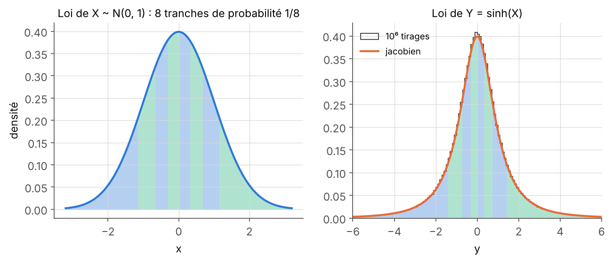
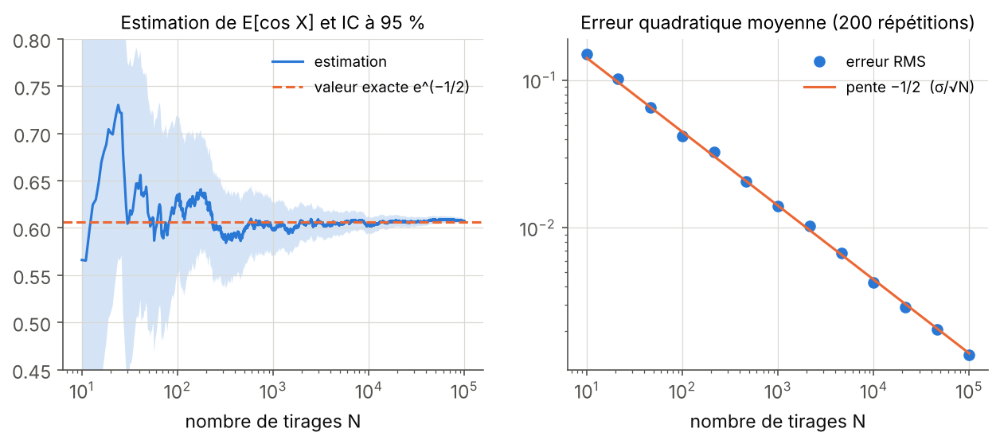
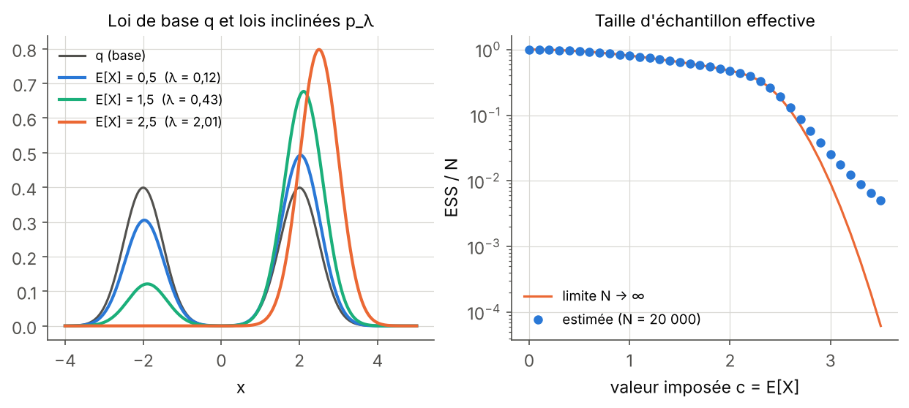
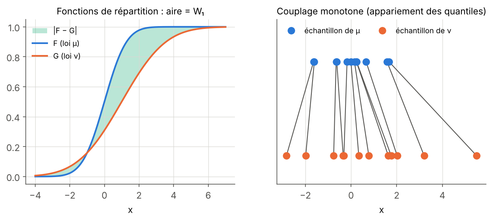
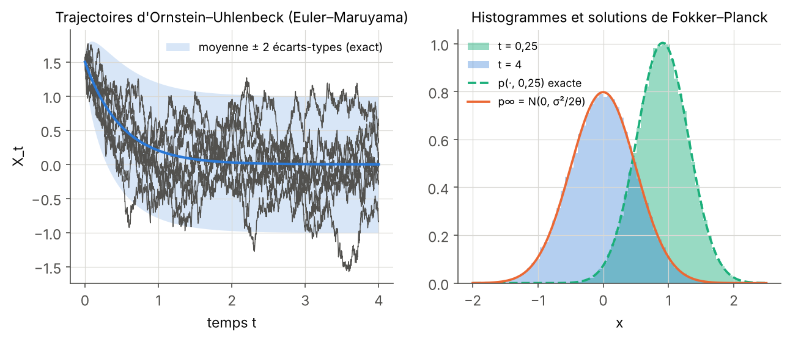
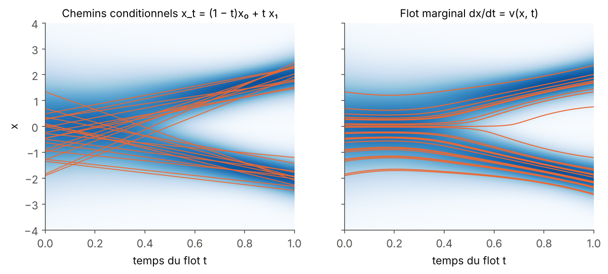

## Objectifs {#objectifs}

Un modèle génératif ne produit pas « un » champ magnétique : il produit une **loi de probabilité** sur des champs, que l'on observe à travers des échantillons. Toutes les questions du stage MilaDy, qu'il s'agisse d'apprendre cette loi, de la contraindre ou de l'évaluer, s'écrivent donc dans la langue des probabilités. Ce module en donne les outils, du niveau L2 jusqu'aux notions qui fondent le flow matching et les contraintes « en loi ».

À la fin des vingt-cinq heures de travail prévues, vous saurez :

1. manipuler variables et vecteurs aléatoires, densités, espérance, variance et covariance, et calculer avec la loi gaussienne multivariée (échantillonnage par Cholesky, lois marginales et conditionnelles) ;
2. calculer la loi image d'une variable aléatoire par une application inversible grâce à la formule du jacobien, et expliquer pourquoi cette formule est la base des flots normalisants ;
3. estimer une espérance par Monte-Carlo avec un intervalle de confiance, justifier l'erreur en $1/\sqrt{N}$, utiliser l'échantillonnage d'importance autonormalisé et en diagnostiquer la qualité par la taille d'échantillon effective (ESS) ;
4. démontrer la positivité de la divergence de Kullback–Leibler, obtenir les familles exponentielles par le principe du maximum d'entropie, démontrer par dualité que la loi la plus proche d'une loi $q$ sous une contrainte de moments est une inclinaison exponentielle de $q$, et la calculer numériquement par la méthode de Newton ;
5. calculer les distances de Wasserstein $W_1$ et $W_2$ en dimension 1 par les quantiles, $W_2$ entre deux gaussiennes, la distance d'énergie et la MMD sur des échantillons, et choisir une métrique adaptée pour comparer des champs générés ;
6. simuler une équation différentielle stochastique par le schéma d'Euler–Maruyama, énoncer la formule d'Itô, établir l'équation de Fokker–Planck et sa solution stationnaire pour le processus d'Ornstein–Uhlenbeck ;
7. démontrer qu'un champ de vitesse transporte une loi selon l'équation de continuité $\partial_t p + \nabla\cdot(p\,v) = 0$, et en déduire pourquoi la vitesse « marginale » du flow matching transporte le bruit vers les données.

## Prérequis {#prerequis}

Le point de départ est le niveau de fin de deuxième année de licence (L2) scientifique, mais un étudiant de L1 motivé peut suivre les chapitres 1 à 3 en revoyant au passage les intégrales multiples. Il faut savoir calculer une intégrale simple et une intégrale double, effectuer un changement de variables dans une intégrale double (jacobien), manipuler des matrices symétriques (valeurs propres, déterminant, inverse) et des séries. Une première rencontre avec les probabilités discrètes (lancers de dés, loi binomiale) aide, sans être indispensable : le chapitre 1 reprend tout depuis les définitions.

Côté programmation, il suffit de savoir manipuler des tableaux NumPy et écrire une fonction en Python. SciPy sert pour quelques fonctions spéciales et PyTorch uniquement pour la différentiation automatique au chapitre 2.

Le module [Calcul vectoriel et analyse de Fourier](../p1-calcul-vectoriel/index.html) est utile pour le chapitre 6 (divergence, théorème de Green–Ostrogradski) et pour la section 5.6 (spectres). Le module [Systèmes dynamiques, bifurcations et mesures invariantes](../p4-systemes-dynamiques/index.html) peut être lu en parallèle : la notion de mesure invariante y est introduite du point de vue des trajectoires, alors qu'elle apparaît ici, au chapitre 6, du point de vue de l'équation de Fokker–Planck. Ce module prépare directement [Apprentissage profond pour la physique](../p6-apprentissage-profond/index.html), [Modèles génératifs : diffusion et flow matching](../p7-modeles-generatifs/index.html) et [Modèles génératifs sous contraintes physiques](../p8-contraintes-physiques/index.html).

## Plan de travail {#plan}

Le niveau indique la difficulté : 1 pour les fondations, 2 pour le cœur du module, 3 pour ce qui touche déjà aux questions de recherche du stage. Il ne redescend jamais d'une séance à la suivante.

| Séance | Durée | Niveau | Contenu | Exercices |
|:---:|:---:|:---:|---|:---:|
| 1 | 3 h | 1 | Chapitre 1, sections 1.1 et 1.2 : variables aléatoires, lois, densités, espérance, variance, inégalités de Jensen et de Tchebychev | 1, 2 |
| 2 | 3 h | 1 | Chapitre 1, sections 1.3 et 1.4 : vecteurs aléatoires, covariance, espérance conditionnelle, loi gaussienne multivariée | 3 |
| 3 | 3 h | 2 | Chapitre 2 : mesure image, formule du jacobien, flots normalisants | 4, 5 |
| 4 | 3,5 h | 2 | Chapitre 3 : Monte-Carlo, loi des grands nombres, TCL, intervalles de confiance, échantillonnage d'importance, ESS | 6, 7 |
| 5 | 3 h | 2 | Chapitre 4, sections 4.1 à 4.3 : entropie, divergence de Kullback–Leibler, maximum d'entropie, familles exponentielles | 8, 9 |
| 6 | 3 h | 3 | Chapitre 4, sections 4.4 et 4.5 : I-projection, dual et méthode de Newton, limites quand le support manque | 10 |
| 7 | 3,5 h | 3 | Chapitre 5 : Monge et Kantorovich, Wasserstein en 1D et entre gaussiennes, Wasserstein tranché, distance d'énergie, MMD, métriques pour champs | 11, 12 |
| 8 | 3 h | 3 | Chapitre 6 : brownien, EDS, Euler–Maruyama, Itô, Fokker–Planck, équation de continuité, vitesse marginale du flow matching | 13, 14, 15 |
| **Total** | **25 h** | | 6 chapitres, 6 figures, 5 schémas interactifs | 15 exercices |

Chaque séance se termine par les exercices indiqués, à faire avant de lire leur solution. Les blocs de code sont courts (moins de 30 secondes chacun sur un seul cœur de processeur) : recopiez-les, exécutez-les, puis modifiez-les. Les schémas interactifs se manipulent directement dans la page ; ils reprennent les exemples du texte avec des curseurs.

## 1. Variables aléatoires, lois et moments {#ch1}

Un ensemble de champs MHD simulés à $Rm$ donné n'est pas une collection de fichiers sans structure : c'est un échantillon d'une loi $\mu_{\boldsymbol\lambda}$, et ce que l'on demande à un modèle génératif, c'est de reproduire cette loi. Ce chapitre fixe le vocabulaire (variable aléatoire, loi, densité, moments) et se termine par la loi gaussienne multivariée, point de départ de tous les modèles de diffusion et de flow matching.

### 1.1 Espace probabilisé, variable aléatoire, loi

::: def
[Définition 1.1 — Espace probabilisé]{.tag}
Un espace probabilisé est un triplet $(\mathcal{U}, \mathcal{F}, \mathbb{P})$ formé d'un ensemble $\mathcal{U}$ des issues possibles d'une expérience, d'une famille $\mathcal{F}$ de parties de $\mathcal{U}$ appelées événements (une tribu : stable par complémentaire et par réunion dénombrable), et d'une probabilité $\mathbb{P} : \mathcal{F} \to [0, 1]$ telle que $\mathbb{P}(\mathcal{U}) = 1$ et $\mathbb{P}(\bigcup_n A_n) = \sum_n \mathbb{P}(A_n)$ pour des événements deux à deux disjoints.
:::

On note l'univers $\mathcal{U}$ plutôt que $\Omega$, la lettre habituelle, pour ne pas le confondre avec le domaine physique $\Omega \subset \mathbb{R}^d$ des autres modules. En pratique, on ne manipule presque jamais $\mathcal{U}$ directement : on manipule des variables aléatoires et leurs lois.

::: def
[Définition 1.2 — Variable aléatoire, loi, fonction de répartition]{.tag}
Une variable aléatoire réelle est une fonction $X : \mathcal{U} \to \mathbb{R}$ telle que $\{X \le x\}$ soit un événement pour tout $x$. Sa **loi** est la probabilité $\mu_X$ sur $\mathbb{R}$ définie par

$$
\mu_X(A) = \mathbb{P}(X \in A)
$$

pour toute partie (borélienne) $A$ de $\mathbb{R}$. Sa **fonction de répartition** est $F_X(x) = \mathbb{P}(X \le x)$ : elle est croissante, continue à droite, tend vers 0 en $-\infty$ et vers 1 en $+\infty$, et elle caractérise la loi.
:::

La définition 1.2 dit déjà quelque chose d'important pour la suite : la loi de $X$ est l'image de la probabilité $\mathbb{P}$ par l'application $X$. Le chapitre 2 généralise cette opération « mesure image » à toute application, et c'est elle qu'un modèle génératif réalise.

::: def
[Définition 1.3 — Densité]{.tag}
La variable $X$ a pour densité $p : \mathbb{R} \to [0, +\infty)$ si, pour tout intervalle $[a, b]$,

$$
\mathbb{P}(a \le X \le b) = \int_a^b p(x)\,\mathrm{d}x.
$$

On a alors $\int_{\mathbb{R}} p = 1$ et $F_X' = p$ en tout point de continuité de $p$. Une densité n'est pas une probabilité : $p(x)$ peut dépasser 1 ; seule l'aire sous la courbe est une probabilité.
:::

::: ex
[Exemple 1.4 — Trois lois de référence]{.tag}
La loi **uniforme** sur $[a, b]$ a pour densité $\frac{1}{b-a}$ sur $[a, b]$ et 0 ailleurs. La loi **exponentielle** de paramètre $a > 0$ a pour densité $a\,e^{-ax}$ pour $x \ge 0$ ; elle modélise par exemple le temps d'attente entre deux renversements de polarité dans un régime où ceux-ci surviennent au hasard et sans mémoire. La loi **normale** (ou gaussienne) $\mathcal{N}(m, \sigma^2)$ a pour densité

$$
p(x) = \frac{1}{\sqrt{2\pi\sigma^2}}\exp\Big(-\frac{(x - m)^2}{2\sigma^2}\Big).
$$

On note $\Phi$ la fonction de répartition de $\mathcal{N}(0, 1)$ ; elle n'a pas d'expression élémentaire, mais $\Phi(1{,}96) \approx 0{,}975$, une valeur qui reviendra au chapitre 3.
:::

### 1.2 Espérance, variance et deux inégalités

::: def
[Définition 1.5 — Espérance, formule de transfert]{.tag}
Si $X$ a pour densité $p$ et si $g$ est une fonction telle que $\int |g(x)|\,p(x)\,\mathrm{d}x < \infty$, l'espérance de $g(X)$ est

$$
\mathbb{E}[g(X)] = \int_{\mathbb{R}} g(x)\,p(x)\,\mathrm{d}x.
$$

Pour $g(x) = x$, on obtient la moyenne $\mathbb{E}[X]$. L'espérance est linéaire, positive ($g \ge 0 \Rightarrow \mathbb{E}[g(X)] \ge 0$) et vérifie $\mathbb{E}[1] = 1$. Pour un événement $A$, $\mathbb{E}[\mathbf{1}_A] = \mathbb{P}(A)$.
:::

La formule de transfert est le principe de tous les calculs de ce module : pour calculer la moyenne d'une observable $g(X)$, on n'a pas besoin de connaître la loi de $g(X)$, seulement celle de $X$.

:::: thm
[Théorème 1.6 — Inégalité de Jensen]{.tag}
Si $\varphi$ est convexe et si $X$ et $\varphi(X)$ sont intégrables, alors

$$
\varphi(\mathbb{E}[X]) \le \mathbb{E}[\varphi(X)].
$$

Si $\varphi$ est strictement convexe, il y a égalité si et seulement si $X$ est presque sûrement constante.

::: proof
Une fonction convexe est au-dessus de chacune de ses tangentes (ou de ses droites d'appui si elle n'est pas dérivable) : en $m = \mathbb{E}[X]$, il existe une pente $a$ telle que $\varphi(x) \ge \varphi(m) + a(x - m)$ pour tout $x$. On remplace $x$ par $X$ et on prend l'espérance : $\mathbb{E}[\varphi(X)] \ge \varphi(m) + a(\mathbb{E}[X] - m) = \varphi(m)$. Si $\varphi$ est strictement convexe, l'inégalité $\varphi(x) > \varphi(m) + a(x - m)$ est stricte pour $x \neq m$ ; l'égalité des espérances impose donc $X = m$ presque sûrement. [∎]{.qed}
:::
::::

::: def
[Définition 1.7 — Variance, écart-type]{.tag}
Si $\mathbb{E}[X^2] < \infty$, la variance de $X$ est $\mathrm{Var}(X) = \mathbb{E}\big[(X - \mathbb{E}[X])^2\big] = \mathbb{E}[X^2] - \mathbb{E}[X]^2$, et son écart-type est $\sigma_X = \sqrt{\mathrm{Var}(X)}$. Pour des réels $a$ et $b$, $\mathrm{Var}(aX + b) = a^2\,\mathrm{Var}(X)$.
:::

L'égalité $\mathbb{E}[(X - \mathbb{E}X)^2] = \mathbb{E}[X^2] - \mathbb{E}[X]^2$ s'obtient en développant le carré et en utilisant la linéarité. Elle montre au passage, avec Jensen appliqué à $\varphi(x) = x^2$, que $\mathbb{E}[X]^2 \le \mathbb{E}[X^2]$.

:::: prop
[Proposition 1.8 — Inégalités de Markov et de Bienaymé–Tchebychev]{.tag}
(i) Si $Y \ge 0$ et $a > 0$, alors $\mathbb{P}(Y \ge a) \le \mathbb{E}[Y]/a$.

(ii) Si $X$ a une variance finie et $\varepsilon > 0$, alors

$$
\mathbb{P}\big(|X - \mathbb{E}[X]| \ge \varepsilon\big) \le \frac{\mathrm{Var}(X)}{\varepsilon^2}.
$$

::: proof
(i) On a $Y \ge a\,\mathbf{1}_{\{Y \ge a\}}$ partout, car le membre de droite vaut $a \le Y$ sur l'événement et $0 \le Y$ ailleurs. On prend l'espérance : $\mathbb{E}[Y] \ge a\,\mathbb{P}(Y \ge a)$. (ii) On applique (i) à $Y = (X - \mathbb{E}X)^2$ et $a = \varepsilon^2$. [∎]{.qed}
:::
::::

L'inégalité de Tchebychev est grossière, mais elle suffit pour démontrer la loi des grands nombres au chapitre 3.

### 1.3 Vecteurs aléatoires, covariance, espérance conditionnelle

Un champ discrétisé $\mathbf{x} \in \mathbb{R}^D$ est un vecteur aléatoire : chaque point de grille est une coordonnée, et toute l'information physique (corrélations spatiales, spectre, hélicité) est dans la **loi jointe** des coordonnées, pas dans les lois des coordonnées prises une à une.

::: def
[Définition 1.9 — Loi jointe, marginales, indépendance]{.tag}
Un vecteur aléatoire $\mathbf{X} = (X_1, \dots, X_d)$ a pour densité jointe $p : \mathbb{R}^d \to [0, \infty)$ si $\mathbb{P}(\mathbf{X} \in A) = \int_A p(\mathbf{x})\,\mathrm{d}\mathbf{x}$ pour toute partie $A$. La densité marginale de $X_1$ s'obtient en intégrant les autres variables : $p_1(x_1) = \int p(x_1, x_2, \dots, x_d)\,\mathrm{d}x_2\cdots\mathrm{d}x_d$. Les coordonnées sont **indépendantes** si la densité jointe est le produit des marginales : $p(\mathbf{x}) = p_1(x_1)\cdots p_d(x_d)$.
:::

::: def
[Définition 1.10 — Covariance, matrice de covariance]{.tag}
La covariance de deux variables de carré intégrable est $\mathrm{Cov}(X, Y) = \mathbb{E}[(X - \mathbb{E}X)(Y - \mathbb{E}Y)] = \mathbb{E}[XY] - \mathbb{E}[X]\mathbb{E}[Y]$. Le coefficient de corrélation est $\mathrm{Cov}(X, Y)/(\sigma_X\sigma_Y) \in [-1, 1]$. Pour un vecteur $\mathbf{X}$ de moyenne $\mathbf{m} = \mathbb{E}[\mathbf{X}]$, la matrice de covariance est

$$
\Sigma = \mathbb{E}\big[(\mathbf{X} - \mathbf{m})(\mathbf{X} - \mathbf{m})^{\mathsf{T}}\big], \qquad \Sigma_{ij} = \mathrm{Cov}(X_i, X_j).
$$
:::

:::: prop
[Proposition 1.11 — Propriétés de la covariance]{.tag}
(i) $\Sigma$ est symétrique et semi-définie positive : $\mathbf{a}^{\mathsf{T}}\Sigma\,\mathbf{a} \ge 0$ pour tout $\mathbf{a} \in \mathbb{R}^d$.

(ii) Pour une matrice $A$ de taille $k \times d$ et $\mathbf{b} \in \mathbb{R}^k$, le vecteur $A\mathbf{X} + \mathbf{b}$ a pour moyenne $A\mathbf{m} + \mathbf{b}$ et pour covariance $A\Sigma A^{\mathsf{T}}$.

(iii) Si $X$ et $Y$ sont indépendantes, $\mathrm{Cov}(X, Y) = 0$. La réciproque est fausse.

::: proof
(i) La symétrie est évidente. Pour $\mathbf{a}$ fixé, $\mathbf{a}^{\mathsf{T}}\Sigma\,\mathbf{a} = \mathbb{E}\big[(\mathbf{a}^{\mathsf{T}}(\mathbf{X} - \mathbf{m}))^2\big] = \mathrm{Var}(\mathbf{a}^{\mathsf{T}}\mathbf{X}) \ge 0$. (ii) Par linéarité, $\mathbb{E}[A\mathbf{X} + \mathbf{b}] = A\mathbf{m} + \mathbf{b}$, puis $\mathbb{E}[A(\mathbf{X} - \mathbf{m})(\mathbf{X} - \mathbf{m})^{\mathsf{T}}A^{\mathsf{T}}] = A\Sigma A^{\mathsf{T}}$. (iii) Si la densité jointe est un produit, l'intégrale double $\mathbb{E}[XY]$ se factorise en $\mathbb{E}[X]\,\mathbb{E}[Y]$. Pour un contre-exemple, prendre $X \sim \mathcal{N}(0, 1)$ et $Y = X^2$ : $\mathrm{Cov}(X, Y) = \mathbb{E}[X^3] = 0$ par symétrie, alors que $Y$ est une fonction de $X$ (exercice 2). [∎]{.qed}
:::
::::

Le point (iii) est un piège classique quand on valide un modèle génératif : reproduire les covariances des données ne garantit pas de reproduire leurs dépendances non linéaires, comme celles qui lient l'amplitude d'un mode à son signe dans un régime de renversements.

::: def
[Définition 1.12 — Densité conditionnelle, espérance conditionnelle]{.tag}
Si $(X, Y)$ a pour densité $p(x, y)$ et $Y$ pour densité $p_Y(y) > 0$, la densité conditionnelle de $X$ sachant $Y = y$ est $p(x \mid y) = p(x, y)/p_Y(y)$, et l'espérance conditionnelle est

$$
\mathbb{E}[X \mid Y = y] = \int x\,p(x \mid y)\,\mathrm{d}x.
$$

On note $\mathbb{E}[X \mid Y]$ la variable aléatoire $h(Y)$ où $h(y) = \mathbb{E}[X \mid Y = y]$. La définition s'étend telle quelle aux vecteurs.
:::

:::: thm
[Théorème 1.13 — L'espérance conditionnelle est la meilleure prédiction quadratique]{.tag}
Soit $\mathbf{X}$ de carré intégrable. Parmi toutes les fonctions $h$ telles que $h(Y)$ soit de carré intégrable, la quantité $\mathbb{E}\big[|\mathbf{X} - h(Y)|^2\big]$ est minimale pour $h(y) = \mathbb{E}[\mathbf{X} \mid Y = y]$. De plus, l'erreur $\mathbf{X} - \mathbb{E}[\mathbf{X} \mid Y]$ est orthogonale à toute fonction $g$ de $Y$ telle que $g(Y)$ soit de carré intégrable : $\mathbb{E}\big[(\mathbf{X} - \mathbb{E}[\mathbf{X} \mid Y])\cdot g(Y)\big] = 0$.

::: proof
Notons $h^\star(Y) = \mathbb{E}[\mathbf{X} \mid Y]$. Pour toute $g$, $\mathbb{E}[\mathbf{X}\cdot g(Y)] = \iint \mathbf{x}\cdot g(y)\,p(\mathbf{x}\mid y)\,p_Y(y)\,\mathrm{d}\mathbf{x}\,\mathrm{d}y = \int h^\star(y)\cdot g(y)\,p_Y(y)\,\mathrm{d}y = \mathbb{E}[h^\star(Y)\cdot g(Y)]$, ce qui donne l'orthogonalité. Ensuite, pour toute $h$, on écrit $\mathbf{X} - h(Y) = (\mathbf{X} - h^\star(Y)) + (h^\star(Y) - h(Y))$ ; le second terme est une fonction de $Y$, donc le produit croisé a une espérance nulle et

$$
\mathbb{E}\big[|\mathbf{X} - h(Y)|^2\big] = \mathbb{E}\big[|\mathbf{X} - h^\star(Y)|^2\big] + \mathbb{E}\big[|h^\star(Y) - h(Y)|^2\big] \ge \mathbb{E}\big[|\mathbf{X} - h^\star(Y)|^2\big].
$$

L'égalité n'a lieu que si $h(Y) = h^\star(Y)$ presque sûrement. [∎]{.qed}
:::
::::

Ce théorème, élémentaire, est le ressort mathématique du flow matching : on y entraîne un réseau à prédire par moindres carrés une quantité aléatoire, et l'optimum est une espérance conditionnelle (proposition 6.15).

### 1.4 La loi gaussienne multivariée

::: def
[Définition 1.14 — Loi normale multivariée]{.tag}
Soit $\mathbf{m} \in \mathbb{R}^d$ et $\Sigma$ une matrice $d \times d$ symétrique définie positive. La loi $\mathcal{N}(\mathbf{m}, \Sigma)$ a pour densité

$$
p(\mathbf{x}) = \frac{1}{(2\pi)^{d/2}\sqrt{\det\Sigma}}\exp\Big(-\frac12(\mathbf{x} - \mathbf{m})^{\mathsf{T}}\Sigma^{-1}(\mathbf{x} - \mathbf{m})\Big).
$$

La loi $\mathcal{N}(0, I)$ est la loi normale standard : ses coordonnées sont des $\mathcal{N}(0, 1)$ indépendantes, puisque la densité se factorise.
:::

:::: prop
[Proposition 1.15 — Construction par transformation affine]{.tag}
Soit $L$ une matrice inversible telle que $LL^{\mathsf{T}} = \Sigma$ (par exemple le facteur de Cholesky, triangulaire inférieur). Si $\mathbf{Z} \sim \mathcal{N}(0, I)$, alors $\mathbf{X} = \mathbf{m} + L\mathbf{Z} \sim \mathcal{N}(\mathbf{m}, \Sigma)$. Plus généralement, toute transformation affine $A\mathbf{X} + \mathbf{b}$ d'un vecteur gaussien est gaussienne, de covariance $A\Sigma A^{\mathsf{T}}$ (elle n'a une densité que si cette matrice est inversible), et toute marginale d'un vecteur gaussien est gaussienne.

::: proof
C'est un cas particulier du théorème 2.5 (formule du jacobien), que l'on peut déjà vérifier avec le changement de variables dans les intégrales multiples vu en L2. L'application $\mathbf{z} \mapsto \mathbf{m} + L\mathbf{z}$ a pour inverse $\mathbf{x} \mapsto L^{-1}(\mathbf{x} - \mathbf{m})$ et pour jacobien constant $\det L$, avec $|\det L| = \sqrt{\det\Sigma}$. La densité de $\mathbf{X}$ vaut donc $p_{\mathbf{Z}}(L^{-1}(\mathbf{x} - \mathbf{m}))/|\det L|$, et $|L^{-1}(\mathbf{x} - \mathbf{m})|^2 = (\mathbf{x} - \mathbf{m})^{\mathsf{T}}(LL^{\mathsf{T}})^{-1}(\mathbf{x} - \mathbf{m})$ redonne la définition 1.14. Pour une transformation affine quelconque ou une marginale, on admet le résultat ; une preuve courte passe par la fonction caractéristique $\mathbb{E}[e^{i\mathbf{u}\cdot\mathbf{X}}] = e^{i\mathbf{u}\cdot\mathbf{m} - \frac12\mathbf{u}^{\mathsf{T}}\Sigma\mathbf{u}}$. [∎]{.qed}
:::
::::

Cette proposition est utilisée dans tous les modèles génératifs du parcours : on tire $\mathbf{Z}$ coordonnée par coordonnée, puis on transforme. La définition 1.14 a aussi une conséquence propre aux gaussiennes, qui fait exception à la mise en garde du point (iii) de la proposition 1.11 : **pour un vecteur gaussien, des coordonnées non corrélées sont indépendantes**, car une matrice $\Sigma$ diagonale rend la densité factorisable. L'hypothèse porte sur la loi jointe : deux variables qui sont chacune gaussiennes, sans former ensemble un vecteur gaussien, peuvent être non corrélées et dépendantes.

:::: prop
[Proposition 1.16 — Lois conditionnelles gaussiennes]{.tag}
Découpons $\mathbf{X} = (\mathbf{X}_1, \mathbf{X}_2) \sim \mathcal{N}(\mathbf{m}, \Sigma)$ en deux blocs, avec $\Sigma = \begin{pmatrix}\Sigma_{11} & \Sigma_{12}\\ \Sigma_{21} & \Sigma_{22}\end{pmatrix}$. La loi de $\mathbf{X}_1$ sachant $\mathbf{X}_2 = \mathbf{x}_2$ est gaussienne :

$$
\mathbf{X}_1 \mid \mathbf{X}_2 = \mathbf{x}_2 \;\sim\; \mathcal{N}\big(\mathbf{m}_1 + \Sigma_{12}\Sigma_{22}^{-1}(\mathbf{x}_2 - \mathbf{m}_2),\; \Sigma_{11} - \Sigma_{12}\Sigma_{22}^{-1}\Sigma_{21}\big).
$$

::: proof
Posons $A = \Sigma_{12}\Sigma_{22}^{-1}$ et $\mathbf{R} = \mathbf{X}_1 - A\mathbf{X}_2$. Le couple $(\mathbf{R}, \mathbf{X}_2)$ est une transformation linéaire de $\mathbf{X}$, donc gaussien. Sa covariance croisée vaut $\mathrm{Cov}(\mathbf{R}, \mathbf{X}_2) = \Sigma_{12} - A\Sigma_{22} = 0$ : $\mathbf{R}$ et $\mathbf{X}_2$ sont non corrélés, donc indépendants (vecteur gaussien). Ainsi, sachant $\mathbf{X}_2 = \mathbf{x}_2$, $\mathbf{X}_1 = \mathbf{R} + A\mathbf{x}_2$ a la loi de $\mathbf{R}$ translatée de $A\mathbf{x}_2$. Or $\mathbb{E}[\mathbf{R}] = \mathbf{m}_1 - A\mathbf{m}_2$ et $\mathrm{Var}(\mathbf{R}) = \Sigma_{11} - A\Sigma_{21} - \Sigma_{12}A^{\mathsf{T}} + A\Sigma_{22}A^{\mathsf{T}} = \Sigma_{11} - \Sigma_{12}\Sigma_{22}^{-1}\Sigma_{21}$. [∎]{.qed}
:::
::::

La moyenne conditionnelle est affine en $\mathbf{x}_2$ et la variance conditionnelle ne dépend pas de $\mathbf{x}_2$ : c'est la régression linéaire, et c'est aussi le calcul qui donne la vitesse du flow matching entre gaussiennes (exercice 15).

::: ex
[Exemple 1.17 — Un cas chiffré]{.tag}
Prenons $\mathbf{m} = (1, -2)$ et $\Sigma = \begin{pmatrix}2 & 1{,}2\\ 1{,}2 & 1\end{pmatrix}$, dont le déterminant $0{,}56$ est positif. Sachant $X_2 = -1$, la moyenne de $X_1$ vaut $1 + \frac{1{,}2}{1}(-1 + 2) = 2{,}2$ et sa variance $2 - 1{,}2^2/1 = 0{,}56$. Le code ci-dessous tire $4\times10^5$ points par Cholesky et vérifie ces valeurs sur la tranche $|X_2 + 1| < 0{,}01$.
:::

```python
import numpy as np

rng = np.random.default_rng(0)
m = np.array([1.0, -2.0])
S = np.array([[2.0, 1.2],
              [1.2, 1.0]])
L = np.linalg.cholesky(S)                 # S = L L^T, L triangulaire inférieure
N = 400_000
Z = rng.standard_normal((N, 2))           # Z ~ N(0, I)
X = m + Z @ L.T                           # X = m + L Z ~ N(m, S)
print("moyenne empirique    :", X.mean(axis=0).round(3))
print("covariance empirique :", np.cov(X.T).round(3).tolist())

# Loi conditionnelle de X1 sachant X2 = -1 (proposition 1.16)
x2 = -1.0
mu_c = m[0] + S[0, 1] / S[1, 1] * (x2 - m[1])
var_c = S[0, 0] - S[0, 1] ** 2 / S[1, 1]
sel = np.abs(X[:, 1] - x2) < 0.01         # tranche fine autour de X2 = -1
print(f"théorie   : E[X1 | X2=-1] = {mu_c:.3f}, Var = {var_c:.3f}")
print(f"empirique : E[X1 | X2=-1] = {X[sel, 0].mean():.3f}, Var = {X[sel, 0].var():.3f}  ({sel.sum()} points)")

# Covariance nulle n'entraîne pas l'indépendance
Y = rng.standard_normal(N)
print("Cov(Y, Y^2) =", round(np.cov(Y, Y ** 2)[0, 1], 3),
      "; Corr(|Y|, Y^2) =", round(np.corrcoef(np.abs(Y), Y ** 2)[0, 1], 3))
# sortie :
# moyenne empirique    : [ 1.003 -1.998]
# covariance empirique : [[2.002, 1.199], [1.199, 0.999]]
# théorie   : E[X1 | X2=-1] = 2.200, Var = 0.560
# empirique : E[X1 | X2=-1] = 2.205, Var = 0.567  (1959 points)
# Cov(Y, Y^2) = 0.009 ; Corr(|Y|, Y^2) = 0.936
```

Les écarts entre théorie et empirique sont de l'ordre de $10^{-2}$ pour la tranche conditionnelle, qui ne contient que 1959 points : le chapitre 3 explique pourquoi cet ordre de grandeur est celui attendu. La covariance de $Y$ et $Y^2$ est nulle aux fluctuations près, alors que $|Y|$ et $Y^2$ sont corrélés à 94 %.

:::: recap
::: recap-title
Ce qu'il faut retenir — chapitre 1
:::
- La loi d'une variable aléatoire est l'image de $\mathbb{P}$ par cette variable ; on calcule $\mathbb{E}[g(X)] = \int g\,p$ sans connaître la loi de $g(X)$.
- Jensen ($\varphi$ convexe $\Rightarrow \varphi(\mathbb{E}X) \le \mathbb{E}\varphi(X)$) et Tchebychev sont les deux inégalités de base du module.
- La covariance est semi-définie positive et se transforme en $A\Sigma A^{\mathsf{T}}$ ; covariance nulle n'implique pas indépendance, sauf pour un vecteur gaussien.
- $\mathbb{E}[\mathbf{X} \mid Y]$ est la meilleure prédiction de $\mathbf{X}$ par une fonction de $Y$ au sens des moindres carrés.
- $\mathbf{m} + L\mathbf{Z}$ avec $LL^{\mathsf{T}} = \Sigma$ et $\mathbf{Z} \sim \mathcal{N}(0, I)$ réalise $\mathcal{N}(\mathbf{m}, \Sigma)$ ; les conditionnelles gaussiennes sont des régressions linéaires.
::::

## 2. Changement de variables et mesure image {#ch2}

Un modèle génératif est, dans sa forme la plus simple, une application $T_\theta$ qui transforme un bruit gaussien $\mathbf{Z}$ en un champ $T_\theta(\mathbf{Z})$. La loi générée est donc la **mesure image** de $\mathcal{N}(0, I)$ par $T_\theta$. Ce chapitre définit cette opération, donne la formule du jacobien qui calcule la densité image, et montre comment elle fonde les flots normalisants ; le chapitre 6 en donnera la version en temps continu, qui fonde le flow matching.

### 2.1 Mesure image

::: def
[Définition 2.1 — Mesure image (pushforward)]{.tag}
Soit $\mu$ une loi sur $\mathbb{R}^d$ et $T : \mathbb{R}^d \to \mathbb{R}^k$ une application (mesurable). La mesure image de $\mu$ par $T$, notée $T_\#\mu$, est la loi sur $\mathbb{R}^k$ définie par

$$
(T_\#\mu)(B) = \mu\big(T^{-1}(B)\big) = \mu\big(\{\mathbf{x} : T(\mathbf{x}) \in B\}\big).
$$

Autrement dit, si $\mathbf{X} \sim \mu$, alors $T(\mathbf{X}) \sim T_\#\mu$.
:::

:::: prop
[Proposition 2.2 — Formule de transfert pour une mesure image]{.tag}
Pour toute fonction $g$ positive ou intégrable,

$$
\int g\,\mathrm{d}(T_\#\mu) = \int g\circ T\,\mathrm{d}\mu, \qquad \text{c'est-à-dire} \qquad \mathbb{E}[g(T(\mathbf{X}))] = \mathbb{E}_{T_\#\mu}[g].
$$

::: proof
Pour $g = \mathbf{1}_B$, les deux membres valent $\mu(T^{-1}(B))$ par définition. Par linéarité, l'égalité vaut pour les fonctions étagées (combinaisons finies d'indicatrices), puis pour toute $g$ positive par convergence monotone (limite croissante de fonctions étagées), et enfin pour $g$ intégrable en écrivant $g = g^+ - g^-$. [∎]{.qed}
:::
::::

Cette formule est la raison pour laquelle on peut évaluer un modèle génératif sans jamais écrire sa densité : pour calculer la moyenne d'une observable (énergie, hélicité, divergence) sous la loi générée, il suffit d'évaluer l'observable sur des échantillons $T_\theta(\mathbf{Z}_i)$.

::: ex
[Exemple 2.3 — Symétrie d'une loi invariante]{.tag}
Le modèle à trois modes de Gissinger (2012) pour les renversements du champ magnétique est invariant par la symétrie $S(Q, D, V) = (-Q, -D, V)$ : si $(Q, D, V)$ est une solution, $(-Q, -D, V)$ en est une autre. Si $\mu$ est une loi invariante, $S_\#\mu$ en est donc une autre ; lorsque la loi invariante est unique, ce que l'on attend dans un régime de renversements où une trajectoire typique visite les deux polarités, on a $S_\#\mu = \mu$. La proposition 2.2 appliquée à $g(Q, D, V) = D$ donne alors $\mathbb{E}_\mu[D] = \mathbb{E}_\mu[-D]$, donc $\mathbb{E}_\mu[D] = 0$ : en moyenne sur un temps long, le dipôle n'a pas de polarité préférée. Dans un régime sans renversement, il peut au contraire exister deux lois invariantes, une par polarité, que $S$ échange. Vérifier qu'une loi générée respecte $S_\#q = q$ est l'un des tests de l'expérience E1 (voir le [rapport](../../rapport/index.html#e1)).
:::

:::: prop
[Proposition 2.4 — Méthode de la fonction de répartition inverse]{.tag}
Soit $F$ une fonction de répartition continue et strictement croissante, et $U$ uniforme sur $[0, 1]$. Alors $X = F^{-1}(U)$ a pour fonction de répartition $F$. Autrement dit, $F^{-1}$ transporte la loi uniforme sur la loi de fonction de répartition $F$ : $(F^{-1})_\#\,\mathcal{U}[0, 1] = \mu_F$.

::: proof
Comme $F$ est croissante, $\{F^{-1}(U) \le x\} = \{U \le F(x)\}$, d'où $\mathbb{P}(X \le x) = \mathbb{P}(U \le F(x)) = F(x)$. [∎]{.qed}
:::
::::

En dimension 1, on sait donc transporter n'importe quelle loi sans atome sur n'importe quelle autre par une application croissante : si $F$ est continue, $F(X)$ est uniforme et $G^{-1}\circ F$ envoie la loi de fonction de répartition $F$ sur celle de fonction de répartition $G$. Cette application « des quantiles » réapparaîtra au chapitre 5 comme le transport optimal en dimension 1.

### 2.2 La formule du jacobien

:::: thm
[Théorème 2.5 — Densité d'une mesure image par un difféomorphisme]{.tag}
Soit $T : U \to V$ un difféomorphisme de classe $C^1$ entre deux ouverts de $\mathbb{R}^d$, de matrice jacobienne $J_T(\mathbf{x}) = \big(\partial_j T_i(\mathbf{x})\big)_{ij}$. Si $\mathbf{X}$ a pour densité $p_{\mathbf{X}}$ sur $U$, alors $\mathbf{Y} = T(\mathbf{X})$ a pour densité sur $V$

$$
p_{\mathbf{Y}}(\mathbf{y}) = p_{\mathbf{X}}\big(T^{-1}(\mathbf{y})\big)\,\big|\det J_{T^{-1}}(\mathbf{y})\big| = \frac{p_{\mathbf{X}}(\mathbf{x})}{|\det J_T(\mathbf{x})|}\quad\text{avec } \mathbf{x} = T^{-1}(\mathbf{y}). \tag{2.1}
$$

::: proof
Pour toute partie $B \subset V$, $\mathbb{P}(\mathbf{Y} \in B) = \mathbb{P}(\mathbf{X} \in T^{-1}(B)) = \int_{T^{-1}(B)} p_{\mathbf{X}}(\mathbf{x})\,\mathrm{d}\mathbf{x}$. Le théorème de changement de variables dans les intégrales multiples (L2), appliqué avec $\mathbf{x} = T^{-1}(\mathbf{y})$, transforme cette intégrale en $\int_B p_{\mathbf{X}}(T^{-1}(\mathbf{y}))\,|\det J_{T^{-1}}(\mathbf{y})|\,\mathrm{d}\mathbf{y}$. Cette égalité, vraie pour tout $B$, est la définition d'une densité. La seconde forme de (2.1) vient de $J_{T^{-1}}(\mathbf{y}) = J_T(\mathbf{x})^{-1}$ (dérivée d'une composée $T\circ T^{-1} = \mathrm{id}$), donc $\det J_{T^{-1}}(\mathbf{y}) = 1/\det J_T(\mathbf{x})$. [∎]{.qed}
:::
::::

L'interprétation est celle d'une conservation de la masse : la probabilité contenue dans un petit volume $\mathrm{d}\mathbf{x}$ autour de $\mathbf{x}$ se retrouve dans le volume $|\det J_T|\,\mathrm{d}\mathbf{x}$ autour de $T(\mathbf{x})$. Si $T$ dilate localement les volumes, la densité diminue d'autant. La figure 1 le montre sur un exemple en dimension 1.

```{=html}
<figure class="schema">

<figcaption>Figure 1 — Mesure image de N(0, 1) par T(x) = sinh(x). Chaque tranche colorée garde sa probabilité 1/8 ; là où T étire l'axe (|x| grand), la densité image s'aplatit, là où T' = cosh(x) vaut 1 (près de 0), elle est inchangée. L'histogramme de 10⁶ tirages de sinh(X) coïncide avec la formule (2.1).</figcaption>
</figure>
```

:::: cor
[Corollaire 2.6 — Forme logarithmique et composition]{.tag}
Avec les notations du théorème 2.5,

$$
\log p_{\mathbf{Y}}(T(\mathbf{x})) = \log p_{\mathbf{X}}(\mathbf{x}) - \log\big|\det J_T(\mathbf{x})\big|.
$$

Pour une composée $T = T_K\circ\cdots\circ T_1$, en notant $\mathbf{x}_0 = \mathbf{x}$ et $\mathbf{x}_k = T_k(\mathbf{x}_{k-1})$, on a $\log p_{\mathbf{Y}}(T(\mathbf{x})) = \log p_{\mathbf{X}}(\mathbf{x}) - \sum_{k=1}^K \log|\det J_{T_k}(\mathbf{x}_{k-1})|$.

::: proof
On prend le logarithme de (2.1), puis on utilise $J_T(\mathbf{x}) = J_{T_K}(\mathbf{x}_{K-1})\cdots J_{T_1}(\mathbf{x}_0)$ (dérivée d'une composée) et la multiplicativité du déterminant. [∎]{.qed}
:::
::::

::: ex
[Exemple 2.7 — Le sinus hyperbolique]{.tag}
Soit $X \sim \mathcal{N}(0, 1)$ et $Y = \sinh X$. L'inverse est $T^{-1}(y) = \operatorname{argsh} y$, de dérivée $1/\sqrt{1 + y^2}$. La formule (2.1) donne

$$
p_Y(y) = \frac{1}{\sqrt{2\pi}\sqrt{1 + y^2}}\exp\Big(-\frac{(\operatorname{argsh} y)^2}{2}\Big).
$$

En $y = 0$, $p_Y(0) = 1/\sqrt{2\pi} \approx 0{,}3989$, la même valeur que $p_X(0)$, car $T'(0) = \cosh 0 = 1$. En revanche $p_Y$ décroît beaucoup moins vite que la gaussienne : $Y$ a des queues lourdes, comme les incréments de vitesse en turbulence.
:::

:::: prop
[Proposition 2.8 — Lemme du déterminant matriciel]{.tag}
Pour deux vecteurs $\mathbf{u}, \boldsymbol\psi \in \mathbb{R}^d$, $\det(I + \mathbf{u}\boldsymbol\psi^{\mathsf{T}}) = 1 + \boldsymbol\psi^{\mathsf{T}}\mathbf{u}$.

::: proof
La matrice $\mathbf{u}\boldsymbol\psi^{\mathsf{T}}$ est de rang au plus 1. Tout vecteur orthogonal à $\boldsymbol\psi$ est dans son noyau, donc vecteur propre de $I + \mathbf{u}\boldsymbol\psi^{\mathsf{T}}$ pour la valeur propre 1 ; cela donne $d - 1$ valeurs propres égales à 1. La trace vaut $d + \boldsymbol\psi^{\mathsf{T}}\mathbf{u}$, donc la dernière valeur propre est $1 + \boldsymbol\psi^{\mathsf{T}}\mathbf{u}$, et le déterminant est le produit des valeurs propres. [∎]{.qed}
:::
::::

::: ex
[Exemple 2.9 — Un flot « planaire »]{.tag}
Rezende et Mohamed (2015) proposent les transformations $T(\mathbf{x}) = \mathbf{x} + \mathbf{u}\tanh(\mathbf{w}\cdot\mathbf{x} + b)$. La jacobienne vaut $I + \mathbf{u}\boldsymbol\psi(\mathbf{x})^{\mathsf{T}}$ avec $\boldsymbol\psi(\mathbf{x}) = (1 - \tanh^2(\mathbf{w}\cdot\mathbf{x} + b))\,\mathbf{w}$, donc, par la proposition 2.8,

$$
\det J_T(\mathbf{x}) = 1 + \big(1 - \tanh^2(\mathbf{w}\cdot\mathbf{x} + b)\big)\,\mathbf{u}\cdot\mathbf{w}.
$$

Le coût est $O(d)$ au lieu de $O(d^3)$ pour un déterminant quelconque. Si $\mathbf{u}\cdot\mathbf{w} > -1$, le déterminant reste positif et $T$ est inversible : en posant $a = \mathbf{w}\cdot\mathbf{x} + b$, l'équation $\mathbf{w}\cdot\mathbf{y} + b = a + (\mathbf{u}\cdot\mathbf{w})\tanh a$ est scalaire et strictement croissante en $a$, puis $\mathbf{x} = \mathbf{y} - \mathbf{u}\tanh a$.
:::

Le schéma interactif 1 permet de faire varier une application monotone en dimension 1 et de voir les tranches de probabilité se déformer.

```{=html}
<div class="widget" data-widget="pushforward">
<p class="widget-title">Schéma interactif 1 — Mesure image et formule du jacobien</p>
<p class="widget-note">L'application est T(x) = s (x + a sin 2x), croissante tant que |a| &lt; 1/2. Les traits noirs relient les déciles de X à leurs images : chaque tranche colorée garde la masse 0,1. La courbe orange est la formule (2.1), le contour gris l'histogramme de 20 000 tirages de T(X). Approchez |a| de 0,45 : min T′ se rapproche de 0 et la densité image développe des pics là où T s'aplatit.</p>
</div>
```

### 2.3 Flots normalisants

::: def
[Définition 2.10 — Flot normalisant]{.tag}
Un flot normalisant est une famille de difféomorphismes $T_\theta : \mathbb{R}^D \to \mathbb{R}^D$, paramétrés par les poids $\theta$ d'un réseau, telle que $T_\theta^{-1}$ et $\log|\det J_{T_\theta}|$ soient calculables à faible coût. Le modèle génératif est $q_\theta = (T_\theta)_\#\mathcal{N}(0, I)$, de densité

$$
\log q_\theta(\mathbf{x}) = \log p_{\mathbf{Z}}\big(T_\theta^{-1}(\mathbf{x})\big) + \log\big|\det J_{T_\theta^{-1}}(\mathbf{x})\big|.
$$

On l'entraîne par maximum de vraisemblance : on maximise $\frac1N\sum_i \log q_\theta(\mathbf{x}_i)$ sur les données $\mathbf{x}_i \sim \mu$.
:::

La section 4.2 montrera que maximiser la vraisemblance revient à minimiser la divergence de Kullback–Leibler $\mathrm{KL}(\mu\,\|\,q_\theta)$. La revue de Papamakarios et al. (2021) décrit les architectures qui rendent le déterminant bon marché (couplages affines, transformations autorégressives, jacobiennes triangulaires).

::: note
[Remarque 2.11 — Pourquoi passer au temps continu]{.tag}
Pour un champ 3D discrétisé sur $64^3$ points avec 6 composantes ($\mathbf{u}$ et $\mathbf{B}$), $D \approx 1{,}6\times10^6$ : un déterminant général, en $O(D^3)$, est hors de portée, et les architectures à jacobienne triangulaire limitent l'expressivité. Une autre voie consiste à définir $T$ comme le flot au temps 1 d'une équation différentielle $\dot{\mathbf{x}} = v(\mathbf{x}, t)$. Le corollaire 6.14 montrera qu'alors $\frac{\mathrm{d}}{\mathrm{d}t}\log p_t(\mathbf{x}(t)) = -\nabla\cdot v$ : le log-déterminant devient l'intégrale d'une divergence (Chen et al., 2018). Le flow matching (Lipman et al., 2023) va plus loin : il entraîne $v$ par une simple régression, sans jamais calculer cette divergence pendant l'apprentissage (section 6.5).
:::

Le code suivant vérifie la formule (2.1) en dimension 1, compare le log-déterminant du flot planaire à celui obtenu par différentiation automatique, puis contrôle la densité image en dimension 2 de deux façons indépendantes : par intégration de $p_{\mathbf{Y}}$ sur une grille de $\mathbf{y}$ (ce qui exige $T^{-1}$) et par comptage d'échantillons.

```python
import numpy as np
import torch
torch.set_num_threads(1)
rng = np.random.default_rng(1)

# 1) Dimension 1 : Y = sinh(X) avec X ~ N(0, 1)
phi = lambda x: np.exp(-x ** 2 / 2) / np.sqrt(2 * np.pi)
p_Y = lambda y: phi(np.arcsinh(y)) / np.sqrt(1 + y ** 2)   # p_X(T^{-1}(y)) |(T^{-1})'(y)|
Y = np.sinh(rng.standard_normal(1_000_000))
hist, edges = np.histogram(Y, bins=80, range=(-4, 4))
centres = (edges[:-1] + edges[1:]) / 2
dens = hist / (len(Y) * (edges[1] - edges[0]))              # histogramme normalisé en densité
print("écart max histogramme / formule :", f"{np.abs(dens - p_Y(centres)).max():.4f}",
      "; p_Y(0) =", f"{p_Y(0.0):.4f}")

# 2) Dimension 2 : flot « planaire » T(x) = x + u tanh(w.x + b)
u = torch.tensor([1.5, -0.5]); w = torch.tensor([2.0, 1.0]); b = 0.3
def T(x):
    return x + u * torch.tanh(x @ w + b).unsqueeze(-1)
def logdet(x):                      # det(I + u psi^T) = 1 + u.psi avec psi = (1 - tanh^2) w
    return torch.log(torch.abs(1 + (1 - torch.tanh(x @ w + b) ** 2) * (u @ w)))
x = torch.tensor([0.4, -1.1])
J = torch.autograd.functional.jacobian(T, x)                # jacobienne 2 x 2 par autograd
print("log|det J| : autograd =", f"{torch.logdet(J).item():.6f}", "; formule =", f"{logdet(x).item():.6f}")

def T_inv(y, it=60):
    # a = w.x + b vérifie w.y + b = a + (u.w) tanh(a) : équation scalaire croissante (u.w > -1)
    c = y @ w + b
    a = c.clone()
    for _ in range(it):                                     # Newton scalaire
        a = a - (a + (u @ w) * torch.tanh(a) - c) / (1 + (u @ w) * (1 - torch.tanh(a) ** 2))
    return y - u * torch.tanh(a).unsqueeze(-1)

# 3) Vérification : p_Y(y) = p_X(T^{-1}(y)) / |det J_T(T^{-1}(y))|
g = torch.linspace(-8, 8, 1601, dtype=torch.float64); h = (g[1] - g[0]).item()
u, w = u.double(), w.double()
GY = torch.stack(torch.meshgrid(g, g, indexing="ij"), -1).reshape(-1, 2)
GX = T_inv(GY)
print("erreur d'inversion max :", f"{(T(GX) - GY).abs().max().item():.1e}")
pY = torch.exp(-(GX ** 2).sum(-1) / 2 - logdet(GX)) / (2 * np.pi)
print("intégrale de p_Y sur la grille :", f"{pY.sum().item() * h * h:.4f}")
region = (GY[:, 0] > 0.5) & (GY[:, 1] < 0.0)
Xs = torch.randn(400_000, 2, generator=torch.Generator().manual_seed(0), dtype=torch.float64)
Ys = T(Xs)
print("P(Y1 > 0.5, Y2 < 0) : formule =", f"{(pY * region).sum().item() * h * h:.4f}",
      "; échantillons =", f"{((Ys[:, 0] > 0.5) & (Ys[:, 1] < 0)).double().mean().item():.4f}")
# sortie :
# écart max histogramme / formule : 0.0050 ; p_Y(0) = 0.3989
# log|det J| : autograd = 1.252763 ; formule = 1.252763
# erreur d'inversion max : 2.7e-15
# intégrale de p_Y sur la grille : 1.0000
# P(Y1 > 0.5, Y2 < 0) : formule = 0.2799 ; échantillons = 0.2794
```

L'écart de $0{,}005$ entre histogramme et formule en dimension 1 est l'erreur statistique attendue : les classes centrales, de largeur $0{,}1$, contiennent environ $4\times10^4$ tirages chacune, si bien que la densité y est estimée à $0{,}002$ près (un écart-type), et le maximum sur 80 classes atteint deux à trois écarts-types. En dimension 2, la densité image intègre à 1 et prédit la probabilité d'une région à $5\times10^{-4}$ près, ce qui est compatible avec l'erreur Monte-Carlo de $400\,000$ tirages (environ $7\times10^{-4}$, voir le chapitre 3).

:::: recap
::: recap-title
Ce qu'il faut retenir — chapitre 2
:::
- $T_\#\mu(B) = \mu(T^{-1}B)$ : si $\mathbf{X} \sim \mu$ alors $T(\mathbf{X}) \sim T_\#\mu$, et $\mathbb{E}[g(T(\mathbf{X}))] = \mathbb{E}_{T_\#\mu}[g]$.
- Une loi invariante par une symétrie $S$ vérifie $S_\#\mu = \mu$ ; c'est un test simple pour une loi générée.
- Formule du jacobien : $p_{\mathbf{Y}}(T(\mathbf{x})) = p_{\mathbf{X}}(\mathbf{x})/|\det J_T(\mathbf{x})|$ ; en logarithme, les log-déterminants s'additionnent le long d'une composée.
- Un flot normalisant est un difféomorphisme appris dont le log-déterminant est bon marché ; en très grande dimension, on passe au temps continu (chapitre 6).
::::

## 3. Estimation Monte-Carlo {#ch3}

Toute métrique d'un modèle génératif (spectre moyen, hélicité moyenne, taux de dissipation, fréquence des renversements) est une espérance que l'on estime avec un nombre fini d'échantillons. Avant de conclure qu'un modèle « respecte le bilan d'énergie », il faut savoir quelle erreur on commet du seul fait de l'échantillonnage. Ce chapitre donne cette barre d'erreur, puis montre comment réutiliser des échantillons d'une loi pour estimer des espérances sous une autre loi, ce qui servira à l'inclinaison exponentielle du chapitre 4.

### 3.1 L'estimateur Monte-Carlo et la loi des grands nombres

::: def
[Définition 3.1 — Estimateur Monte-Carlo]{.tag}
Soit $\mathbf{X}_1, \dots, \mathbf{X}_N$ des tirages indépendants de même loi $\mu$ (on dit i.i.d.), et $f$ une fonction telle que $I = \mathbb{E}_\mu[f]$ existe. L'estimateur Monte-Carlo de $I$ est la moyenne empirique

$$
\hat I_N = \frac1N\sum_{i=1}^N f(\mathbf{X}_i).
$$
:::

:::: prop
[Proposition 3.2 — Biais et variance]{.tag}
$\mathbb{E}[\hat I_N] = I$ (l'estimateur est sans biais) et, si $\sigma^2 = \mathrm{Var}_\mu(f) < \infty$, $\mathrm{Var}(\hat I_N) = \sigma^2/N$.

::: proof
La linéarité de l'espérance donne le premier point. Pour le second, les $f(\mathbf{X}_i)$ sont indépendantes, donc leurs covariances croisées sont nulles et la variance d'une somme est la somme des variances : $\mathrm{Var}(\sum_i f(\mathbf{X}_i)) = N\sigma^2$, puis $\mathrm{Var}(\hat I_N) = N\sigma^2/N^2$. [∎]{.qed}
:::
::::

:::: thm
[Théorème 3.3 — Loi faible des grands nombres]{.tag}
Si $\sigma^2 < \infty$, pour tout $\varepsilon > 0$, $\mathbb{P}(|\hat I_N - I| \ge \varepsilon) \to 0$ quand $N \to \infty$.

::: proof
Par Bienaymé–Tchebychev (proposition 1.8) et la proposition 3.2, $\mathbb{P}(|\hat I_N - I| \ge \varepsilon) \le \sigma^2/(N\varepsilon^2)$, qui tend vers 0. [∎]{.qed}
:::
::::

La loi forte des grands nombres, admise ici, affirme davantage : $\hat I_N \to I$ presque sûrement dès que $\mathbb{E}_\mu|f| < \infty$ (Durrett, 2019). Elle justifie qu'une seule longue suite de tirages suffise.

### 3.2 Théorème central limite et intervalle de confiance

:::: thm
[Théorème 3.4 — Théorème central limite (TCL)]{.tag}
Si $0 < \sigma^2 < \infty$, la loi de $\sqrt{N}\,(\hat I_N - I)/\sigma$ converge vers $\mathcal{N}(0, 1)$ : pour tout $a < b$,

$$
\mathbb{P}\Big(a \le \frac{\sqrt{N}(\hat I_N - I)}{\sigma} \le b\Big) \longrightarrow \Phi(b) - \Phi(a).
$$

::: proof
Esquisse. Posons $Y_i = (f(\mathbf{X}_i) - I)/\sigma$, de moyenne 0 et de variance 1, et $S_N = \frac{1}{\sqrt N}\sum_i Y_i$. La fonction caractéristique de $Y_1$ s'écrit $\mathbb{E}[e^{iuY_1}] = 1 - \frac{u^2}{2} + o(u^2)$ (développement limité à l'ordre 2, licite car $\mathbb{E}[Y_1^2] < \infty$). Par indépendance, $\mathbb{E}[e^{iuS_N}] = \big(1 - \frac{u^2}{2N} + o(\frac1N)\big)^N \to e^{-u^2/2}$, qui est la fonction caractéristique de $\mathcal{N}(0, 1)$. Le théorème de continuité de Lévy (admis) transforme cette convergence en convergence des probabilités. [∎]{.qed}
:::
::::

:::: prop
[Proposition 3.5 — Intervalle de confiance asymptotique]{.tag}
Soit $\hat\sigma_N$ l'écart-type empirique des $f(\mathbf{X}_i)$. L'intervalle

$$
\Big[\hat I_N - 1{,}96\,\frac{\hat\sigma_N}{\sqrt N},\; \hat I_N + 1{,}96\,\frac{\hat\sigma_N}{\sqrt N}\Big]
$$

contient $I$ avec une probabilité qui tend vers $0{,}95$ quand $N \to \infty$.

::: proof
D'après le TCL, $\mathbb{P}(|\hat I_N - I| \le 1{,}96\,\sigma/\sqrt N) \to \Phi(1{,}96) - \Phi(-1{,}96) \approx 0{,}95$. Comme $\hat\sigma_N \to \sigma$ (loi des grands nombres appliquée à $f$ et $f^2$), on peut remplacer $\sigma$ par $\hat\sigma_N$ sans changer la limite (lemme de Slutsky, admis). [∎]{.qed}
:::
::::

::: key
[À retenir — L'erreur Monte-Carlo]{.tag}
L'erreur d'un estimateur Monte-Carlo est d'ordre

$$
\frac{\sigma}{\sqrt N},
$$

quelle que soit la dimension de $\mathbf{X}$. Diviser l'erreur par 10 coûte 100 fois plus de tirages. La dimension n'entre que par la constante $\sigma$.
:::

```{=html}
<figure class="schema">

<figcaption>Figure 2 — Monte-Carlo pour I = E[cos X] = e^(−1/2), X ~ N(0, 1). À gauche, une estimation et son intervalle de confiance à 95 % ; à droite, l'erreur quadratique moyenne sur 200 répétitions suit de près σ/√N, avec σ² = Var(cos X) = (1 + e⁻²)/2 − e⁻¹.</figcaption>
</figure>
```

::: note
[Remarque 3.6 — Échantillons corrélés]{.tag}
Le TCL ci-dessus suppose des tirages indépendants. Quand on estime une loi invariante à partir de **trajectoires** échantillonnées à pas régulier (c'est ainsi que sont produites les données de référence de l'expérience E1 sur le modèle de Gissinger), les points successifs d'une même trajectoire sont corrélés. La variance de la moyenne devient alors approximativement $\frac{\sigma^2}{N}\big(1 + 2\sum_{k \ge 1}\rho_k\big)$, où $\rho_k$ est l'autocorrélation au décalage $k$ : tout se passe comme si l'on disposait de $N/(1 + 2\sum_k\rho_k)$ tirages indépendants seulement (voir par exemple Robert et Casella, 2004). Si l'on définit le temps de corrélation intégré $\tau = \int_0^\infty\rho(s)\,\mathrm{d}s$ et que le pas d'échantillonnage $\Delta$ est petit devant $\tau$, alors $1 + 2\sum_k\rho_k \approx 2\tau/\Delta$ : une trajectoire de durée $100\,\tau$ ne vaut qu'une cinquantaine de tirages indépendants, quel que soit le nombre de points que l'on y prélève.
:::

### 3.3 Échantillonnage d'importance

Les événements rares, comme un renversement de polarité dans un régime où ils sont exceptionnels, posent un problème : si $p = \mathbb{P}(A) = 3\times10^{-5}$, un Monte-Carlo naïf avec $10^5$ tirages voit l'événement trois fois, et l'erreur relative est de l'ordre de 60 %. L'idée de l'échantillonnage d'importance est de tirer ailleurs, puis de corriger par des poids.

::: def
[Définition 3.7 — Échantillonnage d'importance]{.tag}
Soit $p$ la densité cible et $q$ une densité de proposition telle que $q > 0$ partout où $f\,p \neq 0$. Le rapport $w(\mathbf{x}) = p(\mathbf{x})/q(\mathbf{x})$ est le **poids d'importance**, et

$$
\mathbb{E}_p[f] = \int f\,\frac{p}{q}\,q = \mathbb{E}_q[f\,w], \qquad \hat I_N^{\mathrm{IS}} = \frac1N\sum_{i=1}^N f(\mathbf{Y}_i)\,w(\mathbf{Y}_i), \quad \mathbf{Y}_i \sim q \text{ i.i.d.}
$$
:::

:::: prop
[Proposition 3.8 — Variance et proposition optimale]{.tag}
$\hat I_N^{\mathrm{IS}}$ est sans biais, de variance $\frac1N\big(\mathbb{E}_q[f^2w^2] - I^2\big)$. Si $f \ge 0$, la proposition $q^\star = f\,p/I$ donne une variance nulle ; en général, $q^\star \propto |f|\,p$ minimise la variance.

::: proof
Le non-biais et la formule de variance découlent de la proposition 3.2 appliquée à $f w$ sous $q$. Pour la minimisation, l'inégalité de Cauchy–Schwarz donne $\big(\int|f|p\big)^2 = \big(\int\frac{|f|p}{\sqrt q}\sqrt q\big)^2 \le \int\frac{f^2p^2}{q}\int q = \mathbb{E}_q[f^2w^2]$, avec égalité si et seulement si $|f|p/\sqrt q$ est proportionnel à $\sqrt q$, c'est-à-dire $q \propto |f|p$. [∎]{.qed}
:::
::::

La proposition optimale est inutilisable telle quelle (elle contient l'inconnue $I$), mais elle indique la direction : tirer là où $|f|\,p$ est grand. Pour $\mathbb{P}(X > 4)$ avec $X \sim \mathcal{N}(0, 1)$, la proposition $q = \mathcal{N}(4, 1)$ place la moitié des tirages dans l'événement ; le poids vaut $w(y) = e^{8 - 4y}$, et le code ci-dessous obtient une erreur relative de $3\times10^{-3}$ avec $10^5$ tirages.

Souvent, la densité cible n'est connue qu'à une constante près : $p = \tilde p/Z$ avec $Z$ inconnu. C'est le cas d'une loi inclinée $q\,e^{\lambda g}/Z$ au chapitre 4.

::: def
[Définition 3.9 — Poids autonormalisés]{.tag}
Avec $\tilde w_i = \tilde p(\mathbf{Y}_i)/q(\mathbf{Y}_i)$, l'estimateur autonormalisé est

$$
\hat I_N^{\mathrm{AN}} = \frac{\sum_{i=1}^N \tilde w_i\,f(\mathbf{Y}_i)}{\sum_{i=1}^N \tilde w_i} = \sum_{i=1}^N \bar w_i\,f(\mathbf{Y}_i), \qquad \bar w_i = \frac{\tilde w_i}{\sum_j \tilde w_j}.
$$

Il converge vers $\mathbb{E}_p[f]$ (rapport de deux moyennes qui convergent vers $Z\,\mathbb{E}_p[f]$ et $Z$), avec un biais d'ordre $1/N$.
:::

::: def
[Définition 3.10 — Taille d'échantillon effective (ESS)]{.tag}
La taille d'échantillon effective de Kish associée aux poids $w_1, \dots, w_N \ge 0$ est

$$
\mathrm{ESS} = \frac{\big(\sum_i w_i\big)^2}{\sum_i w_i^2} = \frac{1}{\sum_i \bar w_i^2}.
$$
:::

:::: prop
[Proposition 3.11 — Propriétés de l'ESS]{.tag}
(i) Si les poids ne sont pas tous nuls, $1 \le \mathrm{ESS} \le N$, avec $\mathrm{ESS} = N$ si et seulement si tous les poids sont égaux, et $\mathrm{ESS} = 1$ si un seul poids est non nul.

(ii) Quand $N \to \infty$, $\mathrm{ESS}/N \to \mathbb{E}_q[w]^2/\mathbb{E}_q[w^2] = 1/\mathbb{E}_q[(w/\mathbb{E}_q w)^2]$.

::: proof
(i) Cauchy–Schwarz donne $(\sum_i w_i)^2 \le N\sum_i w_i^2$, avec égalité si et seulement si les $w_i$ sont égaux. Par ailleurs $(\sum_i w_i)^2 = \sum_i w_i^2 + \sum_{i\neq j}w_iw_j \ge \sum_i w_i^2$, avec égalité si et seulement si au plus un poids est non nul. (ii) On divise numérateur et dénominateur par $N^2$ : $\mathrm{ESS}/N = (\frac1N\sum w_i)^2/(\frac1N\sum w_i^2)$, et la loi des grands nombres s'applique aux deux moyennes. [∎]{.qed}
:::
::::

L'interprétation usuelle est que la variance de $\hat I_N^{\mathrm{AN}}$ est à peu près celle d'une moyenne de $\mathrm{ESS}$ tirages indépendants de $p$. C'est une heuristique, utile mais pas un théorème : Elvira, Martino et Robert (2022) en discutent les limites. L'exercice 7 montre que pour une cible $\mathcal{N}(0, 1)$ et une proposition $\mathcal{N}(a, 1)$, $\mathrm{ESS}/N \to e^{-a^2}$ : décaler la proposition de 2 écarts-types ne laisse que 1,8 % de tirages utiles.

```python
import numpy as np
from scipy.stats import norm
rng = np.random.default_rng(2)

# 1) Estimer I = E[cos X], X ~ N(0, 1) ; valeur exacte exp(-1/2)
I = np.exp(-0.5)
print("     N   estimation   demi-largeur IC 95 %   |erreur|   |erreur| * sqrt(N)")
for N in [10 ** 2, 10 ** 3, 10 ** 4, 10 ** 5, 10 ** 6]:
    f = np.cos(rng.standard_normal(N))
    m, s = f.mean(), f.std(ddof=1)
    print(f"{N:>7d}   {m:.5f}      {1.96 * s / np.sqrt(N):.5f}             {abs(m - I):.5f}    {abs(m - I) * np.sqrt(N):.3f}")
# Couverture de l'intervalle de confiance sur 2000 répétitions avec N = 1000
f = np.cos(rng.standard_normal((2000, 1000)))
m, s = f.mean(1), f.std(1, ddof=1)
print("taux de couverture de l'IC 95 % :", np.mean(np.abs(m - I) <= 1.96 * s / np.sqrt(1000)))

# 2) Événement rare p = P(X > 4)
p = norm.sf(4)
N = 100_000
x = rng.standard_normal(N)
print(f"\np exact = {p:.3e} ; MC naïf : {np.mean(x > 4):.3e} ({np.sum(x > 4)} succès sur {N})")
# Échantillonnage d'importance : proposition q = N(4, 1), poids w = p(y)/q(y) = exp(8 - 4y)
y = rng.normal(4.0, 1.0, N)
w = np.exp(8 - 4 * y)
est = np.mean(w * (y > 4))
se = np.std(w * (y > 4), ddof=1) / np.sqrt(N)
print(f"IS : {est:.4e} +/- {1.96 * se:.1e} (IC 95 %) ; erreur relative {abs(est - p) / p:.1e}")

# 3) Poids autonormalisés et taille d'échantillon effective (ESS)
def ess(w):
    return w.sum() ** 2 / (w ** 2).sum()
for mu_q in [0.0, 1.0, 2.0, 3.0]:                     # proposition N(mu_q, 1), cible N(0, 1)
    y = rng.normal(mu_q, 1.0, N)
    logw = -y ** 2 / 2 + (y - mu_q) ** 2 / 2          # log p - log q
    w = np.exp(logw - logw.max())                     # stabilisation numérique
    m2 = np.sum(w * y ** 2) / np.sum(w)               # estimateur autonormalisé de E_p[X^2] = 1
    print(f"q = N({mu_q:.0f}, 1) : ESS/N = {ess(w) / N:.3g} (théorie exp(-mu^2) = {np.exp(-mu_q ** 2):.3g}) ; E_p[X^2] ~ {m2:.3f}")
# sortie :
#      N   estimation   demi-largeur IC 95 %   |erreur|   |erreur| * sqrt(N)
#     100   0.63497      0.08392             0.02844    0.284
#    1000   0.59778      0.02829             0.00875    0.277
#   10000   0.60326      0.00884             0.00328    0.328
#  100000   0.60740      0.00277             0.00087    0.275
# 1000000   0.60644      0.00088             0.00009    0.089
# taux de couverture de l'IC 95 % : 0.955
#
# p exact = 3.167e-05 ; MC naïf : 3.000e-05 (3 succès sur 100000)
# IS : 3.1588e-05 +/- 4.2e-07 (IC 95 %) ; erreur relative 2.6e-03
# q = N(0, 1) : ESS/N = 1 (théorie exp(-mu^2) = 1) ; E_p[X^2] ~ 1.002
# q = N(1, 1) : ESS/N = 0.367 (théorie exp(-mu^2) = 0.368) ; E_p[X^2] ~ 1.001
# q = N(2, 1) : ESS/N = 0.0158 (théorie exp(-mu^2) = 0.0183) ; E_p[X^2] ~ 1.114
# q = N(3, 1) : ESS/N = 0.00101 (théorie exp(-mu^2) = 0.000123) ; E_p[X^2] ~ 0.882
```

Trois enseignements. Le produit $|\text{erreur}|\times\sqrt N$ reste de l'ordre de $\sigma \approx 0{,}45$ (pour une erreur gaussienne, sa moyenne vaut $\sigma\sqrt{2/\pi} \approx 0{,}36$) ; l'intervalle de confiance couvre la vraie valeur dans 95,5 % des répétitions. L'échantillonnage d'importance transforme un événement invisible en une estimation précise à $0{,}3$ % près. Enfin, la dernière ligne contient un piège : pour une proposition décalée de $a = 3$ (variable `mu_q` du code), l'ESS **estimé** ($10^{-3}$) est huit fois plus grand que l'ESS **limite** ($1{,}2\times10^{-4}$). Les tirages n'ont pas encore visité la région qui porte les plus gros poids, si bien que l'ESS empirique est optimiste et que l'estimation $0{,}882$ de $\mathbb{E}_p[X^2] = 1$ est fausse sans que rien ne l'annonce. Un ESS faible est un signal d'alarme fiable ; un ESS correct n'est pas une garantie.

:::: recap
::: recap-title
Ce qu'il faut retenir — chapitre 3
:::
- La moyenne empirique est sans biais, de variance $\sigma^2/N$ ; l'erreur est en $\sigma/\sqrt N$ en toute dimension.
- Intervalle de confiance à 95 % : $\hat I_N \pm 1{,}96\,\hat\sigma_N/\sqrt N$ ; avec des échantillons corrélés, $N$ est remplacé par un nombre effectif plus petit.
- Échantillonnage d'importance : $\mathbb{E}_p[f] = \mathbb{E}_q[f\,p/q]$ ; tirer là où $|f|p$ est grand.
- Poids autonormalisés quand $p$ est connue à une constante près ; diagnostic par $\mathrm{ESS} = (\sum w)^2/\sum w^2$, avec $\mathrm{ESS}/N \to \mathbb{E}_q[w]^2/\mathbb{E}_q[w^2]$ ; un ESS empirique peut être trompeusement grand.
::::

## 4. Entropie, divergence de Kullback–Leibler et I-projection {#ch4}

Supposons qu'un modèle génératif entraîné produise une loi $q$ presque juste, mais qui viole en moyenne le bilan d'énergie : l'injection moyenne ne compense pas la dissipation moyenne. Comment corriger $q$ **le moins possible** pour qu'elle satisfasse cette contrainte statistique ? Ce chapitre répond : il faut mesurer l'écart entre lois par la divergence de Kullback–Leibler, et la loi corrigée est alors une inclinaison exponentielle de $q$. C'est le mécanisme de la contrainte « en loi » du bilan d'énergie testée dans l'expérience E2.

### 4.1 Entropie

::: def
[Définition 4.1 — Entropie]{.tag}
Pour une loi discrète $(p_k)$, l'entropie de Shannon est $H(p) = -\sum_k p_k\log p_k$ (avec $0\log 0 = 0$). Pour une densité $p$ sur $\mathbb{R}^d$, l'entropie différentielle est

$$
h(p) = -\int p(\mathbf{x})\log p(\mathbf{x})\,\mathrm{d}\mathbf{x}.
$$

L'entropie mesure l'étalement d'une loi : elle est d'autant plus grande que la masse est répartie sur un grand volume.
:::

::: ex
[Exemple 4.2 — Entropies de référence]{.tag}
Pour la loi uniforme sur $[a, b]$, $h = \log(b - a)$, qui est négative si $b - a < 1$ : contrairement à l'entropie discrète, l'entropie différentielle n'est pas positive. Pour $\mathcal{N}(m, \sigma^2)$, on a $-\log p(x) = \frac12\log(2\pi\sigma^2) + \frac{(x - m)^2}{2\sigma^2}$, dont l'espérance donne

$$
h = \frac12\log(2\pi e\,\sigma^2).
$$

Pour $\mathcal{N}(\mathbf{m}, \Sigma)$ en dimension $d$, le même calcul donne $h = \frac12\log\big((2\pi e)^d\det\Sigma\big)$.
:::

### 4.2 Divergence de Kullback–Leibler

::: def
[Définition 4.3 — Divergence de Kullback–Leibler]{.tag}
Pour deux densités $p$ et $q$, la divergence de Kullback–Leibler (Kullback et Leibler, 1951) est

$$
\mathrm{KL}(p\,\|\,q) = \int p(\mathbf{x})\log\frac{p(\mathbf{x})}{q(\mathbf{x})}\,\mathrm{d}\mathbf{x} = \mathbb{E}_p\Big[\log\frac{p}{q}\Big],
$$

avec la convention $\mathrm{KL}(p\,\|\,q) = +\infty$ s'il existe une région de probabilité positive sous $p$ où $q = 0$.
:::

:::: thm
[Théorème 4.4 — Inégalité de Gibbs]{.tag}
$\mathrm{KL}(p\,\|\,q) \ge 0$, avec égalité si et seulement si $p = q$ presque partout.

::: proof
On utilise l'inégalité $\log t \le t - 1$ pour $t > 0$, avec égalité si et seulement si $t = 1$ (la fonction $t \mapsto t - 1 - \log t$ a pour dérivée $1 - 1/t$, elle est minimale en $t = 1$ où elle vaut 0). Si $\mathrm{KL}(p\,\|\,q) = +\infty$, il n'y a rien à démontrer. Sinon, on l'applique à $t = q(\mathbf{x})/p(\mathbf{x})$ là où $p > 0$ :

$$
-\mathrm{KL}(p\,\|\,q) = \int_{p > 0} p\log\frac{q}{p} \le \int_{p > 0} p\Big(\frac{q}{p} - 1\Big) = \int_{p > 0} q - 1 \le 0.
$$

L'égalité impose $q/p = 1$ presque partout sur $\{p > 0\}$ et $\int_{p > 0} q = 1$, donc $p = q$ presque partout. [∎]{.qed}
:::
::::

La divergence de Kullback–Leibler n'est **pas** une distance : elle n'est pas symétrique et ne vérifie pas l'inégalité triangulaire. L'exercice 8 donne la formule entre deux gaussiennes,

$$
\mathrm{KL}\big(\mathcal{N}(m_1, s_1^2)\,\|\,\mathcal{N}(m_2, s_2^2)\big) = \log\frac{s_2}{s_1} + \frac{s_1^2 + (m_1 - m_2)^2}{2s_2^2} - \frac12,
$$

dont l'asymétrie est visible dès que $s_1 \neq s_2$.

:::: prop
[Proposition 4.5 — Invariance par changement de variables]{.tag}
Si $T$ est un difféomorphisme, $\mathrm{KL}(T_\#p\,\|\,T_\#q) = \mathrm{KL}(p\,\|\,q)$.

::: proof
Par la formule du jacobien (2.1), les densités images au point $T(\mathbf{x})$ valent $p(\mathbf{x})/|\det J_T(\mathbf{x})|$ et $q(\mathbf{x})/|\det J_T(\mathbf{x})|$ : leur rapport est $p(\mathbf{x})/q(\mathbf{x})$, le jacobien se simplifie. La proposition 2.2 appliquée à $g = \log\frac{T_\#p}{T_\#q}$ donne alors $\mathbb{E}_{T_\#p}[g] = \mathbb{E}_p[g\circ T] = \mathbb{E}_p[\log(p/q)]$. [∎]{.qed}
:::
::::

Cette invariance distingue la divergence de Kullback–Leibler des distances de Wasserstein du chapitre 5, qui dépendent de la géométrie de l'espace : changer d'unités ou de variables ne change pas la KL, mais change $W_p$.

::: note
[Remarque 4.6 — Maximum de vraisemblance et KL]{.tag}
Pour un modèle $q_\theta$ et des données de loi $\mu$, $\mathrm{KL}(\mu\,\|\,q_\theta) = \mathbb{E}_\mu[\log\mu] - \mathbb{E}_\mu[\log q_\theta]$. Le premier terme ne dépend pas de $\theta$ : minimiser $\mathrm{KL}(\mu\,\|\,q_\theta)$ revient à maximiser la log-vraisemblance moyenne $\mathbb{E}_\mu[\log q_\theta]$, estimée par $\frac1N\sum_i\log q_\theta(\mathbf{x}_i)$. Cette KL « directe » pénalise fortement les régions où $\mu > 0$ et $q_\theta \approx 0$ : le modèle est poussé à couvrir tous les modes des données. La KL « inverse » $\mathrm{KL}(q_\theta\,\|\,\mu)$ pénalise au contraire les régions où le modèle met de la masse sans données, et tolère qu'un mode soit oublié.
:::

### 4.3 Maximum d'entropie et familles exponentielles

Le principe du maximum d'entropie (Jaynes, 1957) dit : parmi toutes les lois compatibles avec ce que l'on sait (des valeurs moyennes), choisir la plus étalée, celle qui n'ajoute aucune information non justifiée.

:::: thm
[Théorème 4.7 — Maximum d'entropie sous contraintes de moments]{.tag}
Soit $\mathbf{g} = (g_1, \dots, g_m) : \mathbb{R}^d \to \mathbb{R}^m$ et $\mathbf{c} \in \mathbb{R}^m$. Supposons qu'il existe $\lambda \in \mathbb{R}^m$ tel que la densité

$$
p_\lambda(\mathbf{x}) = \frac{\exp\big(\lambda\cdot\mathbf{g}(\mathbf{x})\big)}{Z(\lambda)}, \qquad Z(\lambda) = \int\exp\big(\lambda\cdot\mathbf{g}\big),
$$

vérifie $\mathbb{E}_{p_\lambda}[\mathbf{g}] = \mathbf{c}$. Alors $p_\lambda$ a la plus grande entropie parmi toutes les densités $p$ telles que $\mathbb{E}_p[\mathbf{g}] = \mathbf{c}$, et c'est la seule.

::: proof
Soit $p$ une densité satisfaisant la contrainte. Comme $\log p_\lambda = \lambda\cdot\mathbf{g} - \log Z(\lambda)$, on a

$$
\mathrm{KL}(p\,\|\,p_\lambda) = -h(p) - \mathbb{E}_p[\lambda\cdot\mathbf{g}] + \log Z(\lambda) = -h(p) - \lambda\cdot\mathbf{c} + \log Z(\lambda).
$$

Le même calcul avec $p = p_\lambda$ donne $0 = -h(p_\lambda) - \lambda\cdot\mathbf{c} + \log Z(\lambda)$. En soustrayant, $h(p_\lambda) - h(p) = \mathrm{KL}(p\,\|\,p_\lambda) \ge 0$, avec égalité seulement si $p = p_\lambda$ (théorème 4.4). [∎]{.qed}
:::
::::

::: ex
[Exemple 4.8 — Trois lois familières]{.tag}
Sur $\mathbb{R}$ avec $g(x) = (x, x^2)$ et des moments fixés, la densité $e^{\lambda_1 x + \lambda_2 x^2}/Z$ avec $\lambda_2 < 0$ est une gaussienne : **la gaussienne est la loi d'entropie maximale à moyenne et variance données**. Sur $[0, \infty)$ avec la seule contrainte $\mathbb{E}[X] = m$, on obtient la loi exponentielle de moyenne $m$. Pour un système physique d'énergie $E(\mathbf{x})$ dont on fixe l'énergie moyenne, on obtient la loi de Gibbs $e^{-\beta E}/Z$ de la physique statistique, avec $\lambda = -\beta$, où $\beta$ est l'inverse de la température (exercice 9).
:::

::: def
[Définition 4.9 — Famille exponentielle]{.tag}
Une famille exponentielle est une famille de densités de la forme $p_\lambda(\mathbf{x}) = r(\mathbf{x})\exp\big(\lambda\cdot\mathbf{g}(\mathbf{x}) - A(\lambda)\big)$, où $r$ est une densité de référence, $\mathbf{g}$ la statistique suffisante et $A(\lambda) = \log\int r\,e^{\lambda\cdot\mathbf{g}}$ la fonction de partition logarithmique.
:::

:::: prop
[Proposition 4.10 — Dérivées de la fonction de partition]{.tag}
À l'intérieur du domaine où $A$ est finie, $\nabla A(\lambda) = \mathbb{E}_{p_\lambda}[\mathbf{g}]$ et $\nabla^2 A(\lambda) = \mathrm{Cov}_{p_\lambda}[\mathbf{g}]$. En particulier, $A$ est convexe.

::: proof
En dérivant sous l'intégrale, $\partial_j A = \frac{\int r\,g_j\,e^{\lambda\cdot\mathbf{g}}}{\int r\,e^{\lambda\cdot\mathbf{g}}} = \mathbb{E}_{p_\lambda}[g_j]$. En dérivant une seconde fois ce quotient, $\partial_k\partial_j A = \mathbb{E}_{p_\lambda}[g_jg_k] - \mathbb{E}_{p_\lambda}[g_j]\,\mathbb{E}_{p_\lambda}[g_k] = \mathrm{Cov}_{p_\lambda}(g_j, g_k)$. Une matrice de covariance est semi-définie positive (proposition 1.11), donc $A$ est convexe. [∎]{.qed}
:::
::::

### 4.4 I-projection : la loi la plus proche sous contrainte

On remplace maintenant la mesure de Lebesgue du maximum d'entropie par une loi de référence $q$, celle produite par le modèle génératif. On note les multiplicateurs $\lambda \in \mathbb{R}^m$ ; il ne faut pas les confondre avec les paramètres de contrôle $\boldsymbol\lambda$ ($Re$, $Rm$…) des autres modules.

:::: thm
[Théorème 4.11 — I-projection (Csiszár, 1975)]{.tag}
Soit $q$ une loi, $\mathbf{g} : \mathbb{R}^d \to \mathbb{R}^m$ et $\mathbf{c} \in \mathbb{R}^m$. On cherche à résoudre

$$
\min_p\ \mathrm{KL}(p\,\|\,q) \quad\text{sous la contrainte}\quad \mathbb{E}_p[\mathbf{g}] = \mathbf{c}.
$$

Pour $\lambda \in \mathbb{R}^m$, posons $Z(\lambda) = \mathbb{E}_q[e^{\lambda\cdot\mathbf{g}}]$, la loi inclinée $p_\lambda = q\,e^{\lambda\cdot\mathbf{g}}/Z(\lambda)$ et la fonction duale

$$
\psi(\lambda) = \log Z(\lambda) - \lambda\cdot\mathbf{c}.
$$

(i) **Dualité faible.** Pour toute loi $p$ satisfaisant la contrainte et tout $\lambda$, $\mathrm{KL}(p\,\|\,q) = \mathrm{KL}(p\,\|\,p_\lambda) - \psi(\lambda) \ge -\psi(\lambda)$.

(ii) **Solution.** S'il existe $\lambda^\star$ tel que $\nabla\psi(\lambda^\star) = 0$, c'est-à-dire $\mathbb{E}_{p_{\lambda^\star}}[\mathbf{g}] = \mathbf{c}$, alors $p^\star = p_{\lambda^\star}$ est l'unique solution du problème, et le minimum vaut $\mathrm{KL}(p^\star\,\|\,q) = -\psi(\lambda^\star) = \max_\lambda\big(-\psi(\lambda)\big)$.

(iii) **Pythagore.** Pour toute loi $p$ satisfaisant la contrainte, $\mathrm{KL}(p\,\|\,q) = \mathrm{KL}(p\,\|\,p^\star) + \mathrm{KL}(p^\star\,\|\,q)$.

::: proof
(i) Comme $\log\frac{p}{q} = \log\frac{p}{p_\lambda} + \log\frac{p_\lambda}{q} = \log\frac{p}{p_\lambda} + \lambda\cdot\mathbf{g} - \log Z(\lambda)$, on prend l'espérance sous $p$ et on utilise $\mathbb{E}_p[\mathbf{g}] = \mathbf{c}$ :

$$
\mathrm{KL}(p\,\|\,q) = \mathrm{KL}(p\,\|\,p_\lambda) + \lambda\cdot\mathbf{c} - \log Z(\lambda) = \mathrm{KL}(p\,\|\,p_\lambda) - \psi(\lambda).
$$

Le théorème 4.4 donne l'inégalité. (ii) Par la proposition 4.10 appliquée à la famille $p_\lambda$ (avec $r = q$), $\nabla\psi(\lambda) = \mathbb{E}_{p_\lambda}[\mathbf{g}] - \mathbf{c}$ : si ce gradient s'annule en $\lambda^\star$, la loi $p_{\lambda^\star}$ satisfait la contrainte. L'identité de (i) avec $p = p_{\lambda^\star}$ et $\lambda = \lambda^\star$ donne $\mathrm{KL}(p_{\lambda^\star}\,\|\,q) = -\psi(\lambda^\star)$ ; la borne inférieure de (i) est atteinte, donc $p_{\lambda^\star}$ est optimale. Pour toute autre loi admissible $p$, (i) avec $\lambda = \lambda^\star$ montre que $\mathrm{KL}(p\,\|\,q)$ dépasse le minimum de $\mathrm{KL}(p\,\|\,p_{\lambda^\star})$, qui n'est nul que si $p = p_{\lambda^\star}$ : la solution est unique. Comme $-\psi$ est concave (proposition 4.10) et que son gradient s'annule en $\lambda^\star$, $\lambda^\star$ en est un maximum global. (iii) C'est (i) écrit avec $\lambda = \lambda^\star$ et $-\psi(\lambda^\star) = \mathrm{KL}(p^\star\,\|\,q)$. [∎]{.qed}
:::
::::

::: key
[À retenir — Inclinaison exponentielle]{.tag}
La loi la plus proche de $q$, au sens de $\mathrm{KL}(\cdot\,\|\,q)$, parmi celles qui vérifient $\mathbb{E}[\mathbf{g}] = \mathbf{c}$ est

$$
p^\star(\mathbf{x}) = \frac{q(\mathbf{x})\,e^{\lambda^\star\cdot\mathbf{g}(\mathbf{x})}}{\mathbb{E}_q\big[e^{\lambda^\star\cdot\mathbf{g}}\big]}, \qquad \lambda^\star = \arg\min_\lambda\ \log\mathbb{E}_q\big[e^{\lambda\cdot\mathbf{g}}\big] - \lambda\cdot\mathbf{c}.
$$
:::

La démonstration ci-dessus est complète, mais elle suppose que $\lambda^\star$ existe ; c'est la forme du résultat que l'on utilise en pratique, et la section 4.5 dit ce qui se passe quand cette hypothèse tombe. Csiszár (1975) a développé la géométrie générale de ces projections (existence et caractérisation de la loi la plus proche dans un ensemble convexe de lois, inégalité de type Pythagore, qui devient l'égalité (iii) pour des contraintes linéaires comme ici) ; pour le cas des contraintes de moments, Cover et Thomas (2006, chapitres 11 et 12) donnent un exposé élémentaire. Khalifa, Elsahar et Dymetman (2021) appliquent cette construction à un modèle génératif de texte pré-entraîné pour imposer des contraintes de moments sur les textes produits.

:::: prop
[Proposition 4.12 — Version empirique et méthode de Newton]{.tag}
Si $q$ n'est connue que par un échantillon $\mathbf{x}_1, \dots, \mathbf{x}_N$, on remplace $q$ par la loi empirique $q_N = \frac1N\sum_i\delta_{\mathbf{x}_i}$. La loi inclinée est alors la loi empirique pondérée $p_\lambda = \sum_i\bar w_i\,\delta_{\mathbf{x}_i}$ avec $\bar w_i \propto e^{\lambda\cdot\mathbf{g}(\mathbf{x}_i)}$, et

$$
\nabla\psi(\lambda) = \sum_i\bar w_i\,\mathbf{g}(\mathbf{x}_i) - \mathbf{c}, \qquad \nabla^2\psi(\lambda) = \sum_i\bar w_i\,\big(\mathbf{g}(\mathbf{x}_i) - \bar{\mathbf{g}}\big)\big(\mathbf{g}(\mathbf{x}_i) - \bar{\mathbf{g}}\big)^{\mathsf{T}},
$$

où $\bar{\mathbf{g}} = \sum_i\bar w_i\,\mathbf{g}(\mathbf{x}_i)$. L'itération de Newton $\lambda \leftarrow \lambda - [\nabla^2\psi]^{-1}\nabla\psi$, munie d'une recherche linéaire, converge vers $\lambda^\star$ quand il existe. La divergence obtenue vaut $\mathrm{KL}(p_{\lambda^\star}\,\|\,q_N) = \sum_i\bar w_i\log(N\bar w_i)$.

::: proof
C'est la proposition 4.10 pour la loi de référence $q_N$ ; la hessienne est une covariance pondérée, donc $\psi$ est convexe et la méthode de Newton amortie converge (résultat classique d'optimisation convexe). La formule de la KL vient de $\frac{\mathrm{d}p_\lambda}{\mathrm{d}q_N}(\mathbf{x}_i) = \bar w_i/(1/N)$. [∎]{.qed}
:::
::::

Les poids $\bar w_i$ sont exactement les poids autonormalisés de la définition 3.9 avec $\tilde p = q\,e^{\lambda\cdot\mathbf{g}}$ et la proposition $q$ : **l'I-projection d'un modèle génératif se réalise en repondérant ses échantillons**, et sa qualité se diagnostique par l'ESS du chapitre 3.

::: ex
[Exemple 4.13 — Le cas gaussien]{.tag}
Prenons $q = \mathcal{N}(0, 1)$, $g(x) = x$ et la contrainte $\mathbb{E}[X] = c$. On a $Z(\lambda) = \mathbb{E}_q[e^{\lambda X}] = e^{\lambda^2/2}$, donc $\psi(\lambda) = \lambda^2/2 - \lambda c$, minimal en $\lambda^\star = c$. La loi inclinée $e^{cx - c^2/2}\,q(x)$ est la densité de $\mathcal{N}(c, 1)$ : incliner une gaussienne la translate. La divergence vaut $-\psi(c) = c^2/2$, et l'ESS limite vaut $e^{-c^2}$ (exercice 7) : imposer une moyenne décalée de 2 écarts-types laisse 1,8 % de poids utiles.
:::

Le code suivant implémente la proposition 4.12 pour une loi de base bimodale, $q = \frac12\mathcal{N}(-2, 0{,}5^2) + \frac12\mathcal{N}(2, 0{,}5^2)$, image simplifiée des deux polarités d'une dynamo à renversements. Il compare le multiplicateur estimé sur $N = 20\,000$ tirages au multiplicateur exact, calculable ici parce que l'inclinaison d'un mélange de gaussiennes est un mélange de gaussiennes (exercice 10).

```python
import numpy as np
from scipy.optimize import brentq
rng = np.random.default_rng(3)

def tilt(G, c, iters=50, tol=1e-10):
    """I-projection empirique : poids w_i ∝ exp(lam . g(x_i)) tels que sum_i w_i g(x_i) = c.
    G : (N, m) valeurs des fonctions de contrainte ; c : (m,). Newton sur le dual
    psi(lam) = log mean exp(lam . g) - lam . c (convexe : gradient E_lam[g] - c, hessienne Cov_lam[g])."""
    N, m = G.shape
    lam = np.zeros(m)
    for k in range(iters):
        a = G @ lam
        w = np.exp(a - a.max()); w /= w.sum()           # poids autonormalisés
        mean = w @ G
        grad = mean - c
        if np.linalg.norm(grad) < tol:
            break
        H = (G - mean).T @ ((G - mean) * w[:, None])    # covariance pondérée
        step = np.linalg.solve(H + 1e-12 * np.eye(m), grad)
        t = 1.0                                         # recherche linéaire (Armijo) sur psi,
        psi = lambda l: np.log(np.mean(np.exp(G @ l - (G @ l).max()))) + (G @ l).max() - l @ c
        # avec une marge de 1e-12 pour les erreurs d'arrondi près de l'optimum
        while psi(lam - t * step) > psi(lam) - 1e-4 * t * grad @ step + 1e-12 and t > 1e-8:
            t /= 2
        lam = lam - t * step
    a = G @ lam; w = np.exp(a - a.max()); w /= w.sum()
    ess = 1.0 / np.sum(w ** 2)
    kl = np.sum(w * np.log(N * w + 1e-300))             # KL(p_lam || q_N) entre lois empiriques
    return lam, w, ess, kl, k

# Loi de base q : mélange 0,5 N(-2, 0,5^2) + 0,5 N(2, 0,5^2) (deux « polarités »)
N, s = 20_000, 0.5
x = np.where(rng.random(N) < 0.5, -2.0, 2.0) + s * rng.standard_normal(N)
def mean_exact(lam):        # moyenne de la loi inclinée exacte (calcul analytique, exercice 10)
    a = np.array([-2.0, 2.0]); logp = lam * a + lam ** 2 * s ** 2 / 2
    p = np.exp(logp - logp.max()); p /= p.sum()
    return p @ (a + lam * s ** 2)

print(" c     lambda (éch.)  lambda (exact)   ESS/N     KL     itérations")
for c in [0.0, 0.5, 1.5, 2.5, 3.0, 3.5]:
    lam, w, ess, kl, k = tilt(x[:, None], np.array([c]))
    lam_ex = brentq(lambda l: mean_exact(l) - c, -60, 60)
    print(f"{c:3.1f}   {lam[0]:9.4f}     {lam_ex:9.4f}     {ess / N:8.5f}   {kl:5.2f}     {k}")
lam, w, ess, kl, k = tilt(x[:, None], np.array([4.0]))
print(f"c = 4 : max x_i = {x.max():.3f} < 4, pas de convergence en {k + 1} itérations, lambda = {lam[0]:.1e}, ESS = {ess:.2f}")

# Deux contraintes à la fois : E[X] = 0,5 et E[X^2] = 4,5
G = np.stack([x, x ** 2], axis=1)
lam, w, ess, kl, k = tilt(G, np.array([0.5, 4.5]))
print("\ndeux contraintes : lambda =", lam.round(4), "; moments obtenus =", (w @ G).round(4),
      f"; ESS/N = {ess / N:.3f} ; KL = {kl:.3f}")
# sortie :
#  c     lambda (éch.)  lambda (exact)   ESS/N     KL     itérations
# 0.0      0.0011        0.0000      0.99999    0.00     2
# 0.5      0.1214        0.1198      0.94299    0.03     3
# 1.5      0.4328        0.4300      0.64044    0.29     5
# 2.5      2.0250        2.0053      0.18707    1.20     6
# 3.0      4.3169        4.0000      0.01898    2.76     6
# 3.5      9.3655        6.0000      0.00105    5.88     8
# c = 4 : max x_i = 3.711 < 4, pas de convergence en 50 itérations, lambda = 1.3e+13, ESS = 1.00
#
# deux contraintes : lambda = [0.1146 0.0555] ; moments obtenus = [0.5 4.5] ; ESS/N = 0.927 ; KL = 0.037
```

```{=html}
<figure class="schema">
 2,5." loading="lazy">
<figcaption>Figure 3 — I-projection d'une loi bimodale q sous la contrainte E[X] = c. Tant que c reste dans l'intervalle [−2, 2] couvert par les deux modes, l'inclinaison rééquilibre surtout leurs poids (chaque mode n'est décalé que de λs²) et l'ESS reste élevé ; au-delà, elle doit déplacer le mode de droite vers une région peu peuplée et l'ESS s'effondre. Pour c > 2,5, l'ESS estimé sur 20 000 tirages surestime sa limite, comme au chapitre 3.</figcaption>
</figure>
```

Le tableau se lit en deux régimes. Tant que $c \le 1{,}5$, l'inclinaison transfère de la masse d'un mode vers l'autre, les multiplicateurs estimé et exact coïncident à $3\times10^{-3}$ près et l'ESS reste au-dessus de 60 %. Pour $c \ge 3$, la contrainte exige de déplacer le mode de droite au-delà de ce que l'échantillon contient : le multiplicateur estimé s'écarte du vrai (9,4 au lieu de 6 pour $c = 3{,}5$), la divergence explose et l'ESS tombe à 0,1 %. Le schéma interactif 2 permet de parcourir continûment ces deux régimes.

```{=html}
<div class="widget" data-widget="tilt">
<p class="widget-title">Schéma interactif 2 — Inclinaison exponentielle d'un échantillon et taille d'échantillon effective</p>
<p class="widget-note">Le curseur fixe la moyenne imposée c. À gauche, le contour gris est l'histogramme de 4 000 tirages de q, les barres bleues l'histogramme repondéré par les poids de l'I-projection (Newton sur le dual) et la courbe orange la loi inclinée exacte. À droite, l'ESS/N en fonction de c : courbe limite (orange), valeurs estimées (points bleus) et position courante (cercle). Au-delà du plus grand tirage, aucune inclinaison ne satisfait la contrainte.</p>
</div>
```

### 4.5 Quand le support manque

:::: prop
[Proposition 4.14 — Condition d'existence]{.tag}
Si $\mathbf{c}$ n'appartient pas à l'enveloppe convexe fermée de $\{\mathbf{g}(\mathbf{x}) : \mathbf{x} \in \mathrm{supp}\,q\}$, aucune loi $p$ absolument continue par rapport à $q$ (en particulier aucune loi telle que $\mathrm{KL}(p\,\|\,q) < \infty$) ne vérifie $\mathbb{E}_p[\mathbf{g}] = \mathbf{c}$. Pour un échantillon, la condition devient $\mathbf{c} \in \mathrm{conv}\{\mathbf{g}(\mathbf{x}_1), \dots, \mathbf{g}(\mathbf{x}_N)\}$, et un multiplicateur $\lambda^\star$ fini n'existe que si $\mathbf{c}$ est à l'intérieur de cette enveloppe. Pour une seule contrainte ($m = 1$), quand $c$ s'approche de $\max_i g(\mathbf{x}_i)$, on a $\lambda^\star \to +\infty$, et $\mathrm{ESS} \to 1$ si ce maximum n'est atteint que par un seul tirage.

::: proof
Si $p$ est absolument continue par rapport à $q$, elle ne charge que le support de $q$, et $\mathbb{E}_p[\mathbf{g}]$ est une moyenne de valeurs $\mathbf{g}(\mathbf{x})$ avec $\mathbf{x}$ dans ce support : elle appartient à leur enveloppe convexe fermée. Pour un échantillon et $m = 1$, les poids $\bar w_i \propto e^{\lambda g(\mathbf{x}_i)}$ sont tous strictement positifs pour $\lambda$ fini, donc la moyenne pondérée $\sum_i\bar w_i g(\mathbf{x}_i)$ est strictement inférieure à $\max_i g(\mathbf{x}_i)$ (si les $g(\mathbf{x}_i)$ ne sont pas tous égaux) ; elle ne peut approcher ce maximum que si les poids se concentrent sur les tirages qui l'atteignent, ce qui impose $\lambda \to +\infty$. Si un seul tirage atteint le maximum, un seul poids reste non nul à la limite et l'ESS tend vers 1 (proposition 3.11). En dimension $m \ge 2$, les poids se concentrent de même sur les tirages de la face de l'enveloppe dont $\mathbf{c}$ s'approche, et l'ESS tend vers 1 quand $\mathbf{c}$ s'approche d'un sommet de l'enveloppe ; nous ne détaillons pas ce cas. [∎]{.qed}
:::
::::

Les conséquences pratiques sont importantes pour le stage. L'inclinaison exponentielle **repondère** les échantillons d'un modèle, elle ne crée pas de masse là où le modèle n'en met pas. Elle convient donc pour corriger un léger biais statistique (un bilan d'énergie violé de quelques pour cent), pas pour faire apparaître un régime absent, comme des renversements qu'un modèle n'aurait jamais produits. Quand l'ESS chute, trois remèdes existent dans la littérature récente. Le premier consiste à guider l'échantillonneur pendant la génération, par des méthodes de Monte-Carlo séquentiel qui ré-échantillonnent des particules au fil du débruitage (Wu et al., 2023 ; Singhal et al., 2025). Mun (2026) combine précisément ces ingrédients sur un problème proche du nôtre : pour un émulateur de simulations fondé sur un modèle de diffusion, il cherche la loi inclinée exponentiellement la plus proche en KL de la loi du modèle sous des contraintes de moments, et réalise cette inclinaison au moment de la génération par un tel guidage. Le deuxième remède consiste à affiner le modèle vers la loi inclinée, ce que Tauberschmidt et al. (2026) font pour un modèle de flow matching ; leur récompense est un résidu d'EDP en forme faible, calculé échantillon par échantillon, alors qu'une contrainte comme le bilan d'énergie moyen porte sur la loi entière (remarque 4.15). Le troisième remède est d'imposer la contrainte dès l'entraînement.

::: note
[Remarque 4.15 — Contraintes linéaires en la loi]{.tag}
Une contrainte de la forme $\mathbb{E}_p[g] = c$ est **linéaire en la loi** $p$ : aucun échantillon ne la vérifie seul, c'est une propriété de l'ensemble. Le bilan d'énergie moyen d'un écoulement statistiquement stationnaire est de ce type (injection moyenne = dissipation moyenne), et plus généralement toutes les identités de stationnarité $\mathbb{E}_\mu[\mathcal{L}\varphi] = 0$ du chapitre 6. Le théorème 4.11 dit comment imposer une telle contrainte avec le moindre écart en KL ; l'expérience E2 compare cette approche « en loi » aux contraintes imposées échantillon par échantillon (voir le [rapport](../../rapport/index.html#e2)).
:::

:::: recap
::: recap-title
Ce qu'il faut retenir — chapitre 4
:::
- $\mathrm{KL}(p\,\|\,q) = \mathbb{E}_p[\log(p/q)] \ge 0$, nulle seulement si $p = q$ ; non symétrique, invariante par changement de variables ; maximiser la vraisemblance minimise $\mathrm{KL}(\mu\,\|\,q_\theta)$.
- Maximum d'entropie sous $\mathbb{E}[\mathbf{g}] = \mathbf{c}$ : famille exponentielle $e^{\lambda\cdot\mathbf{g}}/Z$ ; la gaussienne maximise l'entropie à variance fixée.
- I-projection : $\arg\min\{\mathrm{KL}(p\,\|\,q) : \mathbb{E}_p[\mathbf{g}] = \mathbf{c}\} = q\,e^{\lambda^\star\cdot\mathbf{g}}/Z$, avec $\lambda^\star$ minimisant le dual convexe $\log Z(\lambda) - \lambda\cdot\mathbf{c}$ ; identité de Pythagore.
- Sur un échantillon : poids autonormalisés, Newton sur le dual, diagnostic par l'ESS ; impossible si $\mathbf{c}$ sort de l'enveloppe convexe des $\mathbf{g}(\mathbf{x}_i)$.
::::

## 5. Distances entre lois et transport optimal {#ch5}

Pour dire qu'un modèle génératif est bon, il faut mesurer l'écart entre la loi générée $q_{\boldsymbol\lambda}$ et la loi des données $\mu_{\boldsymbol\lambda}$, avec des échantillons des deux. La divergence de Kullback–Leibler s'y prête mal : elle exige des densités, et elle est infinie dès que les supports sont disjoints, même s'ils sont très proches. Les distances de transport optimal mesurent au contraire **de combien il faut déplacer la masse** pour passer d'une loi à l'autre ; elles tiennent compte de la géométrie de l'espace des états.

### 5.1 Les problèmes de Monge et de Kantorovich

::: def
[Définition 5.1 — Problème de Monge]{.tag}
Étant donné deux lois $\mu$ et $\nu$ sur $\mathbb{R}^d$ et un coût $c(\mathbf{x}, \mathbf{y}) \ge 0$, le problème de Monge consiste à trouver une application $T$ telle que $T_\#\mu = \nu$ et qui minimise le coût total de déplacement $\int c(\mathbf{x}, T(\mathbf{x}))\,\mathrm{d}\mu(\mathbf{x})$.
:::

Ce problème peut n'avoir aucune solution admissible : une application déterministe ne peut pas couper une masse ponctuelle en deux, si bien qu'il n'existe aucune $T$ avec $T_\#\delta_0 = \frac12\delta_{-1} + \frac12\delta_1$. Kantorovich a levé cet obstacle en autorisant à répartir la masse.

::: def
[Définition 5.2 — Couplages et problème de Kantorovich]{.tag}
Un **couplage** (ou plan de transport) de $\mu$ et $\nu$ est une loi $\pi$ sur $\mathbb{R}^d\times\mathbb{R}^d$ dont les marginales sont $\mu$ et $\nu$ ; on note $\Pi(\mu, \nu)$ leur ensemble. Le problème de Kantorovich est

$$
\min_{\pi \in \Pi(\mu, \nu)} \int c(\mathbf{x}, \mathbf{y})\,\mathrm{d}\pi(\mathbf{x}, \mathbf{y}).
$$

Le couplage indépendant $\mu\otimes\nu$ est toujours admissible ; une application $T$ définit le couplage déterministe $(\mathrm{id}, T)_\#\mu$.
:::

Pour des lois discrètes $\mu = \sum_i a_i\delta_{\mathbf{x}_i}$ et $\nu = \sum_j b_j\delta_{\mathbf{y}_j}$, un couplage est une matrice $(\pi_{ij})$ positive de sommes de lignes $a_i$ et de sommes de colonnes $b_j$ : le problème de Kantorovich est un programme linéaire. Sous des hypothèses faibles (coût continu et positif), il admet une solution (Villani, 2009, théorème 4.1).

::: def
[Définition 5.3 — Distance de Wasserstein]{.tag}
Pour $p \ge 1$ et des lois ayant un moment d'ordre $p$ fini, la distance de Wasserstein d'ordre $p$ est

$$
W_p(\mu, \nu) = \Big(\min_{\pi \in \Pi(\mu, \nu)}\int|\mathbf{x} - \mathbf{y}|^p\,\mathrm{d}\pi(\mathbf{x}, \mathbf{y})\Big)^{1/p}.
$$

C'est une distance sur l'ensemble de ces lois : symétrique, nulle seulement si $\mu = \nu$, et vérifiant l'inégalité triangulaire (Villani, 2009, chapitre 6).
:::

::: ex
[Exemple 5.4 — Wasserstein contre Kullback–Leibler]{.tag}
Pour deux masses de Dirac, le seul couplage est $\delta_{(a, b)}$, donc $W_p(\delta_a, \delta_b) = |a - b|$ : la distance décroît continûment quand $b \to a$. La divergence de Kullback–Leibler entre $\delta_a$ et $\delta_b$ vaut $+\infty$ pour tout $b \neq a$. Pour comparer un modèle dont les échantillons sont « presque » au bon endroit, seule la première est informative. De même, pour $\mu = \delta_0$ et $\nu = \frac12\delta_{-1} + \frac12\delta_1$, le seul couplage envoie la moitié de la masse vers chaque point et $W_1 = 1$, alors que le problème de Monge n'a pas de solution.
:::

:::: thm
[Théorème 5.5 — Brenier (énoncé)]{.tag}
Si $\mu$ a une densité et si $\mu$ et $\nu$ ont un moment d'ordre 2 fini, le problème de Kantorovich pour le coût $|\mathbf{x} - \mathbf{y}|^2$ a une solution unique, et elle est déterministe : $\pi^\star = (\mathrm{id}, T^\star)_\#\mu$ avec $T^\star = \nabla\phi$, gradient d'une fonction convexe $\phi$.

::: proof
Admis ; voir Villani (2009, chapitre 9) ou Santambrogio (2015, chapitre 1). En dimension 1, le gradient d'une fonction convexe est une fonction croissante, ce que la section suivante retrouve directement. [∎]{.qed}
:::
::::

On utilisera aussi la **formule duale de Kantorovich–Rubinstein**, admise : $W_1(\mu, \nu) = \sup\{\mathbb{E}_\mu[f] - \mathbb{E}_\nu[f]\}$, le supremum portant sur les fonctions $f$ 1-lipschitziennes. Elle a une lecture très concrète pour l'évaluation : si $W_1(q, \mu)$ est petit, la moyenne de **toute** observable lipschitzienne est proche sous les deux lois.

### 5.2 Le cas de la dimension 1 : les quantiles

:::: thm
[Théorème 5.6 — Transport optimal en dimension 1]{.tag}
Soit $p \ge 1$, et $\mu$ et $\nu$ deux lois sur $\mathbb{R}$ ayant un moment d'ordre $p$ fini, de fonctions de répartition $F$ et $G$, et de fonctions quantiles $F^{-1}$ et $G^{-1}$. Alors

$$
W_p^p(\mu, \nu) = \int_0^1\big|F^{-1}(u) - G^{-1}(u)\big|^p\,\mathrm{d}u,
$$

et, pour $p = 1$,

$$
W_1(\mu, \nu) = \int_{\mathbb{R}}\big|F(x) - G(x)\big|\,\mathrm{d}x.
$$

::: proof
Esquisse pour deux échantillons de même taille $N$, $\mu = \frac1N\sum_i\delta_{x_i}$ et $\nu = \frac1N\sum_i\delta_{y_i}$, triés par ordre croissant. Un couplage optimal peut être choisi parmi les permutations (sommets du polytope des matrices bistochastiques, théorème de Birkhoff, admis). Si une permutation apparie $x_i < x_j$ avec $y_l > y_k$, elle « croise » ; pour un coût $h(x - y)$ avec $h$ convexe, l'échange $(x_i, y_k), (x_j, y_l)$ ne coûte pas plus cher, car pour $a = x_i - y_l$, $b = x_j - y_k$ et $a' = x_i - y_k$, $b' = x_j - y_l$, on a $a' + b' = a + b$ avec $a', b'$ compris entre $a$ et $b$, et la convexité donne $h(a') + h(b') \le h(a) + h(b)$. En décroisant successivement, on arrive à l'appariement trié $x_{(i)} \leftrightarrow y_{(i)}$, qui est $F^{-1}(u) \leftrightarrow G^{-1}(u)$. Le cas général s'obtient par approximation. Pour $p = 1$, l'aire entre les graphes de $F^{-1}$ et $G^{-1}$ sur $[0, 1]$ est la même que l'aire entre les graphes de $F$ et $G$ sur $\mathbb{R}$ : ce sont les mêmes régions du plan, vues en échangeant les axes. [∎]{.qed}
:::
::::

En pratique, **calculer $W_p$ entre deux nuages 1D de même taille revient à les trier et à comparer les valeurs rang par rang**, en $O(N\log N)$.

::: ex
[Exemple 5.7 — Deux gaussiennes en dimension 1]{.tag}
Pour $\mu = \mathcal{N}(m_1, s_1^2)$ et $\nu = \mathcal{N}(m_2, s_2^2)$, les quantiles sont $F^{-1}(u) = m_1 + s_1\Phi^{-1}(u)$ et $G^{-1}(u) = m_2 + s_2\Phi^{-1}(u)$. Avec $Z = \Phi^{-1}(U) \sim \mathcal{N}(0, 1)$,

$$
W_2^2 = \mathbb{E}\big[(m_1 - m_2 + (s_1 - s_2)Z)^2\big] = (m_1 - m_2)^2 + (s_1 - s_2)^2.
$$

Pour $\mathcal{N}(0, 1)$ et $\mathcal{N}(1, 2^2)$, $W_2 = \sqrt2 \approx 1{,}414$, et $W_1 = \mathbb{E}|1 + Z| \approx 1{,}167$. Une translation $m$ donne $W_p = |m|$ pour tout $p$, alors que la KL vaut $m^2/2$.
:::

```{=html}
<figure class="schema">

<figcaption>Figure 4 — Transport optimal en dimension 1. À gauche, W₁ entre μ = N(0, 1) et ν = N(1, 2²) est l'aire de la région colorée entre les fonctions de répartition. À droite, le couplage optimal entre deux échantillons apparie le i-ème plus petit point de l'un au i-ème plus petit de l'autre : les segments ne se croisent jamais.</figcaption>
</figure>
```

### 5.3 Le cas gaussien en dimension quelconque

:::: thm
[Théorème 5.8 — Distance $W_2$ entre gaussiennes]{.tag}
Pour $\mu = \mathcal{N}(\mathbf{m}_1, \Sigma_1)$ et $\nu = \mathcal{N}(\mathbf{m}_2, \Sigma_2)$ sur $\mathbb{R}^d$,

$$
W_2^2(\mu, \nu) = |\mathbf{m}_1 - \mathbf{m}_2|^2 + \mathrm{tr}\Big(\Sigma_1 + \Sigma_2 - 2\big(\Sigma_2^{1/2}\Sigma_1\Sigma_2^{1/2}\big)^{1/2}\Big).
$$

Si $\Sigma_1$ et $\Sigma_2$ commutent, le second terme vaut $\|\Sigma_1^{1/2} - \Sigma_2^{1/2}\|_F^2$ (norme de Frobenius).

::: proof
Dowson et Landau (1982) établissent la formule générale, admise ici. Montrons seulement le cas commutatif. Dans une base orthonormée qui diagonalise simultanément $\Sigma_1$ et $\Sigma_2$, les deux lois sont des produits de gaussiennes 1D indépendantes de variances $s_{1,k}^2$ et $s_{2,k}^2$. Le couplage qui applique coordonnée par coordonnée le transport de l'exemple 5.7 coûte $|\mathbf{m}_1 - \mathbf{m}_2|^2 + \sum_k(s_{1,k} - s_{2,k})^2$. On admet qu'aucun couplage ne fait mieux ; c'est d'ailleurs l'application $\mathbf{x} \mapsto \mathbf{m}_2 + \Sigma_2^{1/2}\Sigma_1^{-1/2}(\mathbf{x} - \mathbf{m}_1)$, gradient d'une fonction convexe quadratique, conformément au théorème 5.5. [∎]{.qed}
:::
::::

Cette formule a un usage très répandu : la FID (Fréchet Inception Distance) de Heusel et al. (2017), métrique standard des modèles génératifs d'images, est exactement $W_2^2$ entre deux gaussiennes ajustées sur des descripteurs d'images. Pour des champs physiques, on peut l'appliquer de la même façon à des descripteurs choisis (énergies par bande spectrale, hélicités), en gardant à l'esprit qu'elle ne compare que les deux premiers moments.

### 5.4 Wasserstein tranché

En dimension $d \ge 2$, calculer $W_p$ entre deux nuages de $N$ points demande de résoudre un programme linéaire de taille $N\times N$, ce qui devient coûteux au-delà de quelques milliers de points. L'idée du transport « tranché » est de ne résoudre que des problèmes 1D.

::: def
[Définition 5.9 — Distance de Wasserstein tranchée]{.tag}
Pour une direction unitaire $\boldsymbol\theta \in \mathbb{S}^{d-1}$, notons $P_{\boldsymbol\theta}(\mathbf{x}) = \boldsymbol\theta\cdot\mathbf{x}$. La distance de Wasserstein tranchée d'ordre $p$ est

$$
SW_p(\mu, \nu) = \Big(\int_{\mathbb{S}^{d-1}} W_p^p\big((P_{\boldsymbol\theta})_\#\mu, (P_{\boldsymbol\theta})_\#\nu\big)\,\mathrm{d}\sigma(\boldsymbol\theta)\Big)^{1/p},
$$

où $\sigma$ est la mesure uniforme sur la sphère. On l'estime par Monte-Carlo sur les directions, chaque terme étant un transport 1D calculé par tri (Rabin et al., 2012 ; Bonneel et al., 2015).
:::

:::: prop
[Proposition 5.10 — Le transport tranché minore le transport]{.tag}
$SW_p(\mu, \nu) \le W_p(\mu, \nu)$.

::: proof
Soit $\pi$ un couplage optimal de $\mu$ et $\nu$. Pour chaque $\boldsymbol\theta$, $(P_{\boldsymbol\theta}\times P_{\boldsymbol\theta})_\#\pi$ est un couplage des projections, et $|\boldsymbol\theta\cdot\mathbf{x} - \boldsymbol\theta\cdot\mathbf{y}| \le |\mathbf{x} - \mathbf{y}|$. Donc $W_p^p$ entre les projections est au plus $\int|\mathbf{x} - \mathbf{y}|^p\,\mathrm{d}\pi = W_p^p(\mu, \nu)$ ; on moyenne sur $\boldsymbol\theta$. [∎]{.qed}
:::
::::

### 5.5 Distance d'énergie et MMD

::: def
[Définition 5.11 — Distance d'énergie]{.tag}
Pour $\mathbf{X}, \mathbf{X}'$ indépendants de loi $\mu$ et $\mathbf{Y}, \mathbf{Y}'$ indépendants de loi $\nu$, la distance d'énergie de Székely et Rizzo (2013) est

$$
\mathcal{E}(\mu, \nu) = 2\,\mathbb{E}|\mathbf{X} - \mathbf{Y}| - \mathbb{E}|\mathbf{X} - \mathbf{X}'| - \mathbb{E}|\mathbf{Y} - \mathbf{Y}'|.
$$

Elle est positive, nulle si et seulement si $\mu = \nu$ (admis), et s'estime sans aucun réglage par des moyennes sur les paires de points.
:::

:::: prop
[Proposition 5.12 — Distance d'énergie en dimension 1]{.tag}
Pour deux lois sur $\mathbb{R}$ ayant un moment d'ordre 1 fini, de fonctions de répartition $F$ et $G$, $\mathcal{E}(\mu, \nu) = 2\int_{\mathbb{R}}\big(F(x) - G(x)\big)^2\,\mathrm{d}x$.

::: proof
Pour $X$ et $Y$ indépendants, $|X - Y| = \int\big(\mathbf{1}_{X \le t < Y} + \mathbf{1}_{Y \le t < X}\big)\,\mathrm{d}t$ ; en prenant l'espérance, $\mathbb{E}|X - Y| = \int\big[F(1 - G) + G(1 - F)\big]$. De même $\mathbb{E}|X - X'| = \int 2F(1 - F)$ et $\mathbb{E}|Y - Y'| = \int 2G(1 - G)$. On assemble : $2(F + G - 2FG) - 2F + 2F^2 - 2G + 2G^2 = 2(F - G)^2$. [∎]{.qed}
:::
::::

On retrouve la même structure que $W_1 = \int|F - G|$, mais avec un carré : la distance d'énergie est moins sensible aux queues.

::: def
[Définition 5.13 — Écart moyen maximal (MMD)]{.tag}
Pour un noyau $k$ (symétrique, de type positif), le carré de la MMD de Gretton et al. (2012) est

$$
\mathrm{MMD}_k^2(\mu, \nu) = \mathbb{E}\,k(\mathbf{X}, \mathbf{X}') + \mathbb{E}\,k(\mathbf{Y}, \mathbf{Y}') - 2\,\mathbb{E}\,k(\mathbf{X}, \mathbf{Y}).
$$

Avec le noyau gaussien $k(\mathbf{x}, \mathbf{y}) = e^{-|\mathbf{x} - \mathbf{y}|^2/(2h^2)}$, elle caractérise l'égalité des lois. L'estimateur sans biais remplace chaque espérance par une moyenne sur les paires de points distincts ; il peut être légèrement négatif.
:::

:::: prop
[Proposition 5.14 — La distance d'énergie est une MMD]{.tag}
Avec le noyau $k(\mathbf{x}, \mathbf{y}) = |\mathbf{x}| + |\mathbf{y}| - |\mathbf{x} - \mathbf{y}|$, on a $\mathrm{MMD}_k^2(\mu, \nu) = \mathcal{E}(\mu, \nu)$.

::: proof
On développe : $\mathbb{E}\,k(\mathbf{X}, \mathbf{X}') = 2\mathbb{E}|\mathbf{X}| - \mathbb{E}|\mathbf{X} - \mathbf{X}'|$, $\mathbb{E}\,k(\mathbf{Y}, \mathbf{Y}') = 2\mathbb{E}|\mathbf{Y}| - \mathbb{E}|\mathbf{Y} - \mathbf{Y}'|$ et $\mathbb{E}\,k(\mathbf{X}, \mathbf{Y}) = \mathbb{E}|\mathbf{X}| + \mathbb{E}|\mathbf{Y}| - \mathbb{E}|\mathbf{X} - \mathbf{Y}|$. Les termes $\mathbb{E}|\mathbf{X}|$ et $\mathbb{E}|\mathbf{Y}|$ se compensent dans la combinaison de la définition 5.13, et il reste $2\mathbb{E}|\mathbf{X} - \mathbf{Y}| - \mathbb{E}|\mathbf{X} - \mathbf{X}'| - \mathbb{E}|\mathbf{Y} - \mathbf{Y}'|$. Sejdinovic et al. (2013) montrent plus généralement que les statistiques fondées sur des distances et celles fondées sur des noyaux coïncident ; ils utilisent le noyau moitié $\frac12(|\mathbf{x}| + |\mathbf{y}| - |\mathbf{x} - \mathbf{y}|)$, d'où la relation $\mathcal{E} = 2\,\mathrm{MMD}^2$ que l'on rencontre aussi dans la littérature. [∎]{.qed}
:::
::::

Le code suivant vérifie les formules de cette section : $W_1$ et $W_2$ par tri, comparés à SciPy et aux valeurs exactes ; la distance d'énergie (notée `D_E` dans le code) par la proposition 5.12, comparée à SciPy (attention : `scipy.stats.energy_distance` renvoie $\sqrt{\mathcal{E}}$) ; la formule gaussienne en dimension 2 ; enfin $SW_2$ et la MMD gaussienne, avec la valeur de référence obtenue entre deux échantillons indépendants **de la même loi**.

```python
import numpy as np
from scipy.stats import wasserstein_distance, energy_distance, norm
from scipy.linalg import sqrtm
rng = np.random.default_rng(4)

def wasserstein_1d(x, y, p=1):
    """W_p entre deux nuages 1D de même taille : on apparie les quantiles (tri)."""
    return np.mean(np.abs(np.sort(x) - np.sort(y)) ** p) ** (1 / p)

def energy_1d(x, y):
    """Distance d'énergie D_E = 2E|X-Y| - E|X-X'| - E|Y-Y'| en O(N log N) via l'identité 1D
    E|X-Y| = intégrale de F(1-G) + G(1-F), soit D_E = 2 * intégrale de (F - G)^2."""
    z = np.sort(np.concatenate([x, y]))
    F = np.searchsorted(np.sort(x), z[:-1], side="right") / len(x)
    G = np.searchsorted(np.sort(y), z[:-1], side="right") / len(y)
    return 2 * np.sum((F - G) ** 2 * np.diff(z))

# E|Z| pour Z ~ N(m, s^2) : s sqrt(2/pi) exp(-m^2 / 2s^2) + m (1 - 2 Phi(-m/s))
Eabs = lambda m, s: s * np.sqrt(2 / np.pi) * np.exp(-m ** 2 / (2 * s ** 2)) + m * (1 - 2 * norm.cdf(-m / s))

N = 100_000
x = rng.standard_normal(N)                  # mu = N(0, 1)
y = 1.0 + 2.0 * rng.standard_normal(N)      # nu = N(1, 2^2)
print(f"W1 : quantiles = {wasserstein_1d(x, y):.4f} ; scipy = {wasserstein_distance(x, y):.4f} ; exact E|1+Z| = {Eabs(1, 1):.4f}")
print(f"W2 : quantiles = {wasserstein_1d(x, y, 2):.4f} ; formule gaussienne sqrt(1^2 + (2-1)^2) = {np.sqrt(2):.4f}")
print(f"D_E : 2*int (F-G)^2 = {energy_1d(x, y):.4f} ; scipy energy_distance^2 = {energy_distance(x, y) ** 2:.4f}")
print(f"D_E exacte = {2 * Eabs(1, np.sqrt(5)) - Eabs(0, np.sqrt(2)) - Eabs(0, np.sqrt(8)):.4f}")

# W2 entre gaussiennes en dimension d (formule de Fréchet, Dowson et Landau 1982)
def w2_gauss(m1, S1, m2, S2):
    r = sqrtm(S2)
    c = np.real(sqrtm(r @ S1 @ r))
    return np.sqrt(np.sum((m1 - m2) ** 2) + np.trace(S1 + S2 - 2 * c))
S1 = np.array([[1.0, 0.0], [0.0, 1.0]]); S2 = np.array([[2.0, 1.2], [1.2, 1.0]])
print(f"\nW2 gaussien 2D : {w2_gauss(np.zeros(2), S1, np.array([1.0, -2.0]), S2):.4f}")

# Wasserstein tranché (sliced) et MMD gaussienne en 2D, avec la référence « même loi »
def sliced_w2(X, Y, n_dir=200):
    th = rng.standard_normal((n_dir, X.shape[1])); th /= np.linalg.norm(th, axis=1, keepdims=True)
    return np.sqrt(np.mean([wasserstein_1d(X @ t, Y @ t, 2) ** 2 for t in th]))
def mmd2(X, Y, h=1.0):
    k = lambda A, B: np.exp(-((A[:, None, :] - B[None, :, :]) ** 2).sum(-1) / (2 * h ** 2))
    n, m = len(X), len(Y)
    kxx, kyy = k(X, X), k(Y, Y)
    return ((kxx.sum() - np.trace(kxx)) / (n * (n - 1)) + (kyy.sum() - np.trace(kyy)) / (m * (m - 1))
            - 2 * k(X, Y).mean())                   # estimateur sans biais
n = 2000
L = np.linalg.cholesky(S2)
A = rng.standard_normal((n, 2)); A2 = rng.standard_normal((n, 2))   # deux échantillons de N(0, I)
B = rng.standard_normal((n, 2)) @ L.T                                # N(0, S2)
print(f"SW2 : même loi = {sliced_w2(A, A2):.4f} ; N(0,I) vs N(0,S2) = {sliced_w2(A, B):.4f}")
print(f"MMD^2 : même loi = {mmd2(A, A2):.5f} ; N(0,I) vs N(0,S2) = {mmd2(A, B):.5f}")
# sortie :
# W1 : quantiles = 1.1702 ; scipy = 1.1702 ; exact E|1+Z| = 1.1666
# W2 : quantiles = 1.4193 ; formule gaussienne sqrt(1^2 + (2-1)^2) = 1.4142
# D_E : 2*int (F-G)^2 = 0.5379 ; scipy energy_distance^2 = 0.5379
# D_E exacte = 0.5341
#
# W2 gaussien 2D : 2.3998
# SW2 : même loi = 0.0475 ; N(0,I) vs N(0,S2) = 0.4485
# MMD^2 : même loi = -0.00043 ; N(0,I) vs N(0,S2) = 0.04556
```

Les estimations à partir de $10^5$ tirages s'écartent des valeurs exactes de quelques $10^{-3}$, comme attendu au chapitre 3. La dernière partie illustre une règle d'usage : une distance estimée n'a de sens que comparée à sa valeur entre deux échantillons indépendants de la même loi (ici $SW_2 \approx 0{,}05$ et $\mathrm{MMD}^2 \approx 0$), qui fixe le niveau de bruit.

```{=html}
<div class="widget" data-widget="wasserstein">
<p class="widget-title">Schéma interactif 3 — Wasserstein, distance d'énergie et KL entre deux lois 1D</p>
<p class="widget-note">μ = N(0, 1) est fixe (bleu) ; ν (orange) est le mélange ½ N(m − d, s²) + ½ N(m + d, s²), gaussien si d = 0. À droite, l'aire colorée entre les fonctions de répartition vaut W₁. Essayez une translation pure (s = 1, d = 0) : W₁ = W₂ = |m| alors que KL = m²/2. Réduisez s vers 0,1 : la KL grandit sans borne alors que W₁ et W₂ restent modérées.</p>
</div>
```

### 5.6 Quelle métrique pour comparer des champs générés ?

Un champ MHD discrétisé vit en dimension $D \sim 10^5$ à $10^7$, et l'on ne dispose que de quelques centaines ou milliers d'échantillons. Aucune distance ne peut, dans ces conditions, comparer finement les lois jointes complètes. La bonne pratique consiste à combiner des **métriques ciblées**, chacune sensible à un aspect physique précis, et à toujours les rapporter au niveau de bruit « même loi ». Le tableau résume ce que voit chaque famille.

| Métrique | Ce qu'elle compare | Ce qu'elle ne voit pas |
|---|---|---|
| Erreur quadratique appariée $\mathbb{E}\lvert\mathbf{x}_{\mathrm{gen}} - \mathbf{x}_{\mathrm{data}}\rvert^2$ | rien de pertinent pour un modèle génératif : elle récompense le champ moyen | tout |
| $W_1$ ou distance d'énergie sur les valeurs ponctuelles | loi à un point (histogramme des valeurs) | corrélations spatiales, spectre |
| Écart entre spectres $E(k)$ (en échelle log) | statistiques à deux points, répartition d'énergie par échelle | non-gaussianité, intermittence, phases |
| $W_1$ entre lois d'invariants (énergie, hélicités $H_K$, $H_M$, $H_C$, divergence) | lois de quantités globales physiques | structure spatiale fine |
| MMD, distance d'énergie ou $SW_2$ sur champs entiers | loi jointe complète en principe | peu de puissance en grande dimension avec peu d'échantillons |
| Contraintes par échantillon ($\nabla\cdot\mathbf{B}$, conditions aux limites) | validité physique de chaque champ | fidélité statistique |

Lienen et al. (2024) proposent dans ce même esprit une distance $W_2$ entre ensembles de spectres d'énergie cinétique turbulente, pour éviter les descripteurs appris de type FID. Le code ci-dessous rend ces limites concrètes sur des champs 1D périodiques gaussiens de spectre $E(k) \propto k^{-5/3}$ (les « données »), comparés à quatre « modèles » : un modèle parfait, un modèle au spectre trop raide, un modèle au bon spectre mais à loi ponctuelle déformée, et le champ nul.

```python
import numpy as np
rng = np.random.default_rng(5)
n, M = 128, 2000                                   # points de grille, nombre de champs
k = np.fft.rfftfreq(n, 1 / n)                      # nombres d'onde 0..64

def champs(alpha, M, transforme=False):
    """Champs gaussiens périodiques 1D de spectre E(k) ~ k^-alpha, normalisés à variance 1."""
    amp = np.zeros_like(k); amp[1:] = k[1:] ** (-alpha / 2)
    c = amp * (rng.standard_normal((M, len(k))) + 1j * rng.standard_normal((M, len(k))))
    u = np.fft.irfft(c, n)
    u /= u.std()
    if transforme:                                 # loi à un point non gaussienne
        u = np.sign(u) * np.abs(u) ** 1.5; u /= u.std()
    return u

def spectre(u):
    return np.mean(np.abs(np.fft.rfft(u, axis=1)) ** 2, axis=0)[1:]

def energy(X, Y):                                  # distance d'énergie entre nuages de R^n
    d = lambda A, B: np.sqrt(((A[:, None, :] - B[None, :, :]) ** 2).sum(-1))
    nx, ny = len(X), len(Y)
    return 2 * d(X, Y).mean() - d(X, X).sum() / (nx * (nx - 1)) - d(Y, Y).sum() / (ny * (ny - 1))

ref = champs(5 / 3, M)                             # « données »
modeles = {"A : même loi": champs(5 / 3, M),
           "B : spectre k^-3": champs(3.0, M),
           "C : loi à 1 point déformée": champs(5 / 3, M, transforme=True),
           "D : champ nul": np.zeros((M, n))}
E_ref = spectre(ref)
print(f"{'modèle':28s} {'MSE apparié':>11s} {'W1 1 point':>10s} {'écart log-spectre':>17s} {'D_E champs':>10s}")
for nom, u in modeles.items():
    mse = np.mean((u - ref) ** 2)
    w1 = np.mean(np.abs(np.sort(u.ravel()) - np.sort(ref.ravel())))
    dspec = np.mean(np.abs(np.log(spectre(u) + 1e-12) - np.log(E_ref)))
    de = energy(u[:500], ref[:500])
    print(f"{nom:28s} {mse:11.3f} {w1:10.3f} {dspec:17.3f} {de:10.3f}")
# sortie :
# modèle                       MSE apparié W1 1 point écart log-spectre D_E champs
# A : même loi                       2.002      0.006             0.028      0.010
# B : spectre k^-3                   1.996      0.004             3.792      0.228
# C : loi à 1 point déformée         2.028      0.179             0.119      0.012
# D : champ nul                      1.000      0.798            30.568      6.403
```

Chaque colonne a son angle mort. L'erreur quadratique appariée classe le champ nul (1,0) devant le modèle parfait (2,0) : pour deux champs indépendants de même loi, $\mathbb{E}|\mathbf{x} - \mathbf{x}'|^2 = 2\,\mathrm{Var}$, si bien que cette métrique pénalise la variabilité qu'un modèle génératif doit justement reproduire. La distance $W_1$ sur les valeurs ponctuelles ne distingue pas le spectre trop raide (0,004), puisque les deux lois à un point sont des $\mathcal{N}(0, 1)$. L'écart de spectres repère B mais voit à peine C. La distance d'énergie sur les champs entiers détecte B mais confond C avec le modèle parfait (0,012 contre 0,010) : avec 500 champs en dimension 128, elle manque de puissance pour un défaut de loi marginale. Seule la combinaison de métriques ciblées classe correctement les quatre modèles.

:::: recap
::: recap-title
Ce qu'il faut retenir — chapitre 5
:::
- Kantorovich : minimiser $\int c\,\mathrm{d}\pi$ sur les couplages ; $W_p$ est une vraie distance, finie entre lois de supports disjoints, sensible à la géométrie.
- En 1D, le transport optimal apparie les quantiles : $W_p^p = \int_0^1|F^{-1} - G^{-1}|^p$, $W_1 = \int|F - G|$ ; on trie et on compare.
- Entre gaussiennes, $W_2^2 = |\Delta\mathbf{m}|^2 + \mathrm{tr}(\Sigma_1 + \Sigma_2 - 2(\Sigma_2^{1/2}\Sigma_1\Sigma_2^{1/2})^{1/2})$ (base de la FID).
- $SW_p \le W_p$ se calcule par projections 1D ; distance d'énergie $= 2\int(F - G)^2$ en 1D $=$ MMD pour le noyau $|\mathbf{x}| + |\mathbf{y}| - |\mathbf{x} - \mathbf{y}|$.
- Pour des champs : combiner métriques ciblées (spectres, lois d'invariants, divergence) et toujours comparer au bruit « même loi » ; ne jamais utiliser l'erreur quadratique appariée pour juger un modèle génératif.
::::

## 6. Processus stochastiques, Fokker–Planck et transport de lois {#ch6}

Trois objets du stage relèvent de ce chapitre. Une dynamique physique forcée aléatoirement, $\dot{\mathbf{x}} = F_{\boldsymbol\lambda}(\mathbf{x}) + \sigma\,\dot W$, fait évoluer une loi selon l'équation de Fokker–Planck, dont la solution stationnaire est la loi invariante que l'on veut apprendre. Un modèle de diffusion est lui-même une équation différentielle stochastique (Song et al., 2021). Enfin, le flow matching transporte le bruit vers les données par une équation différentielle ordinaire, et la loi transportée obéit à l'équation de continuité. Ce chapitre relie ces trois points de vue.

### 6.1 Mouvement brownien

::: def
[Définition 6.1 — Mouvement brownien standard]{.tag}
Un mouvement brownien standard est un processus $(W_t)_{t \ge 0}$ à valeurs réelles tel que $W_0 = 0$, que ses accroissements sur des intervalles disjoints soient indépendants, que $W_t - W_s \sim \mathcal{N}(0, t - s)$ pour $s < t$, et que ses trajectoires $t \mapsto W_t$ soient continues. En dimension $d$, on prend $d$ mouvements browniens indépendants.
:::

:::: prop
[Proposition 6.2 — Covariance et variation quadratique]{.tag}
(i) $\mathbb{E}[W_t] = 0$ et $\mathbb{E}[W_sW_t] = \min(s, t)$.

(ii) Pour une subdivision $0 = t_0 < t_1 < \dots < t_n = t$ de pas maximal $\delta$, $\sum_k(W_{t_{k+1}} - W_{t_k})^2$ a pour espérance $t$ et pour variance $2\sum_k(t_{k+1} - t_k)^2 \le 2t\delta$ : elle tend vers $t$ en moyenne quadratique quand $\delta \to 0$.

::: proof
(i) Pour $s < t$, $W_t = W_s + (W_t - W_s)$ avec un accroissement indépendant de $W_s$ et centré, donc $\mathbb{E}[W_sW_t] = \mathbb{E}[W_s^2] = s$. (ii) Chaque $\Delta_k = W_{t_{k+1}} - W_{t_k}$ est $\mathcal{N}(0, h_k)$ avec $h_k = t_{k+1} - t_k$, donc $\mathbb{E}[\Delta_k^2] = h_k$ et $\mathrm{Var}(\Delta_k^2) = \mathbb{E}[\Delta_k^4] - h_k^2 = 3h_k^2 - h_k^2 = 2h_k^2$ ; on somme, les $\Delta_k$ étant indépendants. [∎]{.qed}
:::
::::

Le point (ii) est le cœur du calcul stochastique : un accroissement brownien sur un pas $\mathrm{d}t$ est d'ordre $\sqrt{\mathrm{d}t}$, et son carré $(\mathrm{d}W)^2$ se comporte comme $\mathrm{d}t$, de façon déterministe. Il donne aussi l'intuition d'un résultat classique, admis ici : les trajectoires browniennes ne sont presque sûrement dérivables nulle part, puisque le taux d'accroissement $\Delta W/\Delta t$ est d'ordre $1/\sqrt{\Delta t}$.

### 6.2 Équations différentielles stochastiques et schéma d'Euler–Maruyama

::: def
[Définition 6.3 — Équation différentielle stochastique (EDS)]{.tag}
Une EDS s'écrit $\mathrm{d}\mathbf{X}_t = \mathbf{b}(\mathbf{X}_t, t)\,\mathrm{d}t + \sigma(\mathbf{X}_t, t)\,\mathrm{d}\mathbf{W}_t$, où $\mathbf{b}$ est la dérive et $\sigma$ une matrice de diffusion. Elle signifie l'équation intégrale

$$
\mathbf{X}_t = \mathbf{X}_0 + \int_0^t\mathbf{b}(\mathbf{X}_s, s)\,\mathrm{d}s + \int_0^t\sigma(\mathbf{X}_s, s)\,\mathrm{d}\mathbf{W}_s,
$$

où la seconde intégrale (intégrale d'Itô) est la limite des sommes $\sum_k\sigma(\mathbf{X}_{t_k}, t_k)(\mathbf{W}_{t_{k+1}} - \mathbf{W}_{t_k})$, évaluées au **point gauche** de chaque intervalle.
:::

::: def
[Définition 6.4 — Schéma d'Euler–Maruyama]{.tag}
Avec un pas $\Delta t$ et des $\boldsymbol\xi_n \sim \mathcal{N}(0, I)$ indépendants, le schéma d'Euler–Maruyama est

$$
\mathbf{X}_{n+1} = \mathbf{X}_n + \mathbf{b}(\mathbf{X}_n, t_n)\,\Delta t + \sigma(\mathbf{X}_n, t_n)\sqrt{\Delta t}\,\boldsymbol\xi_n.
$$

Sous des hypothèses de régularité, il converge en ordre fort $1/2$ (erreur trajectoire par trajectoire) et en ordre faible $1$ (erreur sur les espérances) : voir Kloeden et Platen (1992) et l'introduction pratique de Higham (2001).
:::

::: ex
[Exemple 6.5 — Le processus d'Ornstein–Uhlenbeck]{.tag}
Le processus d'Ornstein–Uhlenbeck (Uhlenbeck et Ornstein, 1930) est $\mathrm{d}X_t = -\theta X_t\,\mathrm{d}t + \sigma\,\mathrm{d}W_t$ avec $\theta > 0$ : un rappel linéaire vers 0 perturbé par un bruit blanc. C'est le modèle le plus simple d'une variable physique relaxée et forcée aléatoirement, par exemple l'amplitude d'un mode stable excité par la turbulence. Sa solution s'écrit

$$
X_t = x_0e^{-\theta t} + \sigma\int_0^te^{-\theta(t - s)}\,\mathrm{d}W_s,
$$

et l'on admet que l'intégrale stochastique d'une fonction déterministe est gaussienne, centrée, de variance $\int_0^t e^{-2\theta(t - s)}\,\mathrm{d}s$ (isométrie d'Itô). Donc $X_t \sim \mathcal{N}\big(x_0e^{-\theta t},\ \frac{\sigma^2}{2\theta}(1 - e^{-2\theta t})\big)$, qui tend vers la loi stationnaire $\mathcal{N}(0, \sigma^2/(2\theta))$.
:::

:::: prop
[Proposition 6.6 — Biais de pas de temps pour Ornstein–Uhlenbeck]{.tag}
Le schéma d'Euler–Maruyama appliqué à Ornstein–Uhlenbeck est stable si et seulement si $0 < \theta\Delta t < 2$, et sa loi stationnaire est alors $\mathcal{N}\big(0, \frac{\sigma^2}{\theta(2 - \theta\Delta t)}\big)$ au lieu de $\mathcal{N}\big(0, \frac{\sigma^2}{2\theta}\big)$.

::: proof
Le schéma s'écrit $X_{n+1} = aX_n + \sigma\sqrt{\Delta t}\,\xi_n$ avec $a = 1 - \theta\Delta t$. La variance $v_n$ vérifie $v_{n+1} = a^2v_n + \sigma^2\Delta t$, suite arithmético-géométrique qui converge si et seulement si $|a| < 1$, c'est-à-dire $0 < \theta\Delta t < 2$, vers $v_\infty = \sigma^2\Delta t/(1 - a^2)$. Or $1 - a^2 = \theta\Delta t(2 - \theta\Delta t)$. La moyenne tend vers 0 et la loi reste gaussienne par récurrence. [∎]{.qed}
:::
::::

Pour $\theta = 2$, $\sigma = 1$, la variance exacte est $0{,}25$ ; avec $\Delta t = 0{,}1$, le schéma converge vers $0{,}278$, soit 11 % d'erreur. Ce biais en $O(\Delta t)$ est l'ordre faible 1 annoncé ; il faut l'avoir en tête quand on fabrique des données d'entraînement par intégration numérique.

### 6.3 Formule d'Itô

:::: thm
[Théorème 6.7 — Formule d'Itô (énoncé)]{.tag}
Soit $\mathbf{X}_t$ solution de $\mathrm{d}\mathbf{X}_t = \mathbf{b}\,\mathrm{d}t + \sigma\,\mathrm{d}\mathbf{W}_t$ et $\varphi$ une fonction de classe $C^2$. Alors

$$
\mathrm{d}\varphi(\mathbf{X}_t) = \Big(\mathbf{b}\cdot\nabla\varphi + \frac12\sum_{i,j}(\sigma\sigma^{\mathsf{T}})_{ij}\,\partial_i\partial_j\varphi\Big)(\mathbf{X}_t)\,\mathrm{d}t + \nabla\varphi(\mathbf{X}_t)\cdot\sigma\,\mathrm{d}\mathbf{W}_t.
$$

L'opérateur $\mathcal{L}\varphi = \mathbf{b}\cdot\nabla\varphi + \frac12(\sigma\sigma^{\mathsf{T}}):\nabla^2\varphi$ s'appelle le **générateur** du processus. Pour un bruit additif isotrope ($\sigma$ scalaire constant) et une dérive $F$, on retrouve la notation commune du parcours : $\mathcal{L}\varphi = F\cdot\nabla\varphi + \frac{\sigma^2}{2}\Delta\varphi$.

::: proof
Esquisse heuristique en dimension 1 : un développement de Taylor à l'ordre 2 donne $\mathrm{d}\varphi = \varphi'\,\mathrm{d}X + \frac12\varphi''\,(\mathrm{d}X)^2 + \dots$, avec $\mathrm{d}X = b\,\mathrm{d}t + \sigma\,\mathrm{d}W$. Dans $(\mathrm{d}X)^2$, les termes $(\mathrm{d}t)^2$ et $\mathrm{d}t\,\mathrm{d}W$ sont négligeables, mais $(\mathrm{d}W)^2 = \mathrm{d}t$ d'après la proposition 6.2 (ii). Il reste $\frac12\sigma^2\varphi''\,\mathrm{d}t$, le terme qui n'existe pas en calcul différentiel ordinaire. La démonstration rigoureuse se trouve dans Øksendal (2003, chapitre 4). [∎]{.qed}
:::
::::

::: ex
[Exemple 6.8 — Deux calculs]{.tag}
Pour $\varphi(x) = x^2$ et $X = W$ ($b = 0$, $\sigma = 1$) : $\mathrm{d}(W_t^2) = 2W_t\,\mathrm{d}W_t + \mathrm{d}t$. L'intégrale d'Itô étant d'espérance nulle, $\mathbb{E}[W_t^2] = t$. Pour Ornstein–Uhlenbeck et $\varphi(x) = x^2$ : $\mathcal{L}\varphi = -2\theta x^2 + \sigma^2$, donc $\frac{\mathrm{d}}{\mathrm{d}t}\mathbb{E}[X_t^2] = -2\theta\,\mathbb{E}[X_t^2] + \sigma^2$, dont la solution stationnaire est $\sigma^2/(2\theta)$.
:::

:::: prop
[Proposition 6.9 — Formule de Dynkin]{.tag}
Pour $\varphi$ régulière à croissance contrôlée, $\frac{\mathrm{d}}{\mathrm{d}t}\mathbb{E}[\varphi(\mathbf{X}_t)] = \mathbb{E}[\mathcal{L}\varphi(\mathbf{X}_t)]$.

::: proof
On intègre la formule d'Itô entre $t$ et $t + h$, on prend l'espérance (le terme en $\mathrm{d}\mathbf{W}$ est d'espérance nulle), on divise par $h$ et on fait tendre $h$ vers 0. [∎]{.qed}
:::
::::

### 6.4 L'équation de Fokker–Planck

:::: thm
[Théorème 6.10 — Équation de Fokker–Planck]{.tag}
Si $\mathbf{X}_t$ a une densité $p(\mathbf{x}, t)$ régulière, alors

$$
\partial_tp = -\nabla\cdot(\mathbf{b}\,p) + \frac12\sum_{i,j}\partial_i\partial_j\big((\sigma\sigma^{\mathsf{T}})_{ij}\,p\big) =: \mathcal{L}^*p.
$$

Pour un bruit additif isotrope : $\partial_tp = -\nabla\cdot(F\,p) + \frac{\sigma^2}{2}\Delta p$.

::: proof
Pour toute fonction test $\varphi$ régulière à support compact, la formule de Dynkin s'écrit $\frac{\mathrm{d}}{\mathrm{d}t}\int\varphi\,p = \int(\mathcal{L}\varphi)\,p$. Dans le membre de droite, on intègre par parties une fois le terme de dérive et deux fois le terme de diffusion (les termes de bord sont nuls car $\varphi$ est à support compact) : $\int(\mathcal{L}\varphi)\,p = \int\varphi\,\mathcal{L}^*p$. On obtient $\int\varphi\,(\partial_tp - \mathcal{L}^*p) = 0$ pour toute $\varphi$, donc $\partial_tp = \mathcal{L}^*p$. [∎]{.qed}
:::
::::

:::: prop
[Proposition 6.11 — Lois stationnaires]{.tag}
(i) Une densité $p_\infty$ est stationnaire si $\mathcal{L}^*p_\infty = 0$, ce qui équivaut à la **forme faible** : $\mathbb{E}_{p_\infty}[\mathcal{L}\varphi] = 0$ pour toute fonction test $\varphi$.

(ii) Pour une dérive de gradient $\mathbf{b} = -\nabla V$ et un bruit additif $\sigma$ constant, $p_\infty \propto e^{-2V/\sigma^2}$ est stationnaire (si elle est intégrable).

::: proof
(i) C'est l'identité $\int(\mathcal{L}\varphi)\,p_\infty = \int\varphi\,\mathcal{L}^*p_\infty$ de la démonstration précédente. (ii) On écrit l'équation sous forme de flux, $\mathcal{L}^*p = -\nabla\cdot\mathbf{J}$ avec $\mathbf{J} = -\nabla V\,p - \frac{\sigma^2}{2}\nabla p$. Pour $p = e^{-2V/\sigma^2}$, $\nabla p = -\frac{2}{\sigma^2}\nabla V\,p$, donc $\mathbf{J} = 0$ partout : le flux de probabilité est nul et a fortiori sa divergence. [∎]{.qed}
:::
::::

Pour Ornstein–Uhlenbeck, $V(x) = \theta x^2/2$ et $p_\infty \propto e^{-\theta x^2/\sigma^2}$ : c'est bien $\mathcal{N}(0, \sigma^2/(2\theta))$. La forme faible (i) est la plus utile pour le stage, pour deux raisons. Elle ne demande pas de connaître $p_\infty$, seulement de savoir évaluer $\mathcal{L}\varphi$ sur des échantillons : c'est une contrainte vérifiable sur une loi générée. Et elle reste valable quand la loi invariante n'a pas de densité, ce qui est le cas des attracteurs chaotiques dissipatifs sans bruit. Avec $\varphi$ égale à l'énergie, elle exprime l'égalité en moyenne de l'injection et de la dissipation ; ce sont ces « identités de stationnarité » que l'expérience E1 teste sur la loi générée du modèle de Gissinger (voir le [rapport](../../rapport/index.html#e1)).

Le code suivant simule Ornstein–Uhlenbeck par Euler–Maruyama, compare les moments empiriques à la solution exacte de Fokker–Planck à trois instants, puis vérifie le biais de pas de temps de la proposition 6.6.

```python
import numpy as np
rng = np.random.default_rng(6)

# Ornstein–Uhlenbeck : dX = -theta X dt + sigma dW, X_0 = x0 ; loi stationnaire N(0, sigma^2 / (2 theta))
theta, sigma, x0 = 2.0, 1.0, 1.5
v_inf = sigma ** 2 / (2 * theta)

def euler_maruyama(dt, T, N, instants=()):
    X, sorties = np.full(N, x0), {}
    for n in range(1, int(round(T / dt)) + 1):
        X = X - theta * X * dt + sigma * np.sqrt(dt) * rng.standard_normal(N)
        for t in instants:
            if n == int(round(t / dt)):
                sorties[t] = X.copy()
    return X, sorties

N = 100_000
X, sorties = euler_maruyama(2e-3, 4.0, N, instants=(0.25, 1.0, 4.0))
for t, Xt in sorties.items():
    m_ex = x0 * np.exp(-theta * t)                       # solution exacte de Fokker–Planck :
    v_ex = v_inf * (1 - np.exp(-2 * theta * t))          # p(., t) = N(m_ex, v_ex)
    print(f"t = {t:4.2f} : moyenne {Xt.mean():.4f} (exacte {m_ex:.4f}), variance {Xt.var():.4f} (exacte {v_ex:.4f})")

# Histogramme à t = 4 comparé à la densité stationnaire p_inf
h, e = np.histogram(X, bins=60, range=(-2, 2), density=True)
c = (e[:-1] + e[1:]) / 2
p_inf = np.exp(-c ** 2 / (2 * v_inf)) / np.sqrt(2 * np.pi * v_inf)
print(f"écart max histogramme / p_inf : {np.abs(h - p_inf).max():.3f} (p_inf(0) = {p_inf.max():.3f})")

# Biais de pas de temps : la chaîne d'Euler–Maruyama a pour variance stationnaire
# sigma^2 dt / (1 - (1 - theta dt)^2) = sigma^2 / (theta (2 - theta dt)), et non sigma^2 / (2 theta)
for dt in [0.01, 0.1, 0.4]:
    X, _ = euler_maruyama(dt, 8.0, N)
    print(f"dt = {dt:4.2f} : variance {X.var():.4f} ; prédiction discrète {sigma ** 2 / (theta * (2 - theta * dt)):.4f} ; continue {v_inf:.4f}")
# sortie :
# t = 0.25 : moyenne 0.9105 (exacte 0.9098), variance 0.1575 (exacte 0.1580)
# t = 1.00 : moyenne 0.2041 (exacte 0.2030), variance 0.2443 (exacte 0.2454)
# t = 4.00 : moyenne 0.0006 (exacte 0.0005), variance 0.2506 (exacte 0.2500)
# écart max histogramme / p_inf : 0.017 (p_inf(0) = 0.796)
# dt = 0.01 : variance 0.2534 ; prédiction discrète 0.2525 ; continue 0.2500
# dt = 0.10 : variance 0.2800 ; prédiction discrète 0.2778 ; continue 0.2500
# dt = 0.40 : variance 0.4185 ; prédiction discrète 0.4167 ; continue 0.2500
```

```{=html}
<figure class="schema">

<figcaption>Figure 5 — Ornstein–Uhlenbeck (θ = 2, σ = 1, x₀ = 1,5) simulé par Euler–Maruyama (Δt = 0,002). À gauche, trajectoires et bande exacte moyenne ± 2 écarts-types ; à droite, les histogrammes de 10⁵ particules suivent la solution de Fokker–Planck à t = 0,25 puis la loi stationnaire N(0, σ²/(2θ)) à t = 4.</figcaption>
</figure>
```

```{=html}
<div class="widget" data-widget="ou">
<p class="widget-title">Schéma interactif 4 — Euler–Maruyama et équation de Fokker–Planck</p>
<p class="widget-note">« Lancer » fait évoluer 3 000 particules d'Ornstein–Uhlenbeck parties de x₀. À gauche, 25 trajectoires et la bande exacte moyenne ± 2 écarts-types ; à droite, l'histogramme, la solution exacte p(·, t) (tirets) et la loi stationnaire p∞ (trait plein). Augmentez Δt jusqu'à 0,4 ou 0,5 avec θ = 2 : la variance stationnaire du schéma s'écarte nettement de σ²/(2θ) ; avec θ Δt ≥ 2, le schéma diverge.</p>
</div>
```

::: note
[Remarque 6.12 — Fréquence de franchissement et formule de Rice]{.tag}
Une loi stationnaire ne contient pas seulement des moyennes : elle contient aussi des fréquences d'événements. Pour un processus stationnaire $X_t$ dérivable, de densité jointe $p(x, \dot x)$ pour la position et la vitesse au même instant, Rice (1944, 1945) montre que le nombre moyen de franchissements du niveau $u$ vers le haut par unité de temps vaut

$$
\nu_u^+ = \int_0^{\infty}\dot x\,p(u, \dot x)\,\mathrm{d}\dot x.
$$

Appliquée à la composante dipolaire d'une dynamo, cette formule relie la fréquence des renversements à la loi invariante jointe de l'état et de sa vitesse ; l'expérience E1 l'utilise pour juger la loi générée sur une quantité que l'entraînement ne voit pas directement (voir le [rapport](../../rapport/index.html#e1)).
:::

### 6.5 Équation de continuité et transport de lois par un champ de vitesse

Supprimons maintenant le bruit : $\sigma = 0$. Les particules suivent l'équation différentielle ordinaire $\dot{\mathbf{x}} = v(\mathbf{x}, t)$, et l'équation de Fokker–Planck se réduit à l'équation de continuité de la mécanique des fluides, où la densité de probabilité joue le rôle de la masse volumique.

:::: thm
[Théorème 6.13 — Transport d'une loi par un champ de vitesse]{.tag}
Soit $v(\mathbf{x}, t)$ un champ de vitesse régulier, $\Phi_t$ son flot ($\Phi_0 = \mathrm{id}$, $\partial_t\Phi_t(\mathbf{x}) = v(\Phi_t(\mathbf{x}), t)$) et $p_t = (\Phi_t)_\#p_0$ la loi au temps $t$ de particules parties de $p_0$. Alors

$$
\partial_tp_t + \nabla\cdot(p_t\,v) = 0. \tag{6.1}
$$

::: proof
Pour une fonction test $\varphi$ à support compact, la proposition 2.2 donne $\int\varphi\,p_t = \mathbb{E}[\varphi(\mathbf{X}_t)]$ avec $\mathbf{X}_t = \Phi_t(\mathbf{X}_0)$. En dérivant, $\frac{\mathrm{d}}{\mathrm{d}t}\mathbb{E}[\varphi(\mathbf{X}_t)] = \mathbb{E}[\nabla\varphi(\mathbf{X}_t)\cdot v(\mathbf{X}_t, t)] = \int\nabla\varphi\cdot v\,p_t = -\int\varphi\,\nabla\cdot(p_t\,v)$ par intégration par parties (théorème de Green–Ostrogradski, module [p1](../p1-calcul-vectoriel/index.html)). D'où $\int\varphi\,(\partial_tp_t + \nabla\cdot(p_tv)) = 0$ pour toute $\varphi$. [∎]{.qed}
:::
::::

:::: cor
[Corollaire 6.14 — Changement de variables instantané]{.tag}
Le long d'une trajectoire $\mathbf{x}(t)$ du flot,

$$
\frac{\mathrm{d}}{\mathrm{d}t}\log p_t(\mathbf{x}(t)) = -(\nabla\cdot v)(\mathbf{x}(t), t).
$$

::: proof
On développe (6.1) : $\partial_tp + v\cdot\nabla p + p\,\nabla\cdot v = 0$. Les deux premiers termes forment la dérivée de $p_t(\mathbf{x}(t))$ le long de la trajectoire ; on divise par $p$. [∎]{.qed}
:::
::::

C'est la version continue de la formule du jacobien (corollaire 2.6) : un champ qui dilate les volumes ($\nabla\cdot v > 0$) fait baisser la densité le long des trajectoires, et un champ à divergence nulle conserve la densité de chaque particule, comme un écoulement incompressible conserve la masse volumique d'une particule fluide. Chen et al. (2018) en tirent les flots normalisants continus, dont la vraisemblance s'obtient en intégrant $\nabla\cdot v$ le long des trajectoires.

:::: prop
[Proposition 6.15 — Vitesse marginale du flow matching]{.tag}
Soit $(\mathbf{x}_0, \mathbf{x}_1)$ un couple aléatoire de marginales $p_0$ (le bruit $\mathcal{N}(0, I)$) et $p_1$ (les données), par exemple indépendants. Posons $\mathbf{x}_t = (1 - t)\mathbf{x}_0 + t\,\mathbf{x}_1$, de loi $p_t$, et

$$
v(\mathbf{x}, t) = \mathbb{E}\big[\mathbf{x}_1 - \mathbf{x}_0 \,\big|\, \mathbf{x}_t = \mathbf{x}\big].
$$

Alors $(p_t, v)$ vérifie l'équation de continuité (6.1). Par conséquent, si le flot de $v$ est bien défini, l'équation $\dot{\mathbf{x}} = v(\mathbf{x}, t)$ issue de $\mathbf{x}(0) \sim p_0$ donne $\mathbf{x}(t) \sim p_t$ pour tout $t$, et en particulier $\mathbf{x}(1) \sim p_1$. De plus, $v$ est le minimiseur, unique à une modification près sur un ensemble de probabilité nulle sous $p_t$, de la perte de flow matching conditionnel

$$
\mathcal{J}(u) = \int_0^1\mathbb{E}\Big[\big|u(\mathbf{x}_t, t) - (\mathbf{x}_1 - \mathbf{x}_0)\big|^2\Big]\,\mathrm{d}t.
$$

::: proof
Pour une fonction test $\varphi$, $\frac{\mathrm{d}}{\mathrm{d}t}\mathbb{E}[\varphi(\mathbf{x}_t)] = \mathbb{E}[\nabla\varphi(\mathbf{x}_t)\cdot(\mathbf{x}_1 - \mathbf{x}_0)]$, car $\frac{\mathrm{d}}{\mathrm{d}t}\mathbf{x}_t = \mathbf{x}_1 - \mathbf{x}_0$. Par l'orthogonalité du théorème 1.13 (avec $Y = \mathbf{x}_t$ et $g = \nabla\varphi$), on peut remplacer $\mathbf{x}_1 - \mathbf{x}_0$ par son espérance conditionnelle sachant $\mathbf{x}_t$ : $\frac{\mathrm{d}}{\mathrm{d}t}\int\varphi\,p_t = \int\nabla\varphi\cdot v\,p_t$. C'est la forme faible de (6.1), comme dans la preuve du théorème 6.13. Le flot de $v$ transporte $p_0$ selon une solution de (6.1) qui part de $p_0$ ; on admet l'unicité de cette solution pour un champ régulier, ce qui donne $\mathbf{x}(t) \sim p_t$. Enfin, pour chaque $t$, le théorème 1.13 dit que $\mathbb{E}|u(\mathbf{x}_t, t) - (\mathbf{x}_1 - \mathbf{x}_0)|^2$ est minimal pour $u(\cdot, t) = v(\cdot, t)$. [∎]{.qed}
:::
::::

::: key
[À retenir — Le principe du flow matching]{.tag}
On ne connaît pas $v$, mais on sait tirer des couples $(\mathbf{x}_0, \mathbf{x}_1)$. On entraîne donc un réseau $v_\theta$ par la régression

$$
\min_\theta\ \mathbb{E}_{t, \mathbf{x}_0, \mathbf{x}_1}\Big[\big|v_\theta(\mathbf{x}_t, t) - (\mathbf{x}_1 - \mathbf{x}_0)\big|^2\Big],
$$

dont l'optimum est la vitesse marginale, qui transporte le bruit sur les données en vertu de l'équation de continuité.
:::

Ce principe est celui de Lipman et al. (2023), de Liu, Gong et Liu (2023, « rectified flow ») et d'Albergo et Vanden-Eijnden (2023, interpolants stochastiques). Les trajectoires individuelles $\mathbf{x}_t = (1 - t)\mathbf{x}_0 + t\,\mathbf{x}_1$ sont des droites qui se croisent ; les trajectoires du flot marginal ne se croisent pas (pour un champ lipschitzien, deux solutions distinctes d'une même EDO ne peuvent se rencontrer), mais elles ont **les mêmes lois à chaque instant**. Le code ci-dessous le vérifie pour un bruit $\mathcal{N}(0, 1)$ et une cible bimodale, pour laquelle $v$ se calcule exactement : sachant la composante $k$ du mélange, le couple $(\mathbf{x}_t, \mathbf{x}_1 - \mathbf{x}_0)$ est gaussien et la proposition 1.16 donne l'espérance conditionnelle.

```python
import numpy as np
rng = np.random.default_rng(7)

# Source x0 ~ N(0, 1) ; cible x1 ~ 0,5 N(-2, 0,4^2) + 0,5 N(2, 0,4^2) ; x_t = (1 - t) x0 + t x1
pis, ms, ss = np.array([0.5, 0.5]), np.array([-2.0, 2.0]), np.array([0.4, 0.4])

def gauss(x, m, v):
    return np.exp(-(x - m) ** 2 / (2 * v)) / np.sqrt(2 * np.pi * v)

def p_t(x, t):                      # loi de x_t sachant la composante k : N(t m_k, (1-t)^2 + t^2 s_k^2)
    x = np.asarray(x)[..., None]
    return np.sum(pis * gauss(x, t * ms, (1 - t) ** 2 + t ** 2 * ss ** 2), axis=-1)

def v(x, t):
    """Vitesse marginale v(x, t) = E[x1 - x0 | x_t = x] (régression gaussienne par composante)."""
    x = np.asarray(x)[..., None]
    var = (1 - t) ** 2 + t ** 2 * ss ** 2               # Var(x_t | k)
    cov = t * ss ** 2 - (1 - t)                          # Cov(x_t, x1 - x0 | k)
    post = pis * gauss(x, t * ms, var)                   # P(k | x_t = x), non normalisée
    v_k = ms + cov / var * (x - t * ms)                  # E[x1 - x0 | x_t = x, k]
    return np.sum(post * v_k, axis=-1) / np.sum(post, axis=-1)

def transporte(z, n_pas=100):
    """Intègre dx/dt = v(x, t) de t = 0 à t = 1 (Runge–Kutta d'ordre 4)."""
    tau = 1.0 / n_pas
    for i in range(n_pas):
        t = i * tau
        k1 = v(z, t); k2 = v(z + tau / 2 * k1, t + tau / 2)
        k3 = v(z + tau / 2 * k2, t + tau / 2); k4 = v(z + tau * k3, t + tau)
        z = z + tau / 6 * (k1 + 2 * k2 + 2 * k3 + k4)
    return z

# 1) Vérification de l'équation de continuité d_t p + d_x (p v) = 0 par différences finies
x = np.linspace(-4, 4, 2001); h = x[1] - x[0]; dt = 1e-5
for t in [0.2, 0.5, 0.8]:
    dpdt = (p_t(x, t + dt) - p_t(x, t - dt)) / (2 * dt)
    div = np.gradient(p_t(x, t) * v(x, t), h)
    print(f"t = {t} : max|d_t p + d_x(p v)| = {np.abs(dpdt + div).max():.1e}  (max|d_t p| = {np.abs(dpdt).max():.2f})")

# 2) Transport de 50 000 particules du bruit vers la cible par l'EDO
z = transporte(rng.standard_normal(50_000))
cible = np.where(rng.random(50_000) < 0.5, -2.0, 2.0) + 0.4 * rng.standard_normal(50_000)
print(f"W1(particules transportées, cible) = {np.mean(np.abs(np.sort(z) - np.sort(cible))):.4f}")
print(f"fraction à droite : {np.mean(z > 0):.4f} ; moyenne de |x| : {np.abs(z).mean():.3f} (cible {np.abs(cible).mean():.3f})")

# 3) L'application x0 -> x1 obtenue est croissante : les trajectoires ne se croisent pas
z0 = np.linspace(-3, 3, 7)
print("x0 :", z0.round(2), "\nx1 :", transporte(z0).round(2))
# sortie :
# t = 0.2 : max|d_t p + d_x(p v)| = 2.8e-06  (max|d_t p| = 0.15)
# t = 0.5 : max|d_t p + d_x(p v)| = 2.3e-05  (max|d_t p| = 1.38)
# t = 0.8 : max|d_t p + d_x(p v)| = 7.4e-05  (max|d_t p| = 1.72)
# W1(particules transportées, cible) = 0.0173
# fraction à droite : 0.4976 ; moyenne de |x| : 1.998 (cible 2.002)
# x0 : [-3. -2. -1.  0.  1.  2.  3.]
# x1 : [-3.11 -2.68 -2.19  0.    2.19  2.68  3.11]
```

Le résidu de l'équation de continuité est de l'ordre de $10^{-5}$, soit l'erreur de troncature des différences finies, pour des dérivées temporelles d'ordre 1. Les $5\times10^4$ particules transportées sont à $W_1 = 0{,}017$ de la cible, et l'application $\mathbf{x}_0 \mapsto \mathbf{x}(1)$ est croissante : en dimension 1, le flot marginal réalise ici une application monotone, donc l'application de transport optimal du théorème 5.6. Le point $\mathbf{x}_0 = 0$ reste en 0 par symétrie : c'est un point d'équilibre instable du flot, qui sépare les particules envoyées vers chacun des deux modes.

```{=html}
<figure class="schema">

<figcaption>Figure 6 — Même évolution de lois p_t (fond bleu), deux familles de trajectoires. À gauche, les chemins conditionnels x_t = (1 − t)x₀ + t x₁ pour des couples indépendants : des droites qui se croisent. À droite, les trajectoires de l'EDO dx/dt = v(x, t) avec la vitesse marginale : elles ne se croisent pas et transportent exactement la même loi à chaque instant (proposition 6.15).</figcaption>
</figure>
```

```{=html}
<div class="widget" data-widget="flow">
<p class="widget-title">Schéma interactif 5 — Équation de continuité : chemins conditionnels et flot marginal</p>
<p class="widget-note">Déplacez t ou cliquez sur « Animer », puis changez d'affichage. Les 3 000 particules suivent soit les droites x_t = (1 − t)x₀ + t x₁, soit l'EDO de vitesse marginale. L'histogramme à droite reste le même dans les deux cas, aux fluctuations d'échantillonnage près, et suit la densité exacte p_t : la distance W₁ entre les deux nuages reste de quelques centièmes, le niveau de bruit attendu pour 3 000 particules, alors que l'écart moyen entre les positions d'une même particule dépasse 1 dès t ≈ 0,5.</p>
</div>
```

::: note
[Remarque 6.16 — Trois prolongements]{.tag}
(i) **Flot de probabilité des modèles de diffusion.** Pour un bruit additif constant, l'équation de Fokker–Planck se réécrit $\partial_tp = -\nabla\cdot\big(p\,(\mathbf{b} - \frac{\sigma^2}{2}\nabla\log p)\big)$, puisque $\frac{\sigma^2}{2}\Delta p = \nabla\cdot(\frac{\sigma^2}{2}p\,\nabla\log p)$. C'est une équation de continuité de vitesse $\mathbf{b} - \frac{\sigma^2}{2}\nabla\log p$ : l'EDO de cette vitesse a les mêmes lois marginales que l'EDS. Song et al. (2021) en tirent le « probability flow ODE » des modèles de diffusion, où le score $\nabla\log p$ est appris. (ii) **Benamou–Brenier.** Parmi tous les couples $(p_t, v)$ vérifiant (6.1) avec $p_0 = \mu$ et $p_1 = \nu$, le minimum de l'énergie cinétique $\int_0^1\!\int|v|^2p_t\,\mathrm{d}\mathbf{x}\,\mathrm{d}t$ vaut $W_2^2(\mu, \nu)$ (Benamou et Brenier, 2000) : le transport optimal est un problème de mécanique des fluides. C'est pourquoi des couplages $(\mathbf{x}_0, \mathbf{x}_1)$ calculés par transport optimal sur des mini-lots redressent les trajectoires du flow matching (Tong et al., 2024). (iii) **Gradient de Wasserstein.** L'équation de Fokker–Planck est le flot de gradient d'une énergie libre pour la distance $W_2$ (Jordan, Kinderlehrer et Otto, 1998).
:::

:::: recap
::: recap-title
Ce qu'il faut retenir — chapitre 6
:::
- Brownien : accroissements indépendants $\mathcal{N}(0, t - s)$, $(\mathrm{d}W)^2 = \mathrm{d}t$ ; Euler–Maruyama $\mathbf{X}_{n+1} = \mathbf{X}_n + \mathbf{b}\,\Delta t + \sigma\sqrt{\Delta t}\,\boldsymbol\xi_n$, ordre faible 1 (biais visible sur la variance stationnaire d'Ornstein–Uhlenbeck).
- Itô : $\mathrm{d}\varphi(\mathbf{X}) = \mathcal{L}\varphi\,\mathrm{d}t + \nabla\varphi\cdot\sigma\,\mathrm{d}\mathbf{W}$ avec $\mathcal{L}\varphi = F\cdot\nabla\varphi + \frac{\sigma^2}{2}\Delta\varphi$ ; Dynkin : $\frac{\mathrm{d}}{\mathrm{d}t}\mathbb{E}\varphi = \mathbb{E}\mathcal{L}\varphi$.
- Fokker–Planck $\partial_tp = \mathcal{L}^*p$ ; stationnarité faible $\mathbb{E}_{p_\infty}[\mathcal{L}\varphi] = 0$, contrainte linéaire en la loi ; dérive de gradient : $p_\infty \propto e^{-2V/\sigma^2}$.
- Sans bruit : $\partial_tp + \nabla\cdot(pv) = 0$ ; $\frac{\mathrm{d}}{\mathrm{d}t}\log p = -\nabla\cdot v$ le long des trajectoires.
- Flow matching : $v(\mathbf{x}, t) = \mathbb{E}[\mathbf{x}_1 - \mathbf{x}_0 \mid \mathbf{x}_t = \mathbf{x}]$ transporte $p_0$ sur $p_1$ et minimise la régression $\mathbb{E}|u(\mathbf{x}_t, t) - (\mathbf{x}_1 - \mathbf{x}_0)|^2$.
::::

## Exercices {#exercices}

Les exercices sont gradués : ★ pour une application directe du cours, ★★ pour un calcul ou une démonstration en plusieurs étapes, ★★★ pour un exercice proche des questions du stage. Cherchez chaque exercice avant de lire sa solution.

1. **★ Loi exponentielle.** Soit $X$ de densité $a\,e^{-ax}$ sur $[0, \infty)$, avec $a > 0$. Calculer $\mathbb{P}(X > t)$, $\mathbb{E}[X]$ et $\mathrm{Var}(X)$, puis montrer l'absence de mémoire : $\mathbb{P}(X > s + t \mid X > s) = \mathbb{P}(X > t)$.

::: sol
*Solution.* $\mathbb{P}(X > t) = \int_t^\infty a\,e^{-ax}\,\mathrm{d}x = e^{-at}$. Par intégration par parties, $\mathbb{E}[X] = \int_0^\infty x\,a\,e^{-ax}\,\mathrm{d}x = \big[-x\,e^{-ax}\big]_0^\infty + \int_0^\infty e^{-ax}\,\mathrm{d}x = 1/a$, et de même $\mathbb{E}[X^2] = \frac{2}{a}\mathbb{E}[X] = 2/a^2$, d'où $\mathrm{Var}(X) = 2/a^2 - 1/a^2 = 1/a^2$. Enfin $\mathbb{P}(X > s + t \mid X > s) = \mathbb{P}(X > s + t)/\mathbb{P}(X > s) = e^{-a(s + t)}/e^{-as} = e^{-at}$. Si les renversements d'une dynamo surviennent avec des temps d'attente exponentiels, le temps déjà écoulé depuis le dernier renversement n'apprend rien sur le prochain ; un écart à la loi exponentielle (mesuré par exemple par $W_1$ entre lois de temps d'attente) signale une mémoire dans la dynamique.
:::

2. **★ Covariance nulle sans indépendance.** Soit $X \sim \mathcal{N}(0, 1)$ et $Y = X^2$. Montrer que $\mathrm{Cov}(X, Y) = 0$, puis que $X$ et $Y$ ne sont pas indépendantes.

::: sol
*Solution.* $\mathrm{Cov}(X, Y) = \mathbb{E}[X^3] - \mathbb{E}[X]\,\mathbb{E}[X^2] = 0 - 0 = 0$, car la densité de $X$ est paire et $x^3$ impaire. Si $X$ et $Y$ étaient indépendantes, on aurait $\mathbb{P}(|X| > 1, Y \le 1) = \mathbb{P}(|X| > 1)\,\mathbb{P}(Y \le 1)$. Or le membre de gauche est nul ($|X| > 1$ entraîne $Y > 1$), alors que le membre de droite vaut $\mathbb{P}(|X| > 1)\,\mathbb{P}(|X| \le 1) \approx 0{,}317\times0{,}683 \approx 0{,}22$. Le code du chapitre 1 montre que $|X|$ et $X^2$ sont corrélés à 94 %.
:::

3. **★★ Conditionnement gaussien.** Avec $\mathbf{m} = (1, -2)$ et $\Sigma = \begin{pmatrix}2 & 1{,}2\\ 1{,}2 & 1\end{pmatrix}$, (a) vérifier que $\Sigma$ est définie positive ; (b) montrer que $R = X_1 - 1{,}2\,X_2$ est indépendante de $X_2$ et calculer sa loi ; (c) en déduire la loi de $X_1$ sachant $X_2 = -1$ et retrouver l'exemple 1.17 ; (d) calculer le facteur de Cholesky $L$.

::: sol
*Solution.* (a) $\mathrm{tr}\,\Sigma = 3 > 0$ et $\det\Sigma = 2 - 1{,}44 = 0{,}56 > 0$ : les deux valeurs propres sont positives. (b) $\mathrm{Cov}(R, X_2) = \Sigma_{12} - 1{,}2\,\Sigma_{22} = 1{,}2 - 1{,}2 = 0$ ; $(R, X_2)$ est gaussien (transformation linéaire de $\mathbf{X}$), donc non corrélé signifie indépendant. $\mathbb{E}[R] = 1 - 1{,}2\times(-2) = 3{,}4$ et $\mathrm{Var}(R) = \Sigma_{11} - 2\times1{,}2\,\Sigma_{12} + 1{,}44\,\Sigma_{22} = 2 - 2{,}88 + 1{,}44 = 0{,}56$. Donc $R \sim \mathcal{N}(3{,}4;\ 0{,}56)$. (c) Sachant $X_2 = -1$, $X_1 = R + 1{,}2\times(-1) = R - 1{,}2 \sim \mathcal{N}(2{,}2;\ 0{,}56)$, comme dans l'exemple 1.17. (d) $L = \begin{pmatrix}\ell_{11} & 0\\ \ell_{21} & \ell_{22}\end{pmatrix}$ avec $\ell_{11}^2 = 2$, $\ell_{11}\ell_{21} = 1{,}2$ et $\ell_{21}^2 + \ell_{22}^2 = 1$, soit $\ell_{11} = \sqrt2 \approx 1{,}414$, $\ell_{21} = 1{,}2/\sqrt2 \approx 0{,}849$, $\ell_{22} = \sqrt{1 - 0{,}72} = \sqrt{0{,}28} \approx 0{,}529$.
:::

4. **★ Loi log-normale.** Soit $X \sim \mathcal{N}(m, s^2)$ et $Y = e^X$. Calculer la densité de $Y$ par la formule du jacobien, puis $\mathbb{E}[Y]$.

::: sol
*Solution.* $T(x) = e^x$ est un difféomorphisme de $\mathbb{R}$ sur $(0, \infty)$, d'inverse $\log y$ et de dérivée inverse $1/y$. Par (2.1), pour $y > 0$,

$$
p_Y(y) = \frac{1}{y\,\sqrt{2\pi s^2}}\exp\Big(-\frac{(\log y - m)^2}{2s^2}\Big).
$$

Par la formule de transfert, $\mathbb{E}[Y] = \mathbb{E}[e^X] = \int e^x\,\frac{e^{-(x - m)^2/(2s^2)}}{\sqrt{2\pi s^2}}\,\mathrm{d}x$ ; en complétant le carré, $x - \frac{(x - m)^2}{2s^2} = m + \frac{s^2}{2} - \frac{(x - m - s^2)^2}{2s^2}$, d'où $\mathbb{E}[Y] = e^{m + s^2/2}$. Le terme $s^2/2$ rappelle que la moyenne d'une exponentielle n'est pas l'exponentielle de la moyenne (Jensen, avec $\varphi = \exp$ convexe).
:::

5. **★★ Méthode de Box–Muller.** Soit $U_1, U_2$ indépendantes uniformes sur $(0, 1)$, $R = \sqrt{-2\log U_1}$ et $\Theta = 2\pi U_2$. Montrer que $(Z_1, Z_2) = (R\cos\Theta, R\sin\Theta)$ suit $\mathcal{N}(0, I_2)$.

::: sol
*Solution.* D'abord, $\mathbb{P}(R > r) = \mathbb{P}(U_1 < e^{-r^2/2}) = e^{-r^2/2}$, donc $R$ a pour densité $r\,e^{-r^2/2}$ sur $(0, \infty)$ ; $\Theta$ est uniforme sur $(0, 2\pi)$, indépendante de $R$. La densité jointe de $(R, \Theta)$ est $\frac{1}{2\pi}r\,e^{-r^2/2}$. L'application $(r, \theta) \mapsto (r\cos\theta, r\sin\theta)$ est un difféomorphisme de $(0, \infty)\times(0, 2\pi)$ sur le plan privé d'une demi-droite (de mesure nulle), de jacobien $r$. Par le théorème 2.5, la densité de $(Z_1, Z_2)$ vaut $\frac{1}{2\pi}r\,e^{-r^2/2}/r = \frac{1}{2\pi}e^{-(z_1^2 + z_2^2)/2}$, qui est la densité de $\mathcal{N}(0, I_2)$. C'est une application (non optimale) qui transporte la loi uniforme du carré sur la gaussienne.
:::

6. **★ Monte-Carlo pour $\pi$.** On tire $N$ points uniformes dans $[0, 1]^2$ et l'on estime $\pi$ par 4 fois la proportion de points tels que $x^2 + y^2 \le 1$. Combien de points faut-il pour que la demi-largeur de l'intervalle de confiance à 95 % soit $10^{-3}$ ?

::: sol
*Solution.* L'indicatrice $f = \mathbf{1}_{x^2 + y^2 \le 1}$ suit une loi de Bernoulli de paramètre $p = \pi/4 \approx 0{,}7854$, de variance $p(1 - p) \approx 0{,}1686$, donc d'écart-type $\sigma \approx 0{,}4106$. L'estimateur $4\hat p$ a pour écart-type $4\sigma/\sqrt N$, et la demi-largeur vaut $1{,}96\times4\times0{,}4106/\sqrt N \approx 3{,}22/\sqrt N$. Elle vaut $10^{-3}$ pour $N \approx (3{,}22\times10^3)^2 \approx 1{,}04\times10^7$ points. Dix millions de tirages pour trois décimales : c'est le prix de l'erreur en $1/\sqrt N$.
:::

7. **★★ ESS d'une proposition décalée, et fléau de la dimension.** Cible $p = \mathcal{N}(0, I_d)$, proposition $q = \mathcal{N}(\mathbf{a}, I_d)$. (a) Calculer $w = p/q$, $\mathbb{E}_q[w]$ et $\mathbb{E}_q[w^2]$. (b) En déduire la limite de $\mathrm{ESS}/N$. (c) Application : un modèle génératif de champs à $d = 10^4$ points de grille dont chaque valeur est biaisée de $0{,}1$ écart-type. Que vaut l'ESS limite si l'on veut corriger ce biais par repondération ?

::: sol
*Solution.* (a) $\log w(\mathbf{y}) = -\frac{|\mathbf{y}|^2}{2} + \frac{|\mathbf{y} - \mathbf{a}|^2}{2} = -\mathbf{a}\cdot\mathbf{y} + \frac{|\mathbf{a}|^2}{2}$. Comme $\mathbf{a}\cdot\mathbf{Y} \sim \mathcal{N}(|\mathbf{a}|^2, |\mathbf{a}|^2)$ sous $q$ et que $\mathbb{E}[e^{tG}] = e^{t\mu + t^2v/2}$ pour $G \sim \mathcal{N}(\mu, v)$, on obtient $\mathbb{E}_q[w] = e^{|\mathbf{a}|^2/2}\,e^{-|\mathbf{a}|^2 + |\mathbf{a}|^2/2} = 1$ (normal : $\int p = 1$) et $\mathbb{E}_q[w^2] = e^{|\mathbf{a}|^2}\,e^{-2|\mathbf{a}|^2 + 2|\mathbf{a}|^2} = e^{|\mathbf{a}|^2}$. (b) Par la proposition 3.11, $\mathrm{ESS}/N \to 1/e^{|\mathbf{a}|^2} = e^{-|\mathbf{a}|^2}$ ; en dimension 1 on retrouve $e^{-a^2}$, vérifié par le code du chapitre 3. (c) $|\mathbf{a}|^2 = 10^4\times0{,}1^2 = 100$, donc $\mathrm{ESS}/N \approx e^{-100} \approx 4\times10^{-44}$ : aucune repondération ne peut corriger un biais petit mais systématique sur toutes les coordonnées d'un champ. L'inclinaison exponentielle n'est utilisable que pour quelques contraintes globales (un bilan d'énergie, quelques moments), pas pour corriger le champ point par point.
:::

8. **★★ Divergence de Kullback–Leibler entre gaussiennes.** Démontrer la formule $\mathrm{KL}(\mathcal{N}(m_1, s_1^2)\,\|\,\mathcal{N}(m_2, s_2^2)) = \log\frac{s_2}{s_1} + \frac{s_1^2 + (m_1 - m_2)^2}{2s_2^2} - \frac12$, puis calculer les deux divergences entre $\mathcal{N}(0, 1)$ et $\mathcal{N}(0, 4)$.

::: sol
*Solution.* Pour $X \sim \mathcal{N}(m_1, s_1^2)$, $\log\frac{p_1(X)}{p_2(X)} = \log\frac{s_2}{s_1} - \frac{(X - m_1)^2}{2s_1^2} + \frac{(X - m_2)^2}{2s_2^2}$. On prend l'espérance : $\mathbb{E}[(X - m_1)^2] = s_1^2$ et $\mathbb{E}[(X - m_2)^2] = s_1^2 + (m_1 - m_2)^2$, ce qui donne la formule. Avec $m_1 = m_2 = 0$ : $\mathrm{KL}(\mathcal{N}(0, 1)\,\|\,\mathcal{N}(0, 4)) = \log 2 + \frac18 - \frac12 \approx 0{,}318$ et $\mathrm{KL}(\mathcal{N}(0, 4)\,\|\,\mathcal{N}(0, 1)) = -\log 2 + 2 - \frac12 \approx 0{,}807$. Lisons ces valeurs comme des KL directes $\mathrm{KL}(\text{données}\,\|\,\text{modèle})$ : modéliser $\mathcal{N}(0, 1)$ par la loi trop étalée $\mathcal{N}(0, 4)$ coûte $0{,}318$, alors que modéliser $\mathcal{N}(0, 4)$ par la loi trop concentrée $\mathcal{N}(0, 1)$ coûte $0{,}807$. À rapport d'échelle égal, la KL directe pénalise davantage un modèle trop concentré, conformément à la remarque 4.6.
:::

9. **★★ Maximum d'entropie.** (a) Sur $[0, \infty)$, trouver la densité d'entropie maximale de moyenne $m$. (b) Sur $\mathbb{R}$, trouver la densité d'entropie maximale de moyenne $\mu$ et de variance $v$. (c) Sur un ensemble fini d'états $\{1, \dots, K\}$ d'énergies $E_k$, trouver la loi d'entropie maximale d'énergie moyenne fixée.

::: sol
*Solution.* On applique le théorème 4.7 ; il suffit de trouver, dans la famille exponentielle correspondante, la loi qui satisfait les contraintes. (a) $g(x) = x$ : $p_\lambda \propto e^{\lambda x}$ sur $[0, \infty)$, intégrable si $\lambda < 0$ ; c'est une loi exponentielle de paramètre $-\lambda$, de moyenne $-1/\lambda$, d'où $\lambda = -1/m$ et $p(x) = \frac1m e^{-x/m}$. (b) $\mathbf{g}(x) = (x, x^2)$ : $p \propto e^{\lambda_1x + \lambda_2x^2}$ avec $\lambda_2 < 0$, une gaussienne ; la contrainte impose $\mathcal{N}(\mu, v)$, d'entropie $\frac12\log(2\pi e v)$. Toute autre loi de même variance a une entropie plus petite. (c) La version discrète du théorème (sommes au lieu d'intégrales, même preuve) donne $p_k = e^{-\beta E_k}/Z(\beta)$ avec $Z(\beta) = \sum_k e^{-\beta E_k}$, où $\beta = -\lambda$ est choisi pour que $\sum_k p_kE_k$ vaille l'énergie imposée : c'est la loi de Gibbs, et $\beta$ est l'inverse de la température (Jaynes, 1957).
:::

10. **★★★ I-projections explicites.** (a) Soit $q = \mathcal{N}(0, 1)$. Calculer l'I-projection sous la contrainte $\mathbb{E}[X^2] = v$ ($v > 0$), le multiplicateur $\lambda^\star$ et la divergence minimale. (b) Montrer que $\mathcal{N}(m, s^2)$ inclinée par $e^{\lambda x}$ est proportionnelle à $\mathcal{N}(m + \lambda s^2, s^2)$, avec la constante $e^{\lambda m + \lambda^2s^2/2}$. En déduire l'inclinaison d'un mélange de gaussiennes, et la moyenne inclinée de $q = \frac12\mathcal{N}(-2, s^2) + \frac12\mathcal{N}(2, s^2)$. (c) Avec $s = 0{,}5$, montrer que $\mathrm{ESS}/N \to \frac12e^{-\lambda^2/4}$ quand $\lambda$ est grand, et expliquer l'écart entre multiplicateur estimé et exact pour $c = 3{,}5$ dans le code du chapitre 4.

::: sol
*Solution.* (a) $q\,e^{\lambda x^2} \propto e^{-(1 - 2\lambda)x^2/2}$, intégrable si $\lambda < 1/2$ : c'est $\mathcal{N}(0, 1/(1 - 2\lambda))$. La contrainte donne $1/(1 - 2\lambda^\star) = v$, soit $\lambda^\star = \frac12(1 - \frac1v)$. La divergence minimale est $\mathrm{KL}(\mathcal{N}(0, v)\,\|\,\mathcal{N}(0, 1)) = \frac12(v - 1 - \log v)$ par l'exercice 8 ; on la retrouve aussi comme $-\psi(\lambda^\star) = \lambda^\star v - \log Z(\lambda^\star)$ avec $\log Z(\lambda^\star) = -\frac12\log(1 - 2\lambda^\star) = \frac12\log v$. (b) En complétant le carré, $-\frac{(x - m)^2}{2s^2} + \lambda x = -\frac{(x - m - \lambda s^2)^2}{2s^2} + \lambda m + \frac{\lambda^2s^2}{2}$. Pour un mélange $\sum_k\pi_k\mathcal{N}(m_k, s_k^2)$, la loi inclinée est le mélange $\sum_k\pi_k'\mathcal{N}(m_k + \lambda s_k^2, s_k^2)$ avec $\pi_k' \propto \pi_k\,e^{\lambda m_k + \lambda^2s_k^2/2}$. Pour les deux modes symétriques, $\pi_\pm' = e^{\pm2\lambda}/(e^{2\lambda} + e^{-2\lambda})$ et la moyenne inclinée vaut $2\tanh(2\lambda) + \lambda s^2$. Avec $s^2 = 0{,}25$ : $c = 3$ donne $\lambda^\star \approx 4$ et $c = 3{,}5$ donne $\lambda^\star \approx 6$, car $\tanh(8)$ et $\tanh(12)$ valent 1 à $3\times10^{-7}$ près ; la résolution exacte donne $\lambda^\star = 4 + 1{,}8\times10^{-6}$ et $6 + 6\times10^{-10}$, les valeurs « exactes » du tableau. (c) Par la proposition 3.11, $\mathrm{ESS}/N \to \mathbb{E}_q[e^{\lambda X}]^2/\mathbb{E}_q[e^{2\lambda X}]$. Avec (b), $\mathbb{E}_q[e^{\lambda X}] = \cosh(2\lambda)\,e^{\lambda^2s^2/2} \approx \frac12e^{2\lambda + \lambda^2/8}$ et $\mathbb{E}_q[e^{2\lambda X}] \approx \frac12e^{4\lambda + \lambda^2/2}$, d'où $\mathrm{ESS}/N \to \frac12e^{-\lambda^2/4}$. Pour $\lambda = 6$, cela fait $\frac12e^{-9} \approx 6{,}2\times10^{-5}$, soit environ **un** tirage effectif sur $N = 20\,000$ : l'échantillon ne contient pas la région où la loi inclinée met sa masse (autour de $3{,}5$, au-delà de presque tous les tirages), et le multiplicateur estimé n'a plus de sens.
:::

11. **★★ Calculs de distances de Wasserstein.** (a) Calculer $W_1$ et $W_2$ entre $\mu = \frac12\delta_0 + \frac12\delta_1$ et $\nu = \frac12\delta_0 + \frac12\delta_3$, et comparer au coût du couplage indépendant. (b) Calculer $W_1$ et $W_2$ entre $\delta_0$ et $\frac12\delta_{-1} + \frac12\delta_1$. (c) Pour une translation $\nu = \mu(\cdot - a)$ en dimension 1, montrer que $W_p(\mu, \nu) = |a|$ pour tout $p$.

::: sol
*Solution.* (a) Par le théorème 5.6, on apparie les quantiles : $0 \leftrightarrow 0$ et $1 \leftrightarrow 3$, chacun de masse $\frac12$. Donc $W_1 = \frac12(0 + 2) = 1$ et $W_2 = \sqrt{\frac12(0 + 4)} = \sqrt2$. Le couplage indépendant coûte $\mathbb{E}|X - Y| = \frac14(0 + 3 + 1 + 2) = 1{,}5 > 1$ : il n'est pas optimal. (b) Le seul couplage envoie la moitié de la masse en $-1$ et l'autre en $1$ : $W_1 = 1$ et $W_2 = 1$. (c) Si $F$ est la fonction de répartition de $\mu$, celle de $\nu$ est $F(\cdot - a)$, et ses quantiles sont $F^{-1}(u) + a$ ; donc $|F^{-1}(u) - G^{-1}(u)| = |a|$ pour tout $u$, et $W_p = |a|$. La KL entre $\mathcal{N}(0, 1)$ et $\mathcal{N}(a, 1)$ vaut $a^2/2$ : elle croît quadratiquement, et elle devient infinie pour des Dirac.
:::

12. **★★ Distance d'énergie.** (a) Calculer $\mathcal{E}(\delta_0, \delta_a)$ directement puis par la proposition 5.12. (b) Pour $\mu = \mathcal{N}(0, 1)$ et $\nu = \mathcal{N}(m, 1)$, montrer que $\mathcal{E} \approx m^2/\sqrt\pi$ quand $m \to 0$. Comparer à $W_1$ et à la KL.

::: sol
*Solution.* (a) Directement : $2|a| - 0 - 0 = 2|a|$. Par la proposition 5.12 (pour $a > 0$), $F - G$ vaut 1 sur $[0, a)$ et 0 ailleurs, donc $2\int(F - G)^2 = 2a$. (b) $X - X' \sim \mathcal{N}(0, 2)$ et $X - Y \sim \mathcal{N}(-m, 2)$. Posons $f(m) = \mathbb{E}|m + \sqrt2Z|$ avec $Z \sim \mathcal{N}(0, 1)$ ; alors $\mathcal{E} = 2f(m) - 2f(0)$, car $\mathbb{E}|X - X'| = \mathbb{E}|Y - Y'| = f(0)$. La fonction $f$ est paire et sa dérivée seconde vaut $f''(m) = 2\,\rho(-m)$, où $\rho$ est la densité de $\sqrt2Z$ (dériver deux fois $|m + y|$ donne $2\delta$). Donc $f''(0) = 2/\sqrt{4\pi} = 1/\sqrt\pi$ et $\mathcal{E} \approx 2\cdot\frac12f''(0)\,m^2 = m^2/\sqrt\pi$. La distance d'énergie, comme la KL ($m^2/2$), est quadratique en $m$ ; $W_1 = |m|$ est linéaire. Pour détecter de petits décalages, $W_1$ est donc plus sensible ; pour des tests statistiques sans réglage, la distance d'énergie a l'avantage d'un estimateur sans biais simple.
:::

13. **★★ Calculs d'Itô.** (a) Calculer $\mathrm{d}(e^{W_t})$ et en déduire $\mathbb{E}[e^{W_t}]$. (b) Pour le mouvement brownien géométrique $\mathrm{d}X = aX\,\mathrm{d}t + bX\,\mathrm{d}W$, calculer $\mathrm{d}(\log X_t)$ et la solution. Comparer le taux de croissance de $\mathbb{E}[X_t]$ à celui d'une trajectoire typique. (c) Vérifier que $p(x, t) = \mathcal{N}(m(t), v(t))$ résout l'équation de Fokker–Planck d'Ornstein–Uhlenbeck si et seulement si $m' = -\theta m$ et $v' = -2\theta v + \sigma^2$.

::: sol
*Solution.* (a) Avec $\varphi = \exp$, $b = 0$, $\sigma = 1$ : $\mathrm{d}(e^{W_t}) = e^{W_t}\,\mathrm{d}W_t + \frac12e^{W_t}\,\mathrm{d}t$. En prenant l'espérance, $u(t) = \mathbb{E}[e^{W_t}]$ vérifie $u' = u/2$, $u(0) = 1$, donc $u(t) = e^{t/2}$, la valeur donnée par la formule $\mathbb{E}[e^G] = e^{v/2}$ pour $G \sim \mathcal{N}(0, v)$. (b) Avec $\varphi = \log$, $\varphi' = 1/x$, $\varphi'' = -1/x^2$ : $\mathrm{d}\log X = (a - \frac{b^2}{2})\,\mathrm{d}t + b\,\mathrm{d}W$, donc $X_t = x_0\exp\big((a - \frac{b^2}{2})t + bW_t\big)$. Par Dynkin, $\mathbb{E}[X_t] = x_0e^{at}$ ; mais $\frac1t\log X_t \to a - \frac{b^2}{2}$ presque sûrement (car $W_t/t \to 0$). Pour $0 < a < b^2/2$, la moyenne croît alors que presque toutes les trajectoires décroissent : la moyenne est dominée par de rares trajectoires exceptionnelles. C'est une mise en garde pour tout taux de croissance « moyen » d'un champ magnétique dans un écoulement fluctuant. (c) Avec $p = (2\pi v)^{-1/2}e^{-(x - m)^2/(2v)}$, on a $\partial_xp = -p\,\frac{x - m}{v}$ et $\partial_x^2p = p\big(\frac{(x - m)^2}{v^2} - \frac1v\big)$, puis $\partial_tp = p\big(-\frac{v'}{2v} + \frac{(x - m)m'}{v} + \frac{(x - m)^2v'}{2v^2}\big)$. Le membre de droite $\theta\,\partial_x(xp) + \frac{\sigma^2}{2}\partial_x^2p$ vaut $p\big(\theta - \frac{\theta x(x - m)}{v} + \frac{\sigma^2}{2}(\frac{(x - m)^2}{v^2} - \frac1v)\big)$ ; on écrit $x = (x - m) + m$ et l'on identifie les coefficients de $1$, $(x - m)$ et $(x - m)^2$. Le premier et le troisième donnent $v' = -2\theta v + \sigma^2$, le deuxième $m' = -\theta m$. On retrouve la solution de l'exemple 6.5.
:::

14. **★★★ Double puits et identité de stationnarité (code).** Soit $\mathrm{d}X = -V'(X)\,\mathrm{d}t + \sigma\,\mathrm{d}W$ avec $V(x) = \frac{x^4}{4} - \frac{x^2}{2}$ et $\sigma = 0{,}8$. (a) Donner la densité stationnaire et le rapport $p_\infty(1)/p_\infty(0)$. (b) En appliquant la forme faible $\mathbb{E}_{p_\infty}[\mathcal{L}\varphi] = 0$ à $\varphi(x) = x^2$, établir une identité entre $\mathbb{E}[X^4]$ et $\mathbb{E}[X^2]$ qui ne demande pas de connaître $p_\infty$. (c) Vérifier (a) et (b) par Euler–Maruyama et par quadrature.

::: sol
*Solution.* (a) Par la proposition 6.11 (ii), $p_\infty \propto e^{-2V/\sigma^2}$, bimodale avec des maxima en $x = \pm1$. Le rapport vaut $e^{-2(V(1) - V(0))/\sigma^2} = e^{1/(2\sigma^2)} = e^{0{,}78} \approx 2{,}18$. (b) Avec $\varphi = x^2$ : $\mathcal{L}\varphi = -V'(x)\,2x + \sigma^2 = -2x^4 + 2x^2 + \sigma^2$. L'identité $\mathbb{E}[\mathcal{L}\varphi] = 0$ donne $\mathbb{E}[X^4] - \mathbb{E}[X^2] = \sigma^2/2 = 0{,}32$ : un bilan « injection par le bruit = dissipation par le rappel », analogue exact du bilan d'énergie en loi. (c) Le code suivant le vérifie.

```python
import numpy as np
from scipy.integrate import quad
rng = np.random.default_rng(8)

# dX = -V'(X) dt + sigma dW avec V(x) = x^4/4 - x^2/2 ; p_inf ∝ exp(-2 V / sigma^2)
sigma, dt, T, N = 0.8, 2e-3, 10.0, 10_000
V = lambda x: x ** 4 / 4 - x ** 2 / 2
X = rng.standard_normal(N)
for _ in range(int(T / dt)):
    X += -(X ** 3 - X) * dt + sigma * np.sqrt(dt) * rng.standard_normal(N)

Z = quad(lambda x: np.exp(-2 * V(x) / sigma ** 2), -np.inf, np.inf)[0]
mom = lambda k: quad(lambda x: x ** k * np.exp(-2 * V(x) / sigma ** 2), -np.inf, np.inf)[0] / Z
print(f"E[X^2] : EM = {np.mean(X ** 2):.4f} ; p_inf = {mom(2):.4f}")
print(f"E[X^4] : EM = {np.mean(X ** 4):.4f} ; p_inf = {mom(4):.4f}")
print(f"identité E[X^4] - E[X^2] = sigma^2/2 = {sigma ** 2 / 2:.4f} : EM = {np.mean(X ** 4 - X ** 2):.4f} ; p_inf = {mom(4) - mom(2):.4f}")
print(f"p_inf(1) / p_inf(0) = {np.exp(-2 * (V(1) - V(0)) / sigma ** 2):.4f} = exp(1/(2 sigma^2))")
# sortie :
# E[X^2] : EM = 0.8455 ; p_inf = 0.8447
# E[X^4] : EM = 1.1655 ; p_inf = 1.1647
# identité E[X^4] - E[X^2] = sigma^2/2 = 0.3200 : EM = 0.3200 ; p_inf = 0.3200
# p_inf(1) / p_inf(0) = 2.1842 = exp(1/(2 sigma^2))
```

L'identité est vérifiée par la loi exacte comme par la simulation. L'accord de la simulation à $10^{-4}$ près est en partie fortuit : l'écart-type de $X^4 - X^2$ sous $p_\infty$ vaut environ $0{,}97$, si bien que l'erreur statistique sur $10^4$ particules est d'environ $10^{-2}$. L'identité est **nécessaire** mais pas suffisante : beaucoup de lois vérifient $\mathbb{E}[X^4] - \mathbb{E}[X^2] = 0{,}32$ (par exemple une loi concentrée en $\pm x^\star$ avec $x^{\star 4} - x^{\star 2} = 0{,}32$). C'est pourquoi une contrainte de stationnarité doit accompagner l'apprentissage sur données, et non le remplacer.
:::

15. **★★★ Flow matching entre deux gaussiennes.** Soit $x_0 \sim \mathcal{N}(0, 1)$ et $x_1 \sim \mathcal{N}(m, s^2)$ indépendants, $x_t = (1 - t)x_0 + t\,x_1$ et $\sigma_t^2 = (1 - t)^2 + t^2s^2$. (a) Donner la loi $p_t$. (b) Calculer la vitesse marginale $v(x, t) = \mathbb{E}[x_1 - x_0 \mid x_t = x]$. (c) Vérifier que $x(t) = tm + \sigma_tx_0$ résout $\dot x = v(x, t)$, et identifier l'application $x_0 \mapsto x(1)$. (d) Montrer que la valeur minimale de la perte de flow matching au temps $t$ vaut $s^2/\sigma_t^2$ ; que faut-il en conclure sur la courbe d'apprentissage ?

::: sol
*Solution.* (a) $x_t$ est une combinaison linéaire de gaussiennes indépendantes : $p_t = \mathcal{N}(tm, \sigma_t^2)$. (b) Le couple $(x_t, x_1 - x_0)$ est gaussien, avec $\mathbb{E}[x_1 - x_0] = m$, $\mathrm{Var}(x_1 - x_0) = 1 + s^2$ et $\mathrm{Cov}(x_t, x_1 - x_0) = -(1 - t) + ts^2$. La proposition 1.16 donne

$$
v(x, t) = m + \frac{ts^2 - (1 - t)}{\sigma_t^2}\,(x - tm).
$$

(c) $\frac{\mathrm{d}}{\mathrm{d}t}(tm + \sigma_tx_0) = m + \sigma_t'x_0$ avec $\sigma_t' = \frac{ts^2 - (1 - t)}{\sigma_t}$, et $x_0 = (x - tm)/\sigma_t$ : on retrouve $v(x, t)$. À $t = 1$, $x(1) = m + s\,x_0$ : le flot marginal réalise l'application affine croissante qui envoie $\mathcal{N}(0, 1)$ sur $\mathcal{N}(m, s^2)$, c'est-à-dire l'application de transport optimal de l'exemple 5.7, alors que le couplage de départ était indépendant. (d) Par le théorème 1.13, la perte minimale au temps $t$ est $\mathbb{E}[\mathrm{Var}(x_1 - x_0 \mid x_t)] = (1 + s^2) - \frac{(ts^2 - (1 - t))^2}{\sigma_t^2}$. En développant, le numérateur $(1 + s^2)\sigma_t^2 - (ts^2 - 1 + t)^2$ se simplifie en $s^2\big((1 - t) + t\big)^2 = s^2$, d'où $s^2/\sigma_t^2$, qui vaut $s^2$ en $t = 0$ et $1$ en $t = 1$. La perte de flow matching **ne tend pas vers zéro**, même pour un réseau parfait : on ne juge pas la convergence de l'entraînement à la valeur absolue de la perte, mais à son palier et aux métriques en loi du chapitre 5.
:::

## Lien avec le stage {#lien-stage}

Le stage MilaDy demande des modèles génératifs conditionnels (diffusion, flow matching) de champs MHD paramétriques, qui respectent la divergence nulle, le bilan d'énergie et les conditions aux limites, et qui soient évalués par des spectres, des hélicités, la divergence et des indicateurs topologiques. Chaque chapitre de ce module intervient à un endroit précis.

- **Ce qu'est un modèle génératif (chapitres 2 et 6).** La loi générée est une mesure image $(T_\theta)_\#\mathcal{N}(0, I)$ ; en flow matching, $T_\theta$ est le flot d'une vitesse $v_\theta$ entraînée par la régression de la proposition 6.15. Le module [Modèles génératifs : diffusion et flow matching](../p7-modeles-generatifs/index.html) part de là.
- **Expérience E1 (chapitres 2, 3 et 6).** Le flow matching conditionnel y apprend la loi invariante du modèle à trois modes de Gissinger (2012). Trois tests de ce module y sont employés : la symétrie $S_\#q = q$ avec $S(Q, D, V) = (-Q, -D, V)$ (exemple 2.3), les identités de stationnarité $\mathbb{E}_q[\mathcal{L}\varphi] = 0$ (proposition 6.11) et la fréquence des renversements par la formule de Rice (remarque 6.12). Les données de référence sont prélevées le long de trajectoires, donc corrélées dans le temps : la remarque 3.6 rappelle qu'elles valent moins de tirages indépendants que leur nombre ne le laisse croire, ce qu'il faut garder en tête en lisant les écarts entre loi générée et référence. Les résultats sont dans le [rapport, section E1](../../rapport/index.html#e1).
- **Expérience E2 (chapitres 4 et 5).** Des champs MHD 2D forcés sont générés conditionnellement à la diffusivité $\eta$, et cinq mécanismes de contrainte de divergence sont comparés (libre, pénalité, projection finale, flot projeté, potentiels). Le volet « contrainte en loi du bilan d'énergie » est une I-projection (théorème 4.11) réalisée par repondération, dont l'ESS mesure le coût (propositions 3.11 et 4.14). Les métriques suivent la section 5.6. Voir le [rapport, section E2](../../rapport/index.html#e2).
- **Expérience E3.** Le taux de croissance de la dynamo cinématique ABC en fonction de $Rm$ est un problème aux valeurs propres déterministe, et ce module n'y sert pas directement. Il servirait dans un prolongement que E3 ne réalise pas : générer des champs de vitesse aléatoires autour de l'écoulement ABC et comparer les lois des taux de croissance obtenus. Voir le [rapport, section E3](../../rapport/index.html#e3).
- **Formulation et taxonomie des contraintes.** La distinction entre contraintes par échantillon (divergence nulle de chaque champ) et contraintes linéaires en la loi (bilan d'énergie moyen, identités de stationnarité, remarque 4.15) structure la [formulation du rapport](../../rapport/index.html#formulation) et sa [taxonomie des contraintes](../../rapport/index.html#taxonomie).
- **Sujet de thèse.** Le sujet de thèse prolonge le stage. Sa [partie théorique](../../these/index.html#theorie) peut s'appuyer sur l'I-projection (chapitre 4) et sur la forme faible de l'équation de Fokker–Planck (chapitre 6), et son [plan expérimental](../../these/index.html#plan-experimental) sur les métriques en loi du chapitre 5.

Les modules suivants du parcours reprennent ces outils : [Apprentissage profond pour la physique](../p6-apprentissage-profond/index.html) pour l'entraînement des réseaux, et [Modèles génératifs sous contraintes physiques](../p8-contraintes-physiques/index.html) pour la combinaison des contraintes par échantillon et en loi.

## Pour aller plus loin {#plus-loin}

- **G. Peyré et M. Cuturi, *Computational Optimal Transport* (2019).** La référence pratique du transport optimal numérique : programmes linéaires, régularisation entropique (algorithme de Sinkhorn), cas 1D et gaussien, transport tranché. Les chapitres 2 et 3 prolongent directement le chapitre 5.
- **F. Santambrogio, *Optimal Transport for Applied Mathematicians* (2015) ; C. Villani, *Optimal Transport: Old and New* (2009).** Le premier est l'exposé le plus lisible de la théorie (Monge, Kantorovich, Brenier, formulation de Benamou–Brenier, flots de gradient) ; le second est l'ouvrage de référence, à consulter pour les démonstrations admises ici.
- **A. B. Owen, *Monte Carlo theory, methods and examples* (2013).** Livre en accès libre, très clair sur l'échantillonnage d'importance, les poids autonormalisés et l'ESS ; à compléter par Elvira, Martino et Robert (2022) pour une discussion critique de l'ESS.
- **G. A. Pavliotis, *Stochastic Processes and Applications* (2014).** Mouvement brownien, EDS, équation de Fokker–Planck, processus d'Ornstein–Uhlenbeck et convergence vers l'équilibre, avec un point de vue de physicien-mathématicien ; Higham (2001) pour une introduction pratique à Euler–Maruyama.
- **G. Papamakarios et al., « Normalizing Flows for Probabilistic Modeling and Inference » (2021), puis Y. Lipman et al., « Flow Matching for Generative Modeling » (2023).** La revue fait le pont entre la formule du jacobien et les architectures modernes ; l'article de flow matching montre comment la vitesse marginale de la proposition 6.15 s'apprend en pratique. C'est la transition naturelle vers le module p7.
- **T. M. Cover et J. A. Thomas, *Elements of Information Theory* (2006) ; I. Csiszár (1975).** Entropie, divergence de Kullback–Leibler, maximum d'entropie (chapitre 12 de Cover et Thomas) ; l'article de Csiszár est la source géométrique de l'I-projection et de l'identité de Pythagore.

## Sources {#sources}

Références vérifiées (DOI, arXiv ou page de l'éditeur consultés).

- Albergo, M. S. et Vanden-Eijnden, E. (2023). Building Normalizing Flows with Stochastic Interpolants. *ICLR 2023*. arXiv:2209.15571. <https://arxiv.org/abs/2209.15571>
- Benamou, J.-D. et Brenier, Y. (2000). A computational fluid mechanics solution to the Monge–Kantorovich mass transfer problem. *Numerische Mathematik* 84, 375–393. <https://doi.org/10.1007/s002110050002>
- Bonneel, N., Rabin, J., Peyré, G. et Pfister, H. (2015). Sliced and Radon Wasserstein Barycenters of Measures. *Journal of Mathematical Imaging and Vision* 51(1), 22–45. <https://doi.org/10.1007/s10851-014-0506-3>
- Chen, R. T. Q., Rubanova, Y., Bettencourt, J. et Duvenaud, D. (2018). Neural Ordinary Differential Equations. *NeurIPS 2018*. arXiv:1806.07366. <https://arxiv.org/abs/1806.07366>
- Cover, T. M. et Thomas, J. A. (2006). *Elements of Information Theory*, 2e éd. Wiley. <https://doi.org/10.1002/047174882X>
- Csiszár, I. (1975). I-Divergence Geometry of Probability Distributions and Minimization Problems. *The Annals of Probability* 3(1), 146–158. <https://doi.org/10.1214/aop/1176996454>
- Dowson, D. C. et Landau, B. V. (1982). The Fréchet distance between multivariate normal distributions. *Journal of Multivariate Analysis* 12(3), 450–455. <https://doi.org/10.1016/0047-259X(82)90077-X>
- Durrett, R. (2019). *Probability: Theory and Examples*, 5e éd. Cambridge University Press. <https://doi.org/10.1017/9781108591034>
- Elvira, V., Martino, L. et Robert, C. P. (2022). Rethinking the Effective Sample Size. *International Statistical Review* 90(3), 525–550. <https://doi.org/10.1111/insr.12500>
- Gissinger, C. (2012). A new deterministic model for chaotic reversals. *The European Physical Journal B* 85(4), 137. <https://doi.org/10.1140/epjb/e2012-20799-5>
- Gretton, A., Borgwardt, K. M., Rasch, M. J., Schölkopf, B. et Smola, A. (2012). A Kernel Two-Sample Test. *Journal of Machine Learning Research* 13(25), 723–773. <https://jmlr.org/papers/v13/gretton12a.html>
- Heusel, M., Ramsauer, H., Unterthiner, T., Nessler, B. et Hochreiter, S. (2017). GANs Trained by a Two Time-Scale Update Rule Converge to a Local Nash Equilibrium. *NeurIPS 2017*. arXiv:1706.08500. <https://arxiv.org/abs/1706.08500>
- Higham, D. J. (2001). An Algorithmic Introduction to Numerical Simulation of Stochastic Differential Equations. *SIAM Review* 43(3), 525–546. <https://doi.org/10.1137/S0036144500378302>
- Jaynes, E. T. (1957). Information Theory and Statistical Mechanics. *Physical Review* 106(4), 620–630. <https://doi.org/10.1103/PhysRev.106.620>
- Jordan, R., Kinderlehrer, D. et Otto, F. (1998). The Variational Formulation of the Fokker–Planck Equation. *SIAM Journal on Mathematical Analysis* 29(1), 1–17. <https://doi.org/10.1137/S0036141096303359>
- Khalifa, M., Elsahar, H. et Dymetman, M. (2021). A Distributional Approach to Controlled Text Generation. *ICLR 2021*. arXiv:2012.11635. <https://arxiv.org/abs/2012.11635>
- Kloeden, P. E. et Platen, E. (1992). *Numerical Solution of Stochastic Differential Equations*. Springer. <https://doi.org/10.1007/978-3-662-12616-5>
- Kullback, S. et Leibler, R. A. (1951). On Information and Sufficiency. *The Annals of Mathematical Statistics* 22(1), 79–86. <https://doi.org/10.1214/aoms/1177729694>
- Lienen, M., Lüdke, D., Hansen-Palmus, J. et Günnemann, S. (2024). From Zero to Turbulence: Generative Modeling for 3D Flow Simulation. *ICLR 2024*. arXiv:2306.01776. <https://arxiv.org/abs/2306.01776>
- Lipman, Y., Chen, R. T. Q., Ben-Hamu, H., Nickel, M. et Le, M. (2023). Flow Matching for Generative Modeling. *ICLR 2023*. arXiv:2210.02747. <https://arxiv.org/abs/2210.02747>
- Liu, X., Gong, C. et Liu, Q. (2023). Flow Straight and Fast: Learning to Generate and Transfer Data with Rectified Flow. *ICLR 2023*. arXiv:2209.03003. <https://arxiv.org/abs/2209.03003>
- Mun, J. (2026). Multifidelity Computer Model Emulation Via Diffusion Model Steering and Targeted Maximum Likelihood. Préprint arXiv:2608.30096. <https://arxiv.org/abs/2608.30096>
- Øksendal, B. (2003). *Stochastic Differential Equations: An Introduction with Applications*, 6e éd. Springer (Universitext). <https://doi.org/10.1007/978-3-642-14394-6>
- Owen, A. B. (2013). *Monte Carlo theory, methods and examples*. Livre en ligne. <https://artowen.su.domains/mc/>
- Papamakarios, G., Nalisnick, E., Rezende, D. J., Mohamed, S. et Lakshminarayanan, B. (2021). Normalizing Flows for Probabilistic Modeling and Inference. *Journal of Machine Learning Research* 22(57), 1–64. arXiv:1912.02762. <https://arxiv.org/abs/1912.02762>
- Pavliotis, G. A. (2014). *Stochastic Processes and Applications*. Springer (Texts in Applied Mathematics). <https://doi.org/10.1007/978-1-4939-1323-7>
- Peyré, G. et Cuturi, M. (2019). Computational Optimal Transport: With Applications to Data Science. *Foundations and Trends in Machine Learning* 11(5–6), 355–607. <https://doi.org/10.1561/2200000073>
- Rabin, J., Peyré, G., Delon, J. et Bernot, M. (2012). Wasserstein Barycenter and Its Application to Texture Mixing. *Scale Space and Variational Methods in Computer Vision (SSVM 2011)*, Lecture Notes in Computer Science, 435–446. <https://doi.org/10.1007/978-3-642-24785-9_37>
- Rezende, D. J. et Mohamed, S. (2015). Variational Inference with Normalizing Flows. *ICML 2015*. arXiv:1505.05770. <https://arxiv.org/abs/1505.05770>
- Rice, S. O. (1944). Mathematical Analysis of Random Noise. *Bell System Technical Journal* 23(3), 282–332. <https://doi.org/10.1002/j.1538-7305.1944.tb00874.x>
- Rice, S. O. (1945). Mathematical Analysis of Random Noise (suite, parties III et IV). *Bell System Technical Journal* 24(1), 46–156. <https://doi.org/10.1002/j.1538-7305.1945.tb00453.x>
- Robert, C. P. et Casella, G. (2004). *Monte Carlo Statistical Methods*, 2e éd. Springer. <https://doi.org/10.1007/978-1-4757-4145-2>
- Santambrogio, F. (2015). *Optimal Transport for Applied Mathematicians*. Birkhäuser. <https://doi.org/10.1007/978-3-319-20828-2>
- Sejdinovic, D., Sriperumbudur, B., Gretton, A. et Fukumizu, K. (2013). Equivalence of distance-based and RKHS-based statistics in hypothesis testing. *The Annals of Statistics* 41(5), 2263–2291. <https://doi.org/10.1214/13-AOS1140>
- Singhal, R., Horvitz, Z., Teehan, R., Ren, M., Yu, Z., McKeown, K. et Ranganath, R. (2025). A General Framework for Inference-time Scaling and Steering of Diffusion Models. *ICML 2025*, PMLR 267, 55810–55827. <https://proceedings.mlr.press/v267/singhal25b.html>
- Song, Y., Sohl-Dickstein, J., Kingma, D. P., Kumar, A., Ermon, S. et Poole, B. (2021). Score-Based Generative Modeling through Stochastic Differential Equations. *ICLR 2021*. arXiv:2011.13456. <https://arxiv.org/abs/2011.13456>
- Székely, G. J. et Rizzo, M. L. (2013). Energy statistics: A class of statistics based on distances. *Journal of Statistical Planning and Inference* 143(8), 1249–1272. <https://doi.org/10.1016/j.jspi.2013.03.018>
- Tauberschmidt, J., Fellenz, S., Vollmer, S. J. et Duncan, A. B. (2026). Physics-Constrained Fine-Tuning of Flow-Matching Models for Generation and Inverse Problems. *ICLR 2026*. arXiv:2508.09156. <https://arxiv.org/abs/2508.09156>
- Tong, A., Fatras, K., Malkin, N., Huguet, G., Zhang, Y., Rector-Brooks, J., Wolf, G. et Bengio, Y. (2024). Improving and generalizing flow-based generative models with minibatch optimal transport. *Transactions on Machine Learning Research*. arXiv:2302.00482. <https://arxiv.org/abs/2302.00482>
- Uhlenbeck, G. E. et Ornstein, L. S. (1930). On the Theory of the Brownian Motion. *Physical Review* 36(5), 823–841. <https://doi.org/10.1103/PhysRev.36.823>
- Villani, C. (2009). *Optimal Transport: Old and New*. Springer (Grundlehren der mathematischen Wissenschaften). <https://doi.org/10.1007/978-3-540-71050-9>
- Wu, L., Trippe, B. L., Naesseth, C. A., Blei, D. M. et Cunningham, J. P. (2023). Practical and Asymptotically Exact Conditional Sampling in Diffusion Models. *NeurIPS 2023*. arXiv:2306.17775. <https://arxiv.org/abs/2306.17775>

```{=html}
<script defer src="widgets.js"></script>
```
